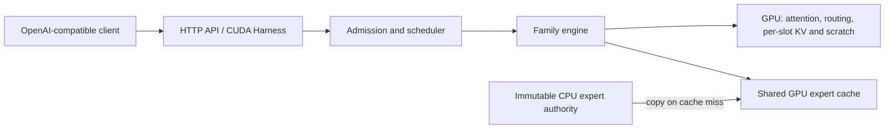

# TensorFold fork

This fork of [TensorFold](https://github.com/ashhart/TensorFold) serves language models on Apple Silicon and NVIDIA GPUs through an OpenAI-compatible API. It retains the upstream model families, family-specific kernels, exact speculative decoding, prompt reuse, tools, reasoning and vision support, and adds a reproducible NVIDIA container, Flash Next YaRN context extension, RAM-backed expert caching, optional RotorQuant KV formats, and service admission controls.

The maintained fork is [kklouzal/TensorFold](https://github.com/kklouzal/TensorFold), branch **`python-0.6`**. The Python integration joins fork baseline `2f8089a7b59588875d639a7efa860117168a29d0` with upstream Python `ed78d6fc204d89d90b045bf033d6551e7714f3a1`. Record the commit you actually clone: branch heads move. Upstream Python history remains part of the fork so later changes can be reviewed and merged.

This README covers, in order: build and installation, supported models, configuration
and runtime reference (expert cache, context, KV formats, API), measured results and
deployment status per hardware target, the eight-V100 (SM70) development status,
cross-cutting validation checkpoints, and operations. Status notes keep their
recorded source/image, hardware, workload and quality scope; unrun checks remain pending.

Development is governed by the ProviderOne implementation design, with SC117/V100 as the
immediate delivery priority; see [Development governance](#development-governance-and-repository-status).

## Start here

- **Changing the code? Follow the [testing methodology](docs/testing-methodology.md)**: serving-matrix performance scoring, teacher-forced quality checks, correctness tests and GPU sharing.
- [Build and run the NVIDIA container](#build-and-run-the-nvidia-container)
- [Install the fork on Apple Silicon](#apple-silicon-and-source-installation)
- [Supported models and formats](#supported-models-and-formats)
- [Configuration](#configuration)
- [RAM-backed expert cache](#ram-backed-expert-cache)
- [Context, RoPE and YaRN](#context-rope-and-yarn)
- [KV cache formats](#kv-cache-formats)
- [API and client behavior](#api-and-client-behavior)
- [Measured performance and tested hardware](#measured-performance-and-tested-hardware):
  [GB10 Gemma 4](#gb10-gemma-4),
  [GB10 Flash Next and Qwen](#gb10-flash-next-and-qwen),
  [RTX PRO 2000 Blackwell](#rtx-pro-2000-blackwell-16-gb-vram--64-gb-ram),
  [eight V100s](#eight-v100s-sm70)
- [V100 (SM70) adaptive development status](#v100-sm70-adaptive-development-status)
- [Validation checkpoints](#validation-checkpoints)
- [Benchmark, operate and update](#benchmark-operate-and-update)
- [Development governance and repository status](#development-governance-and-repository-status)

## Platforms and runtime

| Target | Runtime and scope |
| --- | --- |
| Apple Silicon/macOS | MLX backend; CPython 3.15 with MLX `>=0.32.4,<0.32.5` (0.32.4 is the first release with cp315 wheels) and mlx-lm `>=0.31.3,<0.33`. MLX 0.32.4 is untested on a Mac: the MLX tests and the golden and bit-exactness checks still need to run there, and bit-exact claims measured on 0.32.2/0.32.3 are unverified on 0.32.4. |
| Linux/NVIDIA AMD64 | Native AMD64 container and CUDA backend. The separate-VRAM trials used an RTX PRO 2000 Blackwell with 16 GB VRAM and 64 GB system RAM. |
| Linux/NVIDIA ARM64 | Native ARM64 container and CUDA backend; the GB10 deployments use DGX Spark/GB10 unified memory. |
| Linux/NVIDIA V100 (SM70), AMD64 | Separate source-built CUDA 12.x/SM70 stack through the [V100 source-foundation workflow](deploy/v100/source-foundation.md); CUDA13 official wheels do not provide V100 qualification. See [V100 status](#v100-sm70-adaptive-development-status). |

`--backend auto` selects MLX on macOS and CUDA elsewhere; model-family support still applies. The required native file-owner extension supports Linux and macOS. Native Windows is outside the current runtime contract.

The CUDA backend defaults to a compute-capability floor of **8.9** and refuses unsupported GPUs at startup. Individual kernels can require additional capabilities; cluster extensions require at least 9.0. Native NVFP4 checkpoint math requires SM 12.x, while FP8 math starts at 8.9; supported stored-weight BF16 paths apply where the GPU lacks the checkpoint's native math. Qwen3.8 dense and Qwen3.6 MoE keep their attention caches in CUDA virtual memory (`cuMemCreate`/`cuMemMap` through `libcuda`): startup refuses a GPU or driver that does not report virtual memory management, or maps it in granules that do not divide 2 MiB, before loading weights. Admission counts each retained cache lineage's rounded mappings and separate MTP graph buffers; live-memory gates count queued releases until actually freed ([cache memory](docs/recipes/cuda.md#cache-memory)). Final composed-source GPU qualification remains pending. Check [CUDA formats and qualification](docs/recipes/cuda.md), especially before assuming an untested Ada, Hopper or other Blackwell card has the same execution coverage as the measured machine. Build targeting alone is not hardware verification.

### Pinned container stack

The [2026-11-11 foundation refresh ledger](deploy/gb10/foundation-refresh-20261111.md)
records the current upgrade, candidate discovery and remaining gates for GB10,
x86 Blackwell and x86 V100. The CUDA13.4.3 pins below belong to Blackwell; the
expanded V100 refresh must retain a separately supported CUDA12.x/SM70 stack. Original
NGC CUDA SDK and compiler/runtime packages are captured and held before OS
dependency updates; application installers retain their protected-prefix
contract. Candidate discovery and source changes do not qualify a new image
or replace the recorded production runtime.

The [Dockerfile](deploy/gb10/Dockerfile) uses the selected CUDA **13.4.3 cuDNN development** foundation and genuine official nightlies. Native core providers and the exact protected TorchVision bundled-runtime exceptions follow the [managed foundation contract](deploy/gb10/foundation.md); this does not claim every component uses only the base runtime. The tracked per-architecture pin files are authoritative for base digests and whole-wheel hashes.

| Target | Torch | TorchVision | Triton | Selected inputs |
| --- | --- | --- | --- | --- |
| AMD64 | `2.16.0.dev20261111+cu134` | `0.30.0.dev20261111+cu134` | `3.9.0+gitb7ddcf86` | [AMD64 pins](deploy/gb10/nightly-pins-amd64.json) |
| ARM64 | `2.16.0.dev20261111+cu134` | `0.30.0.dev20261111+cu134` | `3.9.0+gitb7ddcf86` | [ARM64 pins](deploy/gb10/nightly-pins.json) |

The selected foundation also protects the pinned pip 26.3 installer and its full
transitive closure. Declared native add-ons are cuSPARSELt0.10.0.12-1
and NVSHMEM3.8.0-1. Their selected GB10 consumer/provider evidence is recorded;
NVSHMEM distributed execution and AMD64 native execution remain unqualified.
Native ARM64 resolution and explicitly cross-resolved AMD64 metadata remain
distinct from hardware/model qualification; the
[refresh ledger](deploy/gb10/foundation-refresh-20261111.md) records their current scope.

CPython 3.15.2 port status (2026-11-17): the AMD64 inputs come from a native
3.15.2 resolver report, and the AMD64 `verification` and `runtime` targets built
natively on a non-GB10 x86 host, passing every Dockerfile gate (selection,
interpreter and add-on checks, owned pyyaml/xgrammar builds, seal, full audits,
`pip check`, the installed TensorFold/xgrammar import). In-image CPU tests,
native-provider proof and any GPU execution (Blackwell sm_121 included) are
unrun. The ARM64 inputs await [native generation](deploy/gb10/foundation.md#first-arm64-generation-after-the-cpython-315-port)
on GB10; the deployed ARM64 runtime `e0bdd6b4` and its qualification remain CPython 3.12.

A fresh checkout can [stage the seven tracked inputs and acquire the pinned CPython 3.15.2 archive and two declared native addons](deploy/gb10/foundation.md#prepare-the-tracked-selected-inputs) without re-resolving dependencies or using private artifacts. Native ARM images and the [GB10 checkpoint protocols](docs/gb10-nvfp4-validation.md) passed at their recorded bd1 source; final composed-source qualification remains separate. Older deployment profiles and measured rates retain their own identities.

The ARM64 runtime `e0bdd6b4`, source UID `1c166686`, passed installed CPU and
the selected AEON 26B/DFlash functional, media, cancellation and full 262,144-token context
protocols on GB10. It is now deployed on port 8888 as container `0aa83b4b`, with
the exact profile, gold 4/4 and 23/23 cache reuse verified. The replaced `7ea`
service is retained stopped for rollback. Comparative P3 was explicitly deferred
by the user; no gain/equivalence is claimed. AMD64 native qualification is unrun. The
[ledger](deploy/gb10/foundation-refresh-20261111.md) binds the full image/source,
profile, receipt hashes and coverage limits.

The earlier qualified 2026-10-06 build used this NVIDIA NGC CUDA DL inference development image:

```text
nvcr.io/nvidia/cuda-dl-base:26.09-cuda13.4-inference-devel-ubuntu24.04@sha256:f86c199a302a3a7405d5f055adf1311cd660e85d8a66cf452be6eb45d5768639
```

The recorded **2026-10-06** stack is CUDA **13.4.1**, CPython **3.12**, PyTorch **`2.16.0.dev20261006+cu134`**, TorchVision **`0.30.0.dev20261006+cu134`**, Triton **`3.9.0+gitaad2a60d`**, and xgrammar **0.2.8**. These are reproducible pins, rather than a floating “latest” install. [ARM64 pins](deploy/gb10/history/20261006/nightly-pins.json) and [AMD64 pins](deploy/gb10/history/20261006/nightly-pins-amd64.json) contain separate child-image and wheel hashes; matching runtime/test lock files are installed with hash checks. Architecture selection rejects a mismatched native target.

The image includes the extension build toolchain and isolates compiler caches by architecture and CUDA/Torch/Triton identity. It contains no model weights. Install [Docker Engine](https://docs.docker.com/engine/install/), a compatible NVIDIA host driver, and the [NVIDIA Container Toolkit](https://docs.nvidia.com/datacenter/cloud-native/container-toolkit/latest/install-guide.html) first. The Toolkit guide covers `nvidia-ctk runtime configure --runtime=docker` and restarting the host Docker daemon; do that host setup before building or running the service. The compatibility launcher validates the effective driver/runtime environment. Forward compatibility on a tested GB10 driver does not establish support for every desktop driver.

## Build and run the NVIDIA container

Choose the pipeline from the GPU's supported runtime, then select the CPU
architecture. Both pipelines support native AMD64; that architecture alone does
not select CUDA13 or establish V100 support. The labels below describe the
existing workflows and are not new CLI flags.

For GB10 ARM64, use the `modern-cuda13` input preparation with
`TF_BUILD_ARCH=arm64`, then:

```bash
docker buildx build --platform linux/arm64 --load --target runtime \
  --build-context "foundation_pins=$TF_FOUNDATION_PINS" \
  --build-context "foundation_artifacts=$TF_FOUNDATION_ARTIFACTS" \
  --build-arg "BASE_IMAGE=$TF_BASE_IMAGE" \
  --build-arg "PYTHON_SHA256=$TF_PYTHON_SHA256" \
  --build-arg "SOURCE_REVISION=$TF_SOURCE_REVISION" \
  --build-arg "MAX_JOBS=$TF_BUILD_JOBS" \
  -f deploy/gb10/Dockerfile -t tensorfold-gb10:candidate .
```

For x86 Blackwell, use the same `modern-cuda13` preparation with
`TF_BUILD_ARCH=amd64`, then:

```bash
docker buildx build --platform linux/amd64 --load --target runtime \
  --build-context "foundation_pins=$TF_FOUNDATION_PINS" \
  --build-context "foundation_artifacts=$TF_FOUNDATION_ARTIFACTS" \
  --build-arg "BASE_IMAGE=$TF_BASE_IMAGE" \
  --build-arg "PYTHON_SHA256=$TF_PYTHON_SHA256" \
  --build-arg "SOURCE_REVISION=$TF_SOURCE_REVISION" \
  --build-arg "MAX_JOBS=$TF_BUILD_JOBS" \
  -f deploy/gb10/Dockerfile -t tensorfold-x86-modern:candidate .
```

Existing supported Ada/Hopper paths retain their own capability and qualification
contracts within this modern workflow; the x86 Blackwell example does not narrow
that envelope.

For x86 V100, use the separate `volta-sm70` [source-foundation
workflow](deploy/v100/source-foundation.md), including its verified offline
artifact staging and owned framework/NCCL build stages. After verified local
artifact staging, build the candidate source producer with:

```bash
docker build --network=none \
  --build-context source_artifacts=/path/to/foundation-state/release \
  -f deploy/v100/Dockerfile.source-builder \
  -t tensorfold-v100:source-builder-cu1292 .
```

That command builds the source producer, not a serving image. Complete the
source workflow's framework build/export, installed audit and native/model gates
before deployment. CUDA13 official wheels do not provide V100 qualification.

The refreshed V100 nightly source compiled in the64-job bootstrap and its exact
owned05adb fork passed five-path precommit lint/finalization. Its SDK image is
built, and the installed restricted FP32 Triton FMA component and cache-profile
inheritance checks passed. Selected Q8 TP8/ETP4/MTP4 startup and two exact short text requests passed with
NCCL 2.32.6 on all eight ranks. Full SC117 multimodal/full-history/performance
and existing Q03 limitations remain explicitly unqualified future coverage.

The refreshed CPU media producer reuses the protected published Transformers
provider and builds exactly the CPU TorchVision/PyAV wheels. Its 103 preparation/
ownership controls and six CPU build/export stages passed. Final core/media
images passed protected audits, 25 installed and 88 frontend/replay controls;
broader model coverage remains separately recorded.

New source-SDK service launches use both `deploy/v100/compose.yaml` and
`deploy/v100/compose.source-sdk.yaml`, following the
[cache profile](deploy/v100/README.md#refreshed-source-sdk-cache-profile);
the legacy base launch retains its old cache behavior.
The current refresh's three profile statuses remain in the
[shared ledger](deploy/gb10/foundation-refresh-20261111.md).

For a persistent service targeting the full native 262,144-token window on a discrete GPU, use the [discrete-GPU Compose guide](deploy/discrete-gpu/README.md). It supplies service-owned writable storage, health checks, bounded RAM and logs, and automatic restart. Its configuration and measured deployment results are recorded separately from the shorter-context example below.

The following example is for a **native AMD64 Linux host with a separate 16 GB GPU and 64 GB RAM**. It uses the tested Flash Next EXL3 checkpoint, a 2,048-token configured context, four shared decode slots, and a RAM-backed expert cache. Memory admission can still refuse a configuration that does not fit your actual host.

### 1. Clone and build

```bash
git clone --branch python-0.6 https://github.com/kklouzal/TensorFold.git
cd TensorFold || exit
git rev-parse HEAD
```

Run [input preparation](deploy/gb10/foundation.md#prepare-the-tracked-selected-inputs)
with `TF_BUILD_ARCH=amd64` for this example, or `arm64` with a native ARM64 builder.
It copies the seven selected files, derives the base and fetches the declared
interpreter archive and each addon from its pin URL into a temporary file. It checks the complete SHA256
before publishing a canonical `.deb` name. Keep the resulting variables in this
same shell; no hand-copied hashes or private wheelhouse are needed.

```bash
docker buildx build --platform "linux/$TF_BUILD_ARCH" --load --target runtime \
  --build-context "foundation_pins=$TF_FOUNDATION_PINS" \
  --build-context "foundation_artifacts=$TF_FOUNDATION_ARTIFACTS" \
  --build-arg "BASE_IMAGE=$TF_BASE_IMAGE" \
  --build-arg "PYTHON_SHA256=$TF_PYTHON_SHA256" \
  --build-arg "SOURCE_REVISION=$TF_SOURCE_REVISION" \
  --build-arg "MAX_JOBS=$TF_BUILD_JOBS" \
  --tag tensorfold-fork:local --file deploy/gb10/Dockerfile .
docker image inspect tensorfold-fork:local --format '{{.Id}}'
```

Cross-building or resolving another architecture's dependencies does not verify its GPU execution. `SOURCE_REVISION` is a label: a build from an edited working tree is not proven identical to that commit.

The preparation block derives `TF_BUILD_JOBS` from the local builder's available CPUs with `nproc`; use the remote builder's count when applicable. The Dockerfile's unset default remains eight. This controls compiler parallelism and does not prove all cores stay busy.

Check GPU visibility through the image's compatibility launcher. On a mixed-vendor host where `--gpus all` resolves incorrectly, use the existing [explicit UUID/CDI selection](deploy/discrete-gpu/README.md) for the actual NVIDIA device:

```bash
docker run --rm --gpus all --entrypoint python3 tensorfold-fork:local \
  /opt/harness/cuda_entrypoint.py python3 -c \
  'import torch; print(torch.__version__); print(torch.cuda.get_device_name(0)); print(torch.cuda.get_device_capability(0)); print(torch.cuda.mem_get_info())'
```

### 2. Acquire a model at a known revision

Provide enough disk space for the complete checkpoint and downloads. The tested EXL3 snapshot contains approximately **62.8 GB** of assets, including the mapped n-gram file; that is different from its resident expert-weight requirement. Review the model's license. Supply Hugging Face authentication through your environment if the selected repository requires it.

The download below uses the image's installed [Hugging Face `snapshot_download` API](https://huggingface.co/docs/huggingface_hub/package_reference/file_download), requires network access, and does not require a GPU. Set both directories to absolute host paths; acquisition needs a writable model directory.

```bash
TF_MODELS=/absolute/path/to/tensorfold-models
TF_CACHE=/absolute/path/to/tensorfold-kernel-cache
mkdir -p "$TF_MODELS" "$TF_CACHE"

docker run --rm --entrypoint python3 \
  --mount "type=bind,src=$TF_MODELS,dst=/models" \
  tensorfold-fork:local -c \
  'from huggingface_hub import snapshot_download; snapshot_download(repo_id="turboderp/Qwen3.8-Flash-Next-exl3", revision="65c895314393431c09050b2e04e250836b3a6eb4", local_dir="/models/Qwen3.8-Flash-Next-exl3")'
```

For authenticated downloads, add `-e HF_TOKEN` after setting it in the host environment. Keep credentials out of logs and shell history. A different model or revision requires its own format, memory and quality checks. Model files must remain immutable while a service uses them.

### 3. Launch

```bash
docker run -d --name tensorfold-local --gpus all \
  --memory 56000000000 --memory-swap 56000000000 --pids-limit 512 \
  -p 127.0.0.1:8080:8080 \
  -e MAX_JOBS="$TF_BUILD_JOBS" -e HF_HUB_OFFLINE=1 \
  -e TENSORFOLD_NO_UPDATE_CHECK=1 \
  --mount "type=bind,src=$TF_MODELS/Qwen3.8-Flash-Next-exl3,dst=/model,readonly" \
  --mount "type=bind,src=$TF_CACHE,dst=/cache" \
  tensorfold-fork:local serve /model --name local \
  --host 0.0.0.0 --port 8080 --backend cuda --thinking-budget 0 \
  --parallel 4 --context 2048 --max-tokens 128 --vram-experts auto --kv-dtype int8 \
  --mtp-drafts 4 --mtp-confidence 0.5 --yarn-factor 2 \
  --max-http-connections 32 --max-pending-requests 8 --no-thinking

docker logs --tail 100 -f tensorfold-local
```

The **56,000,000,000-byte** limit is 56 decimal GB, about 52.2 GiB. Setting the same memory and swap limit [grants no additional swap budget](https://docs.docker.com/engine/containers/resource_constraints/). This is the tested host's budget, not a universal safe allocation. The caps **32** and **8** are example choices; both are uncapped by default. INT8 KV is an explicit memory/quality tradeoff; the default is BF16. MTP-4, confidence 0.5 and YaRN-2 are selected example settings, rather than the drafting defaults; default prefetch remains enabled. The historical rates below do not automatically apply to this launch. `--no-thinking` disables template reasoning for this simple example and can be omitted for models that use it.

The runtime entrypoint already invokes the compatibility launcher and the CUDA Harness. The Harness requires the installed module and package metadata to identify **TensorFold 0.6.6**, matching this Python integration. Its arguments must begin with **`serve MODEL`**, and it requires **`--thinking-budget 0`**. Other CLI subcommands use the ordinary source installation described below. The container listens on `0.0.0.0` internally; the host publication above exposes it only on loopback. Change the host publication deliberately for remote clients and apply your service's access controls.

The image defaults to root. The model mount must be readable, and `/cache` writable, for whichever UID you select. Adding `--user` requires validating those permissions and home/cache access; generic rootless operation has not been qualified. Persist `/cache` across restarts so runtime extension compilation can reuse matching artifacts.

### 4. Verify readiness and actual generation

Loading and first-time compilation can take several minutes. Watch logs until startup completes, then inspect health and the advertised model ID:

```bash
curl -fsS http://127.0.0.1:8080/health
curl -fsS http://127.0.0.1:8080/v1/models
curl -fsS http://127.0.0.1:8080/v1/chat/completions \
  -H 'Content-Type: application/json' \
  -d '{"model":"local","messages":[{"role":"user","content":"Explain why the sky is blue in one short sentence."}],"max_tokens":64,"temperature":0,"chat_template_kwargs":{"enable_thinking":false}}'

curl -N -fsS http://127.0.0.1:8080/v1/chat/completions \
  -H 'Content-Type: application/json' \
  -d '{"model":"local","messages":[{"role":"user","content":"Write a short description of the Moon."}],"max_tokens":64,"temperature":0,"stream":true,"chat_template_kwargs":{"enable_thinking":false}}'
```

A healthy listener alone is insufficient: consume a complete generation. Check reported context, admission and cache information in health/logs before increasing capacity.

### GB10 Compose profile

[deploy/gb10/compose.yaml](deploy/gb10/compose.yaml) is a deployment-specific GB10 Flash Next profile: a captured model path, 114 GiB memory, host CPU affinity, four slots, a 1,048,576-token YaRN-4 context and `rotorquant8-norm` for both K and V. It is not a portable 16 GB GPU configuration. Review its memory, affinity, mounts, networking and flags before running it. `HF_CACHE`, `KERNEL_CACHE` and `TENSORFOLD_IMAGE` override its paths/image; its health check allows 15 minutes for initial compilation/loading. It sets `TENSORFOLD_FAILURE_CAPTURE_DIR` to a bounded directory under the kernel cache, where a reply that ended inside its think block is captured (redacted request, token IDs, statistics); a normal reply's request is never logged or captured. See the [deployment guide](deploy/gb10/README.md).

```bash
docker compose -f deploy/gb10/compose.yaml config --quiet
docker compose -f deploy/gb10/compose.yaml up -d
docker compose -f deploy/gb10/compose.yaml ps
docker compose -f deploy/gb10/compose.yaml logs --tail 100 -f tensorfold
```

Four slots share weights and an expert cache; they do not guarantee four simultaneous full-size contexts fit.

That profile uses the shared local model store at `HF_CACHE=/models/hf`.
It mounts the existing private token separately through `HF_TOKEN_FILE`, read-only,
with host-path creation disabled. Override both variables for a different host
layout; model data and authentication remain separate. See the
[model-location settings](deploy/gb10/README.md#local-model-and-authentication-paths).

It uses a separate cache directory for the Python image,
preserving the previous image's compiled cache for rollback. See the
[GB10 cache and deployment guide](deploy/gb10/README.md) for the captured host
paths and the source-specific cache override.

The GB10 Gemma profile, [compose.gemma4.yaml](deploy/gb10/compose.gemma4.yaml), defaults to its native 262,144-token context, a 16 GiB
host-memory reserve, ten build/compute threads and CPUs `5-9,15-19`. Thinking is
enabled by default with no server-side thinking-token limit; Harness controls
thinking and budgets per request. Explicit environment overrides remain available.

For the qualified Flash Next NVFP4 profile on GB10, use the [dedicated deployment profile](deploy/gb10/nvfp4.md):
six native MTP drafts, four streams, SSD n-grams, vision and automatic graph sizing,
with an 8 GiB host-memory reserve. Its immutable runtime and measured tradeoffs
are recorded separately from the historical affine/YaRN deployment.
The earlier [2026-10-18 deployment receipt](deploy/gb10/deployment-nvfp4-20261018.json)
records that Flash Next service's LAN acceptance at `http://192.168.1.50:8888/v1`, full-token
serial/MTP identity, image/video and strict tool calls, before the GB10 service
switched to [Gemma 4](#gb10-gemma-4).
Forty retired TensorFold containers were removed with their logs preserved.

## Apple Silicon and source installation

Install **this fork**, rather than an upstream wheel or Homebrew release, to obtain its changes. On Apple Silicon, use a virtual environment with CPython 3.15 (see the MLX wheel note in the platform table):

```bash
git clone --branch python-0.6 https://github.com/kklouzal/TensorFold.git
cd TensorFold
python3 -m venv .venv
. .venv/bin/activate
python -m pip install --upgrade pip
python -m pip install -e '.[grammar]'
tensorfold models
tensorfold info Vontra/NVIDIA-Nemotron-3.5-Lightning-30B-A3B-MLX-4bit
tensorfold pull Vontra/NVIDIA-Nemotron-3.5-Lightning-30B-A3B-MLX-4bit
tensorfold serve Vontra/NVIDIA-Nemotron-3.5-Lightning-30B-A3B-MLX-4bit --no-update-check
```

The native extension requires a working platform compiler. Add the `vision` extra for image input, or `ssd` for the supported SSD expert path, for example `python -m pip install -e '.[grammar,vision,ssd]'`. The grammar extra installs xgrammar; the pinned Docker runtime already includes it. On CUDA, use the container's matching Torch, Triton and extension compiler; the package has no `cuda` installation extra.

`tensorfold models` lists registered families/checkpoints. `info MODEL` checks configuration without fetching weights. `pull MODEL [DRAFTER ...]` downloads ahead of time; `serve` can download a missing checkpoint. The CLI download uses repository defaults; the revision-pinned API download above is preferable for reproducible deployments. See the [runbook](RUNBOOK.md) and [recipes](docs/recipes/README.md) for family-specific setup.

## Python-line integration

This fork follows upstream's `python-0.6` line. The integration source is
`ed78d6fc204d89d90b045bf033d6551e7714f3a1`; upstream `main` is the separate
native Zig engine. Fork changes retain their Git history and selected numerical,
resource ownership, cache and serving contracts. New arithmetic or scheduling
alternatives require same-region correctness and complete-workload evidence
before replacing a selected implementation.

The Python integration adds API-key authentication, bounded chunked requests,
Anthropic Messages and token-counting routes, configured background model IDs,
and offline planning/service tools. The running images and historical performance
results below keep their recorded source identities. Integration CPU, installed
package, native device and full-model qualification have separate scopes; an
upstream measurement does not qualify the combined fork automatically.

The repository default and only live branch are now `python-0.6`. All 606
reviewed non-target branch names were retired serially with exact-SHA guards.
The independent archive restores their original tips, and the exact unselected
C06 packet remains recoverable; its adoption gates are still open.

## Supported models and formats

The table describes supported integration paths. It is not a promise that every checkpoint fits a particular machine, or that all paths have been rerun on this fork's latest image. CUDA registers Qwen dense, Qwen3.6 MoE, Flash Next, Nemotron and GLM families, plus the initial single-stream Gemma4 affine/NVFP4 trial. Bonsai and DeepSeek listed here are MLX-only.

| Model | Example checkpoint | Backend | Drafting |
| --- | --- | --- | --- |
| Nemotron 3.5 Lightning | `Vontra/NVIDIA-Nemotron-3.5-Lightning-30B-A3B-MLX-4bit` | MLX, CUDA | Included MTP; context copies on MLX |
| Qwen3.8-27B dense | `Vontra/Qwen3.8-27B-MLX-4bit` | MLX, CUDA | `z-lab/Qwen3.8-27B-DFlash2`; optional on MLX |
| Qwen3.6-35B-A3B MoE | `Vontra/Qwen3.6-35B-A3B-MLX-4bit-MTP` | MLX, CUDA | Included MTP; see the [recipe](docs/recipes/qwen3.6-moe.md) |
| Qwen3.6-35B-A3B CT NVFP4 | `AEON-7/Qwen3.6-35B-A3B-heretic-NVFP4` | CUDA SM12, one GPU; discrete RAM expert pool when needed | Separate `z-lab/Qwen3.6-35B-A3B-DFlash` v1; [recipe](docs/recipes/qwen3.6-moe.md#original-ct-nvfp4-and-dflash-v1) |
| Qwen3.8 Flash Next | `Vontra/Qwen3.8-Flash-Next-MLX-4bit-MTP` | MLX, CUDA | Included MTP and context copies |
| GLM-5.3-Flash | `Vontra/GLM-5.3-Flash-MLX-4bit-MTP` | MLX on a 256 GB Mac; CUDA with two ranks | MTP; optional DFlash2 on CUDA |
| Gemma 4 E4B | `DavidAU/gemma-4-E4B-it-The-DECKARD-V2-Strong-HERETIC-UNCENSORED-Thinking` | CUDA BF16 candidate; [recipe](docs/recipes/gemma-4-e4b.md) | Native Google assistant and EAGLE3 candidates; comparison pending, neither is DFlash |
| Gemma 4 26B-A4B | `mlx-community/gemma-4-26b-a4b-it-4bit`; CUDA trial: zecanard mixed4/6 or AEON-7 NVFP4; ModelOpt NVFP4 ([recipe](docs/recipes/gemma-4-26b-modelopt.md)) | MLX; initial CUDA trial; AEON-7 NVFP4 on eight V100s with `--tp 8` ([recipe](docs/recipes/gemma-4.md#eight-v100s-tp8etp4)) | Optional `z-lab/gemma-4-26B-A4B-it-DFlash`; BF16 companion or prepared FP8 in the qualified GB10 CT profile, one stream |
| DeepSeek-V4-Flash | `mlx-community/DeepSeek-V4-Flash-4bit` | MLX on a 256 GB Mac | `Vontra/DeepSeek-V4-Flash-DSpark-MLX` or `Vontra/DeepSeek-V4-Flash-MTP-MLX` |
| Qwen3.8-27B NVFP4 | `nvidia/Qwen3.8-27B-NVFP4`; `AEON-7/Qwen3.8-27B-AEON-ULTIMATE-UNCENSORED-NVFP4-MIXED` ([recipe](docs/recipes/qwen3.8-27b.md#aeon-mixed-nvfp4-export)) | CUDA, one GPU | DFlash2 and context copies |
| Qwen3.8-27B EXL3, experimental | `turboderp/Qwen3.8-27B-exl3`, branches `3.00bpw` / `4.00bpw` | CUDA | DFlash2 and context copies |
| Flash Next EXL3, experimental | `turboderp/Qwen3.8-Flash-Next-exl3`, branch `3.05bpw_h5_ng5` | CUDA | Included MTP and context copies |
| Ternary Bonsai 2 27B | `prism-ml/Ternary-Bonsai-2-27B-mlx-2bit` | MLX | `z-lab/Qwen3.8-27B-DFlash2` and context copies |
| Flash Next NVFP4 | `local-inference-lab/Qwen3.8-Flash-Next-NVFP4` or `RadixArk/Qwen3.8-Flash-Next-NVFP4` | CUDA; resident single-GPU or RAM expert-rank mode | Included MTP and context copies |
| Flash Next mixed GGUF | Huihui UD-Q4_K_XL V2 local shards | CUDA SM70/FP16, TP1/2/4/8; validated on eight V100s | Matching stock MTP or DSpark; [profile and scope](deploy/v100/README.md) |

Dense Qwen reads affine 2/3/4/5/6/8-bit checkpoints, including mixed layers and groups 32/64/128; newer paths retain their documented hardware-qualification limits. Flash Next's affine path requires 4-bit/group-32 weights. Its EXL3 path reads per-tensor codebook widths; supported NVFP4 exports and block-scaled FP8 linears have separate checks. Flash Next without an MTP head needs `--no-drafts` on CUDA, or the matching separate stock head on the GGUF SM70 path. Nemotron CUDA uses 4-bit/group-64 weights and requires its MTP head unless serial decoding is selected.

GLM reads affine 4-bit/group-64 and supported mixed-bit MLX conversions; CUDA also has the experimental `Mia-AiLab/GLM-5.3-Flash-EXL3-TR3-4bpw` path. Its optional `incoai/GLM-5.3-Flash-DFlash2` has non-commercial terms. Gemma on MLX uses 4-bit/group-32 or 64 with an 8-bit router. The CUDA paths read original affine mixed4/6 group-64 projections with a 6-bit tied head, or AEON compressed-tensors NVFP4 with calibrated FP4 activations on SM12.x and its original BF16 tied head by default. Both use BF16 KV. The original affine checkpoint requires BF16 DFlash; the qualified GB10 CT profile prepares FP8 drafting with `--drafter-bits 8`, while the general CLI default remains `16`. Unsupported checkpoint/layout combinations are refused. DeepSeek uses affine 4-bit/group-64 plus MXFP4 experts and the converted DSpark/MTP heads. Model weights and draft models keep their own licenses. Consult [quantized checkpoints](docs/quantization.md), [third-party notices](THIRD_PARTY_NOTICES.md) and the [family recipes](docs/recipes/README.md).

### Model-family notes

GLM prompt adapters forward the current encoding/render-credit interface and
preserve caller literal origins in thinking-off transformations on CUDA and HF.
The current source also preserves origin through Unicode capitalization and
removes only fully trusted, complete Max/Low/High effort headers. All 253 CPU
controls passed on the genuinely rebuilt owned application with an isolated,
matching CPU TorchVision verification layer. This does not qualify GPU vision,
MLX or complete models. Legacy raw-tokenizer compatibility is retained by
explicit user decision; it does not inherit protected-interface qualification.

Qwen3.8 mixed-FP8 startup compares two-rank YaRN factors exactly, including differences below one
millionth. Its FP8-only checkpoint tests are admitted on SM 8.9 and newer; native block-scaled FP4 cases still require
SM 12.x. Numerical regression thresholds retain their original sensitivity and are distinguished from deterministic
error bounds in the [qualification record](docs/optimization-validation.md#qwen38-27b-aeon-mixed-nvfp4-2026-10-19).

### Exact speculative decoding and concurrency

Drafting accepts a token only when it equals the same engine's serial choice. Sampling keys use the prompt or explicit seed, absolute position and token ID. Compare an otherwise identical request with `"draft": false` to check the serial reference.

CUDA block drafters refuse nonfinite proposal confidence scores before publishing
their chains or applying the confidence cutoff. Valid proposals retain the same
node budget and cutoff rule; every committed token remains target-verified.

Exactness is scoped to the **same engine, weights, runtime, precision, KV format and request settings**. It does not promise bit identity between MLX and CUDA, different weight/KV quantizations or tensor-parallel layouts.

GLM's CUDA MoE sum rounds each weighted expert output to FP32 before its
slot-ordered FP32 addition. The shared EXL3 kernel's BF16 activation mode keeps
that [family arithmetic](docs/recipes/glm-5.3-flash.md#exl3); its FP32 mode retains
an FMA slot sum.

Flash Next's concurrent modern CUDA decoder captures its pure decode rounds (the verify forward and each MTP step) as CUDA graphs at startup. The GGUF SM70 path currently runs eagerly; its native component graph tests do not qualify full-model capture. With `TENSORFOLD_MULTI_GRAPH_MIB` unset, eligible providers use remaining admitted memory after eager warmup, protecting one complete context window, cache-resize overlap, snapshots, serving workspace and the configured memory floor. Additional concurrent contexts grow while memory lasts. A numeric value is an explicit MiB ceiling (`0` disables capture). The startup record retains the original context admission, resolved graph allowance, measured memory and any reason capture stopped. Rounds with a prompt pass, image rows or the Rotor7 lookup decoder, and keys outside the allowance, run eagerly with the same bits; experts read through a host cache (`--vram-experts`) decline capture and plan no graph memory. Automatic sizing passed the [source297 installed GB10 model protocols](docs/gb10-nvfp4-validation.md#source297-auto-graph-protocols) and focused CPU contracts; the [user-selected four-stream profile](docs/gb10-nvfp4-validation.md#controlled-eight-start-comparison-and-user-selection) has a separate controlled comparison and explicit single-request tradeoffs. Its decode kernels use programmatic dependent launch on GB10 (compute capability 12.1, where it was measured; other GPUs launch them plainly), which keeps every result unchanged. Earlier fixed-budget GB10 measurements found 1.6 to 2.4% faster decode with captured rounds, no established difference from programmatic dependent launch, up to 8.7% faster long-context decode from the multi-CTA sparse-attention select and 34 to 38% faster RotorQuant 6 prompt passes; see [optimization validation](docs/optimization-validation.md) for those sources, workloads and uncertainty.

MLX shares rounds across supported requests, with per-request state and sampling keys; load-time checks restrict families that cannot reproduce their serial arithmetic. CUDA explicit `--parallel N` enables shared rounds for Qwen dense on one/two ranks, Qwen3.6 MoE on one rank and Flash Next on its supported concurrent providers. Flash Next's modern provider supports concurrency on one rank and refuses concurrent `--tp 2`; the GGUF SM70 provider supports concurrent TP1/2/4/8 through the same scheduler. The separate same-host expert-rank mode keeps `--tp 1` and supports concurrent requests on rank zero. GLM and Nemotron CUDA are serial; CUDA `--parallel auto` means one outside the GGUF GPU-history adaptive path, whose count is computed at the selected context. Qwen dense, modern Flash Next and Nemotron have one/two-rank CUDA paths; GLM requires two. The expert-rank path supports affine4 and NVFP4 RAM-backed routed experts; EXL3 expert partitioning is refused. Hardware and full-model qualification remain scoped to their recorded deployments; a one-rank NCCL check does not establish a multi-GPU deployment. See [two-rank setup](RUNBOOK.md#nvidia-gpus) and the [V100 profile](deploy/v100/README.md).

Concurrent Qwen prompt batches run routed experts with the single-stream BF16 boundary and respect their admitted aggregate row limit. Installed numerical and full-model checks cover these increments on this host; other hardware requires separate qualification.

**CUDA DFlash sampler migration:** sampled Gemma 4, Qwen dense DFlash2 and Qwen3.6 CT NVFP4 DFlash requests use standard rejection sampling in the integration candidate, including normalized represented probability rows and strictly interior keyed uniforms. Greedy serial identity remains required; sampled serial/drafted tokens may differ while preserving the target sampling distribution. Fixed seed/configuration, cache and batch reproducibility remain required. [Implementation contract and pending qualification](docs/rejection-sampling-validation.md) distinguish this increment from the historical coupled-sampler results below.

Startup admission reserves rejection-sampling scratch for the configured proposal routes and serving geometry. Serial-only configurations do not reserve unreachable copy-proposal storage; companion verification retains its required target-distribution workspace.

## Configuration

Use `tensorfold serve --help` from your checkout for the authoritative parser. A request can override supported generation defaults. Unsupported backend/family combinations are refused; a listed flag is not available for every model. GiB flags use binary GiB; Docker's example RAM limit above uses bytes.

Model defaults now reconcile supported [checkpoint and ancillary metadata](docs/model-metadata.md),
including quantization sidecars, declared activation formats, tokenizer EOS and
named chat templates. Explicit launch flags take precedence. Metadata is resolved
before loading; it does not authorize model code or silently change precision.
CUDA tokenizers retain checkpoint vocabulary, special tokens and postprocessing,
while disabling exported batch padding/truncation. Counting returns the complete
sequence, and generation rejects prompts that exceed the served context.

### Service, generation and admission

| Flags | Default / contract |
| --- | --- |
| `-h`, `--help` | Show serve help. |
| `--backend auto\|mlx\|cuda` | `auto`: MLX on macOS, CUDA elsewhere. |
| `--host`, `--port` | `127.0.0.1`, `8080`; container port publication needs `--host 0.0.0.0` inside. |
| `--api-key KEY`, `--api-key-file FILE` | Require bearer authentication; repeat static keys or load a restricted-permission key file. Configuration is bound at startup; key-file contents reload during operation and invalid configuration refuses authenticated routes. Both backends. |
| `--metrics-open` | Permit unauthenticated `/metrics` and `/stats` when keys are configured. |
| `--name-priority ID=background` | Give CUDA requests for that served model ID background priority by default. |
| `--vision-image-tokens N` | Explicit CUDA Qwen visual-token budget, 1 through 65,536; frontend image/resource limits remain active. Flash Next retains its 16,384-token default. |
| `--name`, `--alias` | Model's own name; aliases are repeatable additional IDs on both backends. |
| `--max-http-connections N` | Unset: uncapped workers. Positive cap includes active/idle keepalive connections; at capacity acceptance pauses and connections wait in the existing listen backlog. |
| `--max-pending-requests N` | Unset: uncapped. Positive cap counts unfinished logical generation requests, including preparation, queued/running work and work retained after cancellation. Excess receives HTTP 503 before a configured stream opens. |
| `--max-engine-calls N` | MLX only; unset: uncapped. Positive cap counts queued/running engine RPC callbacks, including callbacks retained after caller timeout. CUDA refuses it. |
| `--context N` | Omitted: fitted model capacity. CUDA omitted/0 targets affordable native capacity; MLX 0 removes the metadata cap, while finite memory/engine limits remain. |
| `--max-tokens N` | Checkpoint `generation_config.json` `max_new_tokens`, otherwise `4096`, when a request omits its reply limit. |
| `--eos-token-id ID` | Omitted: reconcile model/generation/tokenizer reply EOS. Repeat to replace the reply EOS set; PLE training EOS is unchanged. |
| `--chat-template FILE`, `--chat-template-name NAME` | Omitted: checkpoint template, with automatic `default`/`tool_use` selection for named templates. Mutually exclusive explicit source/name overrides. |
| `--tokenizer FILE` | CUDA only; omitted: the checkpoint's `tokenizer.json`. Encodes and decodes with FILE instead, admitted only when its vocabulary, merges and added tokens equal the checkpoint's (text handling such as the pre-tokenizer may differ); the startup log names the file, its SHA-256 and what differs. Read once at startup. Refused with `--vision` (its image prompts keep the checkpoint's tokenizer) and with several ranks (`--tp`, `--expert-ranks`). For a fine-tune that ships an altered pre-tokenizer, e.g. the AEON Qwen3.8-27B export (see the [27B recipe](docs/recipes/qwen3.8-27b.md#aeon-mixed-nvfp4-export)). |
| `--temperature`, `--top-p`, `--top-k`, `--min-p` | Checkpoint `generation_config.json`; on both backends temperature falls back to 0, top-k to 0 (off), top-p to 1 (off), min-p to 0. Temperature 0 or top-p 0 is greedy; top-p and min-p outside 0 to 1 are refused at startup. |
| `--presence-penalty`, `--frequency-penalty`, `--repetition-penalty` | 0, 0 and the checkpoint's `generation_config.json` `repetition_penalty`, else 1 (off). OpenAI/vLLM penalties applied by the CUDA Gemma 4, Qwen dense and Qwen3.6 MoE CT NVFP4 engines on one GPU ([API](docs/api.md#penalties)); presence/frequency outside -2 to 2 or repetition at or below 0 are refused at startup; other engines and the Metal backend name defaults they do not apply and refuse requests asking for them. |
| `--thinking`, `--no-thinking` | Thinking enabled by default when the template supports it. |
| `--reasoning-effort low\|medium\|high\|xhigh` | Template default when unset; unnamed levels map to the nearest named level, ties upward. |
| `--thinking-budget N` | `0`: no limit. Positive budgets close the reasoning block at the limit; the container Harness requires the CLI value 0. |
| `--no-update-check` | Off by default; `TENSORFOLD_NO_UPDATE_CHECK=1` also disables the startup upstream-release check. Recommended for this fork. |
| `--trust-model-code` | Off by default. MLX provider recipes: explicitly allow checkpoint Python to execute with server privileges; persistent cache identity becomes process-specific. |

Caps bound owner counts, not arbitrary total payload bytes. Generated token buffers remain bounded by each accepted prompt/reply/context contract; a trusted internal RPC callback may allocate its own payload. Canceled callers retain admission until their owned engine work retires. On MLX, direct scoring/cache-warm jobs also consume pending-request admission. Choose limits from measured demand and memory, rather than assuming the example values are defaults.

### Drafts, parallelism and precision

| Flags | Default / contract |
| --- | --- |
| `--parallel N\|auto` | `auto`: MLX up to 8 while projected memory fits; GGUF GPU-history CUDA computes full-context resident capacity; other CUDA providers use 1. On the adaptive path, an integer is an admission ceiling. |
| `--draft-method auto\|none\|mtp\|dspark` | Flash Next CUDA selects an implemented method; `none` omits drafter resources. DFlash is separate and not yet a Flash Next serving choice. |
| `--execution-profile-manifest FILE` | Opt-in GGUF SM70 input/runtime binding and verified execution-profile receipts. GGUF shards are bound by size and header digest (payloads are not hashed); metadata, source and loaded libraries are hashed once; normal startup does not do this work. See the [manifest contract](docs/execution-profile-manifest.md). |
| `--no-drafts` | Off; opt in to the same-engine serial reference. |
| `--drafter auto\|none\|MODEL` | `auto`: a supported family drafter when already pulled. Dense Qwen CUDA needs the drafter pulled or explicit `--no-drafts`. |
| `--drafter-bits N` | MLX default `4`, with `0` retaining BF16 draft linears. CUDA Qwen CT NVFP4 defaults to BF16 (`0` or `16`); explicit `8` (FP8) or `4` (NVFP4) requantizes draft linears and copies a floating target head, for proposals only. Qwen borrows a checkpoint's quantized target head without another copy. CUDA Gemma4 DFlash takes `16` (BF16, default), or `8` with an original or losslessly packed BF16 tied target head: private FP8 copies of its companion projections and head. Gemma FP8 prepares its selected prompt and lane providers during initialization after validating those copies; build failures abort startup. Gemma affine checkpoints with a quantized tied head retain `16`. On eight V100s (`--tp 8`) Gemma DFlash takes `8` (private per-row INT8 W8A16 copies of the companion projections, default since 2026-11-19: measured as fast or faster than BF16) or `16` (original BF16). Target verification preserves reply semantics. A CUDA engine with one draft precision refuses the flag. |
| `--clip-sampled-verification` | Gemma4 non-dense CUDA with enabled DFlash: explicitly clip sampled target verification to remaining room, preserving full proposal sampling. Default off; no precision/geometry/classifier change. |
| `--delta4-head` | Gemma CT NVFP4 MoE on CUDA only: lossless tied BF16 Delta4 storage using fixed reuse16, default off. Preserves the existing drafter/vision/template/context selections. Cannot combine with ModelOpt's separate `--lossless-head`; no graph, clipping or cache candidate is enabled. |
| `--prepare-global-prompt` | Gemma 4 CT NVFP4 or ModelOpt MoE on CUDA: one admitted context-sized shared BF16 global-prompt K/V scratch pair, default off. At the AEON131072 profile this is512 MiB. Does not enable trig, persistent cache, draft graphs or clipping. |
| `--draft-rows N` | CUDA Gemma4 MoE with DFlash: 2–128 rows, default 16, with `--parallel 1`. E2B DFlash2: 2–8 rows, default 8, one lane; [correctness baseline and validation scope](docs/recipes/gemma-4-e2b.md). CUDA Qwen CT NVFP4: unset uses the secondary's metadata block width. With a secondary, explicit width is 2–128 on one stream, at most 16 with `--parallel`; without one, width 1 is also valid. |
| `--mtp-drafts N` | Family-specific; Flash Next defaults to 3 on MLX and up to 4 on CUDA. Startup 0 retains legacy structural-disable behavior under `auto`; explicit `--draft-method mtp` requires a positive allocated maximum. Adaptive runtime `proposal_limit: 0` keeps enabled MTP warm. |
| `--mtp-confidence P` | Flash Next CUDA default `0.70`; range 0–1, stops later low-confidence drafts. |
| `--lane-kernels auto\|on\|off` | `auto`; Qwen dense lane kernels on GPUs with tensor units. |
| `--decode-share F` | MLX default `0.25`, leaving replies progressing during chunked prefill. Flash Next CUDA shared rounds default 0; a positive share sizes one-GPU prompt passes to allow decoding inside them. Tensor-parallel GGUF experts (V100 TP8) carry each round's verify window inside the next prompt pass's rows instead, so the share does not size their passes. |
| `--prefill-fp8`, `--no-prefill-fp8` | CUDA supported prompt kernels; default BF16 activations. FP8 prefill explicitly reduces activation precision. |
| `--precision checkpoint\|full` | CUDA NVFP4 default `checkpoint`: checkpoint-native math when supported, with the documented stored-weight path otherwise. `full` uses BF16 activations against stored weights. |
| `--tp N` | Default 1; tensor-parallel counts remain family-specific. Matching checkpoint/configuration is required across ranks. `--tp 8` also selects the eight-V100 Gemma 4 26B-A4B CT NVFP4 provider (TP8 attention/dense, ETP4 x EP2 experts; [recipe](docs/recipes/gemma-4.md#eight-v100s-tp8etp4)). |
| `--expert-ranks 1\|2\|3\|4` | Default 1. Flash Next affine4/NVFP4 RAM experts, same-host NCCL; requires `--tp 1` and `--vram-experts`. Rank zero owns backbone/state; followers own disjoint routed experts. |
| `--expert-shards COUNTS` | Unset. Comma-separated positive expert counts, one per expert rank, summing to checkpoint `num_experts`; contiguous ownership permits asymmetric splits. |
| `--rank N` | Default 0; valid tensor/expert rank index. Rank zero serves HTTP. The [expert launcher](docs/desktop-report-remediation.md#same-host-expert-ranks) supplies topology arguments. |
| `--master HOST`, `--master-port P` | Rank rendezvous; port defaults to `29551`. The same-host expert launcher selects loopback and owns these arguments. |

FP8 prefill, checkpoint-native low-precision activation math, weight quantization, KV quantization and YaRN are **quality choices**. A quality-preserving speed comparison must keep the chosen numerical contract fixed. See [prompt precision](docs/recipes/cuda.md#prompt-precision) and [NVFP4 precision](docs/recipes/cuda.md#nvfp4-precision).

### Cache, memory and vision

| Flags | Default / contract |
| --- | --- |
| `--vram-experts GIB\|auto` | Flash Next: unset means resident experts; affine4/group-32, EXL3 or ModelOpt NVFP4 support a bounded RAM-backed pool, with expert ranks for affine4/NVFP4. Qwen CT NVFP4 automatically selects RAM experts when its minimum resident state cannot fit; see its [recipe](docs/recipes/qwen3.6-moe.md#original-ct-nvfp4-and-dflash-v1). |
| `--vram-experts-pin off\|auto\|on` | `off`: pageable authority. With supported CUDA RAM experts, `auto` admits host registration or retains pageable bytes on explicit capacity/capability refusal; `on` requires registration. Unknown driver/cleanup failures remain errors. |
| `--kv-full-windows N\|auto` | GGUF GPU-history CUDA computes and reserves complete windows; `auto` is explicit automatic selection and an integer constrains the count. Other supported Flash Next paths retain their existing numeric growth-window contracts; `auto` is refused there. |
| `--kv-short-window TOKENS\|auto` | GGUF GPU-history CUDA with `--parallel P` above `--kv-full-windows N` (mixed resident windows): N slots keep the complete context and the other P-N slots are materialized at startup with one shorter prompt-plus-reply window (an explicit count is verified on every rank, never enlarged; `auto`, the default, takes the largest whole multiple of 1024 tokens the worst rank's memory solver retains and is refused while whole-round graphs use the automatic captured-round pool, which it would consume). A request is placed in the free slot with the shortest window that holds its prompt + `max_tokens` + speculative rows, and waits in FIFO order otherwise; while the FIFO head waits only for a longer window, up to P-N later requests that fit a free shorter slot may start ahead of it (they cannot take a window the head could use, and the head claims the next one that frees); prefix reuse only resumes or copies into fitting slots. Receipts record every slot's capacity. Retention policies, DSpark/DFlash2 and media are refused with mixed windows. |
| `--prefix-host-bytes BYTES` | Flash Next concurrent SM70 unique TP8 GPU histories with MTP (the V100 production path): pinned host RAM, all ranks together, each rank's share rounded down to a power of two (PyTorch pins power-of-two blocks) (on by default: 64 GiB across the ranks, at most a quarter of MemAvailable, agreed by every rank; `0` disables; a default slab that cannot be pinned starts without the tier, an explicit one is a startup error; refused elsewhere; under a stream of unique prompts its spills cost about 1-2% of prefill/decode throughput on the production benchmark), charged as a fixed host obligation before the HTTP payload pool. Prompt points the GPU prefix cache drops by value are copied there and restored into a free slot with the same history-page ownership on a hit (bit-identical to the GPU-resident point); never written to disk. A spill copies only the history rows past those the tier already holds for that slot's conversation (shared, reference-counted row extents), so each row is stored once per conversation rather than once per spilled point. `/stats` `prefix_cache.host` and Prometheus `prefix_host_*` report it. Gemma 4 on eight V100s (`--tp 8`) enables it by default (64 GiB across the ranks, at most a quarter of MemAvailable, agreed by every rank; `0` disables): evicted kept points (full-cache rows and ring snapshots) are copied to one pinned slab per rank allocated at startup and restored byte-exactly into a free slot; its full-cache rows are shared across a conversation's spills the same way. |
| `--ssd-experts GIB` | Unset. Supported MLX families stream checkpoint experts into a GPU pool; distinct from RAM-backed CUDA experts and unsupported with CUDA `--vram-experts`. See the [Flash Next recipe](docs/recipes/qwen3.8-flash-next.md). |
| `--ple-on-ssd` | Off. Supported Flash Next affine, BF16, FP8 and NVFP4 n-gram layouts use bounded demand SSD reads with their original decoding/scale semantics. EXL3 retains its native mapped table and rejects this flag. |
| `--kv-dtype FORMAT` | Flash Next CUDA `bf16`; shorthand selects both K and V formats. Gemma 4 `--tp 8` on V100s: `bf16` (FP16 caches, the CLI default), `rotorquant8-norm` (Q8, the Compose default) or `rotorquant-iso64-norm4-h64` (Q4), same format on K and V; see the [Gemma 4 recipe](docs/recipes/gemma-4.md#eight-v100s-tp8etp4). |
| `--kv-key-dtype FORMAT`, `--kv-value-dtype FORMAT` | Unset; independently override their side of `--kv-dtype`. |
| `--yarn-factor FACTOR` | Flash Next, Qwen3.8 dense and Qwen3.6 on CUDA: checkpoint factor unless overridden; finite factor ≥1. `--context` still governs admission. Qwen3.8 dense and Qwen3.6 extended-window qualification is pending ([27B](docs/recipes/qwen3.8-27b.md#context-and-yarn) and [Qwen3.6](docs/recipes/qwen3.6-moe.md#context-and-yarn) recipes). |

| `--prefix-cache-bytes N` | Gemma 4 MoE on CUDA: shared prefix-cache byte allowance (`0` disables); default uses the context-derived allowance. Explicit bytes keep the requested or native context and must fit full memory admission; no entry ceiling. See the [shared-prefix cache](#gemma-shared-prefix-cache). |

| `--prompt-cache-gib N` | MLX retained-prefix budget; 0 disables retention. Default is idle room after weights/window/shared round, normally at least an eighth of RAM up to 16 GiB, given back on demand. |
| `--checkpoint-slots N` | MLX: default 3 prefixes per lane, at least 8. CUDA Qwen dense with parallel ≥2: default 3 retained prompt states, subject to its rank/memory policy. |
| `--spill-gib N` | MLX, default 0. Disk capacity for evicted conversation prefixes; needs `--snapshot-dir`. |
| `--snapshot-dir DIR` | MLX, default `~/.cache/tensorfold/prefix-snapshots`; `none` disables persistent snapshots. |
| `--max-snapshots N` | MLX, default 3 system-block snapshots loaded at startup. |
| `--prefill-rows N` | CUDA Flash Next prompt-piece rows, 256–16,384; overrides `TENSORFOLD_PREFILL_ROWS`. Default 1,024 on V100 (SM70), otherwise the engine's own plan. Gemma 4 on eight V100s (`--tp 8`): prompt-chunk rows, a multiple of 256 up to 4,096, default 1,024 (prefix-cache points sit on chunk boundaries). On SC117 8× V100, 2,048 rows against 1,024 gave prefill +10% and 10–25% lower time to first token, but per-stream decode about 5% slower at 8+ concurrent requests (worst cell −12%); see [deploy/v100](deploy/v100/README.md#prefill-rows-prompt-piece-size). |
| `--prefill-pass N` | MLX, default 8 prompt chunks per forward for families with a prompt pass. |
| `--pass-cache-gib N` | MLX, default 16 GiB freed-buffer cache during a prompt pass when budget permits. |
| `--mlx-cache-gib N` | MLX, default 8 GiB reusable freed-buffer cache. |
| `--vision` | Off. GLM on MLX, Qwen dense on MLX/CUDA, Flash Next CUDA with parallel ≥2, and supported Gemma4 CUDA checkpoints. E2B includes qualified image/video/audio input; [validation scope](docs/gemma4-e2b-validation.md). |
| `--vision-urls` | Off; image data URLs only by default. Opt in to public HTTP(S) URLs; URL safety policy still applies. |
| `--vision-max-images N` | Effective default 4 across the full history; byte, pixel and visual-token limits also apply. |

Image input requires the `vision` extra in a source installation. The API accepts text/image parts; the E2B CUDA integration adds timestamped video and user `input_audio` parts. The CUDA Harness reports capabilities supported by the loaded frontend, including audio input for E2B. See [vision contracts and qualification](docs/vision.md) and the [Harness/deployment guide](deploy/gb10/README.md). Enabling vision can add workspace and reduce the room available for experts or context.

### Additional CUDA options

These options are described with their evidence in the hardware and development
sections below; `tensorfold serve --help` remains authoritative.

| Flags | Default / contract |
| --- | --- |
| `--max-pending-requests-per-principal N` | CUDA only; unset: no separate principal cap. Requires a finite `--max-pending-requests` cap. The principal comes from authentication, and its logical request claim spans preparation, generation subruns and retirement. |
| `--dflash-head-w4a16` | Gemma 4 CT NVFP4 or ModelOpt MoE on CUDA: original-BF16 private W4A16 proposal head; requires enabled DFlash and `--drafter-bits 8`; default off. See [W4A16 head](#gemma-4-selection-screens). |
| `--lossless-head` | Gemma 4 ModelOpt MoE on CUDA: losslessly pack the tied BF16 embedding/output head; default off. Cannot combine with `--delta4-head`. |
| `--spark-global-gqa`, `--spark-sampled-q` | Experimental Gemma 4 ModelOpt Sparkulator global GQA (requires explicit `--context` ≤ 131072) and sampled proposals (target sampling unchanged); default off, model gates pending. |
| `--no-graphs` | Flash Next CUDA: execute whole forwards eagerly; required by the initial SM70 media profile. |
| `--indexer-history gpu\|ram` | Flash Next GGUF/SM70: `gpu` (default) keeps full raw indexer history on the GPU; `ram` uses a bounded GPU ring with a NUMA-local RAM archive. See [eight V100s](#eight-v100s-sm70). |
| `--expert-tensor-parallel-size 8\|4\|2` | Prepared Flash Next GGUF TP8 routed-expert degree (PP1 only); shared experts stay TP8; V100 qualification pending. |
| `--media-profile-manifest FILE` | With `--vision`, bounded SM70 TP8 media resources, processor and mmproj; requires `--no-graphs`. |
| `--position-profile-manifest PATH` | Flash Next SM70 unique TP8 GPU histories: immutable target/MTP/draft positions; see [Context, RoPE and YaRN](#context-rope-and-yarn). |

Adaptive V100 serving requires explicit positive `--max-pending-requests` and
`--max-http-connections` limits before model loading. The V100 Compose profile's
default Q4 production launch supplies them from its personal profile (32 / 33);
other codecs on its reference launch require explicit `TF_MAX_PENDING_REQUESTS` and
`TF_MAX_HTTP_CONNECTIONS` ([production launch](deploy/v100/README.md#production-launch-compose-default)).

The explicit `TENSORFOLD_SM70_PROFILE=optimized` profile selects canonical
packed experts through R32, prepared linears, native family operations and
admitted graphs. It requires the pinned TP8 Flash Next geometry. Native
attention is qualified for local H3/KV1/D256 and real query ends 65–8192; other
windows retain original per-query Torch attention. `reference` remains the
general profile default. Modern BF16 providers keep their existing contracts.

CUDA rank startup resolves NCCL from the active Python environment or Torch bundle before system libraries. `TF_NCCL_LIB` is authoritative; an invalid override or broken selected environment library fails explicitly. Same-host rendezvous can reuse retired POSIX sessions while preserving active-listener exclusivity; older non-reuse sessions may still need their kernel timeout to expire. [Setup and recovery](RUNBOOK.md#nvidia-gpus) describe the boundaries; these fixes do not add two-GPU qualification.

`TF_SMALL_GATHER_BYTES=N` (opt-in, a multiple of 8 up to 262144; larger values are rejected; unset keeps NCCL everywhere) routes tensor-parallel all-gathers of at most N bytes per rank through a CUDA-graph-capturable peer-mailbox kernel (`src/tensorfold/cuda/small_gather.{py,cu}`): NVLink neighbours are written directly, other pairs are relayed by common NVLink neighbours, and larger or zero-size gathers stay on NCCL. Every rank must set the same value; each communicator allocates `4 x world x N` bytes per GPU (4 MiB for N=131072 at TP8) with cudaMalloc at communicator open. These mailboxes are allocated when the communicator opens. Flash Next and GLM open it before their capacity admission samples free device memory, so the admitted budget already excludes them (as NCCL's own buffers); geometry forecasts do not itemize them. A communicator closed by abort retains its own mailbox until process exit because peers may still write it. A cohort without NVML NVLink topology, a two-hop NVLink path between every pair, or CUDA IPC peer mapping keeps NCCL. On 8x V100-SXM2 (image `cf8c0ff6`, standalone 8-process check, in-graph median per call) per-rank medians were 3.7-4.4 us vs NCCL 15.4-16.5 us at 8 B, 16.0-16.3 vs 28.9-29.6 us at 50 KiB and 35.4 vs 40.6 us at 128 KiB; at 256 KiB both measured 58.7 us and NCCL is faster beyond, so N=131072 was the measured choice for gathers alone; with the small row all-reduce (below) N=262144 measured faster at C8. Bitwise equality with NCCL and 1,000 varying-data graph replays pass in that check. Each launch now uses at most half the device's resident blocks so two communicators' spinning gathers stay co-resident; this lowers the per-row block count only for payloads above about 50 KiB, and the latency figures above predate that bound (re-measurement pending). The maintained GPU check is `tests/cuda/test_sm70_small_gather.py` (eager, in-graph and near-generation-wrap, bitwise vs NCCL; not yet run). A descriptive SC117 TP8/ETP4 C1 serving run (2026-11-14, with the small-M dense and prompt-attention kernels) used N=131072; it is not a qualification receipt.

## RAM-backed expert cache

The service separates HTTP ownership, generation scheduling and model execution. In the CUDA container, the Harness adds token counting around the native API. The diagram shows the Flash Next `--vram-experts` mode: mandatory state remains on the GPU and the expert cache receives unchanged CPU weights on misses.



`--vram-experts` lets a supported Flash Next model keep its routed expert authority in **system RAM**, pageable by default, with a bounded cache of unchanged packed expert weights in VRAM. Frequently reused experts stay cached through bounded aging LFU, with recency and physical-slot tie-breaking. The same cache is shared by all generation slots.

Attention, routing and required non-expert weights stay on the GPU. Each slot's KV cache, recurrent state, retained snapshots and scratch/workspace also consume GPU memory. A miss uploads original quantized bytes **before GPU computation**. Pageable authority uses bounded pinned staging; eligible live registered authority can transfer directly to the GPU pool. Expert computation uses the unchanged stored-weight kernels. Cache residency changes IO cost, not expert selection or precision.

| Mode | Behavior |
| --- | --- |
| Omit `--vram-experts` | Ordinary resident expert loading. |
| `--vram-experts 6` | Limit packed GPU expert storage to 6 GiB, rounded down to whole cache cells. Mandatory model/state/workspace allocations are additional. |
| `--vram-experts auto` | On separate-VRAM CUDA GPUs, assign remaining usable VRAM after resident allocations, selected KV-growth/MTP/snapshot/workspace reservations and one **512 MiB** margin. All slot windows remain reserved unless `--kv-full-windows` is explicit. |

The cache capacity is fixed for the engine's lifetime. Restart after changing context, slot count or its budget. `auto` does not promise every reported VRAM byte becomes cache; mandatory allocations and headroom remain. The weights are shared across slots, but slot state is not, so more slots can reduce cache capacity. Host expert authority must fit the host budget alongside mapped n-gram pages, preparation, transfers and the rest of the process.

For a dedicated discrete-GPU host, `TENSORFOLD_MEMORY_RESERVE_GIB=8` and
`TENSORFOLD_CUDA_MEMORY_RESERVE_GIB=0` keep an 8 GiB host admission reserve and
remove the optional GPU reserve, including the automatic expert pool's 512 MiB
margin. Required weights, KV, scratch and future workspace still count. Leave
absolute memory caps unset and remove container CPU/RAM caps when granting the
whole host. This setting does not lower a unified-memory host's RAM reserve.
See [memory budgeting](docs/recipes/cuda.md#requests-and-memory).

The Flash Next single-GPU path supports affine4/group-32, EXL3 and ModelOpt NVFP4 checkpoints on supported CUDA hardware. Same-host expert ranks additionally partition affine4/NVFP4 routed experts across distinct GPUs; EXL3 remains single-GPU. Its tensor-parallel and MLX paths refuse `--vram-experts`. `auto` requires separate VRAM; unified-memory Flash Next systems use a numeric budget when appropriate. Qwen MoE's separate CT NVFP4 path has the [additional restrictions below](docs/recipes/qwen3.6-moe.md#original-ct-nvfp4-and-dflash-v1). `--ssd-experts` remains the separate MLX option.

`--vram-experts-pin` defaults to `off` until representative end-to-end selection supports a different default. Opted-in registration must admit the complete authority backing plus future loading/staging requirements; source bytes stay owned until copies and consumers retire. NVFP4 offload retains Flash Next's existing W4A16 grouped arithmetic, including on SM120. The optional [packed affine cache](docs/packed-expert-cache.md) needs both `TENSORFOLD_PACKED_EXPERT_CACHE` and an explicit positive `TENSORFOLD_PACKED_EXPERT_CACHE_BYTES` disk quota; it is disabled by default. Source/integrity checks still precede a warm hit. See [desktop contracts](docs/desktop-report-remediation.md) for reduced KV capacity, expert topology, resources and verification limits.

Default EXL3 n-gram prefetch reads the mapped table. Page locking is optional and admitted against host/cgroup/device capacity; refusal leaves mappings pageable and evictable while preserving normal prefetch. There is no public `--no-prefetch` flag. The tested checkpoint has **30,948,556,800 bytes** of CPU expert authority and a **26,240,125,952-byte** native mapped n-gram file. Cached file pages consume system RAM even though the OS can reclaim them. See [RAM-backed experts](docs/recipes/ram-experts.md) for accounting, metrics and limitations.

Weight-only ModelOpt NVFP4 host-authority loading packs original routed payload on CUDA and
completes its CPU transfer before publication. Scalar conversion stays on CPU;
loading admission includes the GPU packing peak. CT native-A4 retains its CPU
byte permutation. Historical source `abb67d62` passed affected installed CPU and
native loader checks; the [loader qualification status](docs/nvfp4-loading-validation.md)
keeps those identities separate from the new [GB10 ModelOpt validation](docs/gb10-nvfp4-validation.md)
and remaining final-source/performance gates.

NVFP4 host admission also reserves the physical pinned Reader backing separately
from GPU scratch and temporary payloads. The shared estimate charges its ring
once, including when routed experts are offloaded. Historical small-model and
installed accounting checks retain their recorded source/image; new-foundation
qualification remains separate.
Host read/publication storage and GPU packing scratch remain separate, including
the distinct backbone and expert readers owned by a multi-rank leader.

## Context, RoPE and YaRN

Flash Next SM70 unique TP8 histories now have an explicit [positional profile preparation contract](docs/position-profiles.md), including exact CPU range checks and separate target/MTP/draft bounds. `--position-profile-manifest` binds an immutable candidate; native/extended artifact, media and V100 execution qualification remain pending. Legacy replicated and DSpark paths retain their existing selection.

Context means **prompt plus reply**, not reply length alone. An explicit reply limit is reserved before prefill; an omitted reply limit is capped by remaining context. Startup reports native/extended limits and affordable engine capacity. A positive configuration that cannot fit is refused rather than silently making all slots usable at that length.

Flash Next CUDA supports static YaRN text RoPE extension. For a checkpoint with native 262,144-token metadata:

```text
--yarn-factor 2 --context 524288
```

This requests a 2× RoPE limit and admission window. It is **not a fit guarantee**, and it is unsuitable as the starting configuration for the 16 GB GPU example. YaRN can change short- and long-context quality; validate your intended tasks. The separate-VRAM performance trials below configured only 2,048 tokens with factor 2. A previous GB10 deployment has a bounded 524k retrieval record in its [deployment guide](deploy/gb10/README.md); one retrieval is not a general long-context accuracy guarantee or qualification of the latest image.

Qwen3.8 dense (MLX, EXL3 and NVFP4 checkpoints, one rank or two) and Qwen3.6 (CT NVFP4 and MLX) on CUDA read the same static YaRN policy: `--yarn-factor 4` takes the native 262,144 positions to 1,048,576 (the upstream cards' 1,000,000- and 1,010,000-token reach), and a checkpoint that declares YaRN brings its own factor. A default-RoPE checkpoint keeps native RoPE at 262,144 tokens when the flag is omitted. Qwen3.6 refuses an admitted window beyond a separate drafter's declared position limit; extended serial serving requires `--drafter none`. Only the policy, wiring and synthetic kernel checks have run; a full-model run at the extended window is **pending**. See the [27B](docs/recipes/qwen3.8-27b.md#context-and-yarn) and [Qwen3.6](docs/recipes/qwen3.6-moe.md#context-and-yarn) recipes.

CUDA omitted/0 context targets affordable native capacity. GLM's default target is a dense 2,051-token window; Nemotron's is 16,384; admission may lower them. MLX omitted context fits the metadata window to startup estimates, while 0 removes only the metadata cap. Use the **reported effective context** for client compaction.

A slot includes engine-specific growth and draft rows: the observed 2,048-token Flash Next/MTP-4 setup had 2,053 cache slots, not exactly 2,048 allocated rows. Shared weights do not remove those per-slot costs.

### MLX memory and prompt reuse

MLX normally uses a process budget of 70% of physical RAM. GLM may use 85% on a Mac with 256 GB or less. `TENSORFOLD_MEMORY_LIMIT_GB` overrides the share in **GiB**, within physical/working-set limits. A 3 GiB process reserve precedes the allocator budget. Admission includes weights, growing contexts and workspace; fitting weights alone is insufficient. Concurrent streams grow in bounded increments and can wait when projected memory is insufficient without changing their tokens.

MLX prompt chunks follow rendered token sequences and recognized message boundaries; otherwise a family-specific grid applies. Fresh and resumed prompts use the same plan. Reuse stops at an exact matching prefix and valid boundary; templates that rewrite history can reduce reuse. There is no `--prefill-grid` option.

Persistent prefix snapshots use format 2 and explicit current-model registries. Malformed, legacy, mismatched or unregistered snapshots rebuild through ordinary prefill. Stored class names do not import code. Snapshot identity hashes selected model/draft trees and installed runtime inputs, including native libraries; model inputs must remain immutable. Explicitly trusted checkpoint Python uses a process-specific namespace. `--snapshot-dir none` disables persistent reuse and these persistence hashes. CUDA engines own separate prompt states and do not use MLX disk snapshots. See the [recipe book](docs/recipes/README.md).

### MLX environment switches

These read once at startup on Apple Silicon; defaults are the qualified paths.

- `TF_NEMOTRON_MTP=/path/mtp-4bit.safetensors` loads that Nemotron-H MTP head instead of
  searching the model directory and the default cache; `TF_NEMOTRON_MTP=0` loads none.
- `TF_ROW_ATTENTION=1` lets the row decoder (GPUs without tensor units) verify draft trees with
  row-exact tree attention; the default verifies chains query by query.
- `TF_MOE_ROWS=rows` runs Qwen3.6 MoE rows one at a time instead of one batched gather
  (same bits; reference/comparison path).
- `TF_COPY_ROWS=N` caps the copy-draft window of a lone stream (0: the first window; at most 128).
- `TF_FLASH_FUSED=0` loads Flash Next without the fused decode (no MTP drafts).
- `TF_FLASH_DENSE=lane|rows|matrix` and `TF_FLASH_PREFILL=0` select Flash Next dense and
  reference-prefill kernels (see the Flash Next recipe).
- Diagnostics, off by default: `TF_DRAFT_PROFILE=1`, `TF_FAMILY_PROFILE=1` (host time per
  phase), `TF_FAMILY_ROUND_LOG=path`, `TF_DRAFT_LOG=path` (input to
  `tools/fit_draft_calibration.py`), `TF_DRAFT_CAPTURE=dir`, `TF_TREE_TRACE=path`.

## KV cache formats

Flash Next's modern CUDA provider supports the following **16 formats**, with independent K/V selection; **BF16 is its default**. `--kv-dtype` selects both sides; `--kv-key-dtype` and `--kv-value-dtype` override only their respective side. All **256 ordered combinations** are selectable on that provider when head geometry supports them; this is configuration support, not a completed quality/performance matrix for all combinations. The GGUF SM70 provider admits `fp16` (its CLI default), `int8`, `rotorquant-signed128-4`, `rotorquant-signed64-norm4`, and the distinct compact `rotorquant-planar4-sm70-v1` / `rotorquant-iso4-sm70-v1`, with supported independent sides. Its unique-history TP8 owner path (the SC117 serving profile) additionally admits `rotorquant8`, `rotorquant8-norm`, `rotorquant-planar4`, `rotorquant-iso4`, `rotorquant-iso64-norm4` and the SM70-only `rotorquant-iso64-norm4-h64`, with the same format on K and V; every RotorQuant format on that path is written by the fused owned KV writer and read by the native sparse attention kernels, including captured decode rounds (see [RotorQuant KV on V100](#rotorquant-kv-on-v100-sm70)). Raw FP16 stores 512 bytes per 256-value K or V head, with a distinct storage identity; its indexer/pooled state is FP16. Other formats are refused before weight loading on SM70. Gemma 4 `--tp 8` on eight V100s admits `bf16` (FP16 caches, its CLI default), `rotorquant8-norm` (its Compose default) and `rotorquant-iso64-norm4-h64` for the target's full-attention caches, same format on K and V; sliding-window rings and the drafter stay FP16 (see the [Gemma 4 recipe](docs/recipes/gemma-4.md#eight-v100s-tp8etp4)).

| Family | Exact names | Bytes for one 256-value K **or** V head |
| --- | --- | ---: |
| BF16 | `bf16` | 512 |
| INT8 | `int8` | 272 |
| INT4 | `int4` | 144 |
| RotorQuant 3-bit | `rotorquant-planar3`, `rotorquant-iso3` | 104 |
| RotorQuant 4-bit | `rotorquant-planar4`, `rotorquant-iso4`, `rotorquant-iso64-norm4`, `rotorquant-signed128-4`, `rotorquant-signed64-norm4` | 136 |
| Compact CUDA Planar4/Iso4, SM70 only | `rotorquant-planar4-sm70-v1`, `rotorquant-iso4-sm70-v1`; separate pinned FP16 norm/reserved schema | 136 |
| Iso64-norm with per-64 scales, SM70 only | `rotorquant-iso64-norm4-h64`; two norm-corrected FP16 scales (one per 64 values) in each 128-value group's four-byte word | 136 |
| RotorQuant 6-bit | `rotorquant6`, `rotorquant6-norm`, `rotorquant6-outlier-norm` | 200 |
| RotorQuant 7-bit | `rotorquant7` | 232 |
| RotorQuant 8-bit | `rotorquant8`, `rotorquant8-norm` | 264 |

Add K and V storage using the actual rank ownership, and include the backend's indexer/pooled state (modern BF16 or SM70 FP16), MTP, workspace, status and snapshots for total memory. INT8/INT4 use an FP16 scale per 32 values and require head dimensions divisible by 32. The original Rotor formats use packed Lloyd-Max codes and one FP32 scale per 128 values; norm/outlier variants store a corrected scale rather than necessarily the original RMS. Compact SM70 Planar4 instead uses an FP16 norm and reserved FP16 field per 128 values, stored as an opaque four-byte word. Their head dimension must be a power of two divisible by 128.

Examples, to add to a compatible launch:

```text
--kv-dtype bf16
--kv-dtype int8
--kv-dtype rotorquant6-norm
--kv-dtype bf16 --kv-key-dtype rotorquant6-norm --kv-value-dtype int8
```

**Quantized formats can change output.** Compression, quality and speed are user tradeoffs; there is no BF16-equivalence claim. Planar rotations mix pairs, iso formats use quaternion blocks, and signed formats use fixed signs/mixing. Norm variants correct reconstruction energy; the outlier variant changes its scaling/code selection. Equal bit width does not make codecs interchangeable. Changing either side requires a fresh engine/cache; an unsupported format is refused, never silently substituted.

The original FP32-metadata formats use TensorFold-owned scalar Gaussian Lloyd-Max quantization with pinned orthogonal rotations, informed by review of [scrya-com/rotorquant](https://github.com/scrya-com/rotorquant) at commit `fcd76768650659cad2f40a45a330612a7af8f928`. Those original formats do not import upstream cache/kernel bytes. Compact SM70 Planar4 separately pins the CUDA reference at `08e025c0` with retained attribution; see the [adaptive codec contract](docs/v100-adaptive-validation.md#numerical-formats-and-speculation). Provenance, transform/numerical contracts and validation limits are in [the KV recipe](docs/recipes/qwen3.8-flash-next.md#kv-cache), [reference source](src/tensorfold/families/qwen4_exp/cuda/rotorquant_ref.py), [kernel source](src/tensorfold/families/qwen4_exp/cuda/rotorquant_kernel.py), and [third-party notices](THIRD_PARTY_NOTICES.md). The maintained source now includes a seven-bit decoder lookup optimization only within the [controlled region measured below](#controlled-rotorquant7-decoder-comparison). It preserves the chosen same-format output contract; it does not change model weights or KV quantization. It uses the existing internal selection policy, with no new public flag. Default full-prefetch serving and conditions outside that measured region retain the original decoder. Frozen selected-source shipping qualification is complete; see [the shipping results](#frozen-source-shipping-qualification).

RotorQuant's codec-range assertion now uses syntax accepted by Triton 3.8 while
preserving the same inclusive 1–8 range. The selected container uses the official
Torch 2.16/Triton 3.9 nightlies below. The reported Torch 2.14/Triton 3.8 combination
has no completed native qualification here; its interrupted run is preserved in
the [loader receipt](docs/verification-nvfp4-loading-20261017.json).

## API and client behavior

Use `http://127.0.0.1:8080/v1` as an OpenAI-compatible client base URL and an ID returned by `/v1/models`. The [API reference](docs/api.md) defines request fields, supported extensions and errors.

Source now applies request-local `logit_bias` on the supported single-GPU CUDA penalty paths, including greedy
and speculative target scores. IDs must be canonical and in the output vocabulary; adjustments must be finite
between -100 and 100. Empty/zero bias is off; unsupported engines and Metal refuse active bias. Finite negative
bias is suppression rather than an unconditional ban. Container and live qualification of this increment is pending.

| Endpoint | Purpose |
| --- | --- |
| `GET /health` | Readiness, effective configuration and configured admission counters. |
| `GET /v1/models`, `GET /v1/models/{model}` | Advertised model IDs/aliases with their `max_model_len`; an unknown ID is 404, as it is on every generation route. |
| `GET /metrics` | Prometheus-compatible service metrics, vLLM's names and meanings where they apply. |
| `GET /stats` | One JSON snapshot for clients: server identity and start, model, limits, load, KV memory, prefix cache and totals (schema 1). |
| `GET/POST /v1/runtime` | Adaptive GGUF CUDA only: current/pending execution settings, request and prefix-cache counts, bounded placement controls and verified profile registration. Same API-key policy; [control contract](docs/v100-adaptive-validation.md#runtime-control). |
| `POST /v1/chat/completions` | Chat, tools, reasoning, optional image input and SSE. |
| `POST /v1/completions` | Legacy text completions, including streaming. |
| `/v1/responses` | OpenAI Responses-style input/output and typed streaming; documented storage operations; `POST /v1/responses/input_tokens` counts a request's input without generating. |
| `/v1/conversations`, `/v1/conversations/{id}/items` | Standard conversation and item lifecycle when an explicit durable API record store and quotas are configured; logical retention is independent of GPU/checkpoint retention. |
| `POST /v1/tokenize` | CUDA Harness extension: native chat prompt counting without generation, including supported image expansion. Successful replies also carry Harness model-discovery metadata: canonical reasoning efforts, the active chat template's fingerprint and loaded-code provenance. |

Structured output uses xgrammar: supported `response_format` JSON/schema fields, `guided_json`, `guided_regex`, `guided_choice`, `guided_grammar`, and `structured_outputs` aliases. It works with supported draft verification. Malformed/uncompilable constraints, a missing dependency, or incompatible required-tool/grammar combinations are refused before generation. OpenAI function tools with `"strict": true` use the same mechanism for compatible Qwen XML templates: every call holds to its tool's schema, thinking stays free, and unsupported constraints return HTTP 400. Optional properties, finite string-enum uniqueness, decoded-character string-length bounds and provably disjoint `oneOf` branches have owned source adapters. The same adapters serve requested strict response schemas; unsupported intersections are refused rather than dropped. Release records distinguish source checks, installed-container checks and actual serving qualification for these adapters. See [strict function tools](docs/api.md#strict-function-tools) for the enforced subset, resource limits and source-specific verification. A minimal constrained request is:

```bash
curl -fsS http://127.0.0.1:8080/v1/chat/completions \
  -H 'Content-Type: application/json' \
  -d '{"model":"local","messages":[{"role":"user","content":"Return the allowed answer."}],"max_tokens":16,"temperature":0,"guided_choice":["TFOK"],"chat_template_kwargs":{"enable_thinking":false}}'
```

Flash Next CUDA probability output is supported on one GPU for **non-streamed text chat with thinking off**, without tools, stop strings, grammar or a thinking budget. `logprobs` and `top_logprobs` (0–20) report the raw temperature-1 target distribution before sampling filters, including under drafting. `return_token_ids` independently returns the generated token IDs. Unsupported combinations return a validation error. See the API reference for backend differences.

`ignore_eos` is a boolean; it does not disable explicit stop strings. Combining `ignore_eos: true` with active structured output or strict tools returns HTTP 400 before generation. EOS/stop completion reports `stop`, while reply-budget exhaustion reports `length`. Returned token IDs and usage can include a hidden EOS token even when displayed text does not. Tool/reasoning fields follow the selected model's template; not every family supports the same template behavior.

Chat/completion streaming uses SSE `data` events, optional usage and `[DONE]`; Responses uses typed events. Under an explicit CUDA `--parallel N`, an open stream also gets an SSE comment line (`: keepalive`) every 15 s while its request waits or its prompt prefills; SSE clients skip comment lines. A failure after a stream opens is an error event rather than a new HTTP status. CUDA validates its context before opening SSE; default MLX context refusal can occur after opening, while configured admission defers headers to return capacity errors as JSON first.

Without an explicit retention policy, adaptive CUDA sequences are request-scoped.
Completion or cancellation retires the request claim; bounded prefix caching can
preserve reusable bytes without promising a persistent session. The explicit v6
GPU/RAM retention candidate has separate logical-session, backing and GPU-slot
limits; its resource/native-memory and V100 qualification gates remain open.
Stored API items are durable logical history and do not alone promise a retained
compute checkpoint. Runtime receipts distinguish these lifetimes. Temporarily
selecting zero proposals keeps the enabled drafter warm within the active
request; `draft: false` keeps that call serial. A new request starts a new slot generation even when it reuses a prefix. Runtime
work receipts separate logical prompt/cache/replay counts, submitted target and
MTP rows, and verifier acceptance histograms from useful committed output.
Indexer fields describe causal logical work; expert group size and device stage
timing remain unknown until measured without additional critical waits.

Closing a client socket cancels its live request. Ordinary one-GPU CUDA stops at the next round, and a Flash Next prompt still prefilling under `--parallel N` stops before its next prompt pass; some tensor-parallel Flash Next, Nemotron and GLM requests finish on both ranks. Queued cancellation must not start new engine work, and admission is held until retained work actually retires. Deleting a stored Response deletes storage; it is not a live-generation cancellation API. Idle health should show zero logical requests, but its own connection counts toward a configured HTTP cap.

On Linux, the measured transport policy enables TCP_NODELAY once a connection successfully parses a reusable request after its first operation. Fresh/connection-close operations retain the stock setting; untested Apple transport retains stock parsing. This is a bounded HTTP transport result, not an LLM tokens/s claim.

### Chat templates, tools and Harness

Gemma chat presentation routes repeated, nested and unknown channel blocks to
reasoning and holds incomplete control markers while streaming. Channel controls
stay out of visible content; native quoted tool arguments retain their literal
values. CUDA and non-CUDA servers share this channel parser.

Harness connections require the container's compatibility entrypoint, `cuda_entrypoint.py` → `tensorfold_harness.py`, with `--thinking-budget 0`. The native CLI's token-count response lacks Harness's versioned model/context metadata. Gemma count-only image preparation can measure prompts beyond the served context while retaining media safety limits; generation still enforces its context window.

Required-tool format discovery follows the rendered call envelope, including DSML. A tool-name list after the example call in a custom chat template no longer becomes part of the forced call prefix. Existing HTTP enforcement regressions and the Heretic installed-model strict-tool checks pass.

CUDA strict tools recognize exact XML templates that render scalar `True`, `False` and `None`, while preserving canonical JSON containers and API arguments. Ambiguous nullable raw strings and unsupported formats are refused before generation. An unfinished strict call reports `stop` or `length`, preserving partial streaming evidence. Installed Heretic checks verified scalar booleans/null and literal strings through ordinary and streamed strict calls.

#### Model-owned Harness discovery and counting

The owned launcher selects the checkpoint's template metadata by default;
`--chat-template` is an optional override. Thinking/replay discovery renders both
default and tool-use routes and advertises only stable common facts, without
model-name or known-template-hash inference. Launch values remain defaults and
request values win. `/v1/tokenize` keeps Harness envelope version 1, shares CPU
preparation with generation, accepts bounded fixed-length/chunked bodies and
uses a 96 MiB serialized inspection budget rather than a 16K-token ceiling.
Prepared owners and the sole count slot cover serialization through response
writing. These source changes require the selected-model and installed endpoint
checks in the release record; they do not establish model output quality or
universal tokenizer workspace bounds. See [API contracts](docs/api.md) and the
[launcher deployment notes](deploy/gb10/README.md).

### CUDA prefill cancellation

Supported CUDA engines poll cancellation at prompt chunk boundaries even when
nonstream clients have no progress writer. The 248 focused CPU checks and the
updated-image accepted/running cancellation and recovery checks passed. The
black-box check does not independently establish when a GPU chunk first ran or
instant physical retirement. Submitted CUDA work must still retire safely.

### Responses cache

The default Responses cache checks encoded size before cloning a stored result.
Oversized results retain the existing eviction order, including the position of
a replaced ID. Allocation failure during cache publication clears the affected
cache and reports the failure, so an entry cannot remain available without its
byte charge. Cyclic stored parent chains fail within the cache's existing bound.
History cloning retains the message snapshots it needs while releasing an
unneeded reference to the final whole response and its echoed request fields.

## Measured performance and tested hardware

Each result below keeps its recorded source/image, hardware, workload and quality
settings. A later image or configuration requires its own qualification.

### GB10 Gemma 4

#### GB10 Gemma 4 26B-A4B deployment checkpoints

Current production on port `8888` is container `0aa83b4b`, runtime `e0bdd6b4` /
source UID `1c166686`, from the [2026-11-11 foundation refresh](#pinned-container-stack)
with the [shared-prefix cache replacement](#gemma-shared-prefix-cache). It keeps the
same fixed profile: the accepted W4A16 DFlash D4 policy with sampled-verification
clipping (`production-current` selects `deploy-w4-clipping-20261105-v1`). Comparative
P3 for that cutover was explicitly deferred by the user; no gain or equivalence is
claimed. The replaced shared-prefix service `7ea` (runtime `d992ac68`) is retained
stopped for rollback.

That policy was first activated in container `3cc80341`, image `b579387b`, source UID
`ae8d40be`, config fingerprint `1e7d619d`, restored 2026-11-06T05:35:53.382963622Z. The ordinary native CLI
explicitly enables `--dflash-head-w4a16 --drafter-bits 8` alongside
`--prepare-global-prompt --delta4-head --clip-sampled-verification` (reuse16).
Companion transformer FP8,
BF16 KV,131072 context, original model/drafter revisions, aliases, port, vision,
thinking and Google template are preserved; A8 and proposal graphs remain disabled.
At that activation the prior W4 container `4b15d567` and earlier Shared/FP8
container `ffd9c363` were stopped and retained for rollback, and both speech
services remained healthy. NativeReady, math4 and actual header/CLI
readback establish activation of the existing policy.

The earlier723 W4 CLI bridge passed441 existing source checks and31 new flag checks, static/diff
checks and combined review; the new same-SDK installed image passed462 checks
and exact777-file inventory. All14 directed production checks passed. A full
API/cache/media suite then passed16 individual checks and failed its seventeenth
cancellation-counter assertion; aggregate passed/complete remain false and
exit1 is retained. The raw stream had already completed its256-token length
limit before the client stopped parsing, so that attempt did not witness an
active cancellation. A separate4096-budget thinking-enabled witness observed six generated tokens
and running health before disconnect, cancellation counter0→1 plus idle, and
a consumed recovery answer4. It passed its bounded wire/server contract;
the original full-suite aggregate remains false, without a physical GPU-retirement claim.
The earlier idle-precondition refusal and historical failures are preserved.

At the earlier Shared512 cutover, the owner accepted its prefill/retained-memory
tradeoff. That historical `/v1/stats` comparison increased estimated cache workspace
and serving peak by536870912 bytes each; startup estimate is unchanged.
The one512 MiB BF16 K/V pair is inferred structurally from verified source,
CLITrue forwarding, admitted131072 context and NativeReady, not measured by
an HTTP scratch-byte field or as physical VRAM. No new throughput, equivalence,
VRAM-saving or global-optimality claim follows. The CLI flag defaults off for
other launches and only supports Gemma4 CT NVFP4/ModelOpt MoE CUDA; it does not
enable trig, persistent cache, draft graphs, clipping or native-A8 proposals.
See [deployment evidence and estimates](docs/gemma4-cuda-validation.md#shared-global-prompt-scratch-cli).

#### Gemma 4 selection screens

**Expert N32 experiment closed without selection:** the separate immutable
`b21b70f8` candidate passed native compilation and the corrected 30-test SM121
component suite, the paired focused full-model quality bridge, and eight semantic
comparisons across the four-process pilot. Its initial plan-order test-oracle failure remains preserved. The
four-process performance pilot, on Shared512 + Delta4/R16 + DFlash depth4,
showed lower cached primary throughput in all six regions in both paired
halves: the N32/N64 aggregate points ranged from −0.078% to −0.478%. Cold-prefix
primary points were also lower (−0.52% to −1.22%); startup/prefill observations
were mixed and Torch memory counters were identical. These are exploratory
n=2 observations per arm, without a formal confidence/equivalence claim.
N32 was not selected: source runtime files are restored exactly to accepted
`2200ff86`/EECB N64 bytes, with no N32 selector or ABI retained. Independent
plan-order, intermediate quantizer and Gemma word/replay oracles remain as N64
baseline coverage. Post-cleanup checks passed 227 CPU tests and all 26 retained
SM121 GPU oracles without skips on accepted EECB's byte-identical 777-file
runtime inventory; this is not a new build or a new full-model/P3 gain.
No N32 production deployment or performance gain is claimed. See [kernel contracts](docs/cuda-kernel-contracts.md).

**Private W4A16 head: user-accepted mixed trade, deployed.**
The audited D4 screen on Shared512/Delta4-R16/N64/DF8-D4 improved all T0
cold/cached primary rates in both halves (cached code/prose/short
+6.915/+2.475/+2.514%). Cached T1 code was lower by2.146% and cold T1 short
by1.570%; other cells and lifecycle costs retain their recorded mixed scope.
The owner explicitly accepted this disclosed overall trade and directed
promotion before further tuning. This is not all-region superiority or a new
blanket regression tolerance. `--dflash-head-w4a16` now exposes the existing
head-only implementation for Gemma4 CT NVFP4/ModelOpt MoE CUDA with enabled
DFlash and `--drafter-bits 8`; public default is off and omitted false kwargs
preserve prior launches. It does not enable A8, clipping, draft graphs or change
target/transformer/vision/KV math. Source/installed/component/model/P3 evidence
for the prior internal policy is retained. The new frontend build, installed
checks and actual production readback are complete as recorded above; the
full API failure and separate cancellation witness are scoped above.
See [CLI policy and qualification](docs/gemma4-cuda-validation.md#w4a16-private-head-cli).

**W4A16 depth2/3 screen (not selected for broad production):** the current
723221fd runtime completed three full cache preparations and six fresh
processes in D4–D2–D3–D3–D2–D4 order, with all15 semantic checks passing.
D3 retained gains in several long-context cells but repeatedly lost short
workloads and cold sampled prose; D2 lost five of six cached cells. Accepted
W4D4 remains deployed. The D3/D2 sampled-short loss ends higher-depth
exploration under the predeclared adjacent rule, without a global inferiority
claim. See [regional results and limits](docs/gemma4-cuda-validation.md#w4a16-depth-2-and-3-screen).

**Sampled-verification clipping (accepted and deployed):**
`--clip-sampled-verification` explicitly enables the existing per-instance policy
for Gemma4 MoE CUDA with DFlash. Default off/omitted preserves prior launches;
unsupported families/backends, dense E2B and disabled DFlash are rejected.
Full proposal sampling/readback remains intact. On the exact GB10 AEON/zlab
Shared512/R16/N64/W4D4 source723/2dff matched quartet, cold T1 prose/short
primary decode improved1.063165%/1.151823% in both halves. Cached T1 code/short
regressed0.052156%/0.172528%; cached prose+0.042425% had mixed halves. The owner
accepted this specific trade, including cold-prose whole-request+0.188945%
and prefill+0.305197% duration costs, +194560 Torch allocated bytes and mixed
startup. No causal T0 gain, memory saving, equivalence or universal superiority
is claimed. The public CLI bridge passed650 installed checks and exact777-file
inventory on the newae8d/b579 image; only five Python CLI/constructor files
changed, with native/sampler and772 other runtime files unchanged. Actual
production room-one sampled verification,14 directed checks, math4, aliases,
pointer and speech health passed; deployment receipt050a/READY1a3b and D13a3be
retain the exact cutover proof.
These checks do not relabel the earlier723 full-API aggregate failure or its
observed-active cancellation witness as new-image coverage.
See [scope and qualification](docs/gemma4-cuda-validation.md#sampled-verification-clipping-accepted-trade).

**Fused expert-up N128 screen (not selected):** the four-warp CT specialization
passed source385, installed277 and native57 checks plus corrected exact
full-model parity. Its four-process matched screen lost five cached decode
regions in both halves; all six cached geometric means were negative. Cold
T0-prose decode improved0.347% and long-prefix prefill time improved0.09–0.27%,
with better startup observations but no Torch memory gain. These benefits do
not justify this design's decode trade under the current objective. At that closeout, canonical
runtime and the26 independent N64 oracles were restored to the accepted baseline;
prototype source, tests, failures and results remain archived. Accepted W4D4/N64
production then used the separately qualified clipping CLI image ae8d/b579. See [results and limits](docs/gemma4-cuda-validation.md#fused-expert-up-n128-candidate).

**Eight-warp NT2 investigation (not selected):** source6dea/imageef88 passed63
native cases and exact real-trained-bank chain checks. M2 chain latency was
lower in both rotations, but M3–M5 were higher; broad activation was not selected.
A subsequent row-two-only candidate passed exact clip-on full-model and actual
M2 dispatch checks, then the matched accepted-v5 BASE/CAND/CAND/BASE screen.
Cached T1 code/prose throughput fell0.328606%/0.096298% in both paired halves;
long-prefix prefill duration increased0.084–0.372% in both halves, with identical
Torch memory counters. T0 code improved0.390367% in both halves, but its full256
warm request had no M2 exposure, so that gain is retained without causal credit
to NT2. Other mixed regions remain uncertain. Row-two eight-warp is not selected;
this establishes no global inferiority, equivalence or noise claim. At that closeout, the seven
runtime files and maintained26 independent N64 oracles were restored to accepted
bea344 bytes, with only experiment-specific CPU controls removed. Accepted production then remained ae8d/b579 W4D4/N64 with clipping enabled. Historical Git,
images, fixtures, failures and results remain intact; row-two four-warp N128
remained open at that closeout. See [results and limits](docs/gemma4-cuda-validation.md#eight-warp-and-row-two-nt2-candidates).

**N128 row-two investigations closed without selection:** both the a411
four-warp variant and e1cc variant with default Python-work elimination
completed their declared numerical/dispatch and matched request checks. The
latter lost cached sampled prose/short in both halves (-0.523022%/-0.946780%).
Its observed greedy-prose +0.446718% and cold greedy-short decode +0.942411%
remain recorded with their costs and attribution limits. Root retained accepted
ae8d/b579 W4D4/N64/clipping-ON production. Canonical runtime and boundary tests
are restored to the accepted baseline; the private selector/role flags and
transient selector controls are removed. Native N64 and independent glue
oracles, prototype source/images/fixtures and all results/failures are retained.
This is scoped nonselection, not global N128 inferiority or exhaustion. See
[both quartet results and limits](docs/gemma4-cuda-validation.md#row-two-four-warp-n128-investigation).

**Raw-global attention launch screen (four warps retained):** all exact causal,
serial, graph-position and controlled-sensitivity/input-restoration checks passed
before timing. Eight warps were slower10.95–32.73% across M1–5, including ordered
merge, with every paired block slower. This synthetic SM121/64K operator result
is not a full-model throughput or occupancy claim; no model/P3 advance occurred.
[Evidence and limits](docs/gemma4-cuda-validation.md#raw-global-four-versus-eight-warps).

**Native A8 DFlash head investigation (default not selected):** a default-off internal
constructor policy can run only the private FP8 proposal vocabulary head with
existing dynamic per-token E4M3 activations and explicit FP32 output/single
softcap. Its code/column-scale tensors alias the original private copy; target
weights/math and other companion projections are unchanged. Initial scope is
SM121, FP8 DFlash/depth4, hidden2816/vocabulary262144, with DFlash graph disabled;
there is no CLI flag or production activation. Eager activation/output admission
and provider readiness are part of the prototype. Changed proposal q must feed
the existing rejection law: cross-policy greedy target IDs remain an oracle,
but greedy work counts may change; cross-policy sampled IDs/q/counters need not
match. The private b4 candidate passed 407 source and 407 installed CPU checks
(15 existing CUDA-only skips each), all 35 SM121 component checks without skips,
and the bounded OFF/ON full-model policy-quality bridge. The same-image GB10
OFF–ON–ON–OFF pilot completed, with two fresh processes per policy. On the
Shared512/Delta4-R16/DFlash-D4 base, cached T1 code/prose throughput had
descriptive geometric-mean losses of 2.207%/4.940%, with losses in both halves
and identical observed Torch memory maxima;
the broad ON default was not selected. Scoped T0-code/T1-short pilot changes
were +0.674%/+0.956%; these are not established wins or regional offsets.
Narrower policy evidence remains open. There is no CLI or HTTP activation,
and production was unchanged.
See [kernel contracts](docs/cuda-kernel-contracts.md).

The ordered combine-to-MoE-tail prototype completed exact component59 and
compiler-resource checks but is **not advanced to model/P3**: its one-process
synthetic CUDA-graph tail screen had per-M paired geometric latency
increases of33–85% across M1–5, with all paired blocks slower. At that closeout, the four runtime files were restored to the accepted baseline;
useful independent legacy-combine BF16-order/FP32-routing/word oracles remain.
Prototype source, images, raw results and failures are preserved. This is a
scoped negative diagnostic, not global inferiority or a model-performance
measurement. See [results and limits](docs/gemma4-cuda-validation.md#ordered-combine-to-moe-tail-prototype).

The private global-attention query-width8 prototype is **deferred and
unqualified** following the ProviderOne roadmap reprioritization. Source and
installed checks passed435 cases each with six CUDA-required skips and CUDA
inactive, including the default16 proof. No QT8 GPU words, lowering or timing
were qualified; this is not a mathematical-inferiority or performance verdict.
Attention and its original tests are restored to the pre-prototype default16
baseline; cleanup checks passed418 cases with six CUDA-required skips and
clean static/Ruff/diff checks. Prototype source, controls, images and failure/
probe evidence remain preserved. See [scope and disposition](docs/gemma4-cuda-validation.md#deferred-query-width8-prototype).

#### Gemma shared-prefix cache

A [shared-prefix cache replacement](docs/gemma-shared-prefix-cache.md) for Gemma 4
MoE on CUDA now has a byte-funded shared index, State/DFlash range transport,
request-input checkpoints and canonical accepted-output publication. On GB10,
source `ef30337d` / runtime `d992ac68` passed 292 installed CPU checks and both
seven-stage serving sweeps at native context 262144, a 12,667,846,656-byte cache,
40 GiB CUDA allocator cap and 16 GiB host reserve, using the pinned AEON W4/DFlash
profile. Matching fixed-output and native-capacity requests preserved output IDs.
Seventeen of eighteen descriptive two-observation HTTP median groups remained
slower than the old snapshot service; replay-seed and complete-cell costs are
reported separately. The user prioritizes full caching and accepts the observed
small cold-request delay; this is not an equivalence or whole-feature speedup
claim. Those observations retain their `d992ac68` identity. The public service
now runs it on refreshed runtime `e0bdd6b4`; see
[current production](#gb10-gemma-4-26b-a4b-deployment-checkpoints). The
prior 256-entry snapshot mitigation remains an unselected historical checkpoint.

The replacement reuses compatible partial prefixes, retains separate conversation
branches and publishes the actual completed conversation through its renderer.
Its storage allowance includes payload and metadata, with no prompt-entry
ceiling. `--prefix-cache-bytes` selects an explicit allowance (zero disables),
subject to full memory admission while preserving the requested or native
context. The default remains context-derived. Changing cache capacity does not
extend the model's per-request context or promise arbitrary old sliding-window
cuts after their state is evicted. Dense Gemma and other backends retain their
separately scoped cache contracts.

The archive statistics distinguish published payload, reserved/uncertain bytes,
metadata obligations and indexed tokens from safely restorable matches. Retained
frontier, complete-input checkpoint and provisional-media counts remain separate;
selected payload bytes count shared retained groups once. Legacy
point counts without a valid equivalent are null; Prometheus omits those gauges.
Bounded component eviction history exposes token ranges, byte counts and reason,
without prompt text or token IDs. These source capabilities are not a deployment
or measured performance claim.

#### Default-off Gemma constructor investigations

- The CT Gemma constructor has a default-off `delta4_head` path with bounded internal
  `delta4_reuse=1/2/4/8/16`; public `--delta4-head` uses fixed16. One owned lossless BF16 table supplies raw embedding lookup and the original
  ordered vocabulary projection; the DFlash FP8 copy still comes from unscaled original rows. This is
  an explicit CT MoE CUDA CLI option, separate from ModelOpt Sym8. Header admission reserves worst-case escapes and
  CPU/upload overlap, while the loader reports actual packed bytes and retains no raw GPU table.
  The immutable GB10 `f913d5f0` capture passed installed CPU, native word/lookup/tiling/FP8/graph,
  isolated failure, and same-image full-model equivalence gates. Recorded process CUDA allocation
  counters were lower. The later `6a1a9716`/`38670db4` capture also passed the new-source component,
  same-head full-model and scoped K/KV service quality gates described below. This is not a total physical RAM or speed claim.
  See the historical [Delta4 numerical/memory scope](docs/gemma4-cuda-validation.md#experimental-delta4-tied-table-integration)
  and the [later quality and incomplete performance scope](docs/gemma4-persistent-global-cache.md#qualification-checkpoint-2026-11-03).
- CT Gemma has a separate default-off constructor investigation, `global_cache="k"` or `"kv"`,
  retaining raw snapshots and fixed live derived global caches. Its initial policy prepares every append
  and consumes derived data only for decode/verification. No CLI, deployment or winner is selected;
  source `6a1a9716` passed installed CPU, 34 GPU component tests and fresh same-head NONE/K/KV
  full-model equivalence. Private KV service checks and independent K full-context, cache, cancellation
  and media follow-up passed with their recorded limits. The original short-SSE cancellation check
  remains failed; separate observed-active cancellation/recovery checks passed. The matched performance
  sequence is incomplete after production traffic invalidated an attempt, so no end-to-end gain,
  equivalence or winner is claimed. See the [exact scope and lifecycle](docs/gemma4-persistent-global-cache.md).
  A newer default-off `global_cache_prompt=True` option consumes these same active buffers during
  prefill without new persistent bytes; it rejects redundant shared prompt scratch/trig owners.
  Fresh source `07d1664f` / image `f9e04667` passed 489 source CPU tests (15 documented CUDA skips),
  158 installed tests, 36 GPU component tests, all five same-head full-model variants and scoped
  prompt-enabled K/KV service quality. The original short-SSE counter probe remains failed; independent
  observed-active cancellation/recovery passed. P3 remains unmeasured/traffic-blocked and no winner is
  selected. [Exact qualification and limits](docs/gemma4-persistent-global-cache.md#prompt-consumption-qualification-07d1664f).

- Gemma has a separate default-off internal `dflash_graph=True` constructor candidate for private-FP8
  DFlash blocks2..16. It captures only unchanged companion logits, retains one replaceable exact-geometry
  graph and returns a fresh owning FP32 clone; actual-q/readback/draws/accepted append remain outside.
  Header admission charges graph tensor payloads and the return copy. Tested capture source `2c3d7b0e`
  / runtime `d83610b5` passed 519 source CPU tests (15 documented CUDA skips), 188 installed CPU tests
  and 37 native GPU tests without skips. Same-image graph OFF/ON matched 11 real prefills through
  committed131071, 17 probes, two target-teacher comparisons and 13 generation cases with no witness gaps;
  both workers retired safely. HTTP/media/cancellation, usable full-window reply room and controlled
  performance remain pending. Production traffic during correctness and private-cache reuse exclude
  speed/startup comparisons; no production deployment or winner is selected.
  See [DFlash graph ownership and pending gates](docs/gemma4-dflash-graphs.md).

#### 2026-11-01 ModelOpt 26B-A4B checkpoint

Production later moved to the AEON compressed-tensors NVFP4 export described above;
these ModelOpt notes retain their original scope.

The 2026-11-01 standalone production checkpoint on port `8888` ran
[`llmfan46/gemma-4-26B-A4B-it-qat-q4_0-uncensored-heretic-NVFP4`](docs/recipes/gemma-4-26b-modelopt.md)
revision `a9e81e26ed81f541ec1d7314e72c61237a24566f`, **without a drafter**.
Only routed experts use native ModelOpt NVFP4 W4A4. Attention, shared MLP,
routers, tied embeddings/head, vision and KV retain BF16. Native image/video,
tools, schema output, Responses, streaming and both thinking settings are enabled;
the model has no audio tower. The server defaults thinking on and retains the
publisher's sampling defaults: temperature 1, top-k 64, top-p 0.95 and EOS
`[1, 106, 50]`.

The configured **131,072-token** window preserves the prior production contract.
An actual 131,056-token prompt plus 16 output tokens completed. Native model
metadata remains 262,144; the exploratory full-window request exceeded its
600-second HTTP timeout, so native-window latency/capacity is not qualified by
that attempt. No model weights were modified or invalid values replaced.

Image `1d53fa83` contains the whole owned application wheel from source UID
`2f9d0c1e…` and the unchanged allocator adapter. All 760 installed code files
matched the captured source; runtime foundation dependencies were preserved.
The capture includes task integration code beyond its Git base: use the source
UID and [deployment record](deploy/gb10/deployment-gemma4-26b-a4b-20261101.json)
to identify it. Both weight shards matched publisher SHA256; all FP8 scales,
FP32 calibration globals and retained BF16 tensors passed finite checks.

The candidate passed 14 API checks, configured-window execution and nonstream
running-before-output cancellation/counter/idle/recovery checks. Production
health, all four aliases, consumed chat generation and Responses passed after
cutover. The old E4B container/image/model/cache remain stopped for rollback.
Unrelated image/audio/speech services were preserved.

Controlled greedy 64-token exploratory runs observed roughly **33–38 decode
tokens/s** across short code/prose and 8k/32k inputs with a configured 262k
window; these are not a production-131k throughput or universal fastest claim.
An experimental prepared-attention path matched 63 GPU operator cases and all
144 whole-model request outputs/prefill fingerprints, and shortened long TTFT,
but decode-first performance remained inconclusive. It stays **disabled**.

Native vision comparisons matched six first/last-frame feature boundaries
bitwise. A directed motion question correctly identified the moving red square
and stationary blue circle. The generic caption was inaccurate, and a greedy
thinking request exhausted its 768-token budget without a final answer; these
limitations remain recorded rather than being called a general quality pass.

The B01 development candidate pairs equal-width BF16 local K/V and shared
gate/up through existing B16 operators. It passed 23 CPU checks, four actual GPU
checks and 128 exact whole-Engine output comparisons. A four-process, 131k
screen covered greedy and seeded temperature-1/top-k64/top-p0.95 requests:
eight decode point estimates improved by 0.458–1.649%, but only the short-code
production-like setting had a conditional throughput-ratio interval above one
(1.004576, interval [1.000053133, 1.009119458]); the other seven were inconclusive.
B01 remains **unselected**, with no equivalence or inferiority conclusion.
Production image `1d53fa83` was retained for that checkpoint.

The initial standalone experimental Sym8 BF16 operator passed 20 installed CPU
checks and four actual GPU checks, including full tied-head bit reconstruction,
GEMV rows 1–8, lookup and changed-input CUDA graph replay. Its actual logical
packed payload is 830,472,192 bytes versus 1,476,395,008 raw bytes, with no
fallback groups; this is not a serving, VRAM or throughput gain. Isolated invalid
ID/metadata probes failed fatally as required. See the
[qualification receipt](deploy/gb10/gemma26b-sym8-qualification-20261101.json).
The installed lossless-head integration also passed exact whole-Engine text,
cache, cancellation and image checks. Its table saved 645,922,816 logical bytes;
observed peak allocated memory fell by 626,524,160 bytes. The limited comparison
was 1.03–2.87% slower, not a tokens/s win. The owner accepted that small measured
tradeoff for the head-memory saving and requested it for both drafter evaluations
and the eventual deployment; this does not authorize larger future regressions.
See the [integration receipt](deploy/gb10/gemma26b-sym8-integration-20261101.json).
Source CLI now offers explicit `--lossless-head` for Gemma ModelOpt MoE CUDA,
with default off. The latest SDK capture, source UID `4bf0ba0a…`
(runtime `b2a…`, verification `fd7…`), passed 474 installed CPU checks in
5.64 seconds without CUDA initialization; model/drafter gates remain separate.
It performs lossless runtime storage preparation, not checkpoint quantization.
Production image `1d53fa83` was retained while the replacement's gates were pending.

The AEON compressed-tensors baseline keeps its original exact BF16
embedding/output head. Its head exceeds the Sym8 raw-pool format limit and would
expand by at least 408 MiB, so that codec is not selected for this checkpoint.
Original CT calibrated attention/shared-MLP/expert arithmetic and BF16 routers
and vision remain intact. Existing ModelOpt lossless support is unchanged.
The separate `--delta4-head` flag activates the existing lossless Delta4
table on Gemma CT NVFP4 MoE CUDA, at fixed reuse16 and default off. It is mutually
exclusive with ModelOpt's `--lossless-head`. The owner accepted the observed
decode/CPU-startup tradeoff and authorized the completed 2026-11-03 native CLI cutover (see [deployment checkpoints](#gb10-gemma-4-26b-a4b-deployment-checkpoints)); independent performance confirmation remains separate.
See the [AEON validation scope](docs/recipes/gemma-4-26b-modelopt.md#aeon-compressed-tensors-replacement-under-validation).

ModelOpt MoE source admits an explicitly supplied DFlash companion with normal
metadata/tap and capacity checks; automatic drafting remains off. On baseline
source `04f9…`, 128 forced-history target comparisons passed: widths 1–16,
eager/graph versus serial, including a 64k prefix and complete selected
probability bytes, hidden states, taps and logical KV. This does not qualify
complete drafter generation, rejection/cache behavior or performance.

The DF8 private head built from bounded raw Sym8 chunks passed two actual GPU
checks in 62.80 seconds: FP8 payload/scales, FP32 logits at rows 1–16 and raw-row
lookup matched the original BF16-source quantization reference bitwise. Peak
allocated memory was 4.733 GB in that operator test. No model-q, cache/replay or
throughput selection follows from this primitive gate.

Sparkulator's recorded cold-64k native-head oracle passed 108 stage comparisons
and proposal-prefix IDs at counts 2/4/6/15. It uses its own assistant weights/head
and final normalized main hidden state. Live bridge, restore/cache and media
integration remain pending. Default-off `--spark-global-gqa` has passed forced
efficient-provider checks at 64k/131k (16 bitwise observations). The new SDK's
recorded-64k whole-head GQA gate also passed 108 bitwise field comparisons in
20.134 seconds. A subsequent Engine startup exposed an unsupported-slot planner
probe; the source fix bounds searches to the selected profile while preserving
the model native window. Its installed checks and live Engine/cache/media,
actual-q and performance gates remain
pending. `--spark-sampled-q` reuses bounded actual-q sampling with target p
unchanged, but its model-law/cache/performance gates also remain pending.
These are historical experimental checkpoints, not a universal speed claim.
The operator subsequently selected DFlash FP8 at depth 4 (`--draft-rows 5`)
with the lossless head enabled for the Gemma 4 26B A4B ModelOpt deployment,
and stopped further tuning. The selected configuration retains 131,072 context,
BF16 KV, native vision, thinking controls and the served model aliases. Its
replacement image must pass the Harness remediation and installed/live release
checks; the earlier source-specific measurements do not qualify a later image.

#### Dense 31B exploratory adapter

The standard AEON NVFP4-AWQ 31B source adapter remains exploratory. Its pinned
published weights contain 60 nonfinite FP8 scales across 35 layers. The
publisher's workaround zeros 960 weights; it was not enabled. The attempted GPU
load rejected invalid scales, and the user selected 26B-A4B instead. See the
[31B development record](docs/recipes/gemma-4-31b.md); no 31B serving qualification
or repaired-checkpoint quality claim is made.

#### Historical GB10 E4B deployment: 2026-11-01

The prior service on port `8888` used the mixed-precision E4B DECKARD V2
checkpoint with Google's unchanged BF16 assistant: three proposals/four
verification rows, BF16 KV, native 131,072-token context, image/video/audio input
and checkpoint-fixed thinking. Both client aliases `gemma4-26b` and
`gemma4-e2b` are preserved. The former E2B container, image and cache are stopped
and retained for rollback; unrelated image/audio/speech services are unchanged.
The E4B container is now also stopped and retained as the immediate 26B rollback.

The immutable installed runtime is image `2326daf1`, built as a complete owned
wheel from source UID `98ce434f…` plus the recorded allocator adapter. The capture
includes uncommitted integration code; a Git commit alone does not identify the
runtime. **P01 scalar preparation was archived/reverted before capture and is
not in production.** The [deployment record](deploy/gb10/deployment-gemma4-e4b-20261101.json)
and [E4B recipe](docs/recipes/gemma-4-e4b.md) give exact identities and settings.

Installed-image checks exercised 131,056 prompt tokens plus 16 output tokens,
with actual drafting, while the old E2B was still running. This was a capacity
exercise, not long-context retrieval quality or throughput evidence. Image,
audio and video requests executed with serial/drafted reply-hash parity;
**the video fixture's motion answer was wrong**, so execution parity is not a
video-quality pass. Schema, tools, Responses, SSE, tokenization, cancellation
and recovery, thinking-off rejection and post-cutover alias/health checks passed.
Final quality acceptance, broader workloads and comparative optimization remain
open. Three proposals are the balanced deployment choice from exploratory
measurements, not a universal fastest-setting claim. Optimization continues.

`tensorfold quantize plan ./original-bf16-model` remains a header-only
[planning command](docs/quantization.md#offline-nvfp4-planning), not a public
conversion command. The separate experimental producer completed the
1,024-sample E4B conversion used here: 258 active attention/MLP projections use
calibrated ModelOpt NVFP4 W4A4; embeddings, PLE, tied head, modality tensors and
KV retain their original precision. All 1,872 retained BF16 payloads matched
the source byte for byte. No quantized assistant or FP8-table deployment is
claimed. The [producer evidence](deploy/gb10/calibration/EVIDENCE.md) retains the
earlier development-source checks and failures; the dated deployment record
separately describes the subsequent installed runtime.

On E4B, omitted API sampling fields remain greedy because the selected checkpoint
has no `generation_config.json`. The benchmark's `sampled_hf_defaults` region
uses explicit conditional library sampling settings; it is not a publisher
recommendation. The shipped template fixes thinking on, and explicit requests
to disable it return HTTP 400. See the [API contract](docs/api.md#reasoning).

The retained Gemma 4 E2B/DFlash2 rollback image was deployed as a correctness
baseline with complete BF16 target weights and KV, a BF16 companion, and eight
verification rows. The protected installed image passed CPU, native processor
and HTTP/Harness checks, including image, video and audio input. Native
131,072-token execution passed separately through the protected source-mounted
runtime; it was not repeated as an installed-wheel context test. The checkpoint's
own template is retained. Comparative prefill/decode tuning remains pending;
this baseline is not a performance winner. See the
[E2B recipe](docs/recipes/gemma-4-e2b.md) and
[validation scope](docs/gemma4-e2b-validation.md). Historical 26B measurements
retain their original checkpoint and runtime scope.

#### Earlier Gemma CUDA results (October 2026)

**Gemma4 CUDA trial (2026-10-18):** Native paths read original MLX affine mixed4/6 weights or the original AEON compressed-tensors NVFP4 export, with BF16 DFlash, BF16 KV, and the model's image/video processor and thinking/tool syntax. The NVFP4 path requires SM12.x and retains its declared FP4 activation calibrations; the tied embedding/head, router and vision weights stay BF16. This initial path serves one request at a time. The installed GB10 image passed **461 CPU and 50 CUDA checks**, full-token serial/DFlash identity, Harness counting, streaming, image/video and strict tools. Its 512-token coding requests observed **64.49–74.41 decode tok/s** with five verification rows, versus **41.16–41.37** serially. [Source/image, conditions and limits](docs/gemma4-cuda-validation.md) distinguish these observations from the separate head comparison and unresolved R8/R16 ranking. The GB10 profile now selects Google's current Gemma 4 chat template (`4d7ae498`) with `--chat-template`, replacing the checkpoint's launch template. That template renders tool results in the trained format and keeps tool-turn thoughts; [its provenance and prompt changes](docs/gemma4-cuda-validation.md#chat-template-googles-current-template) are recorded, and full-model GB10 verification of the switch is pending. See the [Gemma recipe](docs/recipes/gemma-4.md) and [GB10 Gemma profile](deploy/gb10/compose.gemma4.yaml).

**Gemma4/MoE integration candidate (2026-10-19):** Gemma text decode and DFlash verification now use CUDA graphs over the lane's persistent KV state; prefill and visual blocks remain eager. Startup captures each verification width at the smallest attention grid; larger grids capture on first use and retain their outputs until engine retirement. The accompanying Qwen CT graph path shares its fixed attention buffers with prefill and retained prompt states, with separately owned copies when conversations switch. These changes remain pending final integrated native GB10, full-context, quality and HTTP performance qualification under VBoost 0. Historical results below keep their original source, image and host configuration. See [the candidate's validation scope](docs/gemma4-cuda-validation.md#integration-candidate-2026-10-19).

Gemma CUDA prompt-progress frames count cached tokens in `processed`, matching
the documented `cache <= processed <= total` contract during warm prompt reuse.
Source `ed24272a` passed 100 source CPU checks and 100 fresh installed ARM64
checks. Its GB10 runtime passed cold and warm SSE validation with thinking
enabled and unlimited thinking budget: the 1,333-token prompt reused 1,316 tokens
and reported `processed` 1,330 then 1,333. The launch profile and speech services
were preserved. Separate Harness integration verified two declared speech-tool
cycles, each with two model turns and one TTS call; the positive-reasoning case
replayed all pre-tool reasoning and kept continuation reasoning separate from
the answer. The Harness rollout and its final release checks are verified.
These checks do not establish universal tool coverage or a new numerical or
performance result.
[Source, images and evidence](deploy/gb10/deployment-gemma4-progress-20261020.json).

Gemma DFlash committed prompt projections keep prompt arithmetic through tiny
cache suffixes, so seeded sampled continuations use the same proposal state
after warm and cold prefill. Decode appends retain their existing lane kernels.
On GB10, runtime source `d19d807a` passed 460 installed CPU checks and 23 native
DFlash checks, including BF16/FP8 committed K/V and full proposal-logit invariance.
Eight 512-token identity cases also passed. Remaining numerical, full-context,
media and comparative performance qualification was waived for the accepted
deployment; no new performance winner is claimed.

**Performance development paused (2026-10-21):** the GB10 container was verified healthy on the latest validated runtime, including a live HTTP generation. No new optimization from the resumed campaign completed all model/performance gates. Experimental work is checkpointed separately. [Current runtime verification and resume status](docs/performance-pause-20261021.md).

**Gemma sampled-proposal optimization (2026-10-21):** unpenalized requests with positive `top_k` through 256
bind proposal extraction to that request's top-k support before probability normalization. Boundary ties retain
complete-row repair and deterministic token-ID ordering. Other proposal regions retain their 256-candidate
support. A 32-score guard avoids unnecessary full-vocabulary repairs; remaining complete-row repairs use exact
partial selection. The candidate passed 495 installed ARM64/CUDA checks and a 146-request full-model comparison
on GB10 with identical probabilities, complete token sequences and acceptance counts. The 64-token screen
observed about 35 to 70 decode tok/s on code and 20 to 45 on an 8,451-token chat prompt. The selected image
then passed all 60 checks in a six-seed, 256-token holdout: warm complete-request latency fell from
6.622 to 2.912 seconds on code and 10.939 to 4.743 seconds on chat, with identical output IDs at fixed seed
and configuration. Pooled decode rates were about 39 to 88 and 23 to 54 tok/s, respectively. These results
cover the stated workloads. The deployed runtime passed all 12 live checks, including complete SSE replies,
counting, default thinking, and a tool-call/result cycle. Further launch tuning was canceled at the user's
request, preserving the existing launch parameters. [Deployment receipt](deploy/gb10/deployment-gemma4-throughput-20261021.json).
Target precision and the
request's sampling and thinking settings are unchanged. [Conditions and limits](docs/gemma4-cuda-validation.md#sampled-proposal-cpu-repair-2026-10-21).

On GB10, prepared FP8 Gemma DFlash improved the registered cached-decode
throughput objective by **20.96%** (pointwise 95% interval **15.27–26.94%**) over
BF16 drafting. All eight required decode cells had positive interval bounds;
all 6,144 generated token IDs matched the four fixed greedy reference sequences.
Startup took **14.97% longer**, including provider preparation. The native NVFP4
GB10 Compose profile selects `--drafter-bits 8`; the general CLI default remains
`16`, required for the original affine checkpoint's quantized head.
[Conditions, tradeoffs and raw receipt](docs/optimization-validation.md#gemma-fp8-provider-preparation-2026-10-23).

### GB10 Flash Next and Qwen

#### GB10 Flash Next configuration: YaRN 4× and RotorQuant8-norm

Before the GB10 service moved to [Gemma 4](#gb10-gemma-4), the Flash Next service at
**`http://192.168.1.50:8888/v1`** selected
**1,048,576 prompt-plus-reply tokens, YaRN factor 4, four request slots and
`rotorquant8-norm` for both keys and values**. This uses the same pinned ARM64
image and affine 4-bit/group-32 checkpoint identified below. The canonical
Compose profile changes only context, YaRN factor and KV format. Existing
MTP/copy, sampler, SSD, vision/video, thinking and resource settings are retained.

Fresh startup logs identify both effective KV formats and rotary amplitude
**1.1386294**. Both native INT8 and RotorQuant reconstruct BF16 operands for
attention; selecting the cache format does not select native INT8/FP8 attention
arithmetic. The growing cache forecast is **17.47 GiB for one full window**,
including scales and unchanged indexer/pooled state. It does not establish that
four full windows fit or qualify filled-window quality/performance.

The [configuration-change receipt](deploy/gb10/deployment-rq8norm-yarn4-20261010.json)
records actual startup, functional checks, restart and their limitations.
Consumed JSON/SSE arithmetic, same-policy draft/serial token identity and prefix
reuse passed. After a same-container restart, all six retained feature groups
(image/video recognition and counting, typed tool arguments and xgrammar `TFOK`)
and four synchronized short SSE arithmetic clients passed. The first cold image
trial reached its 60-second client watchdog under shared traffic; the subsequent
shared-service checks used 180-second media deadlines. No resource failure was
observed in their snapshots. Filled-million-token capacity/quality and individual
cancellation retirement under shared traffic remain unqualified.
The INT8/YaRN-2 results below remain historical baseline measurements, not
performance or quality results for the new configuration.

#### Earlier GB10 deployment with YaRN 2×

On **2026-10-10**, the ARM64 **NVIDIA GB10 / 128 GB unified-memory** host
redeployed the latest runtime at **`http://192.168.1.50:8888/v1`** using the
[GB10 Compose profile](deploy/gb10/README.md). It retains
**TensorFold/Qwen3.8-Flash-Next-MLX-4bit-MTP**, revision
`2b170fa6309d5d1ee380b35636075fac7945f286`, affine 4-bit/group-32 weights,
**524,288 prompt-plus-reply tokens, YaRN factor 2, four slots, INT8 K/V,
four MTP drafts at confidence 0.50, copy drafting, vision/video and thinking**.
The production sampler remains temperature 1.0, top-p 0.95 and top-k 20;
the default reply limit is 32,768. Weight/KV precision was preserved, and the
quantized checkpoint is not an NVFP4 checkpoint. Resident experts share the
GB10's physical memory; this deployment does not enable `--vram-experts`.

The runtime image is
`sha256:5b6627ba69d9cd7107016b55e37503a356e108a1ef5ec91bf6ce7740b478efec`,
built from `5fe0e89d4697cf2c2f152a720df7de1c0d90ec8c`, with wheel SHA256
`4ea0280726172616432a20f770ffd4fdbd98be7ceadf1d1915267ae2ebbae391`.
All 465 installed package source/data files matched the audited source inputs.
The deployment-documentation changes do not alter that runtime identity.
The pinned stack is NGC CUDA 13.4.1, PyTorch
`2.16.0.dev20261006+cu134`, Triton `3.9.0+gitaad2a60d` and xgrammar 0.2.8.
Host driver 580.178.04 runs with NGC's validated forward-compatibility user
driver 615.71.09; the launcher selects the actual SM 121 device.

The selected profile increases `TENSORFOLD_PREFILL_ROWS` from 512 to **2,048**
and sets `MAX_JOBS=20`. It preserves the CPU set `5-9,15-19`, containing all
ten fast cores; compiler worker limits do not prove use of every CPU.

| Measured workload | Result |
| --- | --- |
| Three solo, greedy 128-token replies, MTP enabled | Median **57.40 tokens/s**, including complete HTTP/SSE consumption |
| Same three replies, target-only decoding | Median **36.21 tokens/s** |
| Three warm batches of four concurrent requests, 512 generated tokens per batch | **115.16, 115.98, 114.63 tokens/s** aggregate; median **115.16** |
| Fresh logical 1,886-token prompt, 64-token reply, target-only, no prefix reuse; 512 prefill rows | Prefill **0.9786, 0.9848, 0.9795 seconds** |
| Same prompt/reply with 2,048 prefill rows | Prefill **0.2413, 0.2341, 0.2355 seconds** |

These are local client measurements with warmed kernels, one excluded warmup,
temperature 0, top-k 1, top-p 1, min-p 0 and seed 777. Reply counts include
reasoning tokens. Short prompt pairs alternate draft/serial order AB/BA/AB;
they are not perfectly order balanced. Medium-prompt requests reported zero
cached tokens; their prefill timings come from the engine. All tested
draft/serial, concurrent and medium-prompt token hashes matched the corresponding
same-format references, including the 512-row baseline. This bounded identity
check does not establish general model-quality equivalence or BF16 equivalence.

The original 512-row profile measured 114.23 aggregate tokens/s, and its repeat
measured 116.10. Six MTP drafts and disabling copy mode did not show a repeatable
short-decode improvement, so four drafts/copy mode were retained. The selected
profile's short-decode throughput is comparable within that observed variation;
the measured improvement is medium-prompt prefill. Small samples and one warm
process per selected configuration do not establish sustained tail latency or
performance for other workloads.

The 114 GiB container memory limit, equal memory-plus-swap limit, mounts, host
network/IPC, port and restart policy are retained. Unified GPU allocations are
not completely charged to the container's memory cgroup: monitor **host
MemAvailable**, not only Docker memory usage. Startup reported **28.8–29.1 GiB** of
cache room and **8.94 GiB** per complete context window. Four configured slots
do **not** guarantee four simultaneously full 524k windows; cache growth,
eviction and admission remain active. The latest image's full-window stress
test was **not run**. The earlier 523,882-token retrieval belongs to its original
image and is described in the [deployment guide](deploy/gb10/README.md).
Actual LAN generation, image/video input and media token counting, typed tool
calls, and xgrammar constraints passed before and after a same-container
restart. The deployed service was healthy; its old-image rollback remained stopped. The [deployment receipt](deploy/gb10/deployment-20261010.json) records
the image, configuration, observations, sample results and evidence hashes.

#### Flash Next NVFP4 on GB10

Flash Next now selects ModelOpt routed-expert activation math from each
projection's declaration. Checkpoint precision uses declared static group-16 A4
on native SM12 GPUs, preserving the original direct input and weight scales.
Explicit full precision and nonnative devices retain W4A16. An expert group
selects one policy before loading; mixed native/nonnative ranks use W4A16.
Resident A4 banks retain live GPU routing and graph capture. Installed ARM source
`bd1f0e9d` passed native A4/extent checks, full-checkpoint serial/MTP identity,
four concurrent 512-token replies, SSD n-grams, image/video and public CLI strict
tools on GB10. Its MTP6/4096 MiB graph profile observed 43.27–43.50 warm single-request
and 143.80 aggregate completed-HTTP-body tok/s. [Conditions and receipt](docs/gb10-nvfp4-validation.md)
keep those fixed-budget observations separate from later composition results.
Source `297e8487` also passed MTP0/6 AUTO graph model protocols and 580 focused
CPU cases. MTP6 captured all 192 graph keys and observed 43.2464–43.3762 warm
single-request and 143.4139 aggregate HTTP tok/s, with 45/46 prompt tokens cached.
A nine-case test-only native fixture follow-up also passed. A subsequent balanced
A B C D D C B A comparison recorded **144.17–144.26 aggregate HTTP tok/s** for
GPU20/split/common MTP6 AUTO, the user-selected four-stream profile. B/D retained
a slight observed warm single-request edge; this is no all-region superiority
or equivalence claim. [Comparison and limits](docs/gb10-nvfp4-validation.md#controlled-eight-start-comparison-and-user-selection)
retain all observations. Further E/F work was stopped. The 483-node RQ/KV
selection has composite coverage: 192 earlier named passes plus 290 new passes
and one optional-extension skip; the interrupted whole run remains incomplete.
The [live deployment receipt](deploy/gb10/deployment-nvfp4-20261018.json) records
the subsequently launched immutable runtime and its LAN acceptance checks.

#### Qwen3.8-27B AEON mixed NVFP4 on GB10

**2026-10-19:** the CUDA engine reads `AEON-7/Qwen3.8-27B-AEON-ULTIMATE-UNCENSORED-NVFP4-MIXED` as it ships: NVFP4 MLPs under their static FP4 activation scales, and FP8 projections with a scale per output channel whose rows are quantized a token at a time onto the FP8 tensor cores (ModelOpt `FP8_PER_CHANNEL_PER_TOKEN`). `--tokenizer` admits the upstream `tokenizer.json` this export altered. On one GB10 with DFlash2, drafted replies equal serial ones token for token, and 512-token replies decoded at **76.4 (code), 30.5 (chat) and 81.1 (JSON) tok/s** greedy on the engine, against 11.2-12.2 serially. The tool, needle and KL gates are pending. [Conditions, prompt rates and GB10 thermal observations](docs/optimization-validation.md#qwen38-27b-aeon-mixed-nvfp4-2026-10-19); see the [27B recipe](docs/recipes/qwen3.8-27b.md#aeon-mixed-nvfp4-export).

### RTX PRO 2000 Blackwell (16 GB VRAM / 64 GB RAM)

The principal separate-VRAM trials used **RTX PRO 2000 Blackwell (SM 120), nominal 16 GB VRAM / 64 GB system RAM**, on native AMD64 Linux. Observed physical GPU memory was 16,584,343,552 bytes; one intermediate-image startup probe reported 15,868,952,576 bytes available to the job. Available memory changes with other users and allocations.

#### Full native context deployment

On **2026-10-10**, the RTX PRO 2000 Blackwell / 64 GB RAM host deployed the
[discrete-GPU Compose profile](deploy/discrete-gpu/README.md): **262,144 native
prompt-plus-reply tokens, two slots, `rotorquant-iso3` K/V, `--vram-experts auto`,
MTP disabled (`--mtp-drafts 0`), BF16 prompt activations, default n-gram prefetch,
thinking enabled and checkpoint sampling defaults**. No YaRN override is used.
The default reply limit is 32,768 tokens; HTTP/pending-request caps are 32/8.
The model is [turboderp/Qwen3.8-Flash-Next-exl3](https://huggingface.co/turboderp/Qwen3.8-Flash-Next-exl3),
branch `2.05bpw_h4_ng4`, revision `65c895314393431c09050b2e04e250836b3a6eb4`.
This selects the Flash Next backbone at 2.05-bpw checkpoint precision rather
than reducing the model architecture. Weight and three-bit KV quantization
are explicit accuracy/memory tradeoffs.

The deployed runtime image is
`sha256:b091954b6556a540123d2872d30fe86905344f4b24a6ff47e8361269916f7117`,
wheel `4d79339aa56286d6d5863e1d37c6584abacb79938ca97c75386649f62f32fbd2`,
source UID `e7a15d7331560e25bc31bcd5caedf27c6c81c7dbc6d19b2f74d281c78534daba`.
Its 465 installed package sources and non-documentary runtime/build pins match `1ea26a4`;
the deployment-documentation changes do not alter runtime code. Reusing this
verified image does not relabel an older build as a new source identity.

Startup reported **28.24 GiB of pageable expert authority** and a **1.92 GiB GPU
expert pool, 1,631 resident entries and 1,583 experts per lease**. Mandatory
weights, attention/recurrent state and scratch remain on the GPU. Automatic
sizing reserves both complete context windows, ten retained snapshots, resize
overlap and 512 MiB headroom. Consequently, idle VRAM can include room reserved
for future KV growth. The service has a **56,000,000,000-byte RAM limit with no
additional swap**. Same-container restart and subsequent complete generations
passed, including the arithmetic answer `888`. The observed cgroup peak at the
final receipt was **53.148 GB**, with no OOM or swap event. That recorded image did not support NVFP4 expert offload; Blackwell's FP4
instructions alone do not make a resident Flash Next NVFP4 export fit 16 GB.

Actual HTTP/SSE generations used public sky, arithmetic and evaporation prompts,
greedy decoding, seed 777, thinking enabled and 128 generated tokens per request.
Across one-slot MTP, two-slot MTP and two-slot MTP-disabled starts, all three
matched draft/serial pairs produced the same sampled token hashes and text under
this EXL3/ISO3 contract. Two simultaneous requests also matched their solo outputs.
Each concurrent comparison excluded one warmup and consumed three complete
256-token batches. Rates include prompt processing and complete HTTP response
consumption; they are aggregate client throughput, not each user's decode rate.

| Full configured context, two concurrent requests | Median aggregate tokens/s | Three warm samples |
| --- | ---: | --- |
| MTP-4, confidence 0.5; 1.28 GiB expert pool | 10.25 | 10.22, 10.33, 10.25 |
| MTP disabled; 1.92 GiB expert pool — deployed | 11.20 | 11.20, 11.05, 11.28 |

Single-request complete-response medians across the three prompts were 6.43
(tokens/s, MTP enabled) and 7.79 (MTP-disabled serial requests) on two slots;
individual prompt and cache state affected rates. An earlier 64-token warm
single-slot example measured 10.42–10.52 server decode tokens/s with MTP and
8.91–8.99 without; these are different timing scopes and workloads. MTP can
help particular prompts, and remains available by changing the profile and
rechecking admission. The selected default favors the measured concurrent
workload and the larger expert cache.

Three slots with the lowest supported KV footprint and MTP disabled were
refused by normal automatic-cache admission: the full service workspace left
no room for one expert cell. Four requires still more memory under the same
resource budget and was ruled out by source arithmetic, not a physical run.
INT4 KV without MTP fitted one slot but was slower in the bounded warm example
(8.64–9.01 server decode tokens/s). These are small, sequentially collected
samples from one start per comparison configuration, without population
confidence or sustained full-window quality/performance claims. The context
was admitted and reserved; **a filled 262,144-token prompt was not tested**.

#### Current default-prefetch reference

A later qualification used the normal installed Source06 image **`sha256:cf99e0cf0ab8007f0cfcad962c7df3aac8a845f743619fa9e3616239b8847a08`**, source UID `0b6aa865d82a70e5b2633e90c6ad3e8c7670579f45a078b235f904e81ca48c2e`, and wheel `80f1c23f390da93ead7a88928f3b19b0448508567c5e95464c7b9940d8c9842e`. It used the same pinned EXL3 checkpoint below, automatic expert caching, configured context **2,048**, **four slots**, **INT8 KV**, **YaRN factor 2**, eager forwards, **full default n-gram prefetch**, and MTP-4 with confidence 0.5 when drafts were enabled.

Rates measure the complete, consumed public `Engine.generate` operation with synchronized GPU completion; first-token and stall timings come from its generation callbacks. HTTP client timings require their own benchmark.

| Consumed Engine generation workload | Observed median tokens/s | Observed first-token p95 | Observed emission-stall p99 |
| --- | ---: | ---: | ---: |
| Serial greedy, drafts off | 11.74 | 0.796 s | 0.089 s |
| One MTP request | 21.94 | 0.104 s | 0.152 s |
| Four concurrent MTP requests, aggregate | 82.39 | 0.170 s | 0.157 s |

Each row describes **20 warmed short-prompt trials across two stock-policy process starts**, with 64 output tokens per request. The four-request rate is aggregate throughput, not each user's rate. All 308 requests across the four qualification starts matched their original teacher under the chosen INT8/EXL3 contract. Each start completed full n-gram prefetch; optional table pinning was refused and the table remained pageable. The jobs stayed within the **56 decimal GB RAM / no-swap budget** and **15,868,952,576-byte GPU grant**, and retired their engine, cache, scheduler and process owners cleanly.

The observed sampled cgroup RAM peak across those starts was approximately **46.595 GB**; Torch reported peaks of **14.002 GB allocated** and **14.321 GB reserved** GPU memory. The two stock-policy constructors took **244.37 s** and **241.21 s**. These short, warmed observations do not establish a speedup over the historical comparison below, sustained full-context capacity, broad answer quality or performance for a future image. That Source06 image's completed CLI/API qualification is recorded below. The notification comparison retained the original policy for all three tested workloads. A separate full-request optional expert-arena comparison also retained the fixed expert-cache policy: no repeatable improvement was established, and the timed trials did not contain a successfully active arena loan. The separate aggregate-room-clipping diagnostic was inapplicable in the measured workload: its formula selected the original full size in all 1,320 observations, with one allocation success, 1,319 classified native OOM refusals, no aggregate precheck refusal and no positive strict-partial-room opportunity. No smaller arena was allocated, and the underlying refusal cause was not diagnosed. The original fixed-cache policy remains selected; no arena-lending or clipping path is retained. The selected seven-bit decoder comparison below uses a separate controlled workload; its results are not added to these stock figures. Frozen selected-source shipping and packaging qualification is complete below; these stock observations retain their Source06 identity.

#### Controlled RotorQuant7 decoder comparison

The same RTX PRO 2000 Blackwell/SM 120 system and pinned runtime compared the Source06 original image above with lookup image `sha256:91c52073a666411b208befc775ecd09ebdce6cb23d0a4e02f2459454dd95a9e6`, source UID `26e9246f33df05a961cd9162615c9e5222a9359a908186cc9bff612ebea89af0`, wheel `113b2359ec603ef79f9b77ba36959abe9628b912bf5960a261ba3beb60ad88c0`. This is a completed controlled comparison with its own image identity, separate from the frozen shipping artifacts below.

The selected region is **plain symmetric `rotorquant7` (codec 4), 256-value heads**, the pinned EXL3 checkpoint, automatic expert caching, context **2,048**, four allocated slots but **one logical request**, YaRN-2, MTP-4/confidence 0.5 when drafts are enabled, eager forwards, **prefetch disabled**, one GPU, no vision and ordinary foreground, unconstrained generation without logprobs under the canonical greedy policy (`sampling=None`). The existing request predicate also excludes waiting, copy, background, owed-token and carry states. Other runtimes/hardware, shapes, asymmetric or other codecs, concurrent requests, sampling policies, graphs and default-prefetch operation retain the original decoder. There is no public prefetch-disable or decoder-selection flag.

| Complete-request Engine generation workload | Original median tokens/s | Lookup median tokens/s | Paired geometric TPS ratio |
| --- | ---: | ---: | ---: |
| Serial greedy, drafts off | 11.3018 | 11.6589 | 1.0330718 |
| One MTP request | 22.2929 | 22.8707 | 1.0223724 |

Each row uses **20 matched 64-token trials across four balanced process starts, two per arm**. Complete-request and consumed-decode gains appeared in both run-order halves, with unchanged expert-cache traffic and all declared resource/retirement gates passed. The quality gate matched **128 generated tokens and all 1,352 ordered same-format score/state/attention/pending/confidence records exactly** under actual serial/MTP dispatch; native and composed source/image provenance also passed. This is not BF16 equivalence or a general answer-quality comparison.

Only two starts per arm were measured. Trial-level conditional intervals do not establish population confidence; independent two-process-contrast t1 intervals include 1: **0.999460–1.067814 serial** and **0.966796–1.081144 MTP**. The selection is confined to the measured existing policy, with no universal gain, four-concurrent or full default-prefetch claim. Frozen selected-source shipping build/audit, packaging and API qualification is complete below; the performance table retains its measured comparison identities.

#### Historical compact-cache comparison

The model was `turboderp/Qwen3.8-Flash-Next-exl3` revision **`65c895314393431c09050b2e04e250836b3a6eb4`**. The intermediate compact-cache comparison used the pinned CUDA 13.4 nightly stack, configured context **2,048**, four slots, **INT8 KV**, **YaRN factor 2**, eager forwards, **prefetch disabled in the controlled comparison**, and MTP-4 with confidence 0.5. This differs from current default-prefetch operation. RAM was capped at 56 decimal GB with no swap; the prompt was 46 tokens and each measured reply 64 tokens.

| Complete-request workload | Original median tokens/s | Compact cache median tokens/s | Paired geometric mean gain | Conditional 95% ratio interval |
| --- | ---: | ---: | ---: | --- |
| Serial greedy, drafts off | 8.09 | 11.64 | 43.9% | 1.4316–1.4458 |
| Serial MTP | 12.76 | 21.95 | 71.7% | 1.7089–1.7261 |
| Four concurrent requests, aggregate | 48.82 | 81.71 | 67.7% | 1.6687–1.6847 |

The original image was `sha256:afed8f340bba01d2333d2408faeb2daf9d3209c7411cc0a87482bccf7bed0387`; the compact image was `sha256:fb20eb4c7c55018c93f889c1705bdc4b8d56a3dd2845f3dc4e509b45eedc5fdc`. These are historical comparison identities, not the current final image.

All **240 timed requests** matched their **64-token serial teacher** exactly under the chosen INT8/EXL3 contract. There were 20 paired trials per workload inside four ABBA-ordered processes, with only two process starts per arm. The intervals assume independent paired log-errors, are conditional on those starts and do not account for process clustering; the three intervals are unadjusted, not population guarantees. Observed first-token p95 fell from 1.230→0.800 s, 0.138→0.102 s and 0.210→0.173 s respectively; observed emission-stall p99 fell from 0.133→0.090 s, 0.288→0.153 s and 0.289→0.160 s.

The compact arm's observed **sampled cgroup RAM peak** was approximately **45.213 GB**; Torch reported peaks of **14.002 GB GPU allocations** and **14.321 GB reserved GPU memory**. It reduced transferred expert bytes per output token by 52.3%, 60.9% and 61.4% in those workloads. Constructor startup was slower in that comparison: original 225–228 s versus compact about 280 s. These results do not establish cold-prefill speed, BF16-versus-quantized answer quality, sustained four-full-context capacity or latest-image performance.

Separate completed controls include same-format sampling/drafting/grammar/logprob equality, a header-only EXL3 constructor comparison with a **17.17%** conditional reduction, and complete HTTP metadata operations where Linux reused connections improved while fresh-connection differences remained uncertain. They use distinct workloads/source identities and must not be added together as one speedup. The transport result is not model throughput. Exact conditions, intervals, startup costs and remaining gates are in [optimization validation](docs/optimization-validation.md) and [RAM experts](docs/recipes/ram-experts.md).

Earlier native ARM64 **GB10/SM 121** trials are documented in the [deployment guide](deploy/gb10/README.md). Upstream's historical 64 GB M5 Pro/MLX memory results are preserved in the [Qwen recipe](docs/recipes/qwen3.8-27b.md#a-64-gb-m5-pro-on-0351); they are from TensorFold 0.3.5.1/MLX 0.31.2, not this fork's current qualification. Real two-GPU, new Apple runtime, every KV pairing, every head shape and general 524k-context quality remain separate coverage questions. Source checks, one-rank NCCL checks and cross-target compilation are not substitutes.

#### Additional exercised checkpoints

These checks identify their executed image and scope. Each row retains its recorded qualification; it does not establish coverage or generation speed for other models.

| Checkpoint and revision | Hardware / tested image | Completed scope |
| --- | --- | --- |
| `mlx-community/Qwen3.5-9B-MLX-4bit`, `938d8919941c6e7efd3c7150eff7fe9d12afa631` | RTX PRO 2000 Blackwell; intermediate `fb20…` image above | Original CUDA replay/profile, context 512, row widths 1 and 16. No full-generation/TPS claim. |
| `turboderp/Qwen3.8-27B-exl3`, `5fce94d8233690102891329ac3dfca626ece4807`, selected `2.00bpw` | Same separate-VRAM host and `fb20…` image | Original CUDA replay/profile with native per-tensor codebook widths, context 512, row widths 1 and 16. No full-generation/TPS claim. |
| `RishabhSinha/Qwen3.5-9B-NVFP4`, `d51f8fa57a09df7d91a2d84017b7f7cb310887da` | RTX PRO 2000 Blackwell, 16 GB VRAM / 64 GB RAM; normal Source06 `cf99…` image above | Public constructor without admission/loader/precision hooks, context 512, one stream, max row width 16, drafts off, BF16 KV, FP8 prefill off and the default 4 GiB reserve. Each of `full` and `checkpoint` produced nine 64-token generations exactly matching its own-mode prior teacher. Checkpoint/model bytes remained unchanged; model allocations and reservations returned to zero on close. `full` disabled native FP8/NVFP4 math; `checkpoint` enabled both. No paired speedup, cross-precision equality or broader quality claim. |
| `surogate/Qwen3.5-9B-NVFP4`, `3410fbc4f4075661f58f6b222d05b6dde646b8c1` | RTX PRO 2000 Blackwell; installed desktop `c746…` image/runtime `b551e68f` | Real ModelOpt export, full file matched publisher SHA256. Four slots, configured context 16,384, BF16 KV, drafts/FP8 prefill/thinking off, 2 GiB reserve. Each precision mode completed three identical 512-token coding replies; ordinary API, SSE, strict JSON and concurrent/solo identity passed through composite verification. Explicit chat-end stop required; XML strict-tool/catalog requests correctly refused. [Receipt and limits](docs/small-nvfp4-validation.md). |
| Same pinned Surogate NVFP4 9B export | RTX PRO 2000 Blackwell; installed `a440…` image/source `8cf97219` | Automatic precision/EOS/template/reply defaults now pass without a request stop workaround; explicit overrides pass separately. Each mode's three 512-token replies match its prior same-precision reference. Container RAM/CPU/PID caps removed, 8 GiB host floor and zero optional VRAM reserve. A separate omitted-context startup fitted 118,149 tokens and completed a short reply. **1,423 installed CPU and 114 native checks passed**; 12 missing-model/drafter skips, no two-GPU or Apple qualification. [Receipt and limits](docs/model-metadata-validation.md). |
| `turboderp/Qwen3.8-Flash-Next-exl3`, `65c895314393431c09050b2e04e250836b3a6eb4` | Same installed `a440…` image/source `8cf97219` | Four slots, context 16,384, RotorQuant8-norm KV, MTP-4, pageable experts; 3.55 GiB automatic pool with zero optional margin. Strict tools/catalog, repeated/drafted/serial, concurrent/solo and streaming checks passed against recorded reference outputs. Required KV/workspace reservations retained; no paired speedup claim. [Qualification](docs/model-metadata-validation.md). |
| `TensorFold/Qwen3.8-Flash-Next-MLX-4bit-MTP`, `2b170fa6309d5d1ee380b35636075fac7945f286` | GB10/SM 121, 128 GB unified memory; historical deployment | Resident-weight API/restart, four-concurrent/repeated, tool/vision/video checks. YaRN-2 had one bounded 523,882-token prompt plus 18-token retrieval; see the deployment guide for limits. |

The GB10's **`AEON-7/Qwen3.6-35B-A3B-heretic-NVFP4`** checkpoint was copied
to the 16 GB Blackwell host and verified against every pinned publisher hash.
The historical `8cf97219` CLI refusal remains recorded. The new installed
`099eb4d0` reader successfully ran the full model with RAM-backed experts:
one padded upload per missed expert and the same grouped native FP4 activation
math as resident banks. Routed payload alone is 16.88 GiB. This is a 35B-A3B
model, distinct from Qwen3.8-27B dense. See the
[qualification and reproducible profile](docs/qwen36-ct-nvfp4-validation.md).

#### Qwen MoE CT NVFP4, smaller NVFP4 and desktop integration

**Qwen MoE CT NVFP4 qualification (2026-10-17):** the original `AEON-7/Qwen3.6-35B-A3B-heretic-NVFP4` export now runs with RAM-backed experts and its separate DFlash v1 model on the 16 GB RTX PRO 2000 Blackwell. Installed source `099eb4d0` completed serial/drafted identity, strict tools/JSON, streaming, cancellation and four concurrent 512-token replies. The eight-row BF16 draft profile reached about **37 tok/s** in the balanced single-request comparison; four concurrent requests completed at **57.70 aggregate client tok/s** in a separate profile. [Conditions, immutable images and limits](docs/qwen36-ct-nvfp4-validation.md) retain the numerical contracts and conditional performance analysis. Existing affine native-MTP execution keeps its own arithmetic and defaults.

**Smaller pretrained NVFP4 (2026-10-17):** the same installed container ran `surogate/Qwen3.5-9B-NVFP4` in native FP4-activation and BF16-activation modes on this 16 GB Blackwell. Observed 512-token decode rates were 24.06–24.27 and 34.41–34.73 tok/s respectively; the modes have different output contracts. Repeat/concurrent identity, SSE, strict JSON output and explicit strict-tool refusal were verified, with a sampled system-RAM minimum of about 49.7 GiB. This export requires an explicit chat-end stop option. [Conditions, capability limits and composite evidence](docs/small-nvfp4-validation.md) distinguish this dense model from Flash Next offload.

**Desktop integration (2026-10-17):** Flash Next CUDA adds optional expert-authority registration, shared KV-window reservation, affine packed-expert persistence, ModelOpt NVFP4 RAM-backed experts and format-aware SSD n-gram reads. Same-host NCCL expert ranks can partition affine/NVFP4 routed experts while rank zero retains the backbone, concurrent requests and supported vision. Registration and persistence remain opt-in. [Contracts, deployment and validation scope](docs/desktop-report-remediation.md) distinguish implementation from installed-image, full-checkpoint and multi-GPU qualification. Historical results below retain their recorded source/image identities.

#### Earlier installed CLI/API qualification

The ordinary installed PID-1 CLI and HTTP server in the same Source06 `cf99…` image passed seven functional groups on the 16 GB Blackwell / 64 GB RAM host. This used automatic expert caching, full default prefetch, context **2,048**, **four slots**, **INT8 K/V**, YaRN-2, eager execution, BF16 prompts and MTP-4/confidence 0.5. The configured admission limits were **five unfinished requests** and **32 HTTP connections**; these are test values, not the defaults.

The checks covered repeated serial/drafted generations with token IDs and exact log-probabilities, the legacy completion endpoint, xgrammar's `TFOK` choice followed by actual EOS, a 16-token `ignore_eos` request, and malformed/incompatible requests rejected as JSON HTTP 400 before SSE. The `ignore_eos` case demonstrates the recorded length result; it does not prove suppression of an EOS that never occurred.

Four occupied lanes, a FIFO fifth request, and a sixth streaming request refused as JSON HTTP 503 before SSE were observed with the original owners preserved. Cancellation opened the FIFO request, which recovered; all queued/running request owners then retired. Final health reported zero request/running/stream owners and no busy engine; its own HTTP socket still counted. SIGINT exited with status zero, and the server, client and container were reaped without cleanup errors.

The operation took **360.63 s**, including constructor and first native compilation, and its sampled cgroup RAM peak was **47.386 GB** within the 56 GB/no-swap budget. This is bounded functional API evidence, not a throughput/tail comparison, all-KV-pair qualification, 524k-context test or general quality claim. A changed shipping runtime still requires its relevant source/model/API requalification.

#### Frozen source shipping qualification

The completed shipping checks apply to frozen source commit **`07f4294306aba4cc6e1851b9c774fbf89d234900`** on the same RTX PRO 2000 Blackwell / 64 GB RAM Linux host. These identities name the actual built artifacts, not a later documentation HEAD or rebuild:

| Artifact | Exact identity |
| --- | --- |
| Runtime source UID | `e7a15d7331560e25bc31bcd5caedf27c6c81c7dbc6d19b2f74d281c78534daba` |
| Serving image | `sha256:b091954b6556a540123d2872d30fe86905344f4b24a6ff47e8361269916f7117` |
| Verification image | `sha256:46f16ad6498378a3d9a186dcbfc671c1459e86765a2ee21b950291517968455f` |
| Shared application wheel SHA256 | `4d79339aa56286d6d5863e1d37c6584abacb79938ca97c75386649f62f32fbd2` |

Both images passed **15 installed native/source controls with zero skips** through their normal Python 3.12 package/native copies; the verification image used pinned pytest 8.4.2. Its baked packaging batch passed **343 of 351 cases**, with **eight explicit skips**, across 16 modules as UID 1000, **without a checkout mount**. It exercised the genuine copied `CHANGELOG.md`, update checks and public permissions. This separate batch is not added to or substituted for the earlier Source06 6,214-pass CPU snapshot.

An initial CUDA-context probe on the serving image reported **15,868,952,576 bytes free** out of **16,584,343,552 total**, with Torch allocated/reserved bytes both zero. This is available startup memory, not loaded-model VRAM occupancy.

The fresh ordinary installed PID-1 CLI/API run passed all **seven functional groups** above with automatic expert caching, **full default prefetch**, four slots/context 2,048, INT8 K/V, YaRN-2, eager forwards, BF16 prompts, MTP-4/confidence 0.5 and test caps of five unfinished requests/32 HTTP connections. It reproduced token-ID/logprob repeats, legacy completion, `TFOK` then actual EOS, the recorded 16-token `ignore_eos` length result, pre-SSE JSON 400/503 refusals, four occupied lanes/FIFO fifth/cancellation recovery and final zero logical owners. SIGINT and both children exited zero; processes/container retired without cleanup errors.

That functional operation took **359.99 s**, including model startup, prompt warmup and first request-kernel compilation. **349 running samples** observed a cgroup peak of **46.036 GB** within the **56 decimal GB/no-swap budget**, with no sampled swap/OOM events; sampling ended before final retirement, so this is not a full-shutdown peak claim. The expert GPU pool held 4,632 cells. This is functional/source/resource evidence, not a new tokens/s or tail comparison, full-context/all-codec qualification, BF16-equivalence or broader answer-quality claim. Default INT8/full-prefetch serving retains the original decoder policy.

All scoped candidate, source, build, native, packaging and fresh API gates are complete. The performance tables retain their original Source06/private comparison identities and limits. This closing result update changes documentation only; it leaves the qualified runtime code unchanged. A subsequent rebuild must record its own artifact IDs rather than reuse these digests as aliases.

### Eight V100s (SM70)

#### Gemma 4 on eight V100s: prompt reuse, sampled drafts, `--parallel` (2026-11-19)

The eight-V100 Gemma 4 provider now serves through the shared CUDA scheduler (`--parallel N`, batched decode
rounds), reuses prompt prefixes automatically and drafts sampled requests with DFlash
([recipe](docs/recipes/gemma-4.md#eight-v100s-tp8etp4), [design](docs/gemma4-sm70-concurrency.md)).
Measured on eight V100-SXM2-32GB (image `4b2661d8`, `--context 262144`, INT8 DFlash 5 rows, Harness T4 template,
thinking on; previous engine `3f49a0b2` vs this change, one session each):

| | previous | this change |
| --- | ---: | ---: |
| C1 sampled decode, 4K / 16K prompts (tok/s) | 202 / 184 | 235 / 219 |
| C1 greedy decode, 4K / 16K (tok/s) | 263 / 234 | 268 / 238 |
| C1 prefill, greedy 4K / 16K (tok/s) | 5,917 / 5,452 | 5,816 / 5,404 |
| Multi-turn chat, later-turn TTFT median (two interleaved conversations, 7-11K-token prompts) | 1.59 s | 0.19 s |
| Exact repeat TTFT | 1.48 s | 0.013 s |
| Chat decode median (thinking text, T 1.0) | 190 tok/s | 290-300 tok/s |

Replies are unchanged: greedy and seeded sampled chat replies equal the previous engine's (23/23), drafted sampled
replies equal `"draft": false` replies, and replies resumed from a kept prefix (in place, forked, exact repeat,
extensions) equal cold replies bitwise, because kept states sit on prefill chunk boundaries. Teacher-forced exact
repeats score identically to cold on quality corpus v2. Multi-request results are listed in the
[concurrency note](docs/gemma4-sm70-concurrency.md#validation). Later the same day, measured row tiles for the
multi-row decode kernels (replies unchanged, 23/23) raised per-request greedy 4K decode at `--parallel 8` from
271 / 139 / 113 / 63 to 284 / 187 / 124 / 67 tok/s at C1 / C2 / C4 / C8 (A B B A, same image).
The two per-layer cross-rank sums of decode rows (attention output [rows, 2816], FFN [rows, 2, 2816]) take a
rank-ordered FP32 bulk all-reduce from 16 attention rows and 8 FFN rows instead of the all-gather of every rank's
FP32 partials: the same rank-0-first FP32 adds the tail kernels performed on the gathered partials, so the sums are
bitwise unchanged per row (signed zeros, NaN, infinities and subnormals included; the tails then read one summed
input). Fewer rows keep the gather, which measured faster there. Per-request decode at `--parallel 8`, INT8 DFlash 3
rows, 4K prompts (B A A B on python-0.6 `11b01918`, image `4b2661d8`): greedy C1 / C2 / C4 / C8 294.0 / 199.6 /
128.0 / 78.0 -> 294.3 / 199.0 / 133.4 / 84.1 tok/s, sampled 252.9 / 173.8 / 108.1 / 65.3 -> 253.3 / 173.8 /
114.3 / 68.8; prefill unchanged; greedy and seeded sampled replies identical (23/23).

#### Gemma 4 26B-A4B AEON NVFP4 on eight V100s (2026-11-15)

The [throughput checkpoint](docs/gemma4-sm70-throughput-20261115.md) adds exact
vectorized prompt-weight decoding, ordered expert-output fusion, regional expert
packing, captured decode-input copies and faster streaming markup scans. Against
`98c535f6` with the same pre-existing local communication changes, three matched
HTTP requests per case measured 78.7%/75.2% higher complete-request throughput
at 4,010/16,010 prompt tokens with DFlash, and 86.4%/79.2% with serial decoding.
All 15 replies and token counts matched in each mode. Quality acceptance uses
the project's nats/perplexity comparisons; identical output is not a requirement.
These are warmed-model, fresh-prompt
measurements at 32K allocated context, not cold-start or full-context qualification.
The note records source identity, runtime, numerical checks and outstanding work;
the older measurements below retain their original scope.

A subsequent DFlash context-KV packing change measured additional matched HTTP
gains of 0.08–2.64% with the INT8, five-row drafter and 0.55–4.28% with the BF16,
16-row drafter. Its [separate validation](docs/gemma4-sm70-throughput-20261115.md#dflash-context-kv-follow-up)
records quality, added memory and mixed synthetic timing results; these gains
are not folded into the earlier checkpoint percentages above.

The [five-row decode follow-up](docs/gemma4-sm70-throughput-20261115.md#five-row-decode-follow-up)
specializes the native W4, BF16, INT8 and router kernels while retaining their
arithmetic and other row-count paths. It adds no serving flag or precision change.
The validation note separates complete-request, prefill and decode timings,
records both drafter formats, and retains the source-mounted qualification limits.

Throughput candidates are now judged on the whole
[serving matrix](docs/benchmarking.md#serving-matrix-prefill-and-decode-across-concurrency-and-prompt-length)
(`tools/matrix_benchmark.py`): C = 1–32 by 4K–64K exact-length unique prompts,
greedy and default sampling, with a predeclared per-cell scoring rule in which
any cell regression rejects a candidate. The
[`0913d721` baseline](docs/benchmarking.md#gemma-4-sm70-baseline-at-0913d721-2026-11-15)
at `--context 66048` measured C1 prefill of 4,970 → 3,862 tok/s and greedy
DFlash decode of 235 → 183 tok/s from 4K to 64K prompts (sampled serial decode
186 → 153 tok/s); C > 1 cells await multi-lane serving.

A DFlash depth sweep on that matrix (source `cd227249`, same server settings,
C1 greedy, five repeats a session; acceptance and engine round time shown from
4K to 64K) selects `--draft-rows 3` under the session scoring rule:

| `--draft-rows` | Decode tok/s 4K / 8K / 16K / 32K / 64K | Accepted per round | DFlash round, ms |
| --- | --- | --- | --- |
| 2 | 229.1 / 220.0 / 215.5 / 203.2 / 189.9 | 0.66 → 0.59 | 7.25 → 8.35 |
| 3 | 241.7 / 227.9 / 221.4 / 211.2 / 192.7 | 1.03 → 0.84 | 8.40 → 9.55 |
| 4 | 241.1 / 229.3 / 219.6 / 210.0 / 189.8 | 1.22 → 0.96 | 9.22 → 10.33 |
| 5 (current default) | 236.1 / 222.1 / 212.6 / 203.2 / 182.0 | 1.30 → 1.02 | 9.76 → 11.08 |

Rows 3–5 are geometric means over two server sessions (ten repeats); rows 2
over one. Scored with the server session as the unit (each arm's sessions plus
the other identical-configuration sessions as calibration) and swept upward to
the first slower setting: 3 rows beat 2 (aggregate decode 1.034, 95% interval
1.030–1.039), and 4 rows decoded 0.995 (0.992–0.999) of 3 rows, so the sweep
stops at 3 rows; 5 rows decoded 0.968 (0.964–0.973) of 4. Against 5 rows, 3 rows
decoded 1.038 (1.033–1.042) faster with every decode cell a gain and no prefill regression
(superior); 4 rows decoded 1.033 (1.028–1.037) faster, but its 4K prefill cell
scored 0.987 (familywise 0.975–0.999), so that pair is mixed. Prefill
aggregates stayed within 0.992–1.003 with intervals including 1. The first
scoring of this sweep paired repeats inside one server process, called 3 and 4
rows tied and scored process-to-process prefill shifts of about 1% as
regressions; it is superseded. Every greedy reply was token-identical to the 5-row baseline
(2–8 rows keep DFlash equal to serial decoding); sampled requests decode serially
and do not use the drafter. The SM70 provider's default is now 3 rows.
Scope: long-prompt summaries at C1 only; short chats, C > 1 and the 262,144-token
context were not re-scored.

`AEON-7/Gemma-4-26B-A4B-it-Uncensored-NVFP4` (revision `90c8601b`) with
`z-lab/gemma-4-26B-A4B-it-DFlash` (`77d42027`) runs on the eight-V100-SXM2-32GB
host through `tools/launch_cuda_tp.py` and `--tp 8`
([recipe](docs/recipes/gemma-4.md#eight-v100s-tp8etp4)). Numerical profile
`gemma4-sm70-w4a16-v1`: original FP4 codes and E4M3 block scales decoded exactly
in-kernel, FP16 prompt-projection inputs and FP32 small-row GEMV inputs (the
checkpoint's calibrated FP4 activation math is SM12-only), FP32 residual stream,
norms and cross-rank sums, FP16 KV, original BF16 tied head and router.

Measured on source `6979425e` (working-tree snapshot in image `cf8c0ff6`),
`TF_SMALL_GATHER_BYTES=262144`, C1, greedy, `--parallel 1`, context 32768,
streaming chat with thinking off (decode = (N-1) / first-to-last content delta,
512 tokens); single runs, descriptive rather than qualified:

| Path | Decode tok/s | Cold prefill tok/s |
| --- | --- | --- |
| Serial, CUDA graphs | 189 (prose), 190 (list) | 2,388 at 4K, 2,414 at 16K |
| DFlash depth 4 (`--draft-rows 5 --drafter-bits 8`) | 320 (code), 210 (prose), 202 (list) | same |
| DFlash `--draft-rows 8` | 307 (code), 174 (prose), 166 (list) | same |
| 1Cat-vLLM v1.5.2, TP1 (its only loading layout), no drafter | 65 | 527 at 4K |

The earlier `eda379e2` measurement (non-streaming timing) was 98-112 serial and
146-300 DFlash tok/s.
Greedy serial and DFlash replies were identical on five prompts x 256 tokens;
staged one-row and five-row target forwards produce bitwise-equal logits and
taps. On the Gemma-tokenized quality corpus (7,517 teacher-forced tokens), mean
per-token |log-probability difference| from an independent exact FP32 W4A16
reference is 0.364 (chat 0.105) versus 1Cat's 0.434 (chat 0.144). Chat and raw-completion SSE stream per verified round (a raw prompt that ends
inside an opened channel keeps the chat holdback; [API](docs/api.md)). Pending:
image/video input, `--parallel` above 1 and native 262,144-token qualification.
Sampled requests decode serially: a rejection-sampled DFlash trial (seeded
replies reproducible) measured 187/123/112 tok/s (code/prose/list) against
171/154/179 serially, and an adaptive switch to serial did not beat serial
either, so it was not adopted. `--no-graphs` serves eagerly with the same greedy
replies.

#### Flash Next mixed GGUF on eight V100s

These Flash Next (Huihui GGUF) results predate the SC117 adaptive target below and
keep their original source, image and configuration.

**Flash Next on eight V100s (2026-10-24):** the native mixed-GGUF SM70 provider
uses the existing CUDA engine, scheduler and HTTP API, with FP16 execution and
FP32 recurrent state. The selected C22 configuration uses **stock MTP depth 3,
INT8 KV, and three equal 262,144-token context windows**, fully allocated on all
eight ranks with `--parallel 3 --kv-full-windows 3`. The existing 4 GiB device
floor and 2 GiB serving workspace remain protected. `/stats.capacity_plan`
reports admission and actual rank allocations.

Quiet single-client 128-input/512-output replies measured **54.04/54.42/59.78
decode tokens/s** with MTP. Cold 128-token prefill measured 58.2–58.6 tokens/s;
a repeated prompt reused 127 tokens with 0.139 s TTFT. These are short-prompt
measurements with a full reserved window, not262K generation measurements.
**100 single-request decode tokens/s remains unmet.**

DSpark remains maintained and selectable through `--draft-method auto|mtp|dspark`
and `--drafter /path/to/checkpoint`. Its best tested depth in the bounded2/3/7
screen was 3, measuring 50.41/53.92/54.67 decode tokens/s with two fully allocated
262,140-token windows. MTP's three-slot run retained a repeated prefix that the
two-slot DSpark run evicted; these screens do not isolate a method-only gain.
Compose exposes method/checkpoint/depth/confidence and equal full-window counts.

The C21 target arithmetic passed the unchanged 325 + 389 teacher suites, with
mean KL 0/0.00002549, perplexity 1/1.00004297 and full top-1 agreement. C22 changes
allocation, validation and scheduling while retaining that arithmetic. Its
installed checks passed 2,679 CPU and 338 GPU cases. Actual three-window MTP and
six-slot DSpark serving passed all 9 serial/draft pairs, 12 baselines, complete
concurrent responses, SSE, cancellation and prefix recovery. This is relative
INT8-cache quality evidence, not FP16/HF equivalence or full262K quality coverage.
The expert-parallel trial failed quality gates; the TP4 graph-memory trial
refused startup budget. Both are closed and unselected.

At that closeout the plain installed service was healthy on port 8000; all four benchmark outputs
and three simultaneous complete responses matched the qualified candidate. The
four closeouts were complete; the optimization goal was paused at the agreed
stopping point with 100 tokens/s unmet.

[Build and selected configuration](deploy/v100/README.md),
[quality, allocation, workload and experiment evidence](docs/v100-flashnext-validation.md).

**RotorQuant Q4 on V100 (2026-10-25):** native SM70 now supports the existing
`rotorquant-signed128-4` and `rotorquant-signed64-norm4` cache formats,
independently for K/V. Both preserve the fork's packed descriptors and use fused
preparation, packed native attention, FP16 working operands and FP32 reductions.
Four equal **262,144-token windows** were physically allocated on every rank.

The signed128 mode passed 21 live serial/MTP comparisons, four concurrent
replies, SSE, cancellation and recovery. Its quiet 128-input/512-output replies
measured **50.24–51.25 decode tokens/s**. Q4 uses cold prompt preparation:
cross-request prefix borrowing is unqualified and disabled; per-request KV
caching and MTP remain active. INT8/FP16 borrowing policies are preserved.

Q4 is a lossy choice, not quality-equivalent to INT8. On the fixed broader
389-step suite, signed128 Q4 measured perplexity ratio **1.00652** and top-1
agreement **97.43%**; norm-preserving Q4 measured **1.00804** and **97.69%**.
Both completed all 714 teacher steps but failed the old INT8 comparison gates.
The host then selected INT8. [Q4 evidence and limitations](docs/v100-flashnext-validation.md#rotorquant-q4-on-v100).

The optional `--indexer-history ram` path keeps raw FP16 indexer history in
NUMA-local system memory, with bounded GPU ring/staging buffers; pooled indexer
keys and attention KV stay on the GPU. TP8 live checks passed four full INT8
windows and eight Q4 windows of 260,060 tokens, including exact same-format
replies, concurrency, streaming, cancellation and recovery. This establishes
capacity and those output checks, not a throughput gain or full-context payload
qualification. At that checkpoint the host selected **INT8, GPU history, three full
262,144-token windows** at the user's request. See the
[archive deployment procedure](deploy/v100/README.md#numa-local-indexer-archive).

#### SC117 adaptive path measurements

The standard [V100 phase benchmark](docs/benchmarking.md) reuses one loaded
service across levels 1, 2, 4, 8, 16, 24 and 32, within each profile's cap.
It reports prefill/decode CUDA-stream envelopes, separate native/client timings,
and coherent backend-owner overlap evidence. The first Q4 reference completed
levels 1–16 with verified active-owner overlap; 24 was intentionally cancelled
and 32 was not run so shared-path profiling could take priority. This does not
qualify a complete sweep or 32 simultaneously active requests. See the
[measured reference and limits](docs/benchmarking.md#first-sc117-q4-reference).

A later [complete grouped/reference short curve](docs/benchmarking.md#complete-grouped-and-reference-tile-short-curve)
completed all seven levels with matching backend-owner peaks. At 32 requests it
observed 19.9860 prefill and 8.6503 aggregate decode token/s (HTTP-wall 8.6590).
This single short-prompt run remains far below the earlier interim 4,500/450 goals; it is
not a matched gain, populated-long-history, quality or deployment-default qualification.
The [governing performance targets](docs/benchmarking.md#governing-performance-targets)
separately require over 250 C1 and over 600 C24 aggregate decode tokens/s with
Q8/native context, plus over 3,500 prefill tokens/s under a bound workload.
These short Q4 results do not qualify those workloads.

A subsequent [batched-normalization trial](docs/benchmarking.md#batched-global-normalization-trial-selection-held)
observed higher rates at all seven levels, but selection is held: only 74/87
outputs and 72/87 proposal-work records match the baseline. The cause is
unresolved; this is not an accepted gain, quality result or default promotion.
A private [same-input normalization witness](docs/benchmarking.md#private-same-input-normalization-parity-witness)
is available for diagnosis; its comparison fences invalidate all performance
timings. After the first run failed retirement verification, a leader-first
shutdown rerun passed all 87 HTTP requests and produced all eight closed,
nonfailed summaries with zero same-input/result/status mismatches across
47,872 helper calls. This observed parity does not explain the prior 13 output
differences; selection remains held.

The [first combined Graph/gate-up short curve](docs/benchmarking.md#combined-graph-islands-and-grouped-gateup-short-curve)
completed all 87 requests and seven levels through 32 active owners, with all eight
ranks' three Graph roles exercised and closed under the provisional trial budget.
C32 recorded 26.0115 prefill and 10.8023 aggregate decode token/s. This is one
descriptive run, far below the earlier interim 4,500/450 goals; historical prompt-aligned outputs
still differ, and unmatched warmups prevent a controlled comparison. Quality,
matched resource/performance selection and default promotion remain pending.

The [balanced C1 grouped-expert/R4096 trial](docs/benchmarking.md#grouped-expert-and-larger-prefill-c1-comparison)
recorded 3.06 times the control's prefill rate on 1,024/32 requests. Decode
remained uncertain near two tokens/s; quality and deployment gates remain open.

Native owner-attention controls passed on V100, but nonuniform comparisons are
not bit-exact; [full-model qualification remains open](docs/v100-adaptive-validation.md#shared-owner-attention-diagnostics).
The [first matched owner-attention pilot](docs/benchmarking.md#matched-owner-attention-pilot)
records higher trial rates and changed concurrent outputs; repeatability and
quality acceptance remain pending.

With an `observed-demand-v1` catalogue that captures full-width keys
`(participants * (depth + 1), participants)`, multi-request decode pads verify
and batched MTP-refresh windows whenever the round's exact key is absent, up to
the smallest captured key of at most depth + 1 rows per window (full-width or an
intermediate key), so variable draft counts replay captured graphs instead of
running eagerly. Padded rows are never accepted; see
[full-width frames](docs/observed-graph-demand.md#full-width-multi-request-frames).
Adding intermediate verify `(ceil(3.5p), p)` and MTP-refresh `(3p, p)` keys for
p = 2..24 (125 keys) raised the greedy serving-matrix decode_median aggregate
1.089x (95% 1.047-1.132; C1/C8/C16/C24 x 4K/16K, two sessions per arm, no
regressed cell, C1 unchanged) on 8x V100 TP8/ETP4 MTP4 conf 0.7, INT8 KV,
24 x 262,144 windows ([intermediate row keys](docs/observed-graph-demand.md#intermediate-row-keys)).
Roles whose attention captures inside the round graph now capture each key once
(no separate piecewise program), about halving exact-graph memory (the 125-key
catalogue took 4,458 MiB per rank with both captures; a 129-key superset now
takes 2,416 MiB). With verify `(3p, p)` and `(4p, p)` keys added for every
p = 2..24 (171 keys, 3,794 MiB) the greedy serving-matrix decode_median aggregate
rose 1.032x (95% 1.011-1.052; 4K/16K x C1-C24 on the CPython 3.15 image, two
sessions per arm, no regressed cell, C1 unchanged); 32 lanes still cannot cover every
participant count in its 822 MiB grant, so 24 lanes remains the production
configuration ([round-only capture](docs/observed-graph-demand.md#round-only-capture)).
The selected 171-key catalogue and native preparation ship as a tracked packet
with a manifest generator for an actual checkpoint
([measured SC117 configuration](deploy/v100/README.md#measured-sc117-configuration)).
Descriptive single runs (Source40 `cf8c0ff6` + overlays, 8x V100 TP8/ETP4, MTP4
conf 0.7, 64-token prompts, 400 greedy tokens, 79-key catalogue) moved aggregate
decode from 47.3/25.2/35.0/52.4/73.1 tok/s to 47.3/58.6/77.0/103.0/127.7 tok/s at
C1/C2/C4/C8/C24 (C16 124.2). The C1 greedy oracle is unchanged; concurrent
outputs were not C1-identical before or after (batch-dependent numerics).
A one-launch-per-State GDN accepted-prefix replay (`cuda/sm70/gdn_replay_many`,
bitwise the per-layer replay) and a vectorized greedy gathered-candidate chooser
then gave 48.7/61.7/82.7/112.5/129.7/142.7 tok/s at C1/C2/C4/C8/C16/C24 on the
same setup (C1 oracle unchanged).

SM70 GDN prompt chunks of 64 or more rows (outside graph capture) now run
`cuda/sm70/gdn_prefill_split.cu`, a three-kernel form of the serial chain kernel
that spreads each value head's state rows over the whole GPU instead of one
1024-thread block per head. Its outputs, sums, final state and replay saves are
bitwise the serial kernel's (isolated V100 check over four chained 1024-row chunks
and edge cases; maintained by `tests/cuda/test_sm70_gdn_split.py`, which passes on
V100 in the SM70 image); a TP8 1024-row chunk takes 0.64-0.72 ms instead of
4.6-5.4 ms (GPU-state dependent; 6.4-8.2x in the same run). Shorter
decode chains and captured graphs keep the serial kernel. Descriptive cold C1
prefill on the setup above (seeds 601/602/611, 1024-row chunks) rose from
1468/1517/1502 to 1686/1782/1842 tok/s at 4K tokens and from 2054/2101/2094 to
2505/2514/2533 tok/s at 16K; the C1 greedy oracle is unchanged.

SM70 GGUF startup (2026-11-14, SC117 IQ3_S TP8/ETP4 MTP4 with an execution-profile
manifest, 8x V100, warm page cache and extension cache) fell from about 445 s to 124 s to
ready. Pre-weight setup went from 58.8 s to 17.4 s (the GGUF header is parsed from memory and
reused in process only after an exact header-byte and size check; the Triton library digest
runs outside the shared driver lock; cheaper header audit). Weight loading went from 39.3 s to
16.8 s (pinned page-cache staging with byte-exact row selection on the device). The 79-key
exact-graph capture now takes about 50 s (n-gram prime constants are cached instead of
recomputed per State reset). `--execution-profile-manifest` no longer SHA-256-hashes GGUF
payloads (previously ~170-270 s on the 55 GB shard): GGUF artifacts are bound by size, opened
file identity and the digest of their exact header bytes; metadata, source and loaded
libraries are still content-hashed. Manifests must declare `{size, header_sha256}` for `.gguf`
artifacts. Nothing is cached on disk; golden output identical; C1 decode and 4000-token
prefill unchanged or faster.

Tensor-parallel scheduler control frames now travel over same-host FIFOs
(`cuda/control_pipes.py`): rank 0 sends each command and collects each follower's
acknowledgment through one FIFO pair per follower; the rendezvous Store is used once at
startup, followers on another host keep the Store protocol, and a closed pipe end reports a
departed rank (including a leader that dies before its first command) instead of waiting.
The per-operation state digest uses the C JSON encoder. Descriptive same-day runs (Source40
`cf8c0ff6` + overlays, 8x V100 TP8/ETP4, MTP4 conf 0.7, 64-token prompts, 400 greedy tokens,
seeds 501/601/602/611, two passes each) moved C1 decode from a mean of 49.1 to 52.9 tok/s with
every seed/pass pair improving; C8 unchanged; the C1 greedy oracle is unchanged.

SM70 decode verify kernels: the MoE router computes up to eight rows per CTA from one register
copy of the FP32 router weights, bitwise equal to the per-row FP32 GEMV reference, and is
selected by default. Decode-sized expert grouping is one kernel. The RN decode attention QK pass
spreads key tiles over 16 CTAs per row and replays the serial (m, l) recurrence in its original
order (bitwise; 5.6-13x faster per layer from 200 to 2048 keys). The TP8 shared expert runs as a
two-launch FFN (`cuda/sm70/shared_ffn`) with the reference operation boundaries; only the FP32
summation order changed, and its error against FP64 equals the cuBLAS program's. Descriptive runs
(same setup): verify graph 28.1 -> ~20.4 ms and 2730 -> 1567 kernels; C1 about 49.5 -> 56 tok/s;
C8 115 -> 134-137; 3000-token prompts 55 -> 75 tok/s. The C1 greedy oracle is unchanged by the
bitwise parts; the shared-expert change alters one of six oracle prompts after 90 characters
(coherent); teacher-forced quality comparison pending.

Text coordinate frames (decode verify, MTP refresh and each MTP draft step) are written
directly into the compact indexer's coordinate storage: each window is validated as in the
paid host-coordinate stage, then written with one asynchronous H2D copy without a stream
synchronization, and its proof is bound to the written storage after all writes; media frames
keep issued device sources and the packed copy. Same-server A/B on 3db2bc68 (m-profile7h):
C1 decode over seeds 501/601/602/611 x2 rose from 58.97 to 62.28 tok/s (8/8 pairs positive),
C8 from 143.5/138.2 to 152.9/150.6 tok/s; greedy golden outputs identical.

Per-layer tensor-parallel partials of 5-22 rows are reduced with a small row all-reduce on the
NVLink mailboxes (`comm.all_reduce_rows`: rank-ordered FP32 sums rounded once to FP16, bitwise the
gathered consumer's result) instead of being all-gathered as FP32; `TF_SMALL_ALLREDUCE=0` keeps
the gather. Single runs on 8x V100 TP8/ETP4: C4 113/109 -> 118/121 tok/s, C8 144/146 -> 148/148,
C1 unchanged, greedy oracle identical. The all-reduce admits rows while its mailbox regions fit
`TF_SMALL_GATHER_BYTES` (rows <= 22 at 131072, <= 45 at 262144); with 262144 it also covers C8's
40-row verify, and one A/B on the same HEAD snapshot (d7a90544, m-profile7h, new 56-core host) gave
C8 153.3 vs 147.7 tok/s mean of 5 and 4 runs (C1 and C4 unchanged within noise, greedy oracle
identical), so 262144 is the measured choice for SC117 TP8 serving with the all-reduce.

Decode partials of 33 or more rows (C8's 40-row verify, C16/C24/C32's 80/120/160 rows, which previously
fell back to an NCCL FP32 all-gather past the LL mailboxes) use a bulk row all-reduce on the same
NVLink routes: the same rank-ordered FP32 reduce-scatter and single FP16 rounding (bitwise the
gathered consumer's result), but payload moves as plain 16-byte stores in four row chunks, each
published by a flag with the system-scope release/acquire pattern (`fence.acq_rel.sys`,
`ld.acquire.sys`). Prompt rows keep their existing sums. `TF_SMALL_ALLREDUCE_BYTES` sets its per-rank
FP32 partial ceiling (default 1,638,400 = 160 x 2560 rows, rounded to a multiple of 16 x world; `0`
disables; at most 8 MiB); it applies only where `TF_SMALL_GATHER_BYTES` enables the mailboxes, and only
the tensor-parallel communicator allocates it (14.1 MiB per GPU at the default on the 8x V100 cube
mesh). That allocation happens when the engine opens the communicator, before it samples device memory
for admission, so admission's physical-free sample already excludes it. In-graph on 8x V100-SXM2
(image `4b2661d8`, [rows, 2560], 8 processes), bulk vs LL: 17/24/28 rows 33/36/40 vs 23/30/34 us,
32 rows 40.3 vs 40.4 (tie, LL kept), 36/39/40 rows 41/42/45 vs 46/51/52 us; past the LL mailbox,
64/80/120/160 rows 52/60/77/94 us vs 82/94/132/150 us for the NCCL all-gather alone (gather plus an
8-partial sum 110/124/162/195 us). One fast pair on SC117 TP8/ETP4 MTP4 with the first version
(threshold 40 rows, 120-row ceiling; base d718cc9b, `fb-base-t07a642cb4063-prod` vs `fb-dec8-bulk`):
decode geomean +1.96% (trimmed +1.45%), C16 4K/16K +1.3/+5.6%, C24 +4.9/+2.3%, C8 +1.5/-0.6%, C1
+0.4/+0.6%, prefill +0.05%; greedy golden identical. The 33-row threshold and the 160-row ceiling are
bitwise extensions justified by the in-graph timings above (C32 is not yet in the fast decision run).
`tests/cuda/test_sm70_small_gather.py` checks it bitwise against the gathered oracle (5-160 rows,
eager, in-graph, near generation wrap). A communicator opened with `row_reduce=True, fp32_rows=True` (the
eight-V100 Gemma 4 provider's) sizes its phase-2 slots for FP32 sums as well (15.6 MiB per GPU at the default
ceiling) and also serves `NCCL.all_reduce_rows_f32`: a copy of the bulk kernel with the FP32 sums as its output (16-byte
phase-2 words), bitwise the gathered partials summed rank 0 first. The test checks it at 1-73 rows of 2816 and
5632 columns with signed zeros, NaN, infinities and subnormals, eager and in-graph. The FP16 bulk, LL all-reduce
and small-gather kernels compile to the same SASS as before (sm_70, image `4b2661d8`), so Flash Next's collectives
are unchanged.

The [2026-11-15 pending-experiment closeout](docs/verification-sc117-optimization-closeout-20261115.md)
retains the verified runtime: quantized dense and fused-HC prototypes were not adopted, and the
device draft chooser had identical measured quality but mixed workload performance. Its queued
A/B used 131072-byte mailboxes and does not qualify the recommended 262144-byte configuration.

SM70 decode-size (<=32-row) grouped MoE down projections now take the staged
integer path on the rank-sliced ETP4 banks that SC117 actually holds. A 160-column
slice of a 640-column IQ4_NL or Q2_0 row is 90 or 54 bytes, a stride that is 2
mod 4, so every such bank previously fell back to the one-warp WMMA kernel
(`expert_down160_grouped`, ~3.2 ms per C1 verify on one rank); halfword-aligned
staging admits these strides. IQ4_NL (and other non-Q2_0 kinds) keep the int16
activation/dp4a path; Q2_0, whose FP16 coefficients were already exact, forms
exact FP32 coefficients and multiplies unquantized activations so its error does
not rise. Isolated V100 check on sliced banks (FP32 output, error vs FP64 on the
kernel's own activation): IQ4_NL 2.1e-4 -> 3.0e-5, Q2_0 3.3e-7 -> 1-2e-7; down
time per call at 1/5/32 rows 31-36/102/717-733 us -> 8.2-8.6/31-32/130-146 us
(`tests/cuda/test_sm70_decode_down_slices.py` bounds sliced IQ4_NL/Q2_0/Q8_0
outputs against FP64). Descriptive single runs on the setup above
(seeds 501/601/602/611, C1) moved decode from 49.5/49.6/50.0/41.6 to
51.5/48.6/52.4/43.7 tok/s; C8 (rows above 32 keep the prefill kernel) was
119.7/113.1 before and 116.8/114.8 after. As first committed, a token's down output
depended on its call's row count (Split 4 at 1-2 rows and Split 1 at 3-32 rows summed
K in different orders), so time-adaptive draft counts made C1 greedy output differ
between runs on one server (3 golden passes: 2 of 3 differed in two prompts). Both
splits now form the same four-part summation tree, so outputs are bitwise
independent of the row count (`test_decode_rows_do_not_depend_on_the_call_row_count`)
and three golden passes on one server are identical; Split 4 now serves up to 9 rows.
Down time per call at 3/5/9/10/20/32 rows moved from 20/33/61/70/102/146 us to
15/30/63/72/106/150 us (IQ4_NL) and from 20/26/57/61/91/129 us to 15/27/58/74/109/149 us
(Q2_0). The C1 greedy oracle differs from the pre-change record late in two of six
prompts (coherent; re-recorded).

**Cold and cached repeats (2026-11-16).** A repeated prompt now gets its first
request's greedy reply. A drafting prompt keeps its state one token before its end
(for a next turn); a repeat used to recompute that last row as a one-row prompt
pass, which rounds differently from the same row inside the first request's larger
pass, so 9 of 10 long cold/repeat pairs differed, first in that row's head logits.
The concurrent decoder now keeps the first request's prompt end with that state (the
state after the last row, its head-logit row and stream row), and an exact repeat
joins the rounds from it without a prompt pass (its `cached_tokens` is the whole
prompt). The end is kept only for drafting prompts outside DFlash2/DSpark and without
a retention policy (whose recovery pool admits one snapshot per prefix entry), and
it is dropped when another prompt resumes its point in place (that rewrites its last
row); a repeat then recomputes the last row as before. On 8× V100 TP8/ETP4, MTP4, INT8 KV (image `cf8c0ff6` with the source
overlaid, `m-profile7h`, 1,024 prefill rows): cold and repeat replies are identical in
all 20 cases of the long-context oracle (336–6,190-token prompts, two rounds, recorded
and re-checked in a fresh server); mean repeat TTFT fell from 0.54 to 0.10 s (4K, 3
prompts) and from 0.59 to 0.21 s (16K, 2 prompts); corpus-v1 teacher-forced NLL is
bitwise unchanged and cold TTFT is unchanged within cross-session noise (4K 2.25 vs
2.19 s, 16K 8.38 vs 8.24 s; one session each). Still open: concurrent replies differ from C1 replies (batch
numerics), a prompt that extends a kept point (a next turn, a shared prefix) is still
cut into different pieces than its cold prefill, and the single-request engine
(`--parallel 1`) still recomputes the last row. The serving matrix sends unique
prompts, so its cells contain no cache hits.

**Prefix cache: positive temperature, host-RAM tier, metrics (2026-11-19).** On
the optimized SM70 profile a positive-temperature request now reuses kept prompt
state like a greedy one (it used to prefill cold); cached-versus-cold NLL is
equivalent on decode rows for Q4 and INT8 KV ([API notes](docs/api.md)). A prompt
point the GPU cache drops by value (a slot reused, a point past the kept limit, a
resume in place rewriting longer points) is copied into pinned host RAM
(`--prefix-host-bytes`, on by default since 2026-11-20) and restored into a free slot
with the same history-page ownership when a later prompt extends it by at least 64
more tokens than any GPU-resident point; restored state is bit-identical to the
resident point. On 8x V100 (production Compose, a 4,883-token greedy prompt evicted
by 24 longer prompts) the repeat's first token came after 0.061-0.078 s from host
RAM against 1.80-1.82 s recomputed and 0.026-0.030 s still resident, for Q4 and INT8;
replies matched the cold one and a concurrent stream's decode gaps were unchanged. On the
production fastbench (unique prompts, so every eviction spills and nothing is
restored) 64 GiB cost prefill -1.1% and decode -0.9% geomean against the tier off even
with its copies on a side stream. Since 2026-11-20 a spill copies one run per layer
tensor instead of one per history page (coordinator ~3 ms per spill) and the tier is
on by default (64 GiB, at most a quarter of MemAvailable; `--prefix-host-bytes 0`
disables): the remaining cost, measured over two prod pairs, is prefill -0.9% and
decode -1.9% (trimmed geomeans; rq4: -0.7% / +0.1%), accepted for restores that take
0.16 s instead of 3.8 s for an 11.4K-token prompt.
Shared host rows (2026-11-20; image 4b2661d8 + python-0.6, 8x V100). The tier is
on by default, and a spill no longer copies rows the tier already holds for the same
conversation. On the Flash Next production fastbench, spill traffic fell from 48.1 to
36.6 MB/rank per spill, and the tier kept 188 entries in 6.9 GiB/rank instead of 169
in 8.0 GiB/rank. Throughput was unchanged within noise over two pairs (trimmed
-0.14% prefill, -0.16% decode). A host restore of a 12K-token, 8-turn conversation
reads up to 4 row extents: 75.1 ms median against 72.9 ms when every spill held all
its rows, with replies identical. On Gemma 4 (live configuration, 40 conversations x 3
turns), spill bytes fell 30% and the tier kept 107 entries instead of 66. Later-turn
TTFT median fell from 0.183 to 0.149 s.
A temperature-0.7 extension of a 14.6K-token prompt now starts after 0.31 s (5.16 s
cold). `/stats` `prefix_cache` reports lookups and hits/tokens by tier (resumed in
place, forked into a free slot, restored from host) and the host tier's record;
Prometheus has `prefix_cache_tier_hits_total`, `prefix_cache_tier_tokens_total` and
`prefix_host_*`. Raising the GPU kept-point limit (8) was not adopted: a host restore
costs milliseconds, while each GPU point costs 14.6 MB per rank at 32 full windows.

**HTTP payload pool: per-configuration TP frame and header bounds (2026-11-19).**
The fixed host obligations behind the HTTP payload pool were sized for a 96 MiB TP
command/acknowledgment frame and the stdlib header parser's own limits (101 lines of
64 KiB): about 102 GB of RPC working set, 5 GB of native values and 28.5 GB of header
proofs at TP8 with 65 connections. The TP decoder now derives its command bound from
its logical context (1 MiB + 44 B/token + four times a 2 MiB grammar budget: about
20.6 MB at 262,144 tokens; media keeps 96 MiB) and caps acknowledgments at 64 KiB,
enforced before publication (an oversize request fails alone with a named error; a
structured-output/tool grammar above about 2 MiB of source is refused this way) and by
the control-pipe receivers before allocation; the certified HTTP handler reads at most
64 KiB of header fields (more gets HTTP 431). On 8x V100 (production Compose, Q4/32,
32 GiB prefix tier) the pool rose from 121.5 to 234.7 GB; `/stats` `host_payload`
lists the named obligations. The pinned prefix tier is also credited as materialized
now (it had been counted twice). Structured output and tool calls still run over TP.

**Prompt-pass host cost and rank placement (2026-11-16).** Three changes to the
Flash Next tensor-parallel path. (1) Each rank now binds all of its host threads to
the CPUs of its GPU's NUMA node at startup (skipped when a sealed NUMA plan already
placed the worker; logged and left unbound when the NVIDIA PCI topology is not
observable). Unbound rank threads migrated across both sockets. (2) Prompt-pass
tensor-parallel partials larger than the small-gather mailbox are summed by one NCCL
FP32 all-reduce and rounded once to FP16, instead of all-gathering every rank's FP32
partials (each rank moves about a quarter of the bytes and the write-back reads one
FP16 row set). The FP32 sum order is NCCL's rather than rank order; decode rounds and
small prompt pieces are unchanged. (3) Owner-attention descriptor rows are packed per
lane with NumPy instead of a per-row Python loop. On 8× V100 TP8/ETP4, MTP4, INT8 KV
(image `cf8c0ff6` with the source overlaid, `m-profile7h`, 1,024 prefill rows, 24 lanes at
262,144 context), the greedy serving matrix (two server sessions per arm, two repeats,
A B B A) scores *superior*: prefill aggregate 1.196× (1.179–1.212), decode aggregate
1.260× (1.252–1.268), no regressed cell; C1 prefill 4K 1,843 → 2,284, 16K 1,906 → 2,371,
64K 1,793 → 2,104 tok/s; C8 prefill 4K 847 → 973, 16K 1,318 → 1,549 tok/s (C8 cells
include the client's 503 resends); C1 decode 4K 52.5 → 65.7, 16K 40.0 → 56.5, 64K 39.1 →
55.7 tok/s; C8 decode per request 4K 21.3 → 23.8, 16K 12.7 → 14.2 (uncertain cells). Corpus-v1 teacher-forced NLL:
decode equivalent (+0.0012, CI [−0.0008, +0.0036]); prompt rows inconclusive (+0.0013,
CI [−0.0036, +0.0066]); golden-vg2 greedy replies identical; long cold/repeat replies
still identical to each other (their reference record predates the new prompt sums).

**Captured owner attention at every context (2026-11-16).** Decode verify and MTP
round graphs captured owner attention only up to 16,384 tokens of context: the
single-block indexer selector sorted at most 4,096 pooled groups, so past 16K every
verify and MTP step replayed piecewise with eager owner attention per layer (Torch
FP32 matmul scores and a stable argsort over all groups). The captured selector now
scores the pooled groups over up to 160 blocks per row (each group's arithmetic
unchanged) and takes the top 512 with `qsa_select512`'s exact radix selection
(numeric order, lower group first) from the decode buffers' existing score slab, so
the round graphs serve the whole context. Up to 16K its selections are bitwise the
previous ones; above 16K the native score order replaces the eager Torch order (no
less accurate against an FP64 evaluation, `tests/cuda/test_sm70_qsa_select_owned.py`).
One selector call costs 24-37 us at 4K instead of 330-400 us. The RN value kernel now
resolves a row's local keys once, stages each 32-key V tile through shared memory and
skips tiles holding only other owners' pages, and the RN score tiles skip such tiles
too; both are bitwise the previous kernels (432 randomized cases with Q8/RQ4 values,
foreign pages, invalid P and nonfinite inputs) and 1-row/5-row value passes take
80/179 instead of 204/237 us. Same host and configuration as above, base `c081340d`,
greedy matrix C1 at 4K/64K and C8 at 4K/32K (two sessions per arm, two repeats, A B B A):
*superior*, decode aggregate 1.200× (1.067–1.350), prefill 0.984× (uncertain); C1
decode 4K 67.0 → 77.7, 64K 55.2 → 75.0 tok/s (means of four repeats); C8 decode per request 4K 17.3 → 18.9,
32K 12.2 → 14.6 (uncertain cells); golden-vg2 identical. Other GPU work and CPU builds ran
on the host during the second session pair. Long cold/repeat replies agree with each
other, but the base itself changes them between server processes (its NCCL prompt sums),
so they do not compare the two arms.

**Faster RN owner attention and router logits, bitwise unchanged (2026-11-17).** The RN
owner-attention kernels issue page-offset loads in batches, record each block's own
key tiles during the fault scan, read K and V as packed 16-value runs and load the
next K tile while the current one is scored; calls of at most 8 rows spread keys over
32 blocks per row instead of 16. The value pass is one block per row and 16 columns for
all 12 heads, so each V value is decoded once for every head. The router's logit GEMV
loads the next weight tile during the current tile's FMAs, and calls of at most 20 rows
use 4 outputs per block. Every row's FMA and addition order is unchanged: a
base-versus-candidate harness (image `cf8c0ff6`) found 0 of 1,152 RN cases (Q8 and RQ4 values, descriptor
faults, inactive rows, 1/4/12 heads per block) and 0 router cases differing. Packed K/V
payloads must now start on a 16-byte boundary; binding a State whose payload does not
is rejected. Per layer at 1/5/20 rows (same harness), RN took 152/172/425 instead of 257/342/770 us.
On 8× V100 TP8/ETP4, MTP4, INT8 KV, image `4b2661d8` with the source overlaid,
`m-bdec-pad35`, 1,024 prefill rows, 24 lanes, base `ace76993`, greedy matrix C1/C8/C16/C24
at 4K and 16K (one server session per arm and pass, two repeats, A B B A): *superior*,
decode aggregate 1.052× (1.036–1.068) with no regressed cell (lowest 1.020×), prefill
1.004× (0.994–1.015); C1 decode 4K 84.2 → 85.9, 16K 86.1 → 88.4 tok/s; C24 decode per
request 4K 11.5 → 12.4, 16K 11.2 → 12.0 tok/s; golden-vg2 identical. C32 was not run.

**Fixed: prompt pieces above 1,638 rows left hyper-connection rows unwritten (2026-11-17).**
The SM70 family kernels for hyper-connection normalization, stream mixing, the
attention output gate and per-layer embeddings write one element per thread, but
their launch grid was clamped to 65,535 blocks of 256 threads. Elements past
16,776,960 per call were never written, and their rows kept stale buffer contents:
normalization (rows × 4 streams × 2,560) past 1,638 rows in one prompt piece, the gate
past 4,095 and stream mixing past 6,553. The deployed default prompt piece is 2,048
rows (`TENSORFOLD_PREFILL_ROWS` unset), so every SC117 prompt longer than 1,638 tokens
was affected: its later prompt rows, the KV/DeltaNet history built from them, and the
MTP drafter reading those streams. Short prompts were unaffected (golden-vg2 replies
were identical before and after). The grids are now exact.
`tests/cuda/test_sm70_family_large_rows.py` checks 2,048- and 8,192-row calls bitwise
against the same rows computed in two halves; it fails on the previous kernels and
passes with the fix.

Server check: 8× V100 TP8/ETP4, MTP4, INT8 KV; image `4b2661d8` with the source
overlaid; `m-bdec-pad35`; 24 lanes. On six long raw-text corpus-v2 documents
(50,285 teacher-forced prompt rows), prompt-row NLL was 1.755 at 1,024, 1,280 and
1,536 rows, but 2.57, 3.11, 3.29 and 3.54 at 1,792, 1,920, 1,984 and 2,048 rows. With
the fix it is 1.755 at both 2,048 and 1,792 rows. MTP acceptance on 4K prompts went
from 26/64, 18/76 and 23/50 accepted drafts to 50/52, 49/53 and 47/51. Measurements
from configurations with prompt pieces above 1,638 rows before this fix (2,048- and
4,096-row trials and the deployed default) do not represent the model. The V100
measurements in this section set `TENSORFOLD_PREFILL_ROWS=1024`, below every affected
size, so they stand. Other kernels' launch grids were audited for the same clamp: every
other clamped grid loops over its elements.

**Native KV preparation for target prompt rows; one exact selector past 16K (2026-11-17).**
Target prompt rows now use the native owned-Q8 window preparation that decode and MTP
rows already used. It runs in windows of at most 256 rows at consecutive cache
positions, and each prompt piece publishes its raw indexer keys in one compact-indexer
transaction. Before, each piece took about 15 Torch operations per attention layer.
The MTP head's absorb of the prompt keeps the reference preparation: with the native
window there too, the matrix measured decode 0.991× and prefill 1.011× against
target rows alone.

Eager indexer selection no longer uses a stable Torch argsort:
- Prompt windows keep the Torch score arithmetic and select with `qsa_select512`'s
  exact radix top 512 at every context. The selection is bitwise the previous one,
  and one 256-row call takes 0.92 ms instead of 3.14 ms at 64K.
- Decode-shaped eager rows run the captured round selector's score and radix bodies
  (the single-block kernel up to 4,096 groups), so an eager step selects exactly
  what a round graph would.

These routes follow the SM70 extension, not the optimized-profile switch. The first
version gated them on that switch, so the measured `reference` profile kept the
Torch sort, and the matrix gain below comes from the KV preparation alone. The
captured round selector is native in both profiles. Prefill MoE routing follows the
same rule (`routing_native.route`, bitwise the Torch reference). A State without a
KV status word (symmetric FP16 KV without unique-history placement, which has no round
graphs either) keeps the Torch selection wherever the native route would need that word
to report a failure. Measured with them
on (fast pair, base `987ce177`, `m-bdec-r2b-24`, 24 lanes, 4K/16K at C1–C24):
- prefill +1.9%, decode −0.4% (worst cell −1.7%);
- golden-vg2 identical; golden_long identical to the base.
- A selector failure (nonfinite score, context past the score slab) latches the
  State's structural status.

GPU tests (`tests/cuda/test_sm70_qsa_rows_long.py`) cover:
- scores equal to the single-block kernel's, bitwise, up to 262,139 positions;
- ids equal to an exact FP64 lexicographic top 512;
- equality with the single-block kernel inside its envelope;
- the prompt route equal to the stable-sort reference, bitwise;
- status latching.

Quality on 8× V100 TP8/ETP4, MTP4, INT8 KV, image `4b2661d8` with the source
overlaid, `m-bdec-pad35`, 1,024 prefill rows: corpus-v2 raw-text prompt rows d
−0.0007 (CI −0.0020, +0.0007) and decode rows d −0.00002 (CI −0.0018, +0.0018),
both *equivalent*; golden-vg2 identical.

Performance on the standard 10-cell greedy matrix (4K and 16K prompts at C1, C8, C16,
C24 and C32; 32 lanes, `m-profile7h32`; base `a8bc6834`, two server sessions per arm):
- *superior*: prefill aggregate 1.035× (1.033–1.038), decode aggregate 1.001×
  (0.994–1.009), no regressed cell;
- C1 prefill 4K 2,407 → 2,488, 16K 2,437 → 2,529 tok/s;
- C32 prefill 4K 2,010 → 2,074, 16K 2,189 → 2,268 tok/s.

The two candidate sessions ran after the four reference and first-candidate
sessions, not interleaved; the two reference sessions, first and fourth in that
order, agree within 0.5%.

**Prompt-sized MoE experts: staged IQ decode and vector publication (2026-11-18, bitwise).**
Owned SC117 expert calls above `DECODE_MAX_ROWS` rows were bound by per-CTA serialized
weight-decode latency, not bandwidth (about 67 GB/s at 1,024 rows) or tensor-core work: each
of the gate/up kernel's 40 K-steps waited on its own packed-byte and codebook loads. Three
changes in `gguf_ops.cu`, all producing the same bits:
- the prefill gate/up and down kernels are instantiated per admitted kind (gate/up IQ3_XXS,
  IQ3_S, IQ2_S, IQ4_XS; down IQ4_NL, Q2_0) via `decode8_fixed<Kind>`, with the runtime switch
  kept for other kinds;
- for word-aligned gate/up banks (offset 0), the CTA's 64 packed rows of each 256-column
  block are copied to shared memory with word loads issued one block (4 K-steps) ahead, then
  decoded from there by the same `decode8_block` expressions; the FP16 tiles and MMA order
  are unchanged;
- prompt-sized calls publish shared/foreign/invalid slots with `publish_owned8` (8 outputs
  per thread, 16-byte stores, int32 indices) instead of one element per 64-bit-indexed thread.

On real SC117 banks (one rank, 256 resident experts, random top-10 + shared, FP16 output,
one layer per kind combination weighted by the model's 48-layer mix; `pf3/tools/h/moe_pf.py`):
1,024 rows 1,992 → 1,495 us per layer (gate/up 1,056 → 829, publication 206 → 61), with output
and activation hashes equal to the previous kernels at 96, 256 and 1,024 rows. Not adopted:
64-row down spans (down 573 → 640 us), register-prefetched down slices (no gain), and a
second step of activation prefetch in gate/up (no gain). One fast pair on 8x V100 TP8/ETP4
(base `4bc07085`, `fb-base-t1f4e957b4063-prod` vs `fb-pf3-g2p`): prefill +5.3% geomean
(trimmed +5.2%, every cell +4.9 to +5.8%), decode +2.3% (worst cell -0.5%); golden-vg2 identical.

Follow-up (2026-11-19): the staged rows use a pitch of 24 or 40 words (was 22/26/29/35), so a
warp's four decode rows start 8 banks apart. Gate/up 820-831 -> 812-814 us per layer at 1,024 rows
over three interleaved pairs, bits unchanged; about 0.1-0.2% of a 1,024-row pass, below what a
fast pair resolves. Not adopted: an M + 4 C-epilogue pitch in both kernels (no change) and the
down kernel's next-slice register prefetch (down 578-585 -> 610 us, measured twice).

**32 lanes with mixed resident windows (2026-11-18).** `--parallel 32 --kv-full-windows 20
--kv-short-window 40960` serves 32 resident lanes: 20 complete 262,144-token windows plus 12
windows of 40,960 tokens, every State materialized at startup at its own limit and charged by the
worst-rank memory solver. A request takes the free slot with the shortest window that holds its
prompt + `max_tokens` + MTP guard rows and waits in FIFO order otherwise. SC117 8x V100 TP8/ETP4
MTP4 INT8 KV, 227-key C32 graph catalogue (5.23 GiB, all captured): 24 full windows leave too
little for it even with 8 x 8,192-token short windows, so 20 is the largest full count; 16 full +
16 x 94,208 measured the same on the grid. Fast serving matrix, 1 rep, golden-vg2 identical
(prefill aggregate / decode median tok/s): C32 4K 2495 / 12.33, C32 16K 2655 / 11.91; C1-C24
cells equal the 24-lane configuration. The 24-lane configuration's code path is unchanged.

<a id="rotorquant-kv-on-v100-sm70"></a>
**RotorQuant KV on V100 (SM70), Q8 for 24 lanes and Q4 for 32 lanes (2026-11-18).** The
unique-history TP8 owner path now serves RotorQuant caches end to end: the fused owned KV writer
rotates the query into the stored basis and encodes K/V per 128 values (bitwise equal to the
reference rotate/encode kernels), the native sparse (RN) attention and the tensor-core prompt
attention read the packed codes directly (centroids from a shared-memory table, the per-128 scale
applied in FP32, the inverse basis applied once to the merged output), and decode rounds stay
captured. Selected formats, same precision on K and V:
`--kv-dtype rotorquant8-norm` (Q8, 264 bytes per 256-value K or V head, INT8 272) for 24 full
262,144-token windows, and `--kv-dtype rotorquant-iso64-norm4` (Q4, 136 bytes) for **32 full
262,144-token windows** with the whole 227-key C32 graph catalogue captured (5.35 of 7.64 GiB);
INT8 fits only 20 full + 12 x 40,960-token windows at 32 lanes. INT8 stays available and unchanged
(golden-vg2, golden-long and the teacher-forced scores bitwise identical).

Quality is teacher-forced NLL on the SC117 corpus-v2 (`tools/quality_eval`, 96 text documents'
prompt rows / 268 documents' decode rows, one server per arm, deltas against INT8 in nats, mean
KL against INT8): rotorquant8-norm +0.0002 / +0.0001 (equivalent; KL 0.0069 / 0.0024);
rotorquant8 +0.0015 / +0.0008 (KL 0.0072 / 0.0024). Four-bit, all 136 bytes:
iso64-norm4 +0.0054 / -0.0026 (KL 0.029 / 0.010), signed64-norm4 +0.0067 / +0.0015 (KL 0.029 /
0.011), signed128-4 +0.0069 / +0.0015 (KL 0.032 / 0.012), iso4 (FP32 RMS) -0.0011 / +0.0056
(KL 0.040 / 0.015), planar4 +0.0055 / +0.0069 (KL 0.044 / 0.019), compact
`rotorquant-iso4-sm70-v1` +0.0172 / +0.0214 (KL 0.063 / 0.033) and compact planar4 +0.025 / +0.021
(KL 0.069 / 0.038); NLL deltas carry roughly +-0.004 CIs, so the paired KL decides among the
norm-corrected variants. Equal bytes and equal reader cost (RN microbenchmark within 1% of INT8 at
24 rows) leave quality, and with it MTP acceptance, as the deciding term: iso64-norm4 is the
lowest-loss existing format (a signed Iso128 norm4 variant built for this comparison measured KL
0.0285 / 0.0100, a tie, and was not kept). rotorquant8-norm and rotorquant8 tie; the norm variant
is kept (lower prompt-row NLL, the GB10 production format).

Fast serving matrix (8x V100 TP8/ETP4, MTP4, image `4b2661d8` + source, 1 rep; prefill aggregate /
decode median tok/s): Q8 at 24 lanes vs INT8 prod (`fb-base-td16278c34063-prod`): prefill -1.0%,
decode -1.1% geomean, MTP acceptance equal (C24 4K 2506 / 15.50, C24 16K 2632 / 14.80). Q4 at 32
full lanes vs INT8 32 lanes mixed windows: prefill -0.5%, decode -4.0% geomean (C32 4K 2477 / 11.81,
C32 16K 2637 / 11.48); per-round cost is equal and the decode gap is MTP acceptance (0.691 vs 0.720
accepted per draft, 2.31 vs 2.43 tokens per round). Before the prompt attention port, rotor
prefill ran on the RN decode kernels and was 30% slower. Owned RotorQuant formats borrow prompt
state exactly as INT8 does in this layout (golden-long cold == repeat on every case).
Fastbench configs `rq8` / `rq4` (`KVD` selects the format).

**Q4 RotorQuant with per-64 scales at the same bytes (2026-11-18).** `rotorquant-iso64-norm4-h64`
keeps iso64-norm4's Iso64 basis and 136 bytes per 256-value head but normalizes and norm-corrects each
64-value half group on its own, storing the two FP16 corrected scales in the four-byte word that
iso64-norm4 fills with one FP32 scale. Against INT8 on corpus-v2: text prompt rows +0.0025 nats
(iso64-norm4 +0.0054), decode rows -0.0017, mean KL 0.0279 / 0.0096 (iso64-norm4 0.0292 / 0.0101);
paired against iso64-norm4 the prompt rows improve by 0.0029 nats (95% CI -0.0057 to -0.0001).
Serving matrix at 32 full lanes (`fb-rq4h64-g3` vs `fb-rq4n64-a7`): equal to iso64-norm4 within
noise (prefill -0.4%, decode -0.1%; 2.32 vs 2.31 tokens per round; C32 4K 2477 / 11.83, C32 16K
2625 / 11.42). Equal bytes, equal speed and lower loss make it the selected Q4 format (`rq4`
default); iso64-norm4 remains admitted.

**Batched PLE n-gram staging across a round's windows (2026-11-18, bitwise).** Each decode
frame computed every PLE layer's n-gram row ids once per window and staged each window's table
rows separately. `NGram.ids_many` now computes all windows in one batched pass (windows
right-padded; a row's ids read only earlier positions) and the frame's rows stage with one call
per PLE layer. Same ids as the per-window path (400 random rounds with EOS resets). SC117 8x V100
TP8/ETP4 MTP4, C24 4K, rank 0: verify-frame staging 2.77 -> 0.45 ms and late PLE row staging
2.40 -> 0.79 ms per round, round median 139.2 -> 135.3 ms; fast serving matrix (base `d7e4d777`,
two pairs) decode +0.88% (C24 +2.0 to +2.9%), golden-vg2 and golden_long identical.

**GGUF n-gram (PLE) rows decoded on the GPU (2026-11-18).** The SC117 GGUF n-gram
table is IQ4_NL. The host used to decode each round's gathered rows with NumPy and cast
them to FP16 (0.14/0.87/2.55 ms per rank at 5/40/120 rows). It now only gathers the
packed rows into pinned staging. The SM70 family kernel `ple_embed_iq4nl` decodes them
as the GGUF reference does (FP16 of the FP32 product scale × codebook) and applies the
existing embedding arithmetic, so the result is bitwise the previous path's
(`tests/cuda/test_sm70_fused_family.py`). Rows whose values could overflow FP16 are
still checked against the reference decode on the host and refused. One fast-protocol
session per arm (8× V100 TP8/ETP4, MTP4, INT8 KV, image `4b2661d8` with the source
overlaid, `m-bdec-r2b-24`, 24 lanes, base `bf70dddb`, 4K/16K × C1–C24, one repeat):
prefill +4.77% (every cell +1.2% to +6.7%), decode +2.16% (C8 4K +11.9%, C24 16K −2.3%,
other cells within ±2.5%); golden-vg2 identical. The decode figure comes from a single
pair and rests mostly on one cell, so treat its size as uncertain.

**Tensor-parallel followers spin briefly for the next command (2026-11-18).** A
follower rank that slept in `poll()` for the leader's next command woke late when it ran
on the leader's other socket (41–51 µs vs 1–7 µs, then a slower start), so ranks 4–7
launched every verify about 0.33 ms after ranks 0–3. `ControlPipes.receive`
(`src/tensorfold/cuda/control_pipes.py`) now polls without blocking for up to 20 ms
(`RECEIVE_SPIN_SECONDS`) before it falls back to the blocking poll with the remaining
timeout. Leader departure and timeouts are detected exactly as before. Each follower
therefore keeps one CPU core busy for up to 20 ms after its previous command; an idle
cohort sleeps after that. With 4 ranks on each 28-core NUMA node, at most 4 cores per
node spin. 20 ms covers the gap between commands in a decode round (C1 round median
about 27 ms) and was the only value measured. Verify launch spread fell from a median of
334 µs to 61 µs, and the C1 round median from 27.2 to 26.8 ms. One fast-protocol session
per arm (same setup and base as above): decode +2.26% (+1.83% with the best cell
dropped; C24 16K −2.25%), prefill +0.58%; golden-vg2 identical.

**Tensor-parallel operations that fail on some ranks only now fail closed (2026-11-18).**
A follower whose scheduler operation raised a recoverable error (`ValueError`, `NoRoom`)
used to acknowledge and wait for the next command without logging it. When only that
rank failed, the other ranks were already inside a collective it skipped. The leader then
never reached the acknowledgment comparison, so the cohort hung indefinitely (seen at C8
with an owner-local compact-indexer refusal on rank 7). Now the leader confirms each
follower that raised once every acknowledgment matches, and
`src/tensorfold/families/qwen4_exp/cuda/tp_scheduler.py` bounds both waits:
- A follower without that confirmation within `ERROR_AGREEMENT_S` (120 s) poisons the
  cohort. The supervisor then ends every rank.
- A leader whose own operation raised waits for acknowledgments for the same bound,
  then poisons the cohort.

Every rank that poisons its cohort, for this or any other reason, logs one line naming
the failure and its cause (`[tensorfold] rank N: tensor-parallel cohort poisoned by
<type>: ... (cause <type>: ...)`), since the supervisor's retirement carries no reason.

Failures raised alike on every rank keep their per-request outcome; the confirmation
costs one Store write per failed operation. The error-free path is unchanged. On 8x
V100 (prod, 24 lanes, eight 4K streams; `4b2661d8` with the fe709301 source and this
change overlaid), a diagnostic overlay made rank 7 raise before a round's collectives.
Rank 7 logged its local failure 120 s later and the cohort was retired at once; the same
failure previously hung. CPU coverage is `tests/test_tp_rank_local_failure.py`.

**Greedy MTP draft picks on the GPU (2026-11-18).** Each greedy tensor-parallel MTP
proposal step used to read back its gathered candidate packet in a second blocking copy
after the step's KV-status wait, then chose the draft with NumPy (about 0.28 ms per step at
C1). The SM70 family kernel `draft_pick` now applies the host chooser's packet checks and
its greedy rule (maximum real FP32 score, lowest global ID among exact ties) on the
device. Its few result words are copied into pinned memory before the status check's
wait, so the pick needs no readback of its own
(`src/tensorfold/families/qwen4_exp/cuda/draft_pick.py`). Errors keep the host chooser's
precedence, and a possibly truncated tie falls back to the original chooser with its
full-vocabulary repair. The confidence uses the same FP64 operations, so tokens and
confidences are bitwise those of the host chooser (`tests/cuda/test_sm70_draft_pick.py`,
129 differential cases). Sampled requests keep the host path. Two fast-protocol pairs
(8x V100 TP8/ETP4, MTP4, INT8 KV, image `4b2661d8` with the source overlaid,
`m-bdec-r2b-24`, 24 lanes, 4K/16K x C1-C24, one repeat each; bases `987ce177` and
`597869cb`): decode +1.53% (+1.42% with the best cell dropped), every decode cell between
+1.07% and +2.33% combined over both pairs (the first pair alone had C8 4K −2.75%),
prefill +0.01%; golden-vg2 identical.

**Faster QSA selection on V100, same selections (2026-11-18).** The SM70 QSA selector
picks each verify or draft row's top 512 pooled key groups. The captured round selector,
eager long decode rows, and prompt selection past 4096 groups share its radix selection
(`select_greater` in `src/tensorfold/cuda/sm70/qsa_select512.cuh`). Two changes there:
- Each radix pass now finds its bin with a parallel scan over the 256 bin counts, instead
  of one thread walking them.
- The final emission uses one block scan over contiguous per-thread segments, instead of
  one scan per 1024 scores.

The round and eager scorers (`src/tensorfold/cuda/sm70/family.cu`) gain a second body
with one thread per pooled group and no warp shuffles. It keeps the key in registers and
the row's query in shared memory, and replays `warp_sum`'s reduction tree in registers.
Half×half products are exact in FP32, so the scores are bitwise identical. Each row
chooses on the GPU: the existing warp-per-group body below 8192 completed groups (32K
context), the new body at or above. A captured graph and the eager path therefore choose
the same way for every context. The new body still launches below the threshold and
exits at once, which costs about 2–3 µs per layer.

Measured on V100 GPU0 (image `4b2661d8` with the change overlaid; 4×128 indexer;
CUDA-graph µs per layer, base → new):

| Context | Rows | Base | New |
|---|---|---|---|
| 4K | 5 | 28.2 | 22.4 |
| 16K | 5 | 56.2 | 41.6 |
| 64K | 5 | 167.5 | 105.2 |
| 128K | 5 | 327 | 241 |
| 262K | 5 | 577 | 437 |

Selections, scores and counts were bitwise identical on all 22 shapes measured. The QSA
GPU tests fail the same 16 cases in `test_flashnext_qsa_select.py` as the base; these
predate this change.

End to end on 8× V100 (prod config, 24 lanes):
- **Fast protocol, one session per arm:** decode +0.21% (−0.20% with the best cell
  dropped), prefill +0.11%; golden-vg2 identical. Outputs are bitwise identical, so the
  4K/16K differences are noise. C8 moved −3.6%/+3.1%; two base runs of the same tree
  differ by +4.2%/+3.0% there.
- **C1 at 64K, sessions in order A B B A, two prompts:** decode 79.92/79.80 →
  80.52/80.42 and 85.75/85.68 → 86.23/86.50 tok/s (about +0.7%). The gain is specific to
  long contexts.

**MTP host work overlapped with GPU steps (2026-11-18).** In tensor-parallel decode, two
pieces of host work now run while a GPU step executes, before its status wait:
- **Staging the next MTP proposal frame.** It is staged during the producing step, with
  placeholder IDs. The picked IDs are published just before launch. If a different set of
  streams continues, the frame is restaged.
- **The round's per-stream target commits.** They run during the MTP refresh step.

Two contract changes make this safe. First, `compact_indexer.Staging` registers the
compact-indexer spans of each role's current frame. A frame staged early first moves them
into their own storage (`Staging.retain`: one stream-ordered copy on the owning rank).
Without this, the early frame's new staging epoch makes the producing frame's span
unreadable. That span is still read by a padded multi-stream refresh's commit, round-end
snapshots and prefix clones. Before this change the read raised on the owning rank only and
hung the cohort at C8 (the dec4 attempt). Second, compact commits are split by role:
`State.set_pos` commits only the attention layers' entries, and `set_mtp_len` only the MTP
head's. The other role was always a no-op under the previous order. During the overlapped
commits, `State.kv_check(inflight=True)` skips the readback of the running MTP step's
pending status; that step's own status check follows and also covers the commits' writes.

Single-device decode, DSpark, the device greedy handoff and RAM indexer history keep the
previous order. Compact-indexer stream waits now compare raw stream handles instead of
building a `torch.cuda.current_stream()` object on each call.

Evidence: CPU coverage is in `tests/test_compact_indexer.py` (padded refresh after an early
frame, abandoned early frames, two-State frames, role-split commits) and
`tests/test_flashnext_commit_overlap.py`. First, a C8/C24 screen ran: golden identical, no
stall. Then one fast-protocol pair: 8x V100 TP8/ETP4, MTP4, INT8 KV, image `4b2661d8` with
the source overlaid, `m-bdec-r2b-24`, 24 lanes, 4K/16K x C1-C24, one repeat, base
`d718cc9b`. Decode was +3.73% (+3.43% with the best cell dropped) and every decode cell
gained between +2.46% and +5.85% (C1 4K/16K 87.7/89.0 → 90.6/92.0 tok/s). Prefill was
+0.59%. golden-vg2 and golden-long4 round 0 were identical. The same outputs are expected,
because the change only reorders host work and copies. The staging change alone measured
+1.59% (+0.90% trimmed, uncertain) on one earlier pair against `3a99113a`.

**Faster SM70 GDN decode chains, same outputs (2026-11-18).** `chain_body` in
`src/tensorfold/cuda/sm70/gdn.cu` runs every decode, verify and draft row through the
GDN layers, via `chain_kernel` and `batch_chain_kernel`. It used to process each row
completely before starting the next, with five block barriers per row. Only the
delta-rule state update and the read-out depend on the recurrent state. Rows now run in
tiles of 8, in three phases:
1. For every row in the tile, in parallel: the convolution and SiLU, the q/k L2 norms
   and the gates.
2. Row by row: only the register-resident update and read-out, with no barrier per row.
3. The gated RMSNorm output, 128 threads per row.

Each value uses the same expression as before, so outputs, sums, the final state and
the replay saves are bitwise unchanged. Hashes of all of these matched over 70 cases:
rows 1–40, all keep-row variants and both decay forms.

Microbenchmark on V100 GPU0 (6 value heads per rank, µs per launch, base → new):

| Rows | Base | New |
|---|---|---|
| 5 | 35.2 | 26.0 |
| 8 | 49.6 | 33.7 |
| 17 | 92.9 | 64.1 |
| 40 | 203.6 | 130.9 |

End to end on 8× V100 (prod config, 24 lanes):
- **In-graph profile (`4bc07085` base vs this change, 4K):** at C1 the 5-row verify
  graph's GDN time fell from 1.136 to 0.882 ms, and its median span from 23.41 to
  23.19 ms. At C24 the GDN time fell from 2.72 to 2.41 ms per verify graph; the C24 span
  (about 111 ms) is too noisy at 8–9 samples to resolve that.
- **Fast protocol, one session per arm on `d718cc9b`:** decode +0.80% (+0.22% with the
  best cell dropped; worst cell C16 4K −1.25%), so not established by itself;
  golden-vg2 identical. The change is accepted on the bitwise identity and the in-graph
  saving.

**Decode windows ride prompt passes under tensor parallelism (2026-11-20).** While prompts
are filling, a tensor-parallel round no longer runs a separate decode/MTP-verify forward
after each prompt pass. The round's verify window joins the next prompt pass instead, as
extra rows (`compute_merged` in `families/qwen4_exp/cuda/forward.py`).
- **Shared:** every row-wise operation runs once over the pass's rows plus the window's
  rows, on the prompt kernels. That covers the embedding, n-gram branch,
  hyper-connections, projections, router, owned experts and their NCCL sums.
- **Separate:** each frame keeps its own sequence mixers. The window's attention and
  DeltaNet chain run on the decode owner and buffers, with tentative per-row states, so
  acceptance, commits, sampling and MTP drafting are unchanged.
- **Row budget:** the window's rows come out of the pass's prefill rows, so there is no
  new memory. A 32-lane RotorQuant Q4 configuration starts unchanged.
- **Numerics:** the window's rows take the prompt pass's arithmetic, not the decode
  kernels' bits. That is the same computation every prompt row gets.
  - Quality was checked with `quality_eval` teacher-forced scoring while a background
    prompt load kept passes filling (85 corpus-v2 documents, 64 continuation tokens
    each, 5,355 decode rows). Decode rows were equivalent: d −0.00011,
    CI95 [−0.00214, +0.00181], margin 0.005.
  - Single-request replies never merge; golden-vg2 is identical.
- **Not used for:** one-GPU converged rounds keep sharing only the expert launch.
  Draft-feature runtimes (DFlash/DSpark), RAM indexer history and EXL3 keep separate
  rounds. `--decode-share` no longer sizes merged passes.

Fast protocol on 8× V100, `f5259ac6` base vs this change:

| Config | Prefill geomean | Decode geomean | Notable cells |
|---|---|---|---|
| prod: 24 lanes, INT8 KV, two pairs | +0.88% | +5.29% | C16/C24 decode +9 to +12%; worst cell C1 16K decode −1.16% |
| rq4: 32 lanes, RotorQuant Q4, 10 cells | +1.77% | +6.60% | C32 4K +4.9% prefill / +13.0% decode; worst cell C8 4K prefill −0.67% |

While a prompt fills (one session, stall workload), the live decode gap fell:

| Workload | Gap p50, before → after | Gap p99, before → after |
|---|---|---|
| C8 4K, one prompt every 1.5 s | 397 → 377 ms | 474 → 406 ms |
| C24 4K, all prompts sent together | 457 → 358 ms | 605 → 592 ms |

The 200 ms decode-gap budget during prefill is still not met. Each live stream waits one
whole pass.

## V100 (SM70) adaptive development status

The V100 path is being refactored against the
[adaptive inference specification](docs/v100-adaptive-inference-design.md):
full-context capacity planning, unique GPU histories, bounded execution and live
controls. [Implementation and qualification boundaries](docs/v100-adaptive-validation.md)
separate source checks from the pending eight-V100 model, quality and performance
gates. The historical [Flash Next V100 results](#flash-next-mixed-gguf-on-eight-v100s) keep their original source and layout.

### Model target, formats and positional contracts

The revised initial target is the pinned SC117 `IQ3_S` split checkpoint in the
specification. Its mixed tensor inventory includes Q2_0, Q6_K, IQ2_S, IQ3_XXS,
IQ3_S and IQ4_XS; the host and SM70 decoders preserve those original blocks.
Independent pinned GGML wire checks cover the host decoders. New SM70 device,
full-model, media and capacity qualification remains pending; historical model
results in [Flash Next mixed GGUF on eight V100s](#flash-next-mixed-gguf-on-eight-v100s) do not qualify this target.
The GGUF recurrent importer preserves stored FP32 `A_neg=-exp(A_log)` and its
coupled value-head permutation; the FP16 chain consumes that representation
directly. HF-backed providers retain their `A_log` representation. Source
import/recurrence controls are separate from pending V100 numerical qualification.

The V100 model recipe now matches the governing design's first packed MTP
candidate: the pinned Unsloth shared-Q8 companion, sharing the target vocabulary
weights with explicit QSA 4/2048. This corrects a stale guide reference to a
different SC117 companion; it does not select a qualified model or drafter
winner. See [artifact identities](deploy/v100/README.md).

The revised design's shared-GGUF MTP importer preserves the selected target
embedding/head, validates the ordered token-ID mapping, and declares QSA ratio
four with a 2,048-token complete-group budget. Import controls do not qualify
MTP execution, acceptance, quality, or performance on the new V100 stack.

The unique GPU-history source path keeps completed pooled indexer keys and a
bounded four-row raw tail with coordinates, protected append/proposal state and
cut snapshots. [Compact indexer contracts](docs/compact-indexer.md) describe
rollback, prefix reuse and the pending device qualification.
Its new positional profiles initially require unique history and use issued,
generation-bound coordinate frames before computation. Replicated execution
keeps its existing native/YaRN policy; new explicit profiles are refused there.
These source contracts do not qualify extended context or media execution.
The optional attention preparation policy can use fixed four rank KV-head
groups; full TP8 weights and canonical indexer selection remain unchanged.
Selected source foundation CCCL/CUTLASS headers are verified and included in
native build identities. These additions have no new V100 performance claim.

Opt-in [serving profiles](docs/serving-profiles.md) implement model/context/KV/method
transitions on the existing worker and communicator, including unavailable-state
load retry. Host protocol/lifetime checks are separate from pending actual
eight-V100 loading, quality and performance qualification. Prepared profiles
bind the resolved target/companion position receipt and complete source closure
for the adaptive TP8 unique-history layout. Other maintained layouts retain
legacy source/CLI behavior. Explicit native/YaRN candidates remain unqualified
until their runtime, method, media, capacity and quality gates pass.
The initial compact Q4 candidate is the distinct `rotorquant-iso4-sm70-v1`
format; `rotorquant-planar4-sm70-v1` remains its later equal-memory comparison.
Wire/source checks and reference-stack compilation do not qualify either
candidate's V100 quality, long-context execution or performance.

The V100 State separates its admitted logical token/position lifetime from
physical cache storage, including method guard rows. Full-window reservation
continues to allocate and charge every physical row; guards do not extend
context or positional validity. Clone, recovery and retention preserve both
limits.

### Deployment, NUMA and capacity

The V100 Compose profile now starts the measured production path by default: the
owned-routed parent with native TP8/ETP4 experts, an execution-profile manifest
generated into tmpfs at container start (native owner families and the 227-key
exact-graph catalogue, captured at startup), RotorQuant Q4 `rotorquant-iso64-norm4-h64`
KV and 32 complete 262,144-token windows. The previous default (ordinary launcher,
FP16 KV, Torch reference experts) took 266 s to the first token of a 2,014-token
prompt; it remains available as `TF_V100_LAUNCH=reference` for teacher and
qualification tools. Thinking-on requests (the default) are admitted on all 32 lanes:
HTTP host payload grows with each reply instead of reserving the whole 262,144-token
window up front (32 simultaneous thinking requests ran at once). Numbers and limits: [production launch](deploy/v100/README.md#production-launch-compose-default).

Personal V100 deployment profiles cap Q8 KV at 24 concurrent requests and the
SM70 Q4 profiles (`rotorquant-iso64-norm4-h64`, the default, and `rotorquant-iso4-sm70-v1`)
at 32, retaining the full context and VRAM headroom.
These are administrator ceilings; the engine's capacity checks remain in force.
See [the profile configuration](deploy/v100/README.md#personal-concurrency-ceilings).

The eight-V100 deployment now requires a sealed NUMA placement plan and a
worker seccomp profile derived from the running Docker default. Each rank binds
CPU cores and host-memory allocation to its GPU's PCI-local node before exec of
Torch/CUDA, then verifies actual placement again after CUDA and startup. The
unprivileged container permission, eight-rank CPU/exec and actual eight-GPU
Torch/CUDA/NCCL/page/thread placement gates pass. The frozen Source18 TensorFold
reference, maximal 1Cat combination and capture-only GDN Value8 variant passed
the bounded full-model NUMA gate with TP8/ETP4,
24 full 262,144-token Q8 windows, MTP4 and a paid graph catalogue. Its six requests
include exact 64-token serial/MTP agreement and matching complete IDs across
those three variants; broader quality and matched performance
qualification remain pending. The private campaign accepts the required NUMA settings and forwards
the sealed plan to its supervisor. Both GPU-history and RAM-archive deployment
recipes require the worker-purpose profile. See [V100 deployment](deploy/v100/README.md).

Verification-only NUMA capture has a separate fixed CAP40 role. It authenticates
the owned launcher image and actual UID/GID1000 process with only
`CHECKPOINT_RESTORE`, then extends that independently captured Docker default
with the existing narrow worker BIND/self-query rules. Ordinary default-capability
archive/worker profiles remain separate. CPU role and syscall checks do not
qualify the next application image or model; regenerate its matching authority.
See [verification capture](deploy/v100/source-foundation.md#fixed-cap40-numa-capture).

The private generic native-contract Host accepts optional paired resource fields
`cpuset_cpus` and `cpuset_mems`: nonempty sorted distinct nonnegative integer ID
lists, bounded to 4,096 entries each. It passes both masks to Docker before worker
start and checks the inspected CPU/memory cgroup allowance. Omitted fields keep
the existing quota-only behavior. The prepared model NUMA route retains its
separate sealed-plan authority and rejects these competing fields. These masks
restrict CPU and memory-node eligibility; they do not prove per-allocation NUMA
residency or qualify a native GPU workload. The immediate required region is the
owned SM70 component gate; other host topologies require actual resource admission.

The same installed private profile subsequently computed and physically allocated
27 full-context resident slots on every V100 with automatic session/window
selection. Both arithmetic MTP/cold-serial smoke responses matched exactly and
retirement was clean. This verifies allocation at context 262,144; simultaneous
activity, populated near-full histories and throughput remain separate gates.
See [the resident allocation result](docs/v100-adaptive-validation.md#automatic-resident-allocation-on-eight-v100s).

A separate maintained full32 ISO4 capacity gate uses the ordinary installed
API and shared capacity producer. It requires32 actual native-context State
owners per rank, MTP4/E160 and all40 graph keys, retaining the original36. It
does not widen the24-Q8 C8 teacher or infer populated-history correctness,
independent CAP40 origins, model quality or P3. The native v3 run produced all
eight valid full32 capacity receipts, captured all40 keys and reached ordinary
READY with zero inference requests. Its post-close SDK audit was interrupted
during shutdown, so v3 remains an overall failure. The corrected v4 run passed
all eight capacity/READY proofs and full SDK postchecks, exited0 and retired
with unchanged GPU health. This verifies the declared capacity/lifecycle region,
not populated-history correctness, quality or throughput; see
[its contract](docs/optimization-validation.md#full32-iso4-capacity-gate).
The gate preserves the declared absolute model namespace inside its container
so generated GGUF metadata retains its sealed target and MTP paths.
Its import-origin checks distinguish authenticated installed application modules
from tool imports when filenames coincide.
Full32 retirement pays the required post-close SDK audit within the existing
operation deadline; expiry and cleanup failures remain failed outcomes.

Automatic graph admission for the complete resident SC117 region now derives
its allowance from observed worst-rank headroom after24 Q8 or32 Q4 full-context
windows and all remaining service promises. Unused startup reserve can fund
graphs; required workspace, snapshots, copy overlap and absolute grants remain
protected. The Q4 v3 run supplies scoped physical-capacity/graph evidence;
positive Q4 lifecycle closure is verified. The Source40 Q8 forced-prefix pair
also completed: all528 target-logit vectors matched bitwise, while recorded MTP
probabilities differed. Unforced MTP quality and matched performance remain
pending. See
[admission scope](docs/optimization-validation.md#full-window-graph-headroom).
Personal profiles use explicit24/32 ceilings. Uncapped automatic capacity still
maximizes sessions; graph fit depends on the headroom left by that selection.

The private C8 teacher can request `capacity_contract=full-window-physical-headroom-v1`.
Its versioned startup and HTTP capacity records bind the complete native windows,
speculative tail, eight physical rank baselines, unchanged service workspace,
all-rank graph minimum, settled private graph ownership and issued retention.
The shared proof validator distinguishes full 24-slot Q8 and 32-slot Q4 capacity;
the C8 teacher operation remains explicitly 24-slot Q8. Focused CPU contract controls pass;
actual Source37 capacity, numerical quality and performance remain separate gates.

The V100 image runs on [CPython 3.15.2](deploy/v100/python315-runtime.md), built by
the source foundation: the pinned python-build-standalone 3.15.2 archive at
`/opt/python3.15`, the owned PyTorch source rebuilt for cp315, and owned source builds
of Triton 3.2.0 (with a compatibility patch), PyYAML and xgrammar, which have no
usable cp315 wheels. On 8×V100 (SC117 IQ3_S, TP8/ETP4, MTP4, `--context 262144
--parallel 24`, manifest `m-bdec-pad35`, greedy, 512 output tokens), two sessions per
arm of the pipeline-built image against the CPython 3.12.3 image `cf8c0ff6` measured
prefill geomean 1.004 (0.998–1.010) and per-stream decode geomean 1.003 (0.983–1.024)
over 4K/16K × C1/8/16/24 with no cell regression (C32 needs 32 lanes); golden-vg2 and
the ten long greedy prompts were identical in every fresh process, and warm startup was
91 s versus 97 s. An earlier 32-lane comparison with manifest `m-profile7h32` measured
decode geomean 1.041 (1.019–1.063), including C32.

### Serving, admission and startup

Ordinary V100 HTTP admission now binds the actual FIFO scheduler, request-limit
owner and plain ByteLevel tokenizer before using the pinned CPython payload
projection. It separately pays completed HTTP continuations, default-cache
clones and one-shot JSON encoding. Profile-managed Apps keep conservative accounting
through profile publication. This retains the physical/cgroup guard,
full context, MTP and existing route limits. A proven native encoder allocation
failure poisons the HTTP owner and notifies cohort retirement before any encode
retry. The installed `d48e96a1`/`f4cbd945` diagnostic then served one controlled
HTTP chat request successfully: `OK`, two completion tokens, `finish_reason: stop`.
It retained configured context 262,144, TP8/PP1/ETP4 and shared-Q8 MTP depth 6,
then retired normally. Persistent compiler caches were retained. Whole-profile
quality, capacity, performance and private owned-native qualification remain open.
The source default is now MTP depth 4; the successful historical run used depth6.
See [the HTTP envelope scope](docs/v100-adaptive-validation.md#ordinary-http-host-envelope).

The V100 source now has one App-owned host-payload pool with grants before
allocation and ownership through worker, socket and error retirement. Its C27
joint-reservation control passes with unchanged service limits; 591 distinct
CPU test nodes and 21 subtests passed across the explicitly scoped runtime
environments. The installed successor subsequently loaded the model, materialized
32 full-window Q4 States on each rank and completed the [partial phase benchmark](#sc117-adaptive-path-measurements).
See [the host-credit scope](docs/v100-adaptive-validation.md#ordinary-http-phase-credit-integration).
Generation credit is sized by each prepared request's prompt plus output
extent rather than the configured context (thinking/tool/grammar requests keep
a full-context output envelope); SC117 at `--context 262144 --parallel 24`
(image `cf8c0ff6`) now admits 24 simultaneous plain 4K or 64K-prompt requests
with 512 output tokens instead of refusing 20 of 24 with HTTP 503.
Output presentation (decoded text, reply/tool graphs and their future encoding)
is now paid by each reply's actual decoded bytes instead of 262,144 tokens at the
tokenizer's worst decoded piece (128 bytes), which was 84% of a thinking/tool/grammar
envelope (about 44.7 GB each, so only about four fit). On the concurrent FIFO
scheduler the token-proportional owners (Stream/follower/mailbox lists, RPC and ID
forecasts) grow with the reply too: a generation pays its prompt plus 4,096 reply
tokens and a 64 KiB text allowance; the scheduler holds each reply to its paid token
ceiling (every emission window is reserved from the mailbox), and the HTTP owner
raises the ceiling at least 2,048 tokens ahead of the reply and the text allowance by
actual decoded bytes, each by half again. Other engines keep the whole extent up
front. A growth that does not fit
waits ahead of new requests for at most `--queue-timeout-s`, then ends only that
request with `server_is_overloaded` (an error event and `[DONE]` on a stream; nothing
is appended); a prepared request's first grant now waits in the FIFO until the queue
deadline instead of refusing. `/stats` reports the pool (`host_payload`). On 8x V100
with the production Compose (Q4, 32 x 262,144 windows, thinking on), 32 simultaneous
thinking requests (4,000-token prompts, 1,024-token replies) all ran at once (32
decoding, none waiting; about 0.5 GB of pool each against a 34.8 GB pool with the
host prefix tier charged), 48 were all served (16 queued), and a 20,000-token
thinking reply grew past its first allowances without errors. A request whose prompt
and reply together reach the full 262,144 tokens still holds about 4.3 GB plus its
decoded text at that point, so the pool bounds how many such long sequences can grow
at the same time; the others wait, then fail as above.

Ordinary TP admission now releases completed RPC frame payloads after a
recoverable `NoRoom`, preserving the original exception and queued Stream data.
Source checks cover leader and seven-peer retries without cyclic GC; managed
profiles retain their existing retirement certifier. Installed/model integration
and the host-admission successor remain pending. See
[the lifetime evidence](docs/v100-adaptive-validation.md#ordinary-tp-admission-error-lifetimes).

Prompt-encoding helpers now accept optional request-local allocation callbacks
before token-ID conversion, literal expansion, segment-cache access and rendered
part construction. An isolated source check passed 78 CPU tests with no skips;
the complete host-credit integration remains pending. See
[the callback scope](docs/v100-adaptive-validation.md#prompt-encoding-allocation-boundaries).

Progress fixtures now verify the existing internal polling and coalesced-delivery
contract while keeping wire progress opt-in. All 33 stats tests passed against
the unchanged installed V100 runtime. See
[the fixture reconciliation](docs/v100-adaptive-validation.md#progress-fixture-contract-reconciliation).

Source startup diagnostics now separate the existing GGUF target-load interval,
stock-MTP attachment, vocabulary binding and surrounding engine setup. They
report host elapsed/submission time without extra device synchronization or
changing the existing warmup milestone. An installed probe measured substantial
pre-weight and target-load costs. The planner reuses validated
GGUF inventories while preserving authoritative JSON, RoPE and EOS handling.
Inventory-only and compact-row prepared CPU plans are byte-identical to the
prior reference. The combined CPU model-plan mean fell from 16.024 s to 6.114 s;
the private native functional run below also exercised that planner checkpoint.
No integrated startup gain is claimed; further startup optimization is deferred.

The V100 finite backend caller admits one logical text request at a time through
the same model, native-buffer and tensor-parallel host commitment authority before
submission. Its bounded token/result consumer adds no HTTP, metadata or Responses
cache route. The owned ByteLevel payload helper binds the actual tokenizer/native
artifact and selected Python runtime; valid FIFO child metadata has an enforced
versioned schema. Wheel `f17b5d8c` passed 182 focused normal-installed resource and
FIFO checks. Actual target admission/output, the complete HTTP envelope, model
quality, capacity and performance remain separate pending qualification gates.

Adaptive startup drains the synthetic warmup request through every bounded
prefill pass and its decode before publishing FIFO admission. Its temporary
prompt/order owners retire before that policy transition; warmup errors stop
startup instead of publishing an unwarmed slot. Actual model output and
performance qualification remain pending.

The adaptive unique-history modes share an owned synchronous Store selected at
startup for request-scoped, GPU-retained and RAM-retained operation. CPU checks
cover listener ownership, rank agreement, cleanup and conditional resource
composition. Existing legacy and other hardware paths retain their transport
selection.

### Source foundation, SDK and media

The revised V100 foundation is a
[CUDA 12.9 source-build candidate](deploy/v100/source-foundation.md).
The historical cu126 wheel image is reference evidence and does not qualify
the selected combined dependency stack.
Its [process-issued software binding](docs/sm70-software-binding.md) verifies
sealed source-stack inputs without granting compiler/device/model qualification.
Its combined source/media authority also checks the protected CPU processor and
decoder closure; a source-only record cannot satisfy the combined verifier.
The additive [CPU media source image](deploy/v100/media-foundation.md) supplies
the pinned TorchVision/Transformers processors and PyAV/FFmpeg decoder stack.
The internal [bounded CPU media frontend](docs/sm70-media-frontend.md) adds
explicit encoded replay ownership, fresh supervised CPU workers, actual-PTS
metadata and lazy whole-image/temporal-pair FP32 pixel leases. It requires an
admitted envelope and canonical token planner; it adds no default service activation.
CPU software controls remain distinct from pending media service, SC117/mmproj,
V100 resource/quality/performance and compiler qualification.
A [bounded mmproj vision component](docs/sm70-vision.md) maps the selected GGUF
weights into the pinned Qwen4Exp FP16 encoder and requires the combined software
authority. Pinned-HF CPU import/output controls pass, and installed CPU checks
cover the composed media frontend and TP8 serving source path. Actual V100/TP8
media execution, model quality, capacity and performance remain unqualified.
Measured execution profiles use a separate
[content-verified identity and evidence manifest](docs/execution-profile-manifest.md).
A manifest-selected [software NVFP4 SM70 candidate](docs/sm70-nvfp4.md) now
retains supported original packed weights and decodes bounded FP16 tiles through
the shared family engine. It requires an explicit numerical/source manifest and
`--precision full`; artifact quality, actual V100 execution and performance
remain unqualified. Existing Blackwell paths retain their current selection.
CPU/source controls cover bounded hashing, operand ownership and descriptor
device boundaries. Protected source-SDK SM70 compile/link/import checks pass;
actual device and model gates remain open.
Its optional native preparation section builds bounded partial attention graphs
before admission; explicit qualification trials remain unqualified until the
source-built V100 stack and actual device/model gates pass.

The explicit `--media-profile-manifest` candidate combines the bounded CPU
frontend, one fixed encoder, shared TP input rows and target/MTP ownership. It
requires `--vision --no-graphs` and an explicit complete resource envelope; see
the [media integration contract](docs/sm70-media-frontend.md#serving-integration).
Source-composition checks are separate from actual V100 qualification.

The genuine source-built SM70 SDK is now installed in immutable image
`sha256:a24a579e3ffd2a1ead0def6b0d68947d94796135c00c946e8440ebe1f47c5015`
from `e90caf58`. Its protected software audit and two runtime CPU tests passed.
On GPU0 of `sm-v100`, the normal guarded native ETP4 loader then compiled and
passed all 49 component cases, with no skips. These results qualify the recorded
software/component boundaries; full-model TP8/ETP4 quality, capacity, performance
and compiler issue6111901 disposition remain open. The reference serving path
remains selected. See [installed SDK and native execution](docs/v100-adaptive-validation.md#installed-sm70-sdk-and-native-etp4-component).

Standalone primitive, library and synthetic reconvergence probes have now passed
40 single-device runs across all eight V100s on `sm-v100`, plus 12 Compute
Sanitizer runs on GPU0. These 52 jobs establish the recorded component-fixture
results; native expert, multi-rank NCCL, model and installed SDK evidence have
separate identities. See [physical component evidence](docs/v100-adaptive-validation.md#physical-standalone-component-campaign).

The corrected four/eight-rank SM70 collective fixture passed both physical GPU
cases with no skips on `sm-v100`, following 42 passing CPU status-cohort controls.
It verifies the explicit legacy Store/origin policy, word/status exchanges and
side-stream graph replay. The first fixture failure remains preserved; these
communication checks do not qualify NCCL throughput, native ETP4, models or the
final SDK. See [communication evidence and limits](docs/v100-adaptive-validation.md#collective-fixture-store-backend).

The subsequent protected installed image `a24a579e` also passed both four- and
eight-rank collective cases with no skips. All 12 worker traces, initialized
library paths, post-process software audit and retirement checks passed. This
is communication correctness evidence; scheduler, distributed ETP4 model and
throughput qualification remain separate. See
[installed-image results](docs/v100-adaptive-validation.md#installed-sm70-sdk-and-native-etp4-component).

The V100 source-build workflow can now reacquire its frozen APT/Python inputs
with verified hashes, durable cache reuse, an explicit Ubuntu snapshot option
and a staging byte cap.
The earlier197-input acquisition and offline source-builder success retain their
dated receipts. The refresh's191-DEB bundle and newly generated Python closures
have separate build/integrity evidence in the shared refresh ledger. These are
dependency preparation results; they do not qualify the SDK or native model
execution. See [input staging](deploy/v100/source-foundation.md#reacquire-the-frozen-build-inputs).

The V100 source and CPU media producers support explicit `MAX_JOBS=1..64`,
preserving default 4 and matching CMake/OMP limits. Larger target builds require recorded container
CPU/memory budgets and a fresh producer/environment receipt; this does not
change source pins or imply a measured build-speed gain. See the
[build resource contract](deploy/v100/source-foundation.md#build-stages).
Future media stages durably record intent before build effects and atomically
publish completed job facts, requiring a new producer checkpoint; this does not relabel or restart an already-running SDK build. See
[media resource receipts](deploy/v100/media-foundation.md#build-resource-contract).
Future PyAV builds also pass an owned, hashed `DIST_EXTRA_CONFIG` to pinned
setuptools so `build_ext` selects the declared C/C++ extension job count.
This preserves the vendor Make command and flags, does not parallelize Cython,
and does not relabel the completed frozen media build or claim a speed gain.

Active V100 producer/media dependencies select fixed Ninja 1.13.2, with pinned
wheel-to-executable ownership proof and an explicit CMake tool binding. The
interrupted old-tool wheel remains held; a successful exit alone cannot certify
its completion. Actual signal/build evidence and final SDK gates stay separate.
See [the fixed-tool contract](deploy/v100/source-foundation.md#fixed-ninja-producer-boundary).

Fresh SDK bootstrap now stages the exact owned source patch, prepares its native
prerequisites and produces a genuine editable-build compilation database before
required lint and commit finalization. Final SDK capture rejects bootstrap-only
outputs. Native AMD64 checks passed 112 producer/input/install tests and 17
subtests, with two selected-SDK-receipt skips. The actual native editable
framework build, full five-path Spin checks, exact source-commit finalization,
postcommit metadata rebuild and CPU-load readback have also passed. The TP8/ETP4
native operator separately passed offline SM70 compilation and diagnostic
loading with unchanged inputs; no GPU kernel was invoked in that earlier run.
A subsequent genuine final source build/export and installed-SDK software audit
passed; the earlier interrupted-tool generation remains quarantined. Full-model
V100 qualification remains pending. The owner has
directly authorized the necessary pinned builds and tests; permission is no
longer the blocker for that work. See the
[source-build evidence](deploy/v100/source-foundation.md#executed-fresh-bootstrap).

The V100 audit policy separates the pinned Torch build from current CPU dispatch
and conditional CUDA metadata; current images are captured under that version-2
policy by the source pipeline (the CPython 3.12 rebind recipe was retired with the
3.15.2 port); see the
[portable audit record](deploy/v100/source-foundation.md#portable-build-and-host-audit-policy).
Software identity, actual V100 execution and compiler/model qualification remain
separate gates.

The source audit classifies the observed non-executable shared-anonymous
`/dev/zero` backing as runtime data. Code/provider/source artifact retirement
remains a fatal software-integrity failure; the
[versioned mapping policy](deploy/v100/source-foundation.md#portable-build-and-host-audit-policy)
keeps data allocation observations separate from software authority.

Source-built V100 runtimes retain the reference attention path. The private
cu126 attention candidate queries its wheel-specific cuBLAS metadata only for
its exact historical Torch/git/CUDA build; other builds keep their actual
math/workspace/device descriptor and remain ineligible for that candidate.

### Architecture increments A1–A7

Shared artifact I/O now has a neutral source boundary: bounded GGUF inventory
and path resolution live in `tensorfold.gguf_file`; common safetensors/JSON
file checks live in `tensorfold.tensor_file`. Flash Next still owns its model
configuration, architecture admission and decode recipes. Reading another GGUF
architecture's inventory does not add inference support. The move preserves
existing format and numerical contracts. Focused boundary controls and static
checks passed. A fresh built-image check verified installed neutral-module origins
and no source overlay: 1,264 tests passed, 12 pre-existing failures remain
unqualified, and four tests were skipped. This is scoped I/O qualification,
not an all-green suite or a new hardware/model/performance claim. Production
was not changed. See
[the A1 boundary and remaining gates](docs/v100-adaptive-validation.md#neutral-artifact-io-boundary-a1).

Initial adaptive Flash Next TP8 unique-history serving now selects an explicit
fixed degree-four ownership map. It charges zero dedicated live-migration overlap
and does not enable live attention-degree updates. Prefix/COW, restore, recovery,
replacement and other workspaces keep their separate charges. Migration mechanisms
and independent oracles remain optional research, with no new serving flag.
Affected source and fresh installed-image controls pass. Each broader batch
recorded 367 passed, four existing ABI/version failures and 12 frontend-version
skips; those target gaps remain unqualified. This is not a measured capacity
or performance gain or physical V100 qualification. See the
[fixed initial ownership contract](docs/v100-adaptive-validation.md#fixed-initial-unique-history-a2).

The PP1 expert-partition implementation has source and fresh installed CPU coverage. The preparation-only
`--expert-tensor-parallel-size 8|4|2` option selects routed-expert tensor parallelism
within a Flash Next GGUF TP8 stage. Nonexpert operators and shared experts remain
TP8; the MoE MTP companion uses the target's partition. New ETP4/2 paths use
explicit reference execution. Each integrated batch recorded 1,217 passed,
29 inherited fixture failures and one optional-fixture skip. Those failures remain
explicit limits; this is not a qualified V100 profile or a production change.
See [PP1 expert partitions](docs/v100-adaptive-validation.md#pp1-expert-partitions-a3).

Canonical SM70 TP8 GPU-history startup now binds one host kernel and eight
distinct V100 SXM2 32GB device identities before NCCL initialization and model
admission. All TP8 ranks use one preflight envelope, so mixed canonical/legacy
participation refuses before dependent waits. This basic identity check does
not qualify the GPU mesh or model performance. Source and fresh installed CPU
batches each recorded 1,458 passes, 37 inherited fixture failures and one optional
skip. See [physical stage admission and limits](docs/v100-adaptive-validation.md#pp1-physical-stage-admission-a4).
A source correction adapts the pinned Torch `_CUuuid` property only at its
trusted capture boundary; untrusted rank records retain strict UUID validation.
The first full-model attempt's pre-weight failure is preserved. A later attempt
reached MTP warm-up but stopped at a read-only Triton cache before readiness.
The original Triton 3.8 scalar/FMA partial is retained after real-shape exact
oracle checks; the maintainer describes best-effort pre-Ampere support, not a
blanket V100 guarantee. Its fused rounding differs from the retained separate
Torch reference. Keep host-backed Triton and native compiler caches across
restarts; no 3.2 downgrade or runtime arithmetic change is selected. See
[FP32 warm-up dispatch and limits](docs/v100-adaptive-validation.md#sm70-fp32-moe-partial-dispatch).

The A5 fixture repair restores those 37 inherited cases without changing runtime
code or removing their assertions. The scoped source and installed batches now
each pass 1,498 tests with one optional companion-fixture skip. Historical A3/A4
counts above retain their original meaning; the new coverage does not establish
V100/model/performance qualification. See [fixture contracts](docs/v100-adaptive-validation.md#restored-fixture-contracts-a5).

Private PP2 components now import only their owned 24-block target slice and
execute a complete four-stream HC boundary using the existing operators.
Input embedding/PLE and output mixer/head have separate owners; global block
identities remain intact. This is internal groundwork, with no PP2 serving flag.
Endpoint services, speculative transactions and full admission/qualification
remain required. A private two-leader transfer component now preserves full HC
and row metadata with bounded ring credits, stream completion and quarantined
failure ownership. It has no serving integration or public flag; actual CUDA/NCCL
and two-server qualification remain pending. See
[stage import and execution](docs/v100-adaptive-validation.md#private-pp2-stage-components-a6).
Source and fresh installed component/regression batches each pass 1,600 CPU
tests with one optional-fixture skip; these controls do not qualify CUDA model
execution or two-server serving. The A7 transfer increment's final scoped source
and fresh installed-image batches each pass 1,670 tests with the same optional
skip; all 782 installed runtime files match the frozen source. See
[transfer contracts and remaining gates](docs/v100-adaptive-validation.md#private-two-leader-hc-transfer-a7).

### TP8/ETP4 expert execution

Current delivery work prioritizes one-server TP8/ETP4 before further PP2 work.
The V100 Compose profile accepts the explicit
`TF_EXPERT_TENSOR_PARALLEL_SIZE=4` setting while preserving unset defaults.
An owned-expert native ETP4 component separates routed and shared widths and
uses bounded caller-owned scratch; it remains unselected pending target/method
admission and actual SM70/model qualification. The existing reference path stays
selected. At typed-component checkpoint `1066e1cc`, scoped source and fresh
installed-image controls each passed 1,692 CPU tests with one optional fixture
skip; this does not establish native CUDA execution. See
[current contracts and limits](docs/v100-adaptive-validation.md#tp8etp4-one-server-native-component).

A private qualification-only engine path now prepares exclusive native ETP4
execution across target, prompt and MTP calls, and can compose the target with
the existing dense TP8 DFlash profile. It reuses activation/output
storage and accounts for the new route arenas within the already-paid routing
reservation. Reference fallback is refused under this policy; default serving
keeps the reference path. At the MTP/none checkpoint, scoped source and fresh
installed-image batches each passed 1,735 CPU tests with one optional fixture
skip. The subsequent DFlash composition passed 1,850 scoped source CPU tests
with two optional large-artifact skips and 194 required controls. Installed
package and native-target evidence are tracked separately; actual SM70 execution
and full-model qualification remain open.
See [prepared execution and remaining gates](docs/v100-adaptive-validation.md#prepared-tp8etp4-execution-and-workspace).

A [maintained private qualification procedure](deploy/v100/README.md#private-owned-routed-qualification-procedure)
now connects that constructor policy to the existing rank supervisor and normal
CLI/frontend/API. Actual per-rank bank, arena and numerical-binding receipts
must complete before listening. The actual SC117 run now matches selected
reference behavior across all 15 requests, including cold serial/MTP and SSE
parity. Known quality remains five of seven; general quality, capacity and
performance remain open, with no default selection. See [the bounded milestone](docs/v100-adaptive-validation.md#private-native-owned-sc117-functional-milestone).

An internal SM70 expert entry point accepts caller-prepared gate/up activations
and reuses the existing grouped down-projection and shared-output publication.
Serving dispatch is unchanged; model qualification remains separate from the
component contract checks.

The private TP8/ETP4 expert comparison now selects TensorFold or 1Cat gate/up
and down paths independently, including direct raw-IQ2 gate/up. The 1Cat down
candidate uses explicit Q8_1 activation quantization; its output differences are
measured separately from throughput. Stock MTP retains its original FP32 expert
provider and defaults to depth4. Larger target verifier batches and optional
candidate prefill use bounded32-row panels without reducing admitted concurrency.
The finite teacher controller treats unused prepaid cleanup slots as successful
statuses and preserves the original failure plus every real cleanup error.
CPU lifetime and error controls cover this transport; model and quality
qualification remain separate.

The private [ordered Half partial trial](docs/v100-adaptive-validation.md#ordered-half-moe-partial-component-checkpoint)
passed component checks and has per-rank policy attestation; default policy
and other operators remain unchanged. The current combined-selector candidate
passed 371 installed CPU checks; model and performance qualification remain pending.
The [balanced short Half pilot](docs/benchmarking.md#balanced-ordered-half-partial-pilot)
observed higher mean decode at C1/C8; its partial coverage and prefill variability
do not qualify a new default.

Two further private candidates cover [grouped expert down projection and
reference Tile128 preparation](docs/v100-adaptive-validation.md#private-grouped-down-and-reference-tile-preparation).
The integrated source passed 408 CPU and 17 updated GPU checks; component
results and memory accounting remain separate from installed-model quality,
performance selection and deployment defaults.
The combined application image also passed 744 distinct installed CPU controls
after a startup-fixture correction; enabled full-model performance qualification remains pending.
A separate [private grouped gate/up source component](docs/benchmarking.md#private-grouped-gateup-source-component)
passed 388 pinned CPU controls and 49 strict paired cases on one SM70 GPU, with
zero skips. Its typed two-/four-row trial retains the incumbent default;
full-model quality, capacity and performance qualification remain pending.

### Attention trials

The private `aten-cutlass-q8-normalized-lse-owner-v1` attention trial now has
an opt-in owner integration: bounded Q8/QSA gather, fixed masked2051-key panels,
normalized FP16 local outputs and FP32 LSE with ordered four-rank weighting.
It reuses the compatible operator in the pinned owned Torch SDK; no xFormers
wheel is installed. Its arithmetic differs from the reference's globally
normalized FP16 probabilities. Aggregate persistent packing and operator
temporaries require explicit admission. On the owned CUDA12.9 SDK and V100,
45 focused CPU checks and13 native owner component controls pass, including
changed-KV/mask graph replay and a live-row bit-invariance fixture. TP8 owner
transport, model/MTP, quality, capacity and performance remain pending. See
[validation scope](docs/optimization-validation.md#private-aten-normalized-attention-owner).

An optional `aten_tiles.query_layout: fixed12-head-as-query-lse-v1` private trial
views each packed query's twelve heads as compute rows in that same ATen
operator. It retains required LSE, the shared visible-key mask, empty/nonfinite
publication and conservative resource credit. Other tile regimes keep native
GQA. It is a separate numerical layout selection; no new library or provider
is introduced. Its Source33 native component gate passed all 54 cases; actual
model/quality/P3 qualification remains pending.
Its maintained native controls now cover both layouts, shared QSA visibility,
LSE head order, streams/capture and decoded codec operands. These added controls
passed on GPU0 with the protected runtime. The ATen owner retains its Q8-only
admission contract; decoded codec operands do not qualify an Iso4 owner.

The explicit private `flash-v100-q8-normalized-lse-owner-v1` trial now has typed
preparation and sealed campaign staging. `flash_tiles` binds a panel size,
aggregate tensor credit and exact native manifest/SHA; the campaign stages its
closed artifact tree read-only at `/operator/flash-v100`. Each role owns one
fixed-size compacted primitive, with compute-only ghost tails and live State
rows. Cold library residency is included before State admission, and worker
handoff precedes serving. This retains the separate normalized-Half/F32-LSE
numerical profile and its mass-loss limitation. Frozen Source20 passed a bounded
eight-V100 TP8/ETP4 model run with panel16, all 24 full-context Q8 windows,
MTP4, paid graph replay and all 24 NUMA receipts. Six complete outputs match the
Source19 TensorFold reference; broader numerical quality and matched P3 remain pending. See the
[Flash contract](docs/optimization-validation.md#private-sealed-flash-attention-owner).

The private startup receipt now checks the retained Q8 preparation capability
against the actual RN, ATen or Flash decode owner and its prepared family.
The first Source19 Flash model attempt stopped at an RN-only receipt guard
after graph capture; that failure is retained. The correction changes only
cold qualification metadata validation. The subsequent Source20 run passed;
the failed Source19 record retains its original scope.

The private preparation flag `owned_q8_window_prepare: true` selects an
unqualified, uncaptured original-Q8 decode/MTP window candidate. It dispatches
the existing one-row kernel once per row and retains one compact-indexer
transaction per window. The binding now admits the actual MTP layer `-1`;
this requires a new owned native build. Defaults, prefill and the independent
Torch oracle remain unchanged. Native window parity, full-model quality and
matched performance remain pending. See the [window contract](docs/optimization-validation.md#private-q8-window-preparation).

With that trial selected, `owned_q8_window_dispatch: grid-v1` requests a
separate one-launch window candidate. It shares the leaf arithmetic and adds
row addressing plus a guard against overlapping active physical rows. Omitting
the selector retains `leaf-loop-v1` and its existing identity. Both candidates
remain available; the grid requires its own native build, parity, model and
matched performance gates before selection.

The default-off [reference ATen arithmetic islands](docs/benchmarking.md#private-reference-aten-arithmetic-islands-source-component)
passed 330 pinned CPU checks and 35 SM70 GPU cases with no skips. These synthetic
component results do not qualify an application image, deployment memory budget,
full-model quality, performance gain or default release.

The separate [reference-query packing source candidate](docs/benchmarking.md#reference-query-packing-source-candidate)
passed 40 CPU and 15 strict SM70 GPU controls, with no skips. It has no new
application image, full-model result, performance gain or default promotion.

The [batched reference global normalization](docs/v100-adaptive-validation.md#batched-reference-global-normalization-source-candidate) component
passed 169 pinned-runtime CPU checks; 15 SM70 GPU controls matched the unchanged
scalar oracle. Broader model-quality, performance and default-release gates remain open.

### GDN trials

An explicit [GDN chunk64 component trial](docs/gdn-chunk64-component.md) now
preserves the original FlashQLA SM70 TileLang generators behind an owned,
prefill-only API. It is a separate numerical candidate with no serving hook.
Protected-toolchain component compilation and finite native controls passed;
integrated model quality and performance qualification remain pending. It adds no default dependency
or runtime selection. Its fixed native trial includes128-row and129-row
continuations split after row65; both completed in the historical Source36
component run, without establishing an accepted error bound.

The private G3 component now has explicit, default-off owned Half frontend and
epilogue boundaries: unscaled Half q/k, direct FP32 raw gates, Half-rounded beta
and a separately funded raw output. The incumbent GDN path remains selected.
The explicit component also binds funded maximum-row spans and segmented State
cuts without a serving hook or request-time compilation. Source38 passed42 native
Half-boundary diagnostics and19 Value8 compatibility controls. Source39 passed
the seven bounded span/State cases and controlled host-failure probe. These
finite component results do not establish full-model quality, a general error
bound or performance selection; see the [integration contract](docs/gdn-chunk64-prefill-integration.md).

A separate default-off private `g3_prefill` preparation policy now connects the
candidate to explicit accepted target-prefill frames, using one funded slab and
one pass-boundary retirement across packed States/layers. It preserves the final
codec check, existing decode/MTP paths and retained cuts. This group integration
is unqualified; native group, full24/full32 model/quality/resource and performance
gates remain pending. See the [integration contract](docs/gdn-chunk64-prefill-integration.md).

The maintained G3 trial also has an authored `spans-state` native diagnostic
phase for bounded cuts, real State banks and exact copy/retirement checks. Its
matching Source39 native run completed on image `59d619d0` (source `361cb6b1`)
with retained generated sources/cache, positive retirement and unchanged GPU
health. This does not qualify the new group integration, historical18 numerical
cases or stream profiler in that phase, full-model quality, capacity or P3.

The GDN chunk64 compiler now requires an explicit immutable owned-TileLang
attestation, retained wheel and cold hashing credit. It verifies the installed
package members, protected FFI0.1.16, compiler/header identity and a dedicated
cache namespace before TileLang import. The unpatched public0.1.10/FFI0.1.16
tuple is refused after its observed import abort. The owned build and matching
derived application images have actual CPU identity/import admission evidence;
Source39 also completed the scoped native State controls above. Whole-model
quality/performance selection remains pending. See the [artifact contract](docs/gdn-chunk64-component.md#owned-artifact-admission).

The closed G3 attestation v2 additionally distinguishes native-build provenance
from the reviewed Python-only DictAttrs derivation. It verifies the retained
base/derived wheels, exact member delta, metadata/RECORD and embedded provenance
before import. V1 remains unchanged. A matching application image and explicit
actual artifact/native gates are required before this path can be used.

The private [Value8 registered-batch candidate](docs/value8-c32.md) now admits
up to32 States and160 verification rows in source. It reuses the existing paid
GDN Q workspace and retains the same per-State arithmetic. The candidate stays
default-off. Source41 passed73 native component cases, including32-State frames
and captured accepted prefixes, with independent incumbent/kernel provenance
and clean retirement. Integrated model/quality and performance gates remain pending.

The maintained packed-group G3 native test now authors real Q8/ISO4 State,
actor-handoff, pending-codec, cut-copy and one-slab controls against the matching
Source41 GDN artifact. Its native suite passed12 packed frames,472 State/layer
measurements and808 exact cut-layer copies, with loaded-binary provenance and
clean retirement. TP8 model adoption, quality and performance remain pending. The
[finite native contract](docs/gdn-chunk64-prefill-integration.md#packed-group-native-diagnostics)
preserves the separate standalone seven-case oracle.

The standalone GDN native trial has a maintained resource/cache envelope in
`tools/v100_gdn_native_envelope.py`. It preserves kernel failures through
resource, cache-retention and report-publication failures. Its native V100
execution remains a separate component gate.
Its initial-state preservation checks compare FP32 storage bits, including
signed zero, through the alias-refusal control.
The numerical helper defaults to `--phase full`; `--phase nondefault-stream`
isolates the same stream diagnostic and reports main numerical cases as unrun.
A stream-only result does not qualify the complete component.

The first matching Source35 GDN native trial stopped before GDN compilation:
the selected TileLang API requires structured target options. The caller now
uses an explicit CUDA/SM70 dictionary; actual CPU parser and 64 controls pass.
Native kernel, model-quality and performance qualification remain pending.
The rebuilt Source36 component completed all 18 main native cases with finite
outputs and preserved initial-state bits, including both split continuations.
The subsequent stream diagnostic stopped on duplicate declarations of the same
CUDA symbol. After its unique-name parser correction, a separate native stream
run passed the producer/core/consumer ordering controls with three G3 kernels
on one recorded nondefault stream. The original failed full CLI remains failed;
numerical/model/performance acceptance remains pending.

### Preparation, staging and router trials

An explicit private `preparation.coordinate_staging=owned-host-int64-coordinates-v1`
trial (`v100_onecat_campaign.py inputs --coordinate-staging owned-host-int64-coordinates-v1`)
retains paid pinned int64 text-coordinate staging per execution role and
copies into the existing final GPU coordinate owner. CPU rewriting waits for its
own H2D completion; mixed media and deferred MTP boundary coordinates keep their
issued-source contracts. The trial removes fresh text GPU int32 intermediates;
native/model, resource and matched performance gates remain pending. It requires
one Buffers owner per role; defaults retain ordinary issuance.

A prepared decode/MTP M32 trial can now compose with the existing named dense
vendor owner for **prefill only** (`cublas`, `cublaslt` or `cutlass`). Overlapping
decode roles and BitBLAS combinations remain refused. Both owners bind serially
before States with each opaque commitment counted once; actual distinct MTP
faces on prefill absorption keep their original provider. Complete aligned
prefill M32 inputs can borrow the existing sealed plan without a staging copy;
tails and unsupported alignments retain paid staging. This is an unqualified
numerical combination, including fused Concat faces, with no speed/bit-identity
claim. [Composition contract](docs/owned-prepared-m32.md#vendor-prefill-composition).

A separate default-off `preparation.prepared_linears=owned-prepared-m32-v1`
RN-owner trial extends existing prepared Dense/Concat M32 buffers to any
positive logical decode/MTP row count (120 at 24 lanes, 160 at 32 lanes with
MTP4), including an active C1 prefix on a full owner. Paid physical extents
round up to a multiple of 32, with bounded panel views and original full-N
per-part GEMMs. Generic and prefill providers stay selected outside those paid
views. Native GDN registration validates the exact padded projection owner and
its layer stride. This is an unqualified numerical candidate; native/model,
MTP/graph, capacity, quality and matched throughput gates remain pending.
[Contracts and forecast](docs/owned-prepared-m32.md).

A private, default-off `preparation.native_family=owned-native-family-v1` RN-owner
trial now binds the existing native HC, RMS, PLE, attention-output gate, MTP add,
MoE partial and short-window shift operations per Weights/Buffers. It preserves
the selected TP8/ETP4 expert, paged-attention and dense providers. Entry-point
warmup and physical residency accounting precede State admission; the manifest
records separate numerical identity. This changes the family arithmetic and
requires native operator, full-model quality, MTP/graph, capacity and matched
throughput qualification. It does not establish a speedup or enable the broader
optimized profile. [Trial contract and pending gates](docs/owned-native-family.md).

Token staging now retains NumPy views of its existing host ID buffers. Target
and MTP keep their original conversions, DMA fences and buffer payloads. Focused
CPU contracts and local host-fill comparisons pass; full-model performance
selection remains pending. Span-filling alternatives that regressed tested
CPU regions were rejected. See [validation scope](docs/optimization-validation.md#token-staging-host-view-reuse).

The explicit private [descriptor upload ring trial](docs/descriptor-upload-ring.md)
adds a second cold, paid pinned host slot while retaining the same GPU descriptor
slab and attention math. It waits on a slot only when that host storage is reused.
The default remains one slot; native/model/NUMA, output quality and matched
performance qualification of the trial are pending.

An explicit private [gathered sampling readback trial](docs/gathered-readback.md)
retains paid pinned packet and int64 ID storage for target/MTP sampling. It
preserves blocking readback and the original sampling/fallback rules. The
candidate is default-off; native, model quality and matched performance gates
remain pending.

The opt-in gathered sampler readback now reserves controlled header/forecast
metadata, cold setup overlap and observation scratch alongside live packet/ID payloads. Payload-only
credit is insufficient. The chooser is unchanged; the new runtime image and
actual CUDA header-bound gate remain pending.

An explicit private [canonical row sampling scratch trial](docs/row-sampling-scratch.md)
reuses a cold aligned FP32 score row and writes standard Torch top-k/ID/LSE
outputs into the existing candidate packet. Default sampling and all codec
status/readback checks remain unchanged. The focused193-control CPU gate and
13 Source28 SM70 packet/map/changed-input graph cases pass; actual eight-rank
collectives, model quality and matched performance qualification remain pending.

SM70 decode router logits use the native multi-row serial kernel by default for
1–256 rows (up to eight rows per CTA share one register copy of the FP32 router
tile; each row keeps the serial operation sequence, so logits are bitwise the
per-row FP32 GEMV reference at every row count, `tests/cuda/test_sm70_router_rows.py`
and `tests/cuda/test_sm70_router_logits.py`). Prefill keeps the batched reference
GEMM, and other devices, geometries and layouts keep the per-row reference. The
former private selectors for the same arithmetic, the
`TENSORFOLD_PRIVATE_SM70_ROUTER_LOGITS` environment variable and the
`prepared_router: owned-serial-router-v1` preparation field (with the campaign's
`--prepared-router`), are removed; manifests carrying the field are rejected as
unknown preparation. The private launcher records the selector as absent
(`legacy-inherited`) and rejects an explicit request. History:
[serial-router trial](docs/v100-adaptive-validation.md#independent-serial-router-trial).

The private launcher can also [select Dense alone for a controlled trial](docs/benchmarking.md#prepare-once-load-once-run-the-complete-short-matrix),
with per-rank selection receipts; this does not promote a new runtime default.
The private M32 Dense candidate passed its GPU component checks; integrated
[performance and graph qualification remain separate](docs/v100-adaptive-validation.md#private-dense-m32-component-checkpoint).

The default-off [empty-first-page shortcut](docs/v100-adaptive-validation.md#private-shortcut-for-an-empty-first-page)
passed 368 integrated CPU checks and eight eight-rank GPU cases. Its image
packaging then passed 582 CPU checks; enabled-mode model and performance
qualification remain pending.

The [private qualification selector bridge](docs/benchmarking.md#private-qualification-selector-bridge)
separately passed 459 pinned source CPU checks with zero skips. The later
[installed combined and receipt checkpoint](docs/benchmarking.md#prepared-feature-retirement-receipts)
passed 690 CPU controls and 84 SM70 GPU cases, with zero skips.

The private launcher can also [prepare a larger MTP verification envelope](docs/benchmarking.md#private-verification-row-envelope-trials)
before loading; memory and throughput qualification remain required.

The newer qualification-only
mapped-ELF observer passed its installed CPU check and the eight-rank owner
cases with and without the extra head communicator. The funded fixture passed
all 36 cases and recorded all 16 required child origins. Its earlier 64 MiB
preparation refusal remains preserved; the positive fixture uses the existing
2 GiB caller workspace allowance and physical admission checks. Complete model,
physical resource and numerical gates remain separate. The current installed
Q03 prepared/graph run passed 53 of
57 cases with zero skips; four strict numerical failures remain open. The
callback/growth repairs passed, and distributed cases now reach their numerical
checks. Parent native-origin proof does not establish distributed-child origins.
The separate [NativeRN component trial](docs/v100-adaptive-validation.md#nativern-current-source-component-qualification)
passed 52 SM70 operator cases with independent decoded-operator enclosures.
After a view-allocation cleanup, a fresh image passed 255 installed CPU cases
and 42 owner-fixture cases, including four eight-rank GPU cases and all 32
child origins, with zero skips. This bounded RN-H1/toy-Q8 graph evidence does
not establish full-model quality, full-window capacity or throughput. The trial remains unselected and existing defaults are unchanged;
the four Q03 numerical failures receive no waiver.
An isolated SM70 top-512 selector candidate adapts 1Cat's integer radix selection
to existing FP32 scores, retaining numeric tie order and ascending logical IDs.
Its 24 SM70 cases pass. It is not connected to serving dispatch; integrated
serving and performance qualification remain pending.
An owned SM70 HC writeback/PSS candidate combines that operation into one native
launch while preserving the generic route. Its CPU controls and 13 strict SM70
cases pass. A 52-input/four-step model replay matched all 993,280 FP32 logit
values bit-for-bit against the RN-H12 control; broader quality, performance
qualification and production adoption remain pending.
An unselected C1/R1 HC readout graph candidate captures the existing M32 readout
program at startup. It requires joint graph funding without reducing full-State
admission and honors `--no-graphs`. Its selected-target checks passed 546 CPU
tests and two SM70 graph tests; full-State serving resources, model and
performance qualification remain pending.

The isolated C06 preparation candidate passed 163 installed CPU and 50 SM70
cases against unchanged indexed references. It is not applied canonically;
full-method/context/resource, model-quality and performance gates remain open.

The separate default-off `native_hc_writeback_target_eager` preparation trial
extends the existing HC4/D2560/TP8 modes0/3 operator to target decode eager work,
including misses in a graph-enabled private profile. Captured execution keeps
its existing capture selector; MTP and prefill routes retain their previous
policies. The operator and workspace are unchanged. Model, numerical quality
and matched unprofiled performance qualification remain pending. See the
[target-eager HC contract](docs/optimization-validation.md#private-target-eager-hc-writeback).

### Library candidates

The additional V100 candidate inventory covers 1Cat's TurboMind/LMDeploy,
CUTLASS, GGML, FlashAttention-V100 and FlashQLA mechanisms, plus separate
cuBLAS/cuBLASLt, BitBLAS and compatible ATen attention trials. The reference
TP8/ETP4 model has completed bounded eager and paid-catalog graph MTP4 smoke
runs. Matched throughput and held-out quality qualification remain open. The isolated Triton 3.2
profile uses explicit PTX8.3 with the real CUDA12.9 compiler. Its ordered FP32 kernel and changed-input
graph replay passed on V100, alongside a Volta MMA dot-product probe. The frozen
Source19 NUMA model also passed TP8/ETP4, 24 allocated full-context Q8
windows, MTP4 and paid graph replay; all six complete output-ID sequences match
the fresh reference. Broader workload coverage, quality and performance gates
remain open. The optional dense
owner's worker-start handoff has CPU lifecycle coverage; native/model selection
is still pending. A separate private paid-subset graph policy can declare
which exact keys to capture while retaining ordinary eager execution for other
shapes. Its model and performance qualification remains pending. An additional
private HC writeback capture trial reuses the existing native modes0/3 operator
only inside exact decode captures; its eager and prefill paths retain Torch.
Component capture controls pass; model and performance gates remain pending. The private
`bitblas-hc` dense selector now binds the sealed HC-only reference through the
same prepared-owner lifecycle, with a read-only ten-file operator bundle.
Its model and performance selection remains pending.
The maintained HC native gate now defines15 cases through the real typed factory,
with target E120/P256 windows and explicit full-path VMA-backed FD checks for
all three HC libraries and protected cudart. The new native run remains pending;
component diagnostics are not full-model quality or performance acceptance.
See [candidate status](docs/development-checkpoint.md#additional-v100-library-candidates).

### CUDA graph policies

The unique-history graph
candidate captures expert, linear and HC GPU pieces around live attention,
recurrent-state and PLE handoffs. The frozen source15 TensorFold reference
passed bounded MTP4 serving with a paid graph catalog, all24 full-context
windows admitted, and exact64-token serial/MTP agreement. Full 1Cat model
quality and matched performance qualification remain pending. The frozen repaired image
passed679 installed CPU tests plus11 subtests and163 actual V100 component tests,
including37 raw-IQ2 and12 Q8-slot cases. Later prefill-selection changes retain
their separate source and verification scope. These are private trials,
not selected serving defaults. See the [development checkpoint](docs/development-checkpoint.md).

The private `observed-demand-v1` exact-graph policy can request bounded
ragged row totals and participant counts absent from the original 30-key
catalogue. Cold preparation seeds real compact State segments; runtime State
handoffs remain live. Default and `paid-subset-v1` catalogues are unchanged.
The Source30 loaded-model component gate passed both `(28,8)` layouts on all
eight GPUs, with 24 full-context allocations and all 32 requested keys fitting
the unchanged AUTO grant. Other shapes, full-history execution, conditional
quality and performance remain pending. See [demand capture](docs/observed-graph-demand.md).

A controlled [native ragged replay oracle](docs/observed-graph-demand.md)
now compares actual `ExactStateGraphs` target/MTP `(28,8)` replay against eager
execution on the same idle TP8 decoder using ordinary State reset/restaging and
bounded short-prefix CPU references. The Source30 all-eight-rank gate passed;
this adds no full-history, model-quality or performance qualification.

The private ragged component receipt now includes all eight ranks' bounded
capture/settlement and full-window accounting through the existing per-rank
oracle path, with separately timed quiescent CUDA samples. The actual Source30
gate retained all 32 keys within the original budget and passed its exact replay
checks; broader shape, quality and performance gates remain open.

The private [standalone ragged gate controller](tools/v100_ragged_replay_gate.py)
uses the existing owned-container, NUMA and readiness procedures without an
inference client, benchmark or observer mix. It requires a sealed operation,
separately bound current-boot Root GO and the exact installed source/image.
Host boundary checks remain distinct from the recorded Source30 all-eight native
component result. No inference client or throughput measurement ran in that gate.

The private [v2 ragged component gate](docs/observed-graph-demand.md#version2-hot-mtp-component-extension)
retains the qualified Source30 `(28,8)` cases and adds controlled MTP single-row
groups with 3, 5, 6 and 7 participants. Its closed catalogue requires all previous
32 keys plus those four. The Source32 all-eight-GPU component gate passed its
exact replay and fit checks; full-history behavior, conditional quality and
performance remain pending. Application/kernel bytes and ordinary service
defaults are unchanged.

### Qualification, teacher and quality tooling

The private V100 campaign input producer accepts complete preparation DATA via
`inputs --preparation PATH --preparation-sha256 SHA`. The installed runtime
validates and normalizes it before model hashing; it cannot be mixed with the
four existing preparation flags. This exposes existing opt-in candidate fields,
not quality/performance acceptance or G3 selection. See
[the producer contract](docs/optimization-validation.md#campaign-preparation-data).

The [short V100 diagnostic lifecycle helper](tools/v100_short_container.py)
retains the owned container ID before logging and retires clients before
reporting failures. Its 11 CPU fault controls pass; this does not qualify model
quality or serving performance.

The maintained [installed-contract driver](deploy/v100/source-foundation.md#installed-contract-driver)
has 46 passing standard-library controls, including inert multiprocessing
imports and a CPU route that never queries CUDA. The paired controller has
47 passing CPU controls; its earlier version passed 32 controls on the real
V100 host. The pair ran the 16-case CUDA/host lifetime module successfully
and preserved real frontend failures and generation-bound cancellations.

The installed-component verifier reconciles pytest 9's JUnit totals with actual
typed subtest reports and separately checks the collected testcase count.
Subtest failures and skips remain qualification failures; an unexplained count
difference is rejected. This reporting support does not qualify model performance.

The private comparison controller accepts `model --smoke-before-matrix` to run
the existing finite serial/MTP checks and then the ordinary throughput matrix
in one resident model. Both clients retain separate logs and outcomes; use the
same preceding checks and warmup on both arms. This workflow adds no model
quality or performance qualification. It cannot precede a finite instrumented
window plan.

The private closed teacher tooling now describes all 21 expert combinations and
compares complete conditional score outputs through the guarded Host/driver
lifecycle. Its versioned NUMA/CAP40 bridge binds the sealed policy, all 24
placement receipts and the actual worker identities. CPU controls pass;
matching-image native execution and actual model quality runs remain pending.
It defines no accepted error tolerance or held-out accuracy
claim. Its [CPU verification procedure](docs/optimization-validation.md#private-expert-teacher-cpu-checks)
keeps injected protocol fixtures separate from installed-runtime checks.

The private C8 teacher preflight requires the execution profile's complete target,
MTP and runtime frontend size/SHA inventory to match its held asset descriptors
before launch. Frontend preparation's `ready.json` is excluded from runtime metadata.

A separate closed C8 teacher contract, `source33-aten-q8-layouts-v1`, admits a
canonical RN12 reference and paid panel16 ATen default/native-GQA/head-row
profiles. It binds actual runtime numerical/retention identities and protected
Torch provider VMAs; it does not turn attention into a transport boolean.
Existing RN12 teacher versions remain strict. All-eight-rank ATen model/quality,
capacity and matched performance qualification remain pending.

The [private teacher diagnostic](docs/benchmarking.md#private-reference-first-teacher-diagnostics)
has 284 passing x86 CPU controls. Its first region supports NONE/greedy text
only, with MTP4 explicitly unsupported; actual capture evidence follows below.
The [closed teacher-model operation](deploy/v100/source-foundation.md#closed-owned-teacher-model-operation)
now has 358 x86 unit controls: 115 standalone synthetic protocol tests and 243
canonical runtime controls. Its first actual reference capture returned `372`, matching the frozen
arithmetic gold, and sealed four full-vocabulary FP32 frames with all eight
workers closed. All 24 logical 262,144-row windows were materialized; only one
short request ran. A matched four-step reference replay also passed the complete
operation and shutdown gates. Broader quality and performance remain unqualified.
The closed operation also implements matched reference replay with read-only
capture inputs and positive outer-controller completion evidence. The adapter
passed 125 x86 protocol checks.
The offline matched-control comparator reports full-logit bit differences, raw
token choices and diagnostic error metrics without inherited quality margins.
Its 132 x86 CPU controls passed. The actual paired control matched all 993,280
logits bit-for-bit across four steps, with identical original token selections.
This short reference check does not qualify broader quality or performance.
The private qualification client can admit longer socket intervals only when
its whole timeout plus an in-flight socket tail fit the actual remaining
outer work budget. Its 76 x86 driver controls pass. The first 65,472-input
reference capture timed out waiting for response headers after the declared
3,000-second socket interval, with no answer or logit frames. Long-input
quality and performance gates remain open.
The maintained `tools/v100_quality_data.py` producer can capture a distinct
current frontend identity and verifies all 27 preserved long-request token
counts and hashes before publication. Its 42 x86 CPU controls pass. Genuine
x86 capture/generation also passed without Torch: all 27 original long-prompt
token counts/hashes matched, and all 82 request/gold payloads reproduce the
historical bytes.
Historical DATA is preserved; model-quality qualification remains separate.

The private `tools/v100_numerical_teacher.py` v3 protocol adds explicit
`native_family`, `prepared_linears` and `owned_q8_window_prepare` trial axes to
the existing CAP40/NUMA full-vocabulary teacher, retaining the 21 expert
selectors. This intermediate protocol uses C1/NONE/P256/E24 with all 24 native
context windows allocated. It reports forced-prefix conditional KL/NLL/PPL;
it supplies no tolerance, model-accuracy acceptance or throughput claim.
The separate v4 `tools/v100_target_window_teacher.py` protocol adds explicit
C8/MTP4/P256/E120 forced target windows and proposal conditioning, using the
production decoder and graph owners. It streams complete target-vocabulary
rows and preserves original target/MTP samples separately from diagnostic gold
choices and keep paths. Native matching-image execution and model quality remain
unverified; configured depth is distinct from observed proposal/graph coverage.
Focused source CPU controls verify gold proposal continuation under deliberately
wrong low-confidence samples and actual eight-State MTP staging IDs/coordinates.
The first actual reference pilot stopped before POST at an exact stack-limit
guard; the verified CAP40 runtime uses8MiB soft/64MiB hard. The correction
accepts finite positive soft limits within the unchanged64MiB funded bound;
actual quality capture remains pending.
An explicit versioned RN12 preparation contract also describes the current
observed-demand catalogue, router/sampling/coordinate/descriptor transport and
Q8 grid/vendor numerical trials; source controls remain separate from native
and model quality qualification.
See [optimization validation](docs/optimization-validation.md) for the controls,
resource bounds and evidence limits.

The maintained [one-loaded-session correctness client](deploy/v100/README.md#one-loaded-session-correctness)
can run seven bounded known-answer cases, cold serial/MTP token parity and SSE
checks against one existing service. It records its own tool/case identity
without rebuilding or reloading that runtime. Its canonical pilot completed all
15 exchanges with baseline-identical outputs/IDs, while preserving the two
known-answer failures (five of seven cases pass); independent same-GGUF CPU
llama references reproduce both wrong answers. This is not a quality pass.
`TF_PREFILL_ROWS=256` now exposes an opt-in measured development configuration;
unset/empty retains the backend plan. [Pilot observations](docs/v100-adaptive-validation.md#prefill-row-development-pilot)
and the A-B-B-A control select 256 for the recorded eager development workflow,
with 73.785% less mean readiness time; no global default or long-prompt claim changes.

The explicit [supplied-long client scenario](deploy/v100/README.md#supplied-long-correctness)
adds independent request/oracle data, cold serial/MTP/SSE parity and reported
`N/R/L` prompt-floor observations. Runtime readings remain advisory: strict
simultaneous populated-C ownership is Unsupported, not a qualified capacity result.
A source-only private worker attestation and offline acceptor now provide a
separate path to coherent logical-owner evidence, bound to the actual client
service/run; they have not yet qualified an installed long-context run.
The C27/H28 attempt failed host admission before HTTP; see the
[recorded scope](docs/v100-adaptive-validation.md#supplied-long-client-and-host-admission).

The [preserved-request repro diagnostic](docs/benchmarking.md#preserved-raw-completion-reproducibility-diagnostic)
checks baseline batch/serial repeatability without treating differences as
quality acceptance or performance measurements.
The unchanged baseline completed all 28 diagnostic exchanges and showed
context-dependent output variants; [the evidence and operator failure](docs/v100-adaptive-validation.md#unchanged-baseline-reproducibility)
remain separate from candidate qualification.
The private [router-row capture](docs/benchmarking.md#private-router-row-capture)
records four actual prompt-tail inputs and logits for numerical diagnosis;
its blocking copies and file I/O are excluded from performance measurements.
The completed capture found identical sampled inputs but different router logits
between solo and concurrent runs; routing-weight and output attribution remain open.
GPU replays reproduced the sampled batch-context differences without changing
the derived expert choices or rounded routing weights.

Private C8 setup failures publish the bounded qualification journal before the
supervisor can retire the worker. Exact graph completeness compares unique
requested membership while retaining the real capture/accounting sequence.
The retired Source37 attempt completed C36 capture but produced no teacher rows;
its first setup exception was not retained, so no quality baseline is claimed.

Opt-in shared execution binding retains bounded immutable source/library content
metadata on each rank. Rank zero alone owns issued descriptor authority and
hashes bytes; followers validate the current shared projection and their opened
file identities. Projection retention and rebind overlap are paid before host
admission. CPU controls pass; a fresh application image and model gates remain
required before any new C8 reference claim.

The private shared-content reader requires plain integer pass, reuse, byte and
retention counters; JSON booleans cannot satisfy those fields. Its closed
registration includes the advertised content and selected capacity projections.

The private C8 HTTP reader distinguishes uncaptured OwnerPreparation bucket
graphs (`graph_rows=0`) from the decoder's separately proven E120/C36 step
graphs. Retained actual Source40 HTTP telemetry covers the full service and
fresh-registration reader contract; app telemetry and graph execution are unchanged.

The private C8 bounded file reader accepts the existing cooperative read control.
Ordered-admission failures are published to the owning supervisor before HTTP
cancellation and drain; accepted callbacks retain their owners until completion.
CPU lifecycle controls do not establish a model or quality result.

C8 admission receipts publish complete bounded JSON with an atomic exclusive
hard link. The client cannot observe an in-progress final receipt, and an
existing receipt is never replaced. Other teacher output writes are unchanged.

The private C8 teacher permits FIFO cold prefill only after all eight requests
are admitted. Joined decode waits for a separate complete forced-window boundary;
scheduler readiness can reach that boundary before the window is enabled.

The private C8 native-retirement observer binds the installed WindowTeacher.
Its exact planned case set, rounds, frame count and failure state decide capture
completion before post-close native/SDK observation; positive engine retirement
and graph coverage remain separate required checks. Legacy teacher behavior is unchanged.

### Diagnostics

The private campaign runner's
`--diagnostic-graph-pieces` records signed startup allocations at capture-piece
boundaries without synchronizing each piece. Those observations can include
asynchronous allocation effects and are excluded from performance qualification.

The private campaign also accepts `--scheduler-diagnostic-grants` for five
actual scheduler windows: one C1 prefill-containing round, two warmed C1 decode
rounds and two warmed C8 decode rounds. Explicit host, device-headroom, trace
disk, native-log and in-flight CUPTI grants are required. Trace exports are
bounded while streaming; incomplete native collection is rejected. These are
instrumented diagnostics, never throughput evidence. CPU controls pass; actual
GPU profiling remains pending. The first Source21 pilot produced CPU events
only: its CPU-only initialization selected Kineto's process-lifetime CPU mode.
The corrected setup initializes the configured CPU+CUDA backend and requires
actual native CUDA kernel/runtime activity in every window. Three fresh-process
V100 controls reproduced CPU-first failure and verified CUDA events with both
the corrected setup and the public CUDA control, with exact known-answer math.
A fresh model capture remains required. See the [diagnostic contract](docs/optimization-validation.md#private-five-window-scheduler-diagnostic).

The existing private benchmark trace can now select a late C1 prefill cursor
and verify the actual prepared geometry. Its 275 x86 CPU controls pass; no
late profiler or model activation is qualified by those controls.
A closed benchmark-diagnostic path is implemented around the existing matrix
client, owned launcher and worker-origin observer. Its five integrated x86 CPU
suites passed 571 checks with zero skips and clean diagnostics. Model/profiler
execution, physical resource qualification and performance remain separate.

The existing finite commit diagnostic also supports an explicit
[graph-attempt histogram](docs/benchmarking.md#bounded-graph-attempt-histogram):
role, total rows, participants, hit/miss/error reason, and replay API call/return
counts. A versioned binding credit keeps host/SDK grants identical and rejects
underfunded runtime footprints before allocation. It binds only the selected
diagnostic instance, adds no CUDA/profiler operations, and leaves ordinary graph dispatch unchanged. Host counters do not
prove GPU completion; native diagnostic integration remains pending.
Private [scheduler diagnostics](docs/benchmarking.md#bounded-scheduler-diagnostics)
capture finite CPU/CUDA windows without Python stacks and report export sizes
separately from clean performance comparisons.
Active captures label reference-attention and HC dispatch work for attribution;
the updated hook passed 205 selected-x86 CPU checks. Diagnostic traces remain
separate from performance comparisons.

### V100 CPU and installed-software checkpoints

The published adaptive CPU checkpoint passed **5,582 installed checks and 144
subtests across 183 modules**, with nine documented optional/platform skips.
All 707 installed code files matched frozen source tree `ff188313`, without a
source overlay or input drift. The [checkpoint receipt](docs/verification-v100-adaptive-cpu-20261026.json)
records the exact image, source, fixtures and evidence boundaries. This covers
FIFO, retained-state, standard API and conditional native/Python resource
composition; actual physical feasibility remains unqualified.
The corrected owned native SDK now selects Torch `04cf2557`, replacing that
checkpoint's defective `5ab14ac` socket formatter. Its immutable rebuild and
native CPU failure-path/ABI controls pass; the application now requires that
exact revision. A fresh run on the corrected source/media/client stack passed
**5,582 installed checks and 144 subtests across 183 modules**, with nine
documented skips and all 707 code files equal to frozen tree `21a12df3`.
The [corrected-stack receipt](docs/verification-v100-sdk-rebind-cpu-20261026.json)
identifies image `e99c7284` and the complete input/audit evidence.
At that checkpoint, the V100 host source audit exposed runtime-dependent CPU
metadata; the separate audit-policy successor has its own evidence below. Actual
V100 execution, compiler disposition, model quality, capacity and performance
remain unqualified by these CPU checks.
The portable-policy application independently passed **5,707 installed checks
and 144 subtests across 187 modules**, with nine documented skips, on image
`f8f66a9d`. The later mapping-policy image `6daae245` reuses that exact application
wheel and passed 66 affected controls plus an actual shared-memory/software
authority check. The [policy receipt](docs/verification-v100-portable-policy-cpu-20261027.json)
separates those scopes; it does not label the full 187-module run as a new-image
run. Actual successor target acceptance after GPU work remains pending.
A later source-only audit correction separately classifies validated temporary
POSIX semaphore mappings as mutable IPC data, retaining retired software and
executable guards and the maintained host-IPC profile. Its versioned observations
and explicit successor-image procedure are documented in the
[source audit policy](deploy/v100/source-foundation.md#portable-build-and-host-audit-policy).
This does not qualify a rebuilt image, identify the original scheduler mapping,
or establish new target/model results.
The later source-built attention metadata fix uses whole application wheel
`6fac3438` and image `96f69617`. Its [affected software receipt](docs/verification-v100-attention-runtime-cpu-20261027.json)
records 116 runtime checks plus 24 subtests and 33 new-native-FD checks plus five
subtests. The private cu126 candidate stays ineligible. This is scoped new-image
verification; it does not transfer the full 187-module result or establish model
readiness.
The later logical-context fix keeps the admitted 262,144-row domain separate
from physical speculative guard storage. Image `a19233f2`, whole wheel
`b9839482`, passed three [affected CPU suites](docs/verification-v100-logical-context-cpu-20261027.json)
of 158, 1,177 and 231 tests. The target passed the former State-domain refusal
point but later startup still failed before readiness and remains under
investigation; these software checks establish no model or performance result.
The subsequent startup-order fix publishes public Scheduler/FIFO admission
after synthetic warmup, retaining early TP ownership and real public validation.
Whole wheel `86a04dee`/image `30fda46a` has a [scoped CPU receipt](docs/verification-v100-startup-order-cpu-20261027.json):
68 direct controls, a corrected lifetime leaf of 15 tests plus two subtests,
and 23 separately reused additional cases. A live target diagnostic passed the
former rank-0 failure boundary with all eight ranks; model loading/readiness and
complete-output acceptance remain separately owned and unqualified here.
The later FIFO shutdown fix lets an idle backend retire while the caller retains
its between-subrun input credit, and drains controls accepted before close. Its
48 installed CPU controls on source SDK image `30fda46a` cover that protocol;
they make no live-target shutdown, resource-admission or performance claim.
The earlier media/frontend/MTP checkpoint at `64b24dd5` passed 4,365 installed
checks and 124 subtests; tree `413e132b` passed 5,214 checks and 144 subtests.
Those historical results retain their original source and workload scope.

## Validation checkpoints

Cross-cutting software checkpoints, newest first. V100-specific checkpoints are in
[V100 CPU and installed-software checkpoints](#v100-cpu-and-installed-software-checkpoints).

**Verification checkpoint (2026-10-19):** source `808408aa` passed all four ARM64/AMD64 installed-image audits and 10,357 installed ARM64 CPU tests (206 documented skips). The GB10 component batch passed 426 tests with four skips on `5cc6dbe3`, whose production and native-test bytes equal `808408aa`. AMD64 CPU and desktop native runs were interrupted when work stopped; full-model API, context, quality and performance qualification remain pending. [Exact checkpoint and limits](docs/verification-rejection-checkpoint-20261019.json).

**Installed integration checkpoint (2026-10-19):** source `cefd26d3` passed 10,164 installed CPU tests on each of ARM64 and AMD64, and 303 native checks on GB10 (204 documented CPU skips per host; two deliberate-device-trap skips on GB10). All five installed 4k HTTP profiles also completed their identity/mechanics controls: 48 benchmark replies of 512 tokens, 12 greedy and 12 sampled serial/draft comparisons, and 36 repeated pairs. Completed-answer/tool quality, longer context and comparative performance remain pending. Current GB10 runs use VBoost 0 and the host's ten-CPU container partition. Preserve that affinity policy; historical twenty-CPU results keep their recorded conditions.

**Desktop installed checks (2026-10-17):** installed local checks passed **7,994 CPU cases** and cover **2,049 distinct CUDA cases** through the full non-matrix run and complete corrected module. Both trained EXL3 registration policies, strict tools, concurrent replies, three-format exactness and the installed Harness launcher passed. The [desktop receipt](docs/verification-desktop-report-20261017.json) records the corrected fixtures and exact images. Actual two-GPU and mixed-architecture execution require separate hardware qualification.

**CUDA correctness remediation (2026-10-17):** Qwen MoE private cache copies retain their attention arena identity. Stored-layout Triton QMM and prompt attention now express the selected CUDA FMA order explicitly; legacy Triton results can change where compiler-dependent contraction broke the promised parity. GLM weighted BF16 experts retain their family's separately rounded slot sum, while Flash Next's default FP32 FMA path stays unchanged. The Flash Next n-gram sum test uses independent exact arithmetic and checks the consuming kernel. GLM fixtures now exercise distinct vocabulary shards with native integer token IDs, and interrupted-build tests follow the pinned Torch lock protocol. [Arithmetic and buffer contracts](docs/cuda-kernel-contracts.md) describe the affected boundaries; source/image-specific [verification](docs/optimization-validation.md#cuda-failure-remediation-2026-10-17) records the gates and limits. Final installed-image checks passed **7,642 CPU and 2,012 CUDA tests**, plus full-checkpoint API and three-format exactness checks; the [receipt](docs/verification-cuda-remediation-20261017.json) identifies the qualified source and images.

**Earlier API/statistics qualification (2026-10-17):** the API/statistics/strict-tool integration at source `2dd77a9a` passed affected installed CPU, focused GPU, three-format exactness and full-checkpoint HTTP checks on the RTX PRO 2000 Blackwell host. TensorFold enforces requested strict schemas or refuses unsupported constraints; the paired [Harness change](https://github.com/kklouzal/Harness/commit/410bbbf8222c8f75e469b5a019dc88c712e54b66) explicitly relaxes only audited tools with execution-time validation. Deploy that consumer change first. [Qualification and limits](docs/optimization-validation.md#apistatistics-and-strict-tools-local-qualification-2026-10-17) identify the exact images, test results and retained baseline CUDA failures. The aggressive fresh-connection monitoring case did not meet the declared ±0.5% confidence bound; the warm consumer-shaped four-request result also remains inconclusive for two-sided equivalence. No overall instrumentation-overhead claim is made. No GB10 rollout, fresh ARM64 qualification or Apple execution was performed for this change.

**Earlier Python integration qualification (2026-10-11):** source `dfb4669d6b98f26de9ecfd75d3ccf7e90ec747bf` passed the full installed Linux CPU suite on both native ARM64 and AMD64: **7,320 passed, 177 skipped, no failures or errors per host**. Source `2edfaa515d85ca48a57365552f38a97a17123c3c` subsequently passed affected installed-package, CLI, Harness and actual GPU startup checks on both hosts; unchanged runtime/build/test bytes support scoped reuse of the earlier results. Native CUDA component and synthetic model checks passed on GB10 and RTX PRO 2000 Blackwell.

All **256 ordered KV-format pairs passed on both GB10 and RTX PRO 2000 Blackwell**, with completed-run receipt and container-retirement checks. Isolated GDN candidates passed fresh native checks on GB10 and remain unselected pending full-model performance evidence. [Detailed qualification](docs/optimization-validation.md#python-line-integration-2026-10-11) identifies the images, workloads and limits. Full pretrained-model and performance comparisons remain pending; no Apple Silicon host is available. Historical performance results retain their original scope. The historical 2026-10-12 GB10 deployment ran the qualified Python **0.6.6** image with its 1M-context/four-slot profile. [Deployment verification](deploy/gb10/deployment-python-20261012.json) records actual startup, complete generation, tokenization, serial/MTP identity and concurrent-request checks. Source `9acb28c3` then replaced only the Harness launcher so `/v1/tokenize` reports template fingerprint, reasoning-effort and provenance metadata; its [receipt](deploy/gb10/deployment-harness-bridge-20261012.json) records the live checks.

Native build-preparation IO passed **58 source/fault controls** on the Linux
host with CPython 3.14.4 and pytest 9.0.2: 30 capture, 15 controller and 13 progress
cases, with no failures or skips. The checks cover preallocated retirement
ownership, transport exhaustion, file modes and schema4 capture identities.
Seven inherited controller Ruff diagnostics outside the changed spans remain
triaged; no whole-tool Ruff-clean result is claimed. The actual new source
capture and ARM build remain **UNRUN**. This is no model or performance result.
[Capture contract](deploy/gb10/README.md#freeze-immutable-build-inputs).
[Controller IO contract](docs/gb10-controller-io.md) records its separate
durability and process-retirement behavior.

Managed CUDA toolkit-state reads preserve the original read error and an
independent close failure. Thirteen targeted host checks passed; the same
64 MiB limit, file-opening behavior and toolkit validation remain in force.
[Scope and pending image qualification](docs/cuda-managed-state-io.md).

## Benchmark, operate and update

### Reproduce your deployment's performance

Benchmark actual completed generations after startup/warmup, with unchanged model revision, prompts, sampler, seed, precision, KV formats, context, concurrency and draft policy. Record source/image IDs, driver/GPU/runtime, host/cgroup RAM and swap, cache state, compilation/warmup, background load, trial order/count and full results. Compare each affected workload separately; include startup, tails, memory and correctness as well as decode speed.

The maintained client benchmarks use only Python's standard library. Their base argument excludes `/v1`:

```bash
python3 tools/bench_openai.py http://127.0.0.1:8080 local \
  --tokens 64 --reps 5 --temperatures 1.0,0 --output benchmark-serial.json

python3 tools/bench_concurrent.py http://127.0.0.1:8080 local \
  --levels 4 --tokens 64 --reps 3 --temperatures 1.0,0 \
  --mixed --alone --serial --strict --output benchmark-concurrent.json
```

These report client-observed streamed arrival/first-token timing; they do not measure exact GPU emission timestamps. The strict concurrent comparison checks its declared output/hash reference, while a serial throughput run alone is not an equality proof. Network/proxy buffering affects measurements. Inspect output and process exit status; do not treat a nonempty log as success. See [public benchmark fixtures](docs/recipes/README.md#measurements) and [validation methodology](docs/optimization-validation.md).

For comparing two server configurations at prompt depths up to the full context there are five further tools. The
bench and gate tools share one JSON profile per model (served name, context, reply budget, end ids, model-card
sampling per thinking mode, depths and the per-prompt request schedule); the KL tool reads its card sampling:

- `tools/campaign_bench.py` (standard library) sizes prompts from a fixed text corpus with the server's
  `/v1/tokenize`, runs each prompt cold and then warm with greedy and seeded model-card sampling, and records the
  `tensorfold` stats block per request (engine decode tok/s, prefill tok/s, TTFT, queue time, draft acceptance), host
  MemAvailable and token ids. The excluded warmup separately retains client header, first/last-token and complete
  response times relative to submission, using the same clock as measured replies. `analyze` reports per-cell means with 95% t intervals over server starts and, for
  interleaved runs (ABBA), per-cycle ratios against a base configuration plus token identity of repeated requests;
  it lists runs that stopped mid-schedule, replies shorter than the reply budget and mixed tool versions.
- `tools/campaign_gates.py` (standard library) runs a strict and non-strict tool-call suite, multi-key
  needle-in-a-haystack recall to the full context, determinism (repeat, prefix-cache warm against cold, an exact
  token-id prompt extension through `/v1/completions`) and drafted-against-serial (`"draft": false`) identity;
  thresholds are arguments. A determinism or identity comparison whose path the server did not exercise (by the
  `cached` count of the stats block, or a greedy reply that verified no draft) makes the gate `incomplete`, never a
  pass; exit status 1 = fail, 3 = incomplete, 4 = error (a refusal or a tool/server failure: status `error` with
  the reason, never a verdict).
- `campaign_bench.py run` and `campaign_gates.py` take `--progress FILE`: a heartbeat for an external watchdog,
  replaced atomically at each phase change and otherwise at most once a second, naming the phase (`prefill` until a
  stream's first generated text, reasoning or tool-call delta, then `decode`; `wait` for a non-streamed reply; `idle`
  between requests), the request in flight with its prompt size (and reply budget for `wait`) and the chunk count.
  The tools report facts only; the stall policy belongs to the supervisor.
- Each prompting tool also takes `--hot-flag FILE` (default `$TFC_HOT_FLAG`): before every new prompt it waits
  while the shared guard's hot-state file exists, for at most 600 seconds. This covers streamed benchmark/gate
  requests, non-streamed tool calls, KL eval construction and scoring, golden scoring and trace requests. A host
  that stays hot, or whose hot-state reason cannot be read at the deadline, causes an error without issuing the
  request; a gate exits 4. Streamed request records report `hot_wait_s` separately from request timing. Without
  a configured file the tools run without this gate. Guarded sessions require the matching guard and runner:
  they publish the sampled hot state above 85 C in any host zone or above 75 C on the GPU, and while sensors cannot
  establish the state. Publication runs independently of safety sampling; admission waits for its first update,
  and an update pending beyond the guard's 10-second sensor allowance stops the session. The guard aborts at
  93 C in any host zone; this sampled protection does not establish host stability.
- A long-prefill hold covers prompts above 65,536 tokens (the 128k and full-context items) unless
  `--allow-long-prefill` is given (`campaign_bench.py run`, `campaign_gates.py`, `campaign_kl.py dump`,
  `campaign_golden.py`): `run` records them in its `held` list (and `analyze` names them), a gate with held prompts or
  needle depths never passes (it is `incomplete` unless the comparisons that ran fail it, and lists each held item
  with status `incomplete (hold)`; determinism also holds a prompt whose tokens plus reply budget, or whose next chat
  turn, exceed the limit), and the KL dump refuses an eval set that contains such items before it loads the model.
  `campaign_kl.py subset GOLDEN EVAL OUT_DIR [--max-prompt-tokens N]` cuts a golden reference and its eval set to the
  items within N prompt tokens without a GPU, into a directory other than the full set's; both record the full set's
  hashes, so a gate names the set it used.
- `tools/campaign_kl.py` runs `tensorfold serve` with the flags under test in process, teacher-forces a fixed eval
  set through the serial path and compares two dumps: KL(reference || candidate) on the reference's top 1,024 ids
  plus one tail bucket (a lower bound of the true KL, to float32 log-softmax rounding) and top-1 agreement.
  `gate GOLDEN OLD NEW --calibration CALIBRATION.json` is a non-inferiority test of two configurations against a
  golden reference, with 95% block bootstrap intervals (circular blocks within eval items) of
  KL(golden || new) - KL(golden || old) and of the top-1 agreement change. `calibrate GOLDEN BASE NAME=DUMP ...`
  derives its margins from 4 to 6 reorder-only variants of the base (the same declared math in another summation
  order): each margin is the largest absolute 95% bound of a variant's paired difference from the base (the largest
  deviation a numerically equivalent build shows at this eval size); delta_kl is reported in nats and as a
  percentage of the base's KL, in the record and in every calibrated gate result; the record keeps every
  variant's difference, interval and dump hash and a leave-one-out check (each variant judged with the others'
  margins) that counts false alarms. The record names its margin method (`ci_bound`); a gate refuses a record
  made under another rule or whose margins are not finite non-negative numbers (recalibrate). The gate fails
  when an interval lies wholly beyond its margin (a regression is established), passes when the upper KL bound
  and the lower agreement bound lie within the margins (improvements never fail), and is otherwise `incomplete`
  (an interval straddles its margin: more evidence, never a pass); without a calibration it reports the
  intervals as `uncalibrated`. The margins shrink with the eval set's item count, so eval sets are sized for
  sensitivity.
  Non-finite KL values (NaN or -inf log-probabilities) stop the comparison. Exit status 1 = fail, 3 = incomplete or
  uncalibrated, 4 = error (any refusal, written as status `error` with the reason; neither pass nor fail).
- `tools/campaign_golden.py` writes that golden reference: the eval set teacher-forced through the
  pre-quantization BF16 checkpoint with Hugging Face transformers, every decoder layer computed in float32 (TF32
  off for matmuls), in the campaign_kl dump format. `--rename CHECKPOINT_PREFIX=MODEL_PREFIX` loads a checkpoint
  that stores a module under another path; it holds items above 65,536 prompt tokens like the KL dump.
- The KL eval set (`campaign_kl.py dump --build`) holds the `--short` prompt sets, `--mid-depths` items (multi-chunk
  prefill; document review and document-to-code asks, thinking off and on, each on its own corpus window from
  `--corpus-start`) and `--long-depths` corpus prefixes. A build that would repeat an item name or use a thinking
  mode its `--profile` has no card for is refused before the model loads, and a depth the corpus cannot fill before
  any reply is sampled. `campaign_kl.py append BASE_GOLDEN BASE_EVAL NEW_GOLDEN NEW_EVAL OUT_DIR` adds items scored
  by a later golden session (built with `--short` naming only the new prompt sets) without rescoring the existing
  ones, into a directory other than the inputs'; both parts must share the checkpoint, model config, top-K, logits
  dtype, library versions, prefill chunk and precision, item names must be disjoint, and the result lists every
  part's hashes.
- `tools/campaign_trace.py` records one decode request under `torch.profiler` (Perfetto trace plus per-round GPU
  busy time, launches and host synchronizations). Set `--temperature`, `--top-k`, `--top-p` and `--seed` to
  profile the request's sampling policy; the default remains greedy. Warmup and capture use the same prepared
  policy, and sampled traces mark target probability extraction as well as sampling. A trace without actual
  CUDA kernels is an error. CPU stage durations and round boundaries use CPU annotations; `gpu_stages` reports
  separate inclusive GPU annotation ranges, which may overlap and are distinct from kernel busy time.
  Use a fresh `--out` directory. Profiled timings diagnose execution costs; compare unprofiled requests to measure
  performance.
- `tools/gemma4_cuda_head_bench.py --sampled` compares exact head variants against the incumbent's complete
  sequence at the same sampling mode and proposal geometry. Serial sequences also remain equal across proposal
  widths. Greedy serial/drafted identity and direct head-score bit checks remain required; sampled serial and
  drafted sequences, or sampled drafted sequences at different widths, may differ under rejection sampling.
  Its explicit `--pair-r8-r16` diagnostic binds the pinned AEON 26B checkpoint, FP8 DFlash at depth four,
  the Google template override and frozen 64K thinking-enabled inputs. Six mirrored paired blocks compare
  the existing R16 head with R8 while retaining only this same-authority pair's detached prompt snapshot
  across graph reconstruction. Full outputs, proposal counters, cache hits, transition costs and process
  memory are recorded. The target-only head screen does not select a winner; fixed 256-token ignore-EOS
  results require separate normal-EOS validation before promotion.
- `tools/gemma4_cuda_proposal_qualify.py --plan PLAN --out NEW_DIRECTORY` compares the finite Gemma proposal
  policies on an operator-sealed 48/8,451-token prompt pair. Its plan binds the immutable image, source hashes,
  inputs, sampling and request order. Probability-byte and complete-sequence proofs run separately from timing;
  every failed, partial and unrun outcome remains in the report. A screen does not select a production winner.
  Its six-seed, 256-token holdout prepares both policies in full proof requests, warms each prompt once, then
  times balanced ABBA/BAAB blocks with the complete prompt cached. It does not precondition every position by
  generating the identical completion first; timed sample counts and correctness gates remain unchanged.

Campaign identity and determinism rows now retain the typed token count of each
required response peer. This exposes partial replies without adding requests or
changing existing gate verdicts; [evidence boundaries](docs/campaign-evidence.md)
describe the fields and separate qualification consumer requirements.

Teacher-forced KL dumps require successful CLI cleanup as well as completed
scoring; the temporary serving hook is restored on every outcome. See
[campaign evidence boundaries](docs/campaign-evidence.md) for the unchanged
numerical contract and the separate model qualification requirements.

Campaign needle gates can optionally retain complete parsed request/reply evidence,
and determinism probes hold a rendered next turn whose reply cannot fit the served
context. Diagnostic substring recall remains separate from exact answer quality;
[evidence boundaries](docs/campaign-evidence.md) describe the source-level change
and pending installed/model qualification.

### Logs, metrics, shutdown and restart

```bash
curl -fsS http://127.0.0.1:8080/health
curl -fsS http://127.0.0.1:8080/metrics
curl -fsS http://127.0.0.1:8080/stats
docker logs --tail 100 tensorfold-local
docker inspect tensorfold-local --format '{{json .State}}'

docker stop --timeout 120 tensorfold-local
docker start tensorfold-local
```

SIGTERM/SIGINT enter the CLI's cleanup path. Give cancellation and engine retirement time to finish; forcing a kill loses that graceful guarantee. After restart, repeat health, model listing and a consumed generation. `docker restart --timeout 120 tensorfold-local` is an alternative to stop/start. A restart keeps the existing image and arguments; changing context, expert budget, mounts or slots requires creating a container with the new configuration. Keep checkpoints read-only during service operation and retain matching compiler caches. Avoid deleting live cache/lock artifacts to solve a startup conflict.

Source installations print a live throughput line when attached to a terminal. Redirected output disables it, and `TENSORFOLD_NO_LIVE=1` explicitly disables it. Use bounded Docker log rotation for long-lived deployments; the GB10 Compose profile already configures it.

### Verification and development

The [verification Docker target](deploy/gb10/Dockerfile) adds pinned pytest, Git for the isolated editable-update regression, maintained tests/tools, `CHANGELOG.md` and the statistics API reference, readable by unprivileged test workers. Git installation is bracketed by full foundation audits in that target:

```bash
# Keep the selected input-preparation variables in this shell.
docker buildx build --platform "linux/$TF_BUILD_ARCH" --load --target verification \
  --build-context "foundation_pins=$TF_FOUNDATION_PINS" \
  --build-context "foundation_artifacts=$TF_FOUNDATION_ARTIFACTS" \
  --build-arg "BASE_IMAGE=$TF_BASE_IMAGE" \
  --build-arg "PYTHON_SHA256=$TF_PYTHON_SHA256" \
  --build-arg "SOURCE_REVISION=$TF_SOURCE_REVISION" \
  --build-arg "MAX_JOBS=$TF_BUILD_JOBS" \
  --tag tensorfold-fork:verification --file deploy/gb10/Dockerfile .
docker run --rm --network none -e NVIDIA_VISIBLE_DEVICES=void --entrypoint python3 \
  tensorfold-fork:verification /opt/tensorfold-pins/foundation_guard.py run -- \
  python3 -m pytest -o pythonpath=tests -q tests/test_http_service_limits.py
```

This command uses the baked tests with pytest's development `src` path overridden; it does not replace an installed-wheel origin/audit proof. GPU, distributed, model-quality, performance and native-origin gates require their declared hardware and controlled receipts. Missing or skipped hardware checks remain unrun. Follow [CONTRIBUTING.md](CONTRIBUTING.md), [the runbook](RUNBOOK.md), [family interfaces](src/tensorfold/families/README.md) and [kernel layout](src/tensorfold/kernels/README.md) before changing numerical or ownership contracts.

Source `16ae6dfc` exposed the missing Git prerequisite in its full installed CPU
run. Git-provisioned ARM verification images have since been rebuilt and audited.
The later broad CPU run and focused fixture repairs retain their separate
[results](docs/gb10-nvfp4-validation.md#composite-checks-and-remaining-scope);
a clean full-suite rerun for the final composed source remains pending. The
earlier missing-Git failure is preserved. The runtime service image does not need Git.

The completed installed-origin Linux CPU qualification used normal verification image `sha256:aeef439e98eb2c885e5c131105e2d9b612410e81336d6fa63c36078eb6522b64`, with the Source06 wheel `80f1…` above, Python 3.12 and pytest 8.4.2. A read-only qualified fixture supplied maintained tests/tools while the package and native provider remained the normal installed copies. The qualified Source06 manifest contained **387 modules**; its **386-path Linux inventory** completed in **25 successful chunks**, totaling **6,369 cases**: **6,214 non-skipped passes**, **zero failures/errors**, and **155 explicit skips**. One additional Apple-only module with two tests was excluded off target. Skips remain unrun for their declared targets; CPU source/fake controls do not qualify GPU/model numerics, Apple execution or true two-GPU behavior.

The successful evidence combines 16 original chunks, eight corrected-fixture reruns and one final Dense EXL3 cleanup-fixture rerun, each retaining its original source/fixture identity. The full 1,033-file read-only fixture passed native UID-1000 readability/hash checks before and after the final rerun. Current baseline generation and CLI/API evidence is recorded above. The closed notification, full-request expert-arena and aggregate-room-clipping decisions retain the original policies. The selected Rotor7 native/model proofs and completed frozen shipping qualification remain separate from this Source06 Linux CPU snapshot.

The selected Rotor7 source adds [a maintained native GPU test module](tests/cuda/test_rotor_lookup_exact.py); the earlier 6,214 CPU passes do not certify every module or decoder path in the changed current tree. Its native/model evidence is separate; the fresh installed-origin and shipping results are recorded above.

The verification target copies the maintained changelog into `/opt/TensorFold`. The completed CPU results above used the qualified read-only fixture; they do not certify this packaging change. The frozen verification image passed those baked update/public-permissions checks without a checkout mount, as recorded above.

### Keep the fork and upstream changes manageable

The built-in `tensorfold update` checks this fork's published releases; it never selects upstream native releases. An unavailable fork release is an explicit failure. Manage this fork through Git and rebuild its image instead; disable automatic startup update checks in deployed examples.

```bash
git remote add upstream https://github.com/ashhart/TensorFold.git
git fetch upstream
git switch python-0.6
git switch -c integrate-upstream
git merge upstream/python-0.6
```

Add the remote only once; merge `upstream/python-0.6`; upstream `main` is a different native engine. Resolve conflicts while preserving fork contracts, update all affected help/tests/docs, run the applicable gates and review the merge before pushing. Rebuild a new image tag and record its source/image IDs. Preserve the previous image and configuration, stop the old service, and start the new image on the intended port. Confirm health and complete generations before removing the old container; restore the previous image/configuration if validation fails. Do not patch installed dependency trees inside a running image.

## Development governance and repository status

Development is now governed by the [canonical ProviderOne implementation design](ProviderOne%20Implementation%20Docs/ProviderOne_V100_Adaptive_Inference_Design.md)
and its unchanged companion documents in [ProviderOne Implementation Docs](ProviderOne%20Implementation%20Docs/).
SC117/V100 is the immediate delivery priority while selected existing profiles,
including GB10, retain their scoped contracts. The [source-to-contract status map](docs/providerone/implementation-status.md)
separates requested, source-implemented, qualified and effective behavior.
The [same-hardware 1Cat-vLLM optimization survey](docs/onecat-friend-v100-optimizations.md)
catalogues a separately tuned 8x V100 1Cat-vLLM deployment (Flash-Next and DeepSeek-V4.1):
verified gains, rejected paths and a ranked TensorFold adoption list.

This is an authority/source-baseline checkpoint, not a package or runtime
rebrand. Current TensorFold imports, CLI, native names, images and remotes keep
their actual identities until a coherent, verified transition. Historical
receipts and names remain evidence at their original source/image/workload;
older CPU totals do not qualify this checkout. The legacy V100 design path is
a pointer, not a second full contract. Companion experiments remain conditional
under the governing design. Existing untracked `!` drafts are not maintained
authority and are not part of this checkpoint.

The [development handoff checkpoint](docs/development-checkpoint.md) records the
preserved V100 trials, research drafts and known unfinished comparison controls.
Their inclusion on `python-0.6` preserves ongoing development; combined target
qualification remains separate from the qualified production images.

The [branch consolidation](docs/branch-consolidation.md) hardens benchmark
publication, new tool-definition validation and optional segment-cache failure
accounting, removes an unused normal-round FIFO snapshot, and adds a separate
finite GGML projection fixture. The Dense native32 wrapper also validates its
input/output contract and publishes raw-copy mutation metadata. Its CUDA math,
default selection and prepared entry points are unchanged. The explicitly
prepared native owner fills descriptor words through a retained host view with
separately accounted metadata; pinned payload, DMA and device math stay intact.
Installed SM70/model qualification remains pending; Tail/Pool preparation stays
in a qualification patch. No deployment profile or measured gain is promoted.
The fresh `d3fb277d` installed application passed 654 affected CPU tests with
zero skips. Its Dense native32, pinned descriptor, paged-attention, query-pack
and reference-arithmetic component checks also passed on V100. Prepared/graph,
physical-resource and model gates remain open; see the
[remaining consolidation work](docs/branch-consolidation.md#remaining-work).

## Documentation upkeep and license

**Maintainers and agents must update this README in the same change** when public capabilities, supported models or tested hardware, flags/defaults, build/deployment commands, qualified performance or validation status change. Update the affected CLI help, API, recipes, deployment guide and [CONTRIBUTING.md](CONTRIBUTING.md) coherently. Every measured claim needs its actual source/image, hardware, workload and quality settings. Keep private experiments separate from maintained examples, and leave unrun gates explicit. Repository guidance is in [AGENTS.md](AGENTS.md).

TensorFold is Apache-2.0 from 0.6.0; see [LICENSE](LICENSE), [NOTICE](NOTICE) and [third-party notices](THIRD_PARTY_NOTICES.md). Earlier code retains its [MIT notice](LICENSES/MIT.txt). Model weights, draft models and third-party components keep their own license terms.

The 1Cat SM70 expert components and packing adapters include their Apache-2.0
license and provenance notice in package data alongside the native sources. Preserve these notices
when redistributing that component; inclusion does not select a serving path.

## Contributors

Thank you to everyone who has sent TensorFold a pull request, a measurement or a bug report:

[@0mao0](https://github.com/0mao0),
[@321sssrt-bit](https://github.com/321sssrt-bit),
[@aditya1503](https://github.com/aditya1503),
[@AdrianBinDC](https://github.com/AdrianBinDC),
[@akol1](https://github.com/akol1),
[@Alexbob0](https://github.com/Alexbob0),
[@anvilsong](https://github.com/anvilsong),
[@Arminova](https://github.com/Arminova),
[@b-ostrov](https://github.com/b-ostrov),
[@barelyworkingcode](https://github.com/barelyworkingcode),
[@Benjamin-Wegener](https://github.com/Benjamin-Wegener),
[@benthecarman](https://github.com/benthecarman),
[@benwilson](https://github.com/benwilson),
[@BHCC2025](https://github.com/BHCC2025),
[@Bizuayeu](https://github.com/Bizuayeu),
[@BlivionIaG](https://github.com/BlivionIaG),
[@BobClawblaw](https://github.com/BobClawblaw),
[@borodach23](https://github.com/borodach23),
[@Boscoeuk](https://github.com/Boscoeuk),
[@boxabirds](https://github.com/boxabirds),
[@brandonmmusic-max](https://github.com/brandonmmusic-max),
[@bunnyfu](https://github.com/bunnyfu),
[@CerebralCoding](https://github.com/CerebralCoding),
[@cesarswong](https://github.com/cesarswong),
[@chadhurley25075-png](https://github.com/chadhurley25075-png),
[@chaog992](https://github.com/chaog992),
[@Charlie-Louis](https://github.com/Charlie-Louis),
[@Chedrian07](https://github.com/Chedrian07),
[@chris247474](https://github.com/chris247474),
[@christrade215](https://github.com/christrade215),
[@crescit](https://github.com/crescit),
[@cshintov](https://github.com/cshintov),
[@cwschroeder](https://github.com/cwschroeder),
[@DakotaTexas](https://github.com/DakotaTexas),
[@danyo1399](https://github.com/danyo1399),
[@Deesha08](https://github.com/Deesha08),
[@Defilan](https://github.com/Defilan),
[@DevRico003](https://github.com/DevRico003),
[@di37](https://github.com/di37),
[@drowzeys](https://github.com/drowzeys),
[@ecohash-co](https://github.com/ecohash-co),
[@edurdias](https://github.com/edurdias),
[@eleqtrizit](https://github.com/eleqtrizit),
[@ericlsimplifi](https://github.com/ericlsimplifi),
[@EugeneClaw](https://github.com/EugeneClaw),
[@feni6](https://github.com/feni6),
[@gbgbgbg](https://github.com/gbgbgbg),
[@GDACONSULT](https://github.com/GDACONSULT),
[@gecobattya](https://github.com/gecobattya),
[@gilby](https://github.com/gilby),
[@Gogo6969](https://github.com/Gogo6969),
[@gprot42](https://github.com/gprot42),
[@GraithSecurity](https://github.com/GraithSecurity),
[@grantoverton](https://github.com/grantoverton),
[@grearjake-star](https://github.com/grearjake-star),
[@greatyingzi](https://github.com/greatyingzi),
[@harrisonfriia](https://github.com/harrisonfriia),
[@haxudev](https://github.com/haxudev),
[@heitke](https://github.com/heitke),
[@hichaiuse](https://github.com/hichaiuse),
[@ivanfioravanti](https://github.com/ivanfioravanti),
[@jasontitus](https://github.com/jasontitus),
[@jayleaton](https://github.com/jayleaton),
[@jeffpeng3](https://github.com/jeffpeng3),
[@jeidbugs404](https://github.com/jeidbugs404),
[@jetnet](https://github.com/jetnet),
[@jkuepker](https://github.com/jkuepker),
[@johnymoo](https://github.com/johnymoo),
[@JordiPosthumus](https://github.com/JordiPosthumus),
[@JRaxworthy](https://github.com/JRaxworthy),
[@jregan-beasley-smc](https://github.com/jregan-beasley-smc),
[@jschmied](https://github.com/jschmied),
[@juliankang4](https://github.com/juliankang4),
[@kingjamez](https://github.com/kingjamez),
[@kky42](https://github.com/kky42),
[@lcgutierrez](https://github.com/lcgutierrez),
[@LECYWZA](https://github.com/LECYWZA),
[@lijian1999](https://github.com/lijian1999),
[@liumorrisclaw](https://github.com/liumorrisclaw),
[@LXD-8](https://github.com/LXD-8),
[@m-naoki-m](https://github.com/m-naoki-m),
[@mapamalu](https://github.com/mapamalu),
[@mcclanahanaman](https://github.com/mcclanahanaman),
[@MESevenJourney](https://github.com/MESevenJourney),
[@mgoldwasser](https://github.com/mgoldwasser),
[@MiaAI-Lab](https://github.com/MiaAI-Lab),
[@mikolaj92](https://github.com/mikolaj92),
[@millaguie](https://github.com/millaguie),
[@Mirrdhyn](https://github.com/Mirrdhyn),
[@Moutonc](https://github.com/Moutonc),
[@MovieMaker93](https://github.com/MovieMaker93),
[@mrpmorris](https://github.com/mrpmorris),
[@MV10](https://github.com/MV10),
[@NeoAiLabs](https://github.com/NeoAiLabs),
[@Nipale-ai](https://github.com/Nipale-ai),
[@nood-co1](https://github.com/nood-co1),
[@nullburn](https://github.com/nullburn),
[@olexale](https://github.com/olexale),
[@omar16100](https://github.com/omar16100),
[@optimisme](https://github.com/optimisme),
[@outcastofmusic](https://github.com/outcastofmusic),
[@paragontasx](https://github.com/paragontasx),
[@peacockesq](https://github.com/peacockesq),
[@philip-pentatonic](https://github.com/philip-pentatonic),
[@plotarmordev](https://github.com/plotarmordev),
[@pmeenan](https://github.com/pmeenan),
[@pulseandthread](https://github.com/pulseandthread),
[@quigles1977](https://github.com/quigles1977),
[@rafafortes](https://github.com/rafafortes),
[@raymondkpwong](https://github.com/raymondkpwong),
[@robertpitt](https://github.com/robertpitt),
[@RoscoeTT](https://github.com/RoscoeTT),
[@salmanarshad321](https://github.com/salmanarshad321),
[@samwang0041-star](https://github.com/samwang0041-star),
[@sanjaibalajee](https://github.com/sanjaibalajee),
[@satindergrewal](https://github.com/satindergrewal),
[@scottleimroth](https://github.com/scottleimroth),
[@sethforprivacy](https://github.com/sethforprivacy),
[@sfxnz](https://github.com/sfxnz),
[@shantanugoel](https://github.com/shantanugoel),
[@simon-lin88](https://github.com/simon-lin88),
[@simonmd](https://github.com/simonmd),
[@spenchey](https://github.com/spenchey),
[@squarrier](https://github.com/squarrier),
[@ss-cong](https://github.com/ss-cong),
[@styles01](https://github.com/styles01),
[@SxMShaDoW](https://github.com/SxMShaDoW),
[@sxuff](https://github.com/sxuff),
[@taussoe](https://github.com/taussoe),
[@tfolkman](https://github.com/tfolkman),
[@ThinkOffApp](https://github.com/ThinkOffApp),
[@Thotheris](https://github.com/Thotheris),
[@tinyapps](https://github.com/tinyapps),
[@tolewis](https://github.com/tolewis),
[@tomByrer](https://github.com/tomByrer),
[@tonydehnke](https://github.com/tonydehnke),
[@tournierjc](https://github.com/tournierjc),
[@tpischke](https://github.com/tpischke),
[@urtho](https://github.com/urtho),
[@vcruz305](https://github.com/vcruz305),
[@vinicius-symetrix](https://github.com/vinicius-symetrix),
[@wojo](https://github.com/wojo),
[@xjqx2z](https://github.com/xjqx2z),
[@Yuepixel](https://github.com/Yuepixel),
[@YvesLaRose](https://github.com/YvesLaRose).
