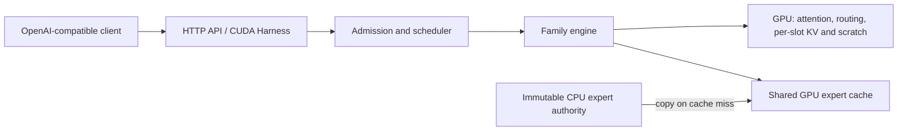

# TensorFold fork

**Gemma4 CUDA trial (2026-10-18):** Native paths read original MLX affine mixed4/6 weights or the original AEON compressed-tensors NVFP4 export, with BF16 DFlash, BF16 KV, and the model's image/video processor and thinking/tool syntax. The NVFP4 path requires SM12.x and retains its declared FP4 activation calibrations; the tied embedding/head, router and vision weights stay BF16. This initial path serves one request at a time. The installed GB10 image passed **461 CPU and 50 CUDA checks**, full-token serial/DFlash identity, Harness counting, streaming, image/video and strict tools. Its 512-token coding requests observed **64.49–74.41 decode tok/s** with five verification rows, versus **41.16–41.37** serially. [Source/image, conditions and limits](docs/gemma4-cuda-validation.md) distinguish these observations from the separate head comparison and unresolved R8/R16 ranking. See the [Gemma recipe](docs/recipes/gemma-4.md) and [GB10 Gemma profile](deploy/gb10/compose.gemma4.yaml).

Harness connections require the container's compatibility entrypoint, `cuda_entrypoint.py` → `tensorfold_harness.py`, with `--thinking-budget 0`. The native CLI's token-count response lacks Harness's versioned model/context metadata. Gemma count-only image preparation can measure prompts beyond the served context while retaining media safety limits; generation still enforces its context window.

For the qualified Flash Next NVFP4 profile on GB10, use the [dedicated deployment profile](deploy/gb10/nvfp4.md):
six native MTP drafts, four streams, SSD n-grams, vision and automatic graph sizing,
with an 8 GiB host-memory reserve. Its immutable runtime and measured tradeoffs
are recorded separately from the historical affine/YaRN deployment.
The earlier [2026-10-18 deployment receipt](deploy/gb10/deployment-nvfp4-20261018.json)
records that Flash Next service's LAN acceptance at `http://192.168.1.50:8888/v1`, full-token
serial/MTP identity, image/video and strict tool calls, before the Gemma switch above.
Forty retired TensorFold containers were removed with their logs preserved.

This fork of [TensorFold](https://github.com/ashhart/TensorFold) serves language models on Apple Silicon and NVIDIA GPUs through an OpenAI-compatible API. It retains the upstream model families, family-specific kernels, exact speculative decoding, prompt reuse, tools, reasoning and vision support, and adds a reproducible NVIDIA container, Flash Next YaRN context extension, RAM-backed expert caching, optional RotorQuant KV formats, and service admission controls.

The maintained fork is [kklouzal/TensorFold](https://github.com/kklouzal/TensorFold), branch **`python-0.6`**. The Python integration joins fork baseline `2f8089a7b59588875d639a7efa860117168a29d0` with upstream Python `ed78d6fc204d89d90b045bf033d6551e7714f3a1`. Record the commit you actually clone: branch heads move. Upstream Python history remains part of the fork so later changes can be reviewed and merged.

The Python branch and an archive of the former `main` tip have been published.
GitHub's default branch is still `main`: the repository-settings update returned
HTTP 403 with the configured token. The old branch remains until the default
change can be verified.

**Desktop integration (2026-10-17):** Flash Next CUDA adds optional expert-authority registration, shared KV-window reservation, affine packed-expert persistence, ModelOpt NVFP4 RAM-backed experts and format-aware SSD n-gram reads. Same-host NCCL expert ranks can partition affine/NVFP4 routed experts while rank zero retains the backbone, concurrent requests and supported vision. Registration and persistence remain opt-in. [Contracts, deployment and validation scope](docs/desktop-report-remediation.md) distinguish implementation from installed-image, full-checkpoint and multi-GPU qualification. Historical results below retain their recorded source/image identities.

**Qwen MoE CT NVFP4 qualification (2026-10-17):** the original `AEON-7/Qwen3.6-35B-A3B-heretic-NVFP4` export now runs with RAM-backed experts and its separate DFlash v1 model on the 16 GB RTX PRO 2000 Blackwell. Installed source `099eb4d0` completed serial/drafted identity, strict tools/JSON, streaming, cancellation and four concurrent 512-token replies. The eight-row BF16 draft profile reached about **37 tok/s** in the balanced single-request comparison; four concurrent requests completed at **57.70 aggregate client tok/s** in a separate profile. [Conditions, immutable images and limits](docs/qwen36-ct-nvfp4-validation.md) retain the numerical contracts and conditional performance analysis. Existing affine native-MTP execution keeps its own arithmetic and defaults.

Weight-only ModelOpt NVFP4 host-authority loading packs original routed payload on CUDA and
completes its CPU transfer before publication. Scalar conversion stays on CPU;
loading admission includes the GPU packing peak. CT native-A4 retains its CPU
byte permutation. Historical source `abb67d62` passed affected installed CPU and
native loader checks; the [loader qualification status](docs/nvfp4-loading-validation.md)
keeps those identities separate from the new [GB10 ModelOpt validation](docs/gb10-nvfp4-validation.md)
and remaining final-source/performance gates.

Flash Next now selects ModelOpt routed-expert activation math from each
projection's declaration. Checkpoint precision uses declared static group-16 A4
on native SM12 GPUs, preserving the original direct input and weight scales.
Explicit full precision and nonnative devices retain W4A16. An expert group
selects one policy before loading; mixed native/nonnative ranks use W4A16.
Resident A4 banks retain live GPU routing and graph capture. Installed ARM source
`bd1f0e9d` passed native A4/extent checks, full-checkpoint serial/MTP identity,
four concurrent 512-token replies, SSD n-grams, image/video and public CLI strict
tools on GB10. Its MTP6/4096 MiB graph profile observed 43.27–43.50 warm single-request
and 143.80 aggregate completed-HTTP-body tok/s. [Conditions and receipt](docs/gb10-nvfp4-validation.md)
keep those fixed-budget observations separate from later composition results.
Source `297e8487` also passed MTP0/6 AUTO graph model protocols and 580 focused
CPU cases. MTP6 captured all 192 graph keys and observed 43.2464–43.3762 warm
single-request and 143.4139 aggregate HTTP tok/s, with 45/46 prompt tokens cached.
A nine-case test-only native fixture follow-up also passed. A subsequent balanced
A B C D D C B A comparison recorded **144.17–144.26 aggregate HTTP tok/s** for
GPU20/split/common MTP6 AUTO, the user-selected four-stream profile. B/D retained
a slight observed warm single-request edge; this is no all-region superiority
or equivalence claim. [Comparison and limits](docs/gb10-nvfp4-validation.md#controlled-eight-start-comparison-and-user-selection)
retain all observations. Further E/F work was stopped. The 483-node RQ/KV
selection has composite coverage: 192 earlier named passes plus 290 new passes
and one optional-extension skip; the interrupted whole run remains incomplete.
The [live deployment receipt](deploy/gb10/deployment-nvfp4-20261018.json) records
the subsequently launched immutable runtime and its LAN acceptance checks.

NVFP4 host admission also reserves the physical pinned Reader backing separately
from GPU scratch and temporary payloads. The shared estimate charges its ring
once, including when routed experts are offloaded. Historical small-model and
installed accounting checks retain their recorded source/image; new-foundation
qualification remains separate.
Host read/publication storage and GPU packing scratch remain separate, including
the distinct backbone and expert readers owned by a multi-rank leader.

Concurrent Qwen prompt batches run routed experts with the single-stream BF16 boundary and respect their admitted aggregate row limit. Installed numerical and full-model checks cover these increments on this host; other hardware requires separate qualification.

RotorQuant's codec-range assertion now uses syntax accepted by Triton 3.8 while
preserving the same inclusive 1–8 range. The selected container uses the official
Torch 2.16/Triton 3.9 nightlies below. The reported Torch 2.14/Triton 3.8 combination
has no completed native qualification here; its interrupted run is preserved in
the [loader receipt](docs/verification-nvfp4-loading-20261017.json).

CUDA rank startup resolves NCCL from the active Python environment or Torch bundle before system libraries. `TF_NCCL_LIB` is authoritative; an invalid override or broken selected environment library fails explicitly. Same-host rendezvous can reuse retired POSIX sessions while preserving active-listener exclusivity; older non-reuse sessions may still need their kernel timeout to expire. [Setup and recovery](RUNBOOK.md#nvidia-gpus) describe the boundaries; these fixes do not add two-GPU qualification.

Required-tool format discovery follows the rendered call envelope, including DSML. A tool-name list after the example call in a custom chat template no longer becomes part of the forced call prefix. Existing HTTP enforcement regressions and the Heretic installed-model strict-tool checks pass.

CUDA strict tools recognize exact XML templates that render scalar `True`, `False` and `None`, while preserving canonical JSON containers and API arguments. Ambiguous nullable raw strings and unsupported formats are refused before generation. An unfinished strict call reports `stop` or `length`, preserving partial streaming evidence. Installed Heretic checks verified scalar booleans/null and literal strings through ordinary and streamed strict calls.

Installed local checks passed **7,994 CPU cases** and cover **2,049 distinct CUDA cases** through the full non-matrix run and complete corrected module. Both trained EXL3 registration policies, strict tools, concurrent replies, three-format exactness and the installed Harness launcher passed. The [desktop receipt](docs/verification-desktop-report-20261017.json) records the corrected fixtures and exact images. Actual two-GPU and mixed-architecture execution require separate hardware qualification.

**Smaller pretrained NVFP4 (2026-10-17):** the same installed container ran `surogate/Qwen3.5-9B-NVFP4` in native FP4-activation and BF16-activation modes on this 16 GB Blackwell. Observed 512-token decode rates were 24.06–24.27 and 34.41–34.73 tok/s respectively; the modes have different output contracts. Repeat/concurrent identity, SSE, strict JSON output and explicit strict-tool refusal were verified, with a sampled system-RAM minimum of about 49.7 GiB. This export requires an explicit chat-end stop option. [Conditions, capability limits and composite evidence](docs/small-nvfp4-validation.md) distinguish this dense model from Flash Next offload.

**CUDA correctness remediation (2026-10-17):** Qwen MoE private cache copies retain their attention arena identity. Stored-layout Triton QMM and prompt attention now express the selected CUDA FMA order explicitly; legacy Triton results can change where compiler-dependent contraction broke the promised parity. GLM weighted BF16 experts retain their family's separately rounded slot sum, while Flash Next's default FP32 FMA path stays unchanged. The Flash Next n-gram sum test uses independent exact arithmetic and checks the consuming kernel. GLM fixtures now exercise distinct vocabulary shards with native integer token IDs, and interrupted-build tests follow the pinned Torch lock protocol. [Arithmetic and buffer contracts](docs/cuda-kernel-contracts.md) describe the affected boundaries; source/image-specific [verification](docs/optimization-validation.md#cuda-failure-remediation-2026-10-17) records the gates and limits. Final installed-image checks passed **7,642 CPU and 2,012 CUDA tests**, plus full-checkpoint API and three-format exactness checks; the [receipt](docs/verification-cuda-remediation-20261017.json) identifies the qualified source and images.

**Earlier API/statistics qualification (2026-10-17):** the API/statistics/strict-tool integration at source `2dd77a9a` passed affected installed CPU, focused GPU, three-format exactness and full-checkpoint HTTP checks on the RTX PRO 2000 Blackwell host. TensorFold enforces requested strict schemas or refuses unsupported constraints; the paired [Harness change](https://github.com/kklouzal/Harness/commit/410bbbf8222c8f75e469b5a019dc88c712e54b66) explicitly relaxes only audited tools with execution-time validation. Deploy that consumer change first. [Qualification and limits](docs/optimization-validation.md#apistatistics-and-strict-tools-local-qualification-2026-10-17) identify the exact images, test results and retained baseline CUDA failures. The aggressive fresh-connection monitoring case did not meet the declared ±0.5% confidence bound; the warm consumer-shaped four-request result also remains inconclusive for two-sided equivalence. No overall instrumentation-overhead claim is made. No GB10 rollout, fresh ARM64 qualification or Apple execution was performed for this change.

**Earlier Python integration qualification (2026-10-11):** source `dfb4669d6b98f26de9ecfd75d3ccf7e90ec747bf` passed the full installed Linux CPU suite on both native ARM64 and AMD64: **7,320 passed, 177 skipped, no failures or errors per host**. Source `2edfaa515d85ca48a57365552f38a97a17123c3c` subsequently passed affected installed-package, CLI, Harness and actual GPU startup checks on both hosts; unchanged runtime/build/test bytes support scoped reuse of the earlier results. Native CUDA component and synthetic model checks passed on GB10 and RTX PRO 2000 Blackwell.

All **256 ordered KV-format pairs passed on both GB10 and RTX PRO 2000 Blackwell**, with completed-run receipt and container-retirement checks. Isolated GDN candidates passed fresh native checks on GB10 and remain unselected pending full-model performance evidence. [Detailed qualification](docs/optimization-validation.md#python-line-integration-2026-10-11) identifies the images, workloads and limits. Full pretrained-model and performance comparisons remain pending; no Apple Silicon host is available. Historical performance results retain their original scope. The historical 2026-10-12 GB10 deployment ran the qualified Python **0.6.6** image with its 1M-context/four-slot profile. [Deployment verification](deploy/gb10/deployment-python-20261012.json) records actual startup, complete generation, tokenization, serial/MTP identity and concurrent-request checks. Source `9acb28c3` then replaced only the Harness launcher so `/v1/tokenize` reports template fingerprint, reasoning-effort and provenance metadata; its [receipt](deploy/gb10/deployment-harness-bridge-20261012.json) records the live checks.

The GB10 Compose profile uses a separate cache directory for the Python image,
preserving the previous image's compiled cache for rollback. See the
[GB10 cache and deployment guide](deploy/gb10/README.md) for the captured host
paths and the source-specific cache override.

## Start here

- [Build and run the NVIDIA container](#build-and-run-the-nvidia-container)
- [Install the fork on Apple Silicon](#apple-silicon-and-source-installation)
- [Supported models and formats](#supported-models-and-formats)
- [Configuration](#configuration)
- [RAM-backed expert cache](#ram-backed-expert-cache)
- [Context, RoPE and YaRN](#context-rope-and-yarn)
- [KV cache formats](#kv-cache-formats)
- [API and client behavior](#api-and-client-behavior)
- [Measured performance and tested hardware](#measured-performance-and-tested-hardware)
- [Benchmark, operate and update](#benchmark-operate-and-update)

## Platforms and runtime

| Target | Runtime and scope |
| --- | --- |
| Apple Silicon/macOS | MLX backend; Python 3.11 or newer. Package requirements currently constrain MLX to `>=0.32.2,<0.32.4` and mlx-lm to `>=0.31.3,<0.33`. |
| Linux/NVIDIA AMD64 | Native AMD64 container and CUDA backend. The separate-VRAM trials used an RTX PRO 2000 Blackwell with 16 GB VRAM and 64 GB system RAM. |
| Linux/NVIDIA ARM64 | Native ARM64 container and CUDA backend; earlier deployment trials used DGX Spark/GB10 unified memory. |

`--backend auto` selects MLX on macOS and CUDA elsewhere; model-family support still applies. The required native file-owner extension supports Linux and macOS. Native Windows is outside the current runtime contract.

The CUDA backend defaults to a compute-capability floor of **8.9** and refuses unsupported GPUs at startup. Individual kernels can require additional capabilities; cluster extensions require at least 9.0. Native NVFP4 checkpoint math requires SM 12.x, while FP8 math starts at 8.9; supported stored-weight BF16 paths apply where the GPU lacks the checkpoint's native math. Check [CUDA formats and qualification](docs/recipes/cuda.md), especially before assuming an untested Ada, Hopper or other Blackwell card has the same execution coverage as the measured machine. Build targeting alone is not hardware verification.

### Pinned container stack

The [Dockerfile](deploy/gb10/Dockerfile) uses the selected CUDA **13.4.3 cuDNN development** foundation and genuine official nightlies. Native core providers and the exact protected TorchVision bundled-runtime exceptions follow the [managed foundation contract](deploy/gb10/foundation.md); this does not claim every component uses only the base runtime. The tracked per-architecture pin files are authoritative for base digests and whole-wheel hashes.

| Target | Torch | TorchVision | Triton | Selected inputs |
| --- | --- | --- | --- | --- |
| AMD64 | `2.16.0.dev20261017+cu134` | `0.30.0.dev20261007+cu134` | `3.9.0+gitfc8d31a5` | [AMD64 pins](deploy/gb10/nightly-pins-amd64.json) |
| ARM64 | `2.16.0.dev20261014+cu134` | `0.30.0.dev20261006+cu134` | `3.9.0+gitfc8d31a5` | [ARM64 pins](deploy/gb10/nightly-pins.json) |

A fresh checkout can [stage the six tracked inputs and acquire the two declared native addons](deploy/gb10/foundation.md#prepare-the-tracked-selected-inputs) without re-resolving dependencies or using private artifacts. Native ARM images and the [GB10 checkpoint protocols](docs/gb10-nvfp4-validation.md) passed at their recorded bd1 source; final composed-source qualification remains separate. Older deployment profiles and measured rates retain their own identities.

The earlier qualified 2026-10-06 build used this NVIDIA NGC CUDA DL inference development image:

```text
nvcr.io/nvidia/cuda-dl-base:26.09-cuda13.4-inference-devel-ubuntu24.04@sha256:f86c199a302a3a7405d5f055adf1311cd660e85d8a66cf452be6eb45d5768639
```

The recorded **2026-10-06** stack is CUDA **13.4.1**, CPython **3.12**, PyTorch **`2.16.0.dev20261006+cu134`**, TorchVision **`0.30.0.dev20261006+cu134`**, Triton **`3.9.0+gitaad2a60d`**, and xgrammar **0.2.8**. These are reproducible pins, rather than a floating “latest” install. [ARM64 pins](deploy/gb10/history/20261006/nightly-pins.json) and [AMD64 pins](deploy/gb10/history/20261006/nightly-pins-amd64.json) contain separate child-image and wheel hashes; matching runtime/test lock files are installed with hash checks. Architecture selection rejects a mismatched native target.

The image includes the extension build toolchain and isolates compiler caches by architecture and CUDA/Torch/Triton identity. It contains no model weights. Install [Docker Engine](https://docs.docker.com/engine/install/), a compatible NVIDIA host driver, and the [NVIDIA Container Toolkit](https://docs.nvidia.com/datacenter/cloud-native/container-toolkit/latest/install-guide.html) first. The Toolkit guide covers `nvidia-ctk runtime configure --runtime=docker` and restarting the host Docker daemon; do that host setup before building or running the service. The compatibility launcher validates the effective driver/runtime environment. Forward compatibility on a tested GB10 driver does not establish support for every desktop driver.

## Build and run the NVIDIA container

For a persistent service targeting the full native 262,144-token window on a discrete GPU, use the [discrete-GPU Compose guide](deploy/discrete-gpu/README.md). It supplies service-owned writable storage, health checks, bounded RAM and logs, and automatic restart. Its configuration and measured deployment results are recorded separately from the shorter-context example below.

The following example is for a **native AMD64 Linux host with a separate 16 GB GPU and 64 GB RAM**. It uses the tested Flash Next EXL3 checkpoint, a 2,048-token configured context, four shared decode slots, and a RAM-backed expert cache. Memory admission can still refuse a configuration that does not fit your actual host.

### 1. Clone and build

```bash
git clone --branch python-0.6 https://github.com/kklouzal/TensorFold.git
cd TensorFold || exit
git rev-parse HEAD
```

Run [input preparation](deploy/gb10/foundation.md#prepare-the-tracked-selected-inputs)
with `TF_BUILD_ARCH=amd64` for this example, or `arm64` with a native ARM64 builder.
It copies the six selected files, derives the base and fetches each declared
addon from its pin URL into a temporary file. It checks the complete SHA256
before publishing a canonical `.deb` name. Keep the resulting variables in this
same shell; no hand-copied hashes or private wheelhouse are needed.

```bash
docker buildx build --platform "linux/$TF_BUILD_ARCH" --load --target runtime \
  --build-context "foundation_pins=$TF_FOUNDATION_PINS" \
  --build-context "foundation_artifacts=$TF_FOUNDATION_ARTIFACTS" \
  --build-arg "BASE_IMAGE=$TF_BASE_IMAGE" \
  --build-arg "SOURCE_REVISION=$TF_SOURCE_REVISION" \
  --build-arg "MAX_JOBS=$TF_BUILD_JOBS" \
  --tag tensorfold-fork:local --file deploy/gb10/Dockerfile .
docker image inspect tensorfold-fork:local --format '{{.Id}}'
```

Cross-building or resolving another architecture's dependencies does not verify its GPU execution. `SOURCE_REVISION` is a label: a build from an edited working tree is not proven identical to that commit.

The preparation block derives `TF_BUILD_JOBS` from the local builder's available CPUs with `nproc`; use the remote builder's count when applicable. The Dockerfile's unset default remains eight. This controls compiler parallelism and does not prove all cores stay busy.

Check GPU visibility through the image's compatibility launcher. On a mixed-vendor host where `--gpus all` resolves incorrectly, use the existing [explicit UUID/CDI selection](deploy/discrete-gpu/README.md) for the actual NVIDIA device:

```bash
docker run --rm --gpus all --entrypoint python3 tensorfold-fork:local \
  /opt/harness/cuda_entrypoint.py python3 -c \
  'import torch; print(torch.__version__); print(torch.cuda.get_device_name(0)); print(torch.cuda.get_device_capability(0)); print(torch.cuda.mem_get_info())'
```

### 2. Acquire a model at a known revision

Provide enough disk space for the complete checkpoint and downloads. The tested EXL3 snapshot contains approximately **62.8 GB** of assets, including the mapped n-gram file; that is different from its resident expert-weight requirement. Review the model's license. Supply Hugging Face authentication through your environment if the selected repository requires it.

The download below uses the image's installed [Hugging Face `snapshot_download` API](https://huggingface.co/docs/huggingface_hub/package_reference/file_download), requires network access, and does not require a GPU. Set both directories to absolute host paths; acquisition needs a writable model directory.

```bash
TF_MODELS=/absolute/path/to/tensorfold-models
TF_CACHE=/absolute/path/to/tensorfold-kernel-cache
mkdir -p "$TF_MODELS" "$TF_CACHE"

docker run --rm --entrypoint python3 \
  --mount "type=bind,src=$TF_MODELS,dst=/models" \
  tensorfold-fork:local -c \
  'from huggingface_hub import snapshot_download; snapshot_download(repo_id="turboderp/Qwen3.8-Flash-Next-exl3", revision="65c895314393431c09050b2e04e250836b3a6eb4", local_dir="/models/Qwen3.8-Flash-Next-exl3")'
```

For authenticated downloads, add `-e HF_TOKEN` after setting it in the host environment. Keep credentials out of logs and shell history. A different model or revision requires its own format, memory and quality checks. Model files must remain immutable while a service uses them.

### 3. Launch

```bash
docker run -d --name tensorfold-local --gpus all \
  --memory 56000000000 --memory-swap 56000000000 --pids-limit 512 \
  -p 127.0.0.1:8080:8080 \
  -e MAX_JOBS="$TF_BUILD_JOBS" -e HF_HUB_OFFLINE=1 \
  -e TENSORFOLD_NO_UPDATE_CHECK=1 \
  --mount "type=bind,src=$TF_MODELS/Qwen3.8-Flash-Next-exl3,dst=/model,readonly" \
  --mount "type=bind,src=$TF_CACHE,dst=/cache" \
  tensorfold-fork:local serve /model --name local \
  --host 0.0.0.0 --port 8080 --backend cuda --thinking-budget 0 \
  --parallel 4 --context 2048 --max-tokens 128 --vram-experts auto --kv-dtype int8 \
  --mtp-drafts 4 --mtp-confidence 0.5 --yarn-factor 2 \
  --max-http-connections 32 --max-pending-requests 8 --no-thinking

docker logs --tail 100 -f tensorfold-local
```

The **56,000,000,000-byte** limit is 56 decimal GB, about 52.2 GiB. Setting the same memory and swap limit [grants no additional swap budget](https://docs.docker.com/engine/containers/resource_constraints/). This is the tested host's budget, not a universal safe allocation. The caps **32** and **8** are example choices; both are uncapped by default. INT8 KV is an explicit memory/quality tradeoff; the default is BF16. MTP-4, confidence 0.5 and YaRN-2 are selected example settings, rather than the drafting defaults; default prefetch remains enabled. The historical rates below do not automatically apply to this launch. `--no-thinking` disables template reasoning for this simple example and can be omitted for models that use it.

The runtime entrypoint already invokes the compatibility launcher and the CUDA Harness. The Harness requires the installed module and package metadata to identify **TensorFold 0.6.6**, matching this Python integration. Its arguments must begin with **`serve MODEL`**, and it requires **`--thinking-budget 0`**. Other CLI subcommands use the ordinary source installation described below. The container listens on `0.0.0.0` internally; the host publication above exposes it only on loopback. Change the host publication deliberately for remote clients and apply your service's access controls.

The image defaults to root. The model mount must be readable, and `/cache` writable, for whichever UID you select. Adding `--user` requires validating those permissions and home/cache access; generic rootless operation has not been qualified. Persist `/cache` across restarts so runtime extension compilation can reuse matching artifacts.

### 4. Verify readiness and actual generation

Loading and first-time compilation can take several minutes. Watch logs until startup completes, then inspect health and the advertised model ID:

```bash
curl -fsS http://127.0.0.1:8080/health
curl -fsS http://127.0.0.1:8080/v1/models
curl -fsS http://127.0.0.1:8080/v1/chat/completions \
  -H 'Content-Type: application/json' \
  -d '{"model":"local","messages":[{"role":"user","content":"Explain why the sky is blue in one short sentence."}],"max_tokens":64,"temperature":0,"chat_template_kwargs":{"enable_thinking":false}}'

curl -N -fsS http://127.0.0.1:8080/v1/chat/completions \
  -H 'Content-Type: application/json' \
  -d '{"model":"local","messages":[{"role":"user","content":"Write a short description of the Moon."}],"max_tokens":64,"temperature":0,"stream":true,"chat_template_kwargs":{"enable_thinking":false}}'
```

A healthy listener alone is insufficient: consume a complete generation. Check reported context, admission and cache information in health/logs before increasing capacity.

### GB10 Compose profile

[deploy/gb10/compose.yaml](deploy/gb10/compose.yaml) is a deployment-specific GB10 profile: a captured model path, 114 GiB memory, host CPU affinity, four slots, a 1,048,576-token YaRN-4 context and `rotorquant8-norm` for both K and V. It is not a portable 16 GB GPU configuration. Review its memory, affinity, mounts, networking and flags before running it. `HF_CACHE`, `KERNEL_CACHE` and `TENSORFOLD_IMAGE` override its paths/image; its health check allows 15 minutes for initial compilation/loading. It sets `TENSORFOLD_FAILURE_CAPTURE_DIR` to a bounded directory under the kernel cache, where a reply that ended inside its think block is captured (redacted request, token IDs, statistics); a normal reply's request is never logged or captured. See the [deployment guide](deploy/gb10/README.md).

```bash
docker compose -f deploy/gb10/compose.yaml config --quiet
docker compose -f deploy/gb10/compose.yaml up -d
docker compose -f deploy/gb10/compose.yaml ps
docker compose -f deploy/gb10/compose.yaml logs --tail 100 -f tensorfold
```

Four slots share weights and an expert cache; they do not guarantee four simultaneous full-size contexts fit.

## Apple Silicon and source installation

Install **this fork**, rather than an upstream wheel or Homebrew release, to obtain its changes. On Apple Silicon, use a virtual environment with Python 3.11 or newer:

```bash
git clone --branch python-0.6 https://github.com/kklouzal/TensorFold.git
cd TensorFold
python3 -m venv .venv
. .venv/bin/activate
python -m pip install --upgrade pip
python -m pip install -e '.[grammar]'
tensorfold models
tensorfold info Vontra/NVIDIA-Nemotron-3.5-Lightning-30B-A3B-MLX-4bit
tensorfold pull Vontra/NVIDIA-Nemotron-3.5-Lightning-30B-A3B-MLX-4bit
tensorfold serve Vontra/NVIDIA-Nemotron-3.5-Lightning-30B-A3B-MLX-4bit --no-update-check
```

The native extension requires a working platform compiler. Add the `vision` extra for image input, or `ssd` for the supported SSD expert path, for example `python -m pip install -e '.[grammar,vision,ssd]'`. The grammar extra installs xgrammar; the pinned Docker runtime already includes it. On CUDA, use the container's matching Torch, Triton and extension compiler; the package has no `cuda` installation extra.

`tensorfold models` lists registered families/checkpoints. `info MODEL` checks configuration without fetching weights. `pull MODEL [DRAFTER ...]` downloads ahead of time; `serve` can download a missing checkpoint. The CLI download uses repository defaults; the revision-pinned API download above is preferable for reproducible deployments. See the [runbook](RUNBOOK.md) and [recipes](docs/recipes/README.md) for family-specific setup.

## Python-line integration

This fork follows upstream's `python-0.6` line. The integration source is
`ed78d6fc204d89d90b045bf033d6551e7714f3a1`; upstream `main` is the separate
native Zig engine. Fork changes retain their Git history and selected numerical,
resource ownership, cache and serving contracts. New arithmetic or scheduling
alternatives require same-region correctness and complete-workload evidence
before replacing a selected implementation.

The Python integration adds API-key authentication, bounded chunked requests,
Anthropic Messages and token-counting routes, configured background model IDs,
and offline planning/service tools. The running images and historical performance
results below keep their recorded source identities. Integration CPU, installed
package, native device and full-model qualification have separate scopes; an
upstream measurement does not qualify the combined fork automatically.

## Supported models and formats

The table describes supported integration paths. It is not a promise that every checkpoint fits a particular machine, or that all paths have been rerun on this fork's latest image. CUDA registers Qwen dense, Qwen3.6 MoE, Flash Next, Nemotron and GLM families, plus the initial single-stream Gemma4 affine/NVFP4 trial. Bonsai and DeepSeek listed here are MLX-only.

| Model | Example checkpoint | Backend | Drafting |
| --- | --- | --- | --- |
| Nemotron 3.5 Lightning | `Vontra/NVIDIA-Nemotron-3.5-Lightning-30B-A3B-MLX-4bit` | MLX, CUDA | Included MTP; context copies on MLX |
| Qwen3.8-27B dense | `Vontra/Qwen3.8-27B-MLX-4bit` | MLX, CUDA | `z-lab/Qwen3.8-27B-DFlash2`; optional on MLX |
| Qwen3.6-35B-A3B MoE | `Vontra/Qwen3.6-35B-A3B-MLX-4bit-MTP` | MLX, CUDA | Included MTP; see the [recipe](docs/recipes/qwen3.6-moe.md) |
| Qwen3.6-35B-A3B CT NVFP4 | `AEON-7/Qwen3.6-35B-A3B-heretic-NVFP4` | CUDA SM12, one GPU; discrete RAM expert pool when needed | Separate `z-lab/Qwen3.6-35B-A3B-DFlash` v1; [recipe](docs/recipes/qwen3.6-moe.md#original-ct-nvfp4-and-dflash-v1) |
| Qwen3.8 Flash Next | `Vontra/Qwen3.8-Flash-Next-MLX-4bit-MTP` | MLX, CUDA | Included MTP and context copies |
| GLM-5.3-Flash | `Vontra/GLM-5.3-Flash-MLX-4bit-MTP` | MLX on a 256 GB Mac; CUDA with two ranks | MTP; optional DFlash2 on CUDA |
| Gemma 4 26B-A4B | `mlx-community/gemma-4-26b-a4b-it-4bit`; CUDA trial: zecanard mixed4/6 or AEON-7 NVFP4 | MLX; initial CUDA trial | Optional `z-lab/gemma-4-26B-A4B-it-DFlash`; CUDA BF16 companion, one stream |
| DeepSeek-V4-Flash | `mlx-community/DeepSeek-V4-Flash-4bit` | MLX on a 256 GB Mac | `Vontra/DeepSeek-V4-Flash-DSpark-MLX` or `Vontra/DeepSeek-V4-Flash-MTP-MLX` |
| Qwen3.8-27B NVFP4 | `nvidia/Qwen3.8-27B-NVFP4` | CUDA, one GPU | DFlash2 and context copies |
| Qwen3.8-27B EXL3, experimental | `turboderp/Qwen3.8-27B-exl3`, branches `3.00bpw` / `4.00bpw` | CUDA | DFlash2 and context copies |
| Flash Next EXL3, experimental | `turboderp/Qwen3.8-Flash-Next-exl3`, branch `3.05bpw_h5_ng5` | CUDA | Included MTP and context copies |
| Ternary Bonsai 2 27B | `prism-ml/Ternary-Bonsai-2-27B-mlx-2bit` | MLX | `z-lab/Qwen3.8-27B-DFlash2` and context copies |
| Flash Next NVFP4 | `local-inference-lab/Qwen3.8-Flash-Next-NVFP4` or `RadixArk/Qwen3.8-Flash-Next-NVFP4` | CUDA; resident single-GPU or RAM expert-rank mode | Included MTP and context copies |

Dense Qwen reads affine 2/3/4/5/6/8-bit checkpoints, including mixed layers and groups 32/64/128; newer paths retain their documented hardware-qualification limits. Flash Next's affine path requires 4-bit/group-32 weights. Its EXL3 path reads per-tensor codebook widths; supported NVFP4 exports and block-scaled FP8 linears have separate checks. Flash Next without an MTP head needs `--no-drafts` on CUDA. Nemotron CUDA uses 4-bit/group-64 weights and requires its MTP head unless serial decoding is selected.

GLM reads affine 4-bit/group-64 and supported mixed-bit MLX conversions; CUDA also has the experimental `Mia-AiLab/GLM-5.3-Flash-EXL3-TR3-4bpw` path. Its optional `incoai/GLM-5.3-Flash-DFlash2` has non-commercial terms. Gemma on MLX uses 4-bit/group-32 or 64 with an 8-bit router. The initial CUDA paths read original affine mixed4/6 group-64 projections with a 6-bit tied head, or AEON compressed-tensors NVFP4 with calibrated FP4 activations on SM12.x and its original BF16 tied head. Both use BF16 KV and BF16 DFlash; other layouts are refused. DeepSeek uses affine 4-bit/group-64 plus MXFP4 experts and the converted DSpark/MTP heads. Model weights and draft models keep their own licenses. Consult [quantized checkpoints](docs/quantization.md), [third-party notices](THIRD_PARTY_NOTICES.md) and the [family recipes](docs/recipes/README.md).

### Exact speculative decoding and concurrency

Drafting accepts a token only when it equals the same engine's serial choice. Sampling keys use the prompt or explicit seed, absolute position and token ID. Compare an otherwise identical request with `"draft": false` to check the serial reference.

Exactness is scoped to the **same engine, weights, runtime, precision, KV format and request settings**. It does not promise bit identity between MLX and CUDA, different weight/KV quantizations or tensor-parallel layouts.

GLM's CUDA MoE sum rounds each weighted expert output to FP32 before its
slot-ordered FP32 addition. The shared EXL3 kernel's BF16 activation mode keeps
that [family arithmetic](docs/recipes/glm-5.3-flash.md#exl3); its FP32 mode retains
an FMA slot sum.

Flash Next's concurrent CUDA decoder captures its pure decode rounds (the verify forward and each MTP step) as CUDA graphs at startup. With `TENSORFOLD_MULTI_GRAPH_MIB` unset, it uses remaining admitted memory after eager warmup, protecting one complete context window, cache-resize overlap, snapshots, serving workspace and the configured memory floor. Additional concurrent contexts grow while memory lasts. A numeric value is an explicit MiB ceiling (`0` disables capture). The startup record retains the original context admission, resolved graph allowance, measured memory and any reason capture stopped. Rounds with a prompt pass, image rows or the Rotor7 lookup decoder, and keys outside the allowance, run eagerly with the same bits; experts read through a host cache (`--vram-experts`) decline capture and plan no graph memory. Automatic sizing passed the [source297 installed GB10 model protocols](docs/gb10-nvfp4-validation.md#source297-auto-graph-protocols) and focused CPU contracts; the [user-selected four-stream profile](docs/gb10-nvfp4-validation.md#controlled-eight-start-comparison-and-user-selection) has a separate controlled comparison and explicit single-request tradeoffs. Its decode kernels use programmatic dependent launch on GB10 (compute capability 12.1, where it was measured; other GPUs launch them plainly), which keeps every result unchanged. Earlier fixed-budget GB10 measurements found 1.6 to 2.4% faster decode with captured rounds, no established difference from programmatic dependent launch, up to 8.7% faster long-context decode from the multi-CTA sparse-attention select and 34 to 38% faster RotorQuant 6 prompt passes; see [optimization validation](docs/optimization-validation.md) for those sources, workloads and uncertainty.

MLX shares rounds across supported requests, with per-request state and sampling keys; load-time checks restrict families that cannot reproduce their serial arithmetic. CUDA explicit `--parallel N` enables shared rounds for Qwen dense on one/two ranks and Flash Next/Qwen3.6 MoE on one rank. Flash Next rejects concurrent tensor-parallel execution with `--tp 2`; its separate same-host expert-rank mode keeps `--tp 1` and supports concurrent requests on rank zero. GLM and Nemotron CUDA are serial; CUDA `--parallel auto` means one. Qwen dense, Flash Next and Nemotron have one/two-rank CUDA paths; GLM requires two. The expert-rank path supports affine4 and NVFP4 RAM-backed routed experts; EXL3 expert partitioning is refused. A real two-GPU deployment needs separate qualification; a one-rank NCCL check does not establish it. See [two-rank setup](RUNBOOK.md#nvidia-gpus).

## Configuration

Use `tensorfold serve --help` from your checkout for the authoritative parser. A request can override supported generation defaults. Unsupported backend/family combinations are refused; a listed flag is not available for every model. GiB flags use binary GiB; Docker's example RAM limit above uses bytes.

Model defaults now reconcile supported [checkpoint and ancillary metadata](docs/model-metadata.md),
including quantization sidecars, declared activation formats, tokenizer EOS and
named chat templates. Explicit launch flags take precedence. Metadata is resolved
before loading; it does not authorize model code or silently change precision.
CUDA tokenizers retain checkpoint vocabulary, special tokens and postprocessing,
while disabling exported batch padding/truncation. Counting returns the complete
sequence, and generation rejects prompts that exceed the served context.

### Service, generation and admission

| Flags | Default / contract |
| --- | --- |
| `-h`, `--help` | Show serve help. |
| `--backend auto\|mlx\|cuda` | `auto`: MLX on macOS, CUDA elsewhere. |
| `--host`, `--port` | `127.0.0.1`, `8080`; container port publication needs `--host 0.0.0.0` inside. |
| `--api-key KEY`, `--api-key-file FILE` | Require bearer authentication; repeat static keys or load a restricted-permission key file. Configuration is bound at startup; key-file contents reload during operation and invalid configuration refuses authenticated routes. Both backends. |
| `--metrics-open` | Permit unauthenticated `/metrics` and `/stats` when keys are configured. |
| `--name-priority ID=background` | Give CUDA requests for that served model ID background priority by default. |
| `--vision-image-tokens N` | Explicit CUDA Qwen visual-token budget, 1 through 65,536; frontend image/resource limits remain active. Flash Next retains its 16,384-token default. |
| `--name`, `--alias` | Model's own name; aliases are repeatable additional IDs on both backends. |
| `--max-http-connections N` | Unset: uncapped workers. Positive cap includes active/idle keepalive connections; at capacity acceptance pauses and connections wait in the existing listen backlog. |
| `--max-pending-requests N` | Unset: uncapped. Positive cap counts unfinished logical generation requests, including preparation, queued/running work and work retained after cancellation. Excess receives HTTP 503 before a configured stream opens. |
| `--max-engine-calls N` | MLX only; unset: uncapped. Positive cap counts queued/running engine RPC callbacks, including callbacks retained after caller timeout. CUDA refuses it. |
| `--context N` | Omitted: fitted model capacity. CUDA omitted/0 targets affordable native capacity; MLX 0 removes the metadata cap, while finite memory/engine limits remain. |
| `--max-tokens N` | Checkpoint `generation_config.json` `max_new_tokens`, otherwise `4096`, when a request omits its reply limit. |
| `--eos-token-id ID` | Omitted: reconcile model/generation/tokenizer reply EOS. Repeat to replace the reply EOS set; PLE training EOS is unchanged. |
| `--chat-template FILE`, `--chat-template-name NAME` | Omitted: checkpoint template, with automatic `default`/`tool_use` selection for named templates. Mutually exclusive explicit source/name overrides. |
| `--tokenizer FILE` | CUDA only; omitted: the checkpoint's `tokenizer.json`. Encodes and decodes with FILE instead, admitted only when its vocabulary, merges and added tokens equal the checkpoint's (text handling such as the pre-tokenizer may differ); the startup log names the file, its SHA-256 and what differs. Read once at startup. Refused with `--vision` (its image prompts keep the checkpoint's tokenizer) and with several ranks (`--tp`, `--expert-ranks`). For a fine-tune that ships an altered pre-tokenizer, e.g. the AEON Qwen3.8-27B export (see the [27B recipe](docs/recipes/qwen3.8-27b.md#aeon-mixed-nvfp4-export)). |
| `--temperature`, `--top-p`, `--top-k`, `--min-p` | Checkpoint `generation_config.json`; on both backends temperature falls back to 0, top-k to 0 (off), top-p to 1 (off), min-p to 0. Temperature 0 or top-p 0 is greedy; top-p and min-p outside 0 to 1 are refused at startup. |
| `--presence-penalty`, `--frequency-penalty`, `--repetition-penalty` | 0, 0 and the checkpoint's `generation_config.json` `repetition_penalty`, else 1 (off). OpenAI/vLLM penalties applied by the CUDA Gemma 4, Qwen dense and Qwen3.6 MoE CT NVFP4 engines on one GPU ([API](docs/api.md#penalties)); presence/frequency outside -2 to 2 or repetition at or below 0 are refused at startup; other engines and the Metal backend name defaults they do not apply and refuse requests asking for them. |
| `--thinking`, `--no-thinking` | Thinking enabled by default when the template supports it. |
| `--reasoning-effort low\|medium\|high\|xhigh` | Template default when unset; unnamed levels map to the nearest named level, ties upward. |
| `--thinking-budget N` | `0`: no limit. Positive budgets close the reasoning block at the limit; the container Harness requires the CLI value 0. |
| `--no-update-check` | Off by default; `TENSORFOLD_NO_UPDATE_CHECK=1` also disables the startup upstream-release check. Recommended for this fork. |
| `--trust-model-code` | Off by default. MLX provider recipes: explicitly allow checkpoint Python to execute with server privileges; persistent cache identity becomes process-specific. |

Caps bound owner counts, not arbitrary total payload bytes. Generated token buffers remain bounded by each accepted prompt/reply/context contract; a trusted internal RPC callback may allocate its own payload. Canceled callers retain admission until their owned engine work retires. On MLX, direct scoring/cache-warm jobs also consume pending-request admission. Choose limits from measured demand and memory, rather than assuming the example values are defaults.

### Drafts, parallelism and precision

| Flags | Default / contract |
| --- | --- |
| `--parallel N\|auto` | `auto`: MLX up to 8 while projected memory fits; CUDA 1. Explicit shared-round support is family/rank-specific. |
| `--no-drafts` | Off; opt in to the same-engine serial reference. |
| `--drafter auto\|none\|MODEL` | `auto`: a supported family drafter when already pulled. Dense Qwen CUDA needs the drafter pulled or explicit `--no-drafts`. |
| `--drafter-bits N` | MLX default `4`, with `0` retaining BF16 draft linears. CUDA Qwen CT NVFP4 defaults to BF16 (`0` or `16`); explicit `8` (FP8) or `4` (NVFP4) requantizes the draft linears and a private copy of the target head, for proposals only. A CUDA engine with one draft precision refuses the flag. |
| `--draft-rows N` | CUDA Qwen CT NVFP4: unset uses the secondary's metadata block width. With a secondary, explicit width is 2–128 on one stream, at most 16 with `--parallel`; without one, width 1 is also valid. |
| `--mtp-drafts N` | Family-specific; Flash Next defaults to 3 on MLX and up to 6 on CUDA. 0 disables MTP drafts. |
| `--mtp-confidence P` | Flash Next CUDA default `0.70`; range 0–1, stops later low-confidence drafts. |
| `--lane-kernels auto\|on\|off` | `auto`; Qwen dense lane kernels on GPUs with tensor units. |
| `--decode-share F` | MLX default `0.25`, leaving replies progressing during chunked prefill. Flash Next CUDA shared rounds default 0; a positive share sizes prompt passes to allow decoding inside them. |
| `--prefill-fp8`, `--no-prefill-fp8` | CUDA supported prompt kernels; default BF16 activations. FP8 prefill explicitly reduces activation precision. |
| `--precision checkpoint\|full` | CUDA NVFP4 default `checkpoint`: checkpoint-native math when supported, with the documented stored-weight path otherwise. `full` uses BF16 activations against stored weights. |
| `--tp N` | Default 1; tensor-parallel counts remain family-specific. Matching checkpoint/configuration is required across ranks. |
| `--expert-ranks 1\|2\|3\|4` | Default 1. Flash Next affine4/NVFP4 RAM experts, same-host NCCL; requires `--tp 1` and `--vram-experts`. Rank zero owns backbone/state; followers own disjoint routed experts. |
| `--expert-shards COUNTS` | Unset. Comma-separated positive expert counts, one per expert rank, summing to checkpoint `num_experts`; contiguous ownership permits asymmetric splits. |
| `--rank N` | Default 0; valid tensor/expert rank index. Rank zero serves HTTP. The [expert launcher](docs/desktop-report-remediation.md#same-host-expert-ranks) supplies topology arguments. |
| `--master HOST`, `--master-port P` | Rank rendezvous; port defaults to `29551`. The same-host expert launcher selects loopback and owns these arguments. |

FP8 prefill, checkpoint-native low-precision activation math, weight quantization, KV quantization and YaRN are **quality choices**. A quality-preserving speed comparison must keep the chosen numerical contract fixed. See [prompt precision](docs/recipes/cuda.md#prompt-precision) and [NVFP4 precision](docs/recipes/cuda.md#nvfp4-precision).

### Cache, memory and vision

| Flags | Default / contract |
| --- | --- |
| `--vram-experts GIB\|auto` | Flash Next: unset means resident experts; affine4/group-32, EXL3 or ModelOpt NVFP4 support a bounded RAM-backed pool, with expert ranks for affine4/NVFP4. Qwen CT NVFP4 automatically selects RAM experts when its minimum resident state cannot fit; see its [recipe](docs/recipes/qwen3.6-moe.md#original-ct-nvfp4-and-dflash-v1). |
| `--vram-experts-pin off\|auto\|on` | `off`: pageable authority. With supported CUDA RAM experts, `auto` admits host registration or retains pageable bytes on explicit capacity/capability refusal; `on` requires registration. Unknown driver/cleanup failures remain errors. |
| `--kv-full-windows N` | Flash Next CUDA only. Unset: reserve every slot's full window. Positive N shares that many full growth windows with `--vram-experts auto`, `--parallel >=2`, `--tp 1`; reduced simultaneous long-request capacity can cause explicit capacity errors. |
| `--ssd-experts GIB` | Unset. Supported MLX families stream checkpoint experts into a GPU pool; distinct from RAM-backed CUDA experts and unsupported with CUDA `--vram-experts`. See the [Flash Next recipe](docs/recipes/qwen3.8-flash-next.md). |
| `--ple-on-ssd` | Off. Supported Flash Next affine, BF16, FP8 and NVFP4 n-gram layouts use bounded demand SSD reads with their original decoding/scale semantics. EXL3 retains its native mapped table and rejects this flag. |
| `--kv-dtype FORMAT` | Flash Next CUDA `bf16`; shorthand selects both K and V formats. |
| `--kv-key-dtype FORMAT`, `--kv-value-dtype FORMAT` | Unset; independently override their side of `--kv-dtype`. |
| `--yarn-factor FACTOR` | Flash Next CUDA: checkpoint factor unless overridden; finite factor ≥1. `--context` still governs admission. |
| `--prompt-cache-gib N` | MLX retained-prefix budget; 0 disables retention. Default is idle room after weights/window/shared round, normally at least an eighth of RAM up to 16 GiB, given back on demand. |
| `--checkpoint-slots N` | MLX: default 3 prefixes per lane, at least 8. CUDA Qwen dense with parallel ≥2: default 3 retained prompt states, subject to its rank/memory policy. |
| `--spill-gib N` | MLX, default 0. Disk capacity for evicted conversation prefixes; needs `--snapshot-dir`. |
| `--snapshot-dir DIR` | MLX, default `~/.cache/tensorfold/prefix-snapshots`; `none` disables persistent snapshots. |
| `--max-snapshots N` | MLX, default 3 system-block snapshots loaded at startup. |
| `--prefill-pass N` | MLX, default 8 prompt chunks per forward for families with a prompt pass. |
| `--pass-cache-gib N` | MLX, default 16 GiB freed-buffer cache during a prompt pass when budget permits. |
| `--mlx-cache-gib N` | MLX, default 8 GiB reusable freed-buffer cache. |
| `--vision` | Off. GLM on MLX, Qwen dense on MLX/CUDA, and Flash Next CUDA with parallel ≥2, with supported vision checkpoints. |
| `--vision-urls` | Off; image data URLs only by default. Opt in to public HTTP(S) URLs; URL safety policy still applies. |
| `--vision-max-images N` | Effective default 4 across the full history; byte, pixel and visual-token limits also apply. |

Image input requires the `vision` extra in a source installation. The API accepts text/image parts; the CUDA Harness reports its supported image/video capabilities. See [vision contracts and qualification](docs/vision.md) and the [Harness/deployment guide](deploy/gb10/README.md). Enabling vision can add workspace and reduce the room available for experts or context.

## RAM-backed expert cache

The service separates HTTP ownership, generation scheduling and model execution. In the CUDA container, the Harness adds token counting around the native API. The diagram shows the Flash Next `--vram-experts` mode: mandatory state remains on the GPU and the expert cache receives unchanged CPU weights on misses.



`--vram-experts` lets a supported Flash Next model keep its routed expert authority in **system RAM**, pageable by default, with a bounded cache of unchanged packed expert weights in VRAM. Frequently reused experts stay cached through bounded aging LFU, with recency and physical-slot tie-breaking. The same cache is shared by all generation slots.

Attention, routing and required non-expert weights stay on the GPU. Each slot's KV cache, recurrent state, retained snapshots and scratch/workspace also consume GPU memory. A miss uploads original quantized bytes **before GPU computation**. Pageable authority uses bounded pinned staging; eligible live registered authority can transfer directly to the GPU pool. Expert computation uses the unchanged stored-weight kernels. Cache residency changes IO cost, not expert selection or precision.

| Mode | Behavior |
| --- | --- |
| Omit `--vram-experts` | Ordinary resident expert loading. |
| `--vram-experts 6` | Limit packed GPU expert storage to 6 GiB, rounded down to whole cache cells. Mandatory model/state/workspace allocations are additional. |
| `--vram-experts auto` | On separate-VRAM CUDA GPUs, assign remaining usable VRAM after resident allocations, selected KV-growth/MTP/snapshot/workspace reservations and one **512 MiB** margin. All slot windows remain reserved unless `--kv-full-windows` is explicit. |

The cache capacity is fixed for the engine's lifetime. Restart after changing context, slot count or its budget. `auto` does not promise every reported VRAM byte becomes cache; mandatory allocations and headroom remain. The weights are shared across slots, but slot state is not, so more slots can reduce cache capacity. Host expert authority must fit the host budget alongside mapped n-gram pages, preparation, transfers and the rest of the process.

For a dedicated discrete-GPU host, `TENSORFOLD_MEMORY_RESERVE_GIB=8` and
`TENSORFOLD_CUDA_MEMORY_RESERVE_GIB=0` keep an 8 GiB host admission reserve and
remove the optional GPU reserve, including the automatic expert pool's 512 MiB
margin. Required weights, KV, scratch and future workspace still count. Leave
absolute memory caps unset and remove container CPU/RAM caps when granting the
whole host. This setting does not lower a unified-memory host's RAM reserve.
See [memory budgeting](docs/recipes/cuda.md#requests-and-memory).

The Flash Next single-GPU path supports affine4/group-32, EXL3 and ModelOpt NVFP4 checkpoints on supported CUDA hardware. Same-host expert ranks additionally partition affine4/NVFP4 routed experts across distinct GPUs; EXL3 remains single-GPU. Its tensor-parallel and MLX paths refuse `--vram-experts`. `auto` requires separate VRAM; unified-memory Flash Next systems use a numeric budget when appropriate. Qwen MoE's separate CT NVFP4 path has the [additional restrictions below](docs/recipes/qwen3.6-moe.md#original-ct-nvfp4-and-dflash-v1). `--ssd-experts` remains the separate MLX option.

`--vram-experts-pin` defaults to `off` until representative end-to-end selection supports a different default. Opted-in registration must admit the complete authority backing plus future loading/staging requirements; source bytes stay owned until copies and consumers retire. NVFP4 offload retains Flash Next's existing W4A16 grouped arithmetic, including on SM120. The optional [packed affine cache](docs/packed-expert-cache.md) needs both `TENSORFOLD_PACKED_EXPERT_CACHE` and an explicit positive `TENSORFOLD_PACKED_EXPERT_CACHE_BYTES` disk quota; it is disabled by default. Source/integrity checks still precede a warm hit. See [desktop contracts](docs/desktop-report-remediation.md) for reduced KV capacity, expert topology, resources and verification limits.

Default EXL3 n-gram prefetch reads the mapped table. Page locking is optional and admitted against host/cgroup/device capacity; refusal leaves mappings pageable and evictable while preserving normal prefetch. There is no public `--no-prefetch` flag. The tested checkpoint has **30,948,556,800 bytes** of CPU expert authority and a **26,240,125,952-byte** native mapped n-gram file. Cached file pages consume system RAM even though the OS can reclaim them. See [RAM-backed experts](docs/recipes/ram-experts.md) for accounting, metrics and limitations.

## Context, RoPE and YaRN

Context means **prompt plus reply**, not reply length alone. An explicit reply limit is reserved before prefill; an omitted reply limit is capped by remaining context. Startup reports native/extended limits and affordable engine capacity. A positive configuration that cannot fit is refused rather than silently making all slots usable at that length.

Flash Next CUDA supports static YaRN text RoPE extension. For a checkpoint with native 262,144-token metadata:

```text
--yarn-factor 2 --context 524288
```

This requests a 2× RoPE limit and admission window. It is **not a fit guarantee**, and it is unsuitable as the starting configuration for the 16 GB GPU example. YaRN can change short- and long-context quality; validate your intended tasks. The separate-VRAM performance trials below configured only 2,048 tokens with factor 2. A previous GB10 deployment has a bounded 524k retrieval record in its [deployment guide](deploy/gb10/README.md); one retrieval is not a general long-context accuracy guarantee or qualification of the latest image.

CUDA omitted/0 context targets affordable native capacity. GLM's default target is a dense 2,051-token window; Nemotron's is 16,384; admission may lower them. MLX omitted context fits the metadata window to startup estimates, while 0 removes only the metadata cap. Use the **reported effective context** for client compaction.

A slot includes engine-specific growth and draft rows: the observed 2,048-token Flash Next/MTP-4 setup had 2,053 cache slots, not exactly 2,048 allocated rows. Shared weights do not remove those per-slot costs.

### MLX memory and prompt reuse

MLX normally uses a process budget of 70% of physical RAM. GLM may use 85% on a Mac with 256 GB or less. `TENSORFOLD_MEMORY_LIMIT_GB` overrides the share in **GiB**, within physical/working-set limits. A 3 GiB process reserve precedes the allocator budget. Admission includes weights, growing contexts and workspace; fitting weights alone is insufficient. Concurrent streams grow in bounded increments and can wait when projected memory is insufficient without changing their tokens.

MLX prompt chunks follow rendered token sequences and recognized message boundaries; otherwise a family-specific grid applies. Fresh and resumed prompts use the same plan. Reuse stops at an exact matching prefix and valid boundary; templates that rewrite history can reduce reuse. There is no `--prefill-grid` option.

Persistent prefix snapshots use format 2 and explicit current-model registries. Malformed, legacy, mismatched or unregistered snapshots rebuild through ordinary prefill. Stored class names do not import code. Snapshot identity hashes selected model/draft trees and installed runtime inputs, including native libraries; model inputs must remain immutable. Explicitly trusted checkpoint Python uses a process-specific namespace. `--snapshot-dir none` disables persistent reuse and these persistence hashes. CUDA engines own separate prompt states and do not use MLX disk snapshots. See the [recipe book](docs/recipes/README.md).

## KV cache formats

Flash Next CUDA supports the following **16 formats**, with independent K/V selection; **BF16 is the default**. `--kv-dtype` selects both sides; `--kv-key-dtype` and `--kv-value-dtype` override only their respective side. All **256 ordered combinations** are selectable when head geometry supports them; this is configuration support, not a completed quality/performance matrix for all combinations.

| Family | Exact names | Bytes for one 256-value K **or** V head |
| --- | --- | ---: |
| BF16 | `bf16` | 512 |
| INT8 | `int8` | 272 |
| INT4 | `int4` | 144 |
| RotorQuant 3-bit | `rotorquant-planar3`, `rotorquant-iso3` | 104 |
| RotorQuant 4-bit | `rotorquant-planar4`, `rotorquant-iso4`, `rotorquant-iso64-norm4`, `rotorquant-signed128-4`, `rotorquant-signed64-norm4` | 136 |
| RotorQuant 6-bit | `rotorquant6`, `rotorquant6-norm`, `rotorquant6-outlier-norm` | 200 |
| RotorQuant 7-bit | `rotorquant7` | 232 |
| RotorQuant 8-bit | `rotorquant8`, `rotorquant8-norm` | 264 |

Add K and V storage, multiply by KV heads, and include unchanged BF16 indexer/pooled state, MTP, workspace, status and snapshots for total memory. INT8/INT4 use an FP16 scale per 32 values and require head dimensions divisible by 32. Rotor formats use packed Lloyd-Max codes and one FP32 scale per 128 values; norm/outlier variants store a corrected scale rather than necessarily the original RMS. Their head dimension must be a power of two divisible by 128.

Examples, to add to a compatible launch:

```text
--kv-dtype bf16
--kv-dtype int8
--kv-dtype rotorquant6-norm
--kv-dtype bf16 --kv-key-dtype rotorquant6-norm --kv-value-dtype int8
```

**Quantized formats can change output.** Compression, quality and speed are user tradeoffs; there is no BF16-equivalence claim. Planar rotations mix pairs, iso formats use quaternion blocks, and signed formats use fixed signs/mixing. Norm variants correct reconstruction energy; the outlier variant changes its scaling/code selection. Equal bit width does not make codecs interchangeable. Changing either side requires a fresh engine/cache; an unsupported format is refused, never silently substituted.

The implementation is TensorFold-owned scalar Gaussian Lloyd-Max quantization with pinned orthogonal rotations, informed by review of [scrya-com/rotorquant](https://github.com/scrya-com/rotorquant) at commit `fcd76768650659cad2f40a45a330612a7af8f928`. It does not import upstream cache/kernel bytes. Provenance, transform/numerical contracts and validation limits are in [the KV recipe](docs/recipes/qwen3.8-flash-next.md#kv-cache), [reference source](src/tensorfold/families/qwen4_exp/cuda/rotorquant_ref.py), [kernel source](src/tensorfold/families/qwen4_exp/cuda/rotorquant_kernel.py), and [third-party notices](THIRD_PARTY_NOTICES.md). The maintained source now includes a seven-bit decoder lookup optimization only within the [controlled region measured below](#controlled-rotorquant7-decoder-comparison). It preserves the chosen same-format output contract; it does not change model weights or KV quantization. It uses the existing internal selection policy, with no new public flag. Default full-prefetch serving and conditions outside that measured region retain the original decoder. Frozen selected-source shipping qualification is complete; see [the shipping results](#frozen-source-shipping-qualification).

## API and client behavior

Use `http://127.0.0.1:8080/v1` as an OpenAI-compatible client base URL and an ID returned by `/v1/models`. The [API reference](docs/api.md) defines request fields, supported extensions and errors.

| Endpoint | Purpose |
| --- | --- |
| `GET /health` | Readiness, effective configuration and configured admission counters. |
| `GET /v1/models`, `GET /v1/models/{model}` | Advertised model IDs/aliases with their `max_model_len`; an unknown ID is 404, as it is on every generation route. |
| `GET /metrics` | Prometheus-compatible service metrics, vLLM's names and meanings where they apply. |
| `GET /stats` | One JSON snapshot for clients: server identity and start, model, limits, load, KV memory, prefix cache and totals (schema 1). |
| `POST /v1/chat/completions` | Chat, tools, reasoning, optional image input and SSE. |
| `POST /v1/completions` | Legacy text completions, including streaming. |
| `/v1/responses` | OpenAI Responses-style input/output and typed streaming; documented storage operations; `POST /v1/responses/input_tokens` counts a request's input without generating. |
| `POST /v1/tokenize` | CUDA Harness extension: native chat prompt counting without generation, including supported image expansion. Successful replies also carry Harness model-discovery metadata: canonical reasoning efforts, the active chat template's fingerprint and loaded-code provenance. |

Structured output uses xgrammar: supported `response_format` JSON/schema fields, `guided_json`, `guided_regex`, `guided_choice`, `guided_grammar`, and `structured_outputs` aliases. It works with supported draft verification. Malformed/uncompilable constraints, a missing dependency, or incompatible required-tool/grammar combinations are refused before generation. OpenAI function tools with `"strict": true` use the same mechanism for compatible Qwen XML templates: every call holds to its tool's schema, thinking stays free, and unsupported constraints return HTTP 400. Optional properties and finite string-enum uniqueness are supported extensions; string-length constraints remain unsupported. Requested strict response schemas are also checked before compilation. See [strict function tools](docs/api.md#strict-function-tools) for the enforced subset, resource limits and source-specific verification. A minimal constrained request is:

```bash
curl -fsS http://127.0.0.1:8080/v1/chat/completions \
  -H 'Content-Type: application/json' \
  -d '{"model":"local","messages":[{"role":"user","content":"Return the allowed answer."}],"max_tokens":16,"temperature":0,"guided_choice":["TFOK"],"chat_template_kwargs":{"enable_thinking":false}}'
```

Flash Next CUDA probability output is supported on one GPU for **non-streamed text chat with thinking off**, without tools, stop strings, grammar or a thinking budget. `logprobs` and `top_logprobs` (0–20) report the raw temperature-1 target distribution before sampling filters, including under drafting. `return_token_ids` independently returns the generated token IDs. Unsupported combinations return a validation error. See the API reference for backend differences.

`ignore_eos` is a boolean; it does not disable explicit stop strings. Combining `ignore_eos: true` with active structured output or strict tools returns HTTP 400 before generation. EOS/stop completion reports `stop`, while reply-budget exhaustion reports `length`. Returned token IDs and usage can include a hidden EOS token even when displayed text does not. Tool/reasoning fields follow the selected model's template; not every family supports the same template behavior.

Chat/completion streaming uses SSE `data` events, optional usage and `[DONE]`; Responses uses typed events. Under an explicit CUDA `--parallel N`, an open stream also gets an SSE comment line (`: keepalive`) every 15 s while its request waits or its prompt prefills; SSE clients skip comment lines. A failure after a stream opens is an error event rather than a new HTTP status. CUDA validates its context before opening SSE; default MLX context refusal can occur after opening, while configured admission defers headers to return capacity errors as JSON first.

Closing a client socket cancels its live request. Ordinary one-GPU CUDA stops at the next round, and a Flash Next prompt still prefilling under `--parallel N` stops before its next prompt pass; some tensor-parallel Flash Next, Nemotron and GLM requests finish on both ranks. Queued cancellation must not start new engine work, and admission is held until retained work actually retires. Deleting a stored Response deletes storage; it is not a live-generation cancellation API. Idle health should show zero logical requests, but its own connection counts toward a configured HTTP cap.

On Linux, the measured transport policy enables TCP_NODELAY once a connection successfully parses a reusable request after its first operation. Fresh/connection-close operations retain the stock setting; untested Apple transport retains stock parsing. This is a bounded HTTP transport result, not an LLM tokens/s claim.

## Measured performance and tested hardware

### Current GB10 configuration: YaRN 4× and RotorQuant8-norm

The GB10 service at **`http://192.168.1.50:8888/v1`** now selects
**1,048,576 prompt-plus-reply tokens, YaRN factor 4, four request slots and
`rotorquant8-norm` for both keys and values**. This uses the same pinned ARM64
image and affine 4-bit/group-32 checkpoint identified below. The canonical
Compose profile changes only context, YaRN factor and KV format. Existing
MTP/copy, sampler, SSD, vision/video, thinking and resource settings are retained.

Fresh startup logs identify both effective KV formats and rotary amplitude
**1.1386294**. Both native INT8 and RotorQuant reconstruct BF16 operands for
attention; selecting the cache format does not select native INT8/FP8 attention
arithmetic. The growing cache forecast is **17.47 GiB for one full window**,
including scales and unchanged indexer/pooled state. It does not establish that
four full windows fit or qualify filled-window quality/performance.

The [configuration-change receipt](deploy/gb10/deployment-rq8norm-yarn4-20261010.json)
records actual startup, functional checks, restart and their limitations.
Consumed JSON/SSE arithmetic, same-policy draft/serial token identity and prefix
reuse passed. After a same-container restart, all six retained feature groups
(image/video recognition and counting, typed tool arguments and xgrammar `TFOK`)
and four synchronized short SSE arithmetic clients passed. The first cold image
trial reached its 60-second client watchdog under shared traffic; the subsequent
shared-service checks used 180-second media deadlines. No resource failure was
observed in their snapshots. Filled-million-token capacity/quality and individual
cancellation retirement under shared traffic remain unqualified.
The INT8/YaRN-2 results below remain historical baseline measurements, not
performance or quality results for the new configuration.

### Earlier GB10 deployment with YaRN 2×

On **2026-10-10**, the ARM64 **NVIDIA GB10 / 128 GB unified-memory** host
redeployed the latest runtime at **`http://192.168.1.50:8888/v1`** using the
[GB10 Compose profile](deploy/gb10/README.md). It retains
**TensorFold/Qwen3.8-Flash-Next-MLX-4bit-MTP**, revision
`2b170fa6309d5d1ee380b35636075fac7945f286`, affine 4-bit/group-32 weights,
**524,288 prompt-plus-reply tokens, YaRN factor 2, four slots, INT8 K/V,
four MTP drafts at confidence 0.50, copy drafting, vision/video and thinking**.
The production sampler remains temperature 1.0, top-p 0.95 and top-k 20;
the default reply limit is 32,768. Weight/KV precision was preserved, and the
quantized checkpoint is not an NVFP4 checkpoint. Resident experts share the
GB10's physical memory; this deployment does not enable `--vram-experts`.

The runtime image is
`sha256:5b6627ba69d9cd7107016b55e37503a356e108a1ef5ec91bf6ce7740b478efec`,
built from `5fe0e89d4697cf2c2f152a720df7de1c0d90ec8c`, with wheel SHA256
`4ea0280726172616432a20f770ffd4fdbd98be7ceadf1d1915267ae2ebbae391`.
All 465 installed package source/data files matched the audited source inputs.
The deployment-documentation changes do not alter that runtime identity.
The pinned stack is NGC CUDA 13.4.1, PyTorch
`2.16.0.dev20261006+cu134`, Triton `3.9.0+gitaad2a60d` and xgrammar 0.2.8.
Host driver 580.178.04 runs with NGC's validated forward-compatibility user
driver 615.71.09; the launcher selects the actual SM 121 device.

The selected profile increases `TENSORFOLD_PREFILL_ROWS` from 512 to **2,048**
and sets `MAX_JOBS=20`. It preserves the CPU set `5-9,15-19`, containing all
ten fast cores; compiler worker limits do not prove use of every CPU.

| Measured workload | Result |
| --- | --- |
| Three solo, greedy 128-token replies, MTP enabled | Median **57.40 tokens/s**, including complete HTTP/SSE consumption |
| Same three replies, target-only decoding | Median **36.21 tokens/s** |
| Three warm batches of four concurrent requests, 512 generated tokens per batch | **115.16, 115.98, 114.63 tokens/s** aggregate; median **115.16** |
| Fresh logical 1,886-token prompt, 64-token reply, target-only, no prefix reuse; 512 prefill rows | Prefill **0.9786, 0.9848, 0.9795 seconds** |
| Same prompt/reply with 2,048 prefill rows | Prefill **0.2413, 0.2341, 0.2355 seconds** |

These are local client measurements with warmed kernels, one excluded warmup,
temperature 0, top-k 1, top-p 1, min-p 0 and seed 777. Reply counts include
reasoning tokens. Short prompt pairs alternate draft/serial order AB/BA/AB;
they are not perfectly order balanced. Medium-prompt requests reported zero
cached tokens; their prefill timings come from the engine. All tested
draft/serial, concurrent and medium-prompt token hashes matched the corresponding
same-format references, including the 512-row baseline. This bounded identity
check does not establish general model-quality equivalence or BF16 equivalence.

The original 512-row profile measured 114.23 aggregate tokens/s, and its repeat
measured 116.10. Six MTP drafts and disabling copy mode did not show a repeatable
short-decode improvement, so four drafts/copy mode were retained. The selected
profile's short-decode throughput is comparable within that observed variation;
the measured improvement is medium-prompt prefill. Small samples and one warm
process per selected configuration do not establish sustained tail latency or
performance for other workloads.

The 114 GiB container memory limit, equal memory-plus-swap limit, mounts, host
network/IPC, port and restart policy are retained. Unified GPU allocations are
not completely charged to the container's memory cgroup: monitor **host
MemAvailable**, not only Docker memory usage. Startup reported **28.8–29.1 GiB** of
cache room and **8.94 GiB** per complete context window. Four configured slots
do **not** guarantee four simultaneously full 524k windows; cache growth,
eviction and admission remain active. The latest image's full-window stress
test was **not run**. The earlier 523,882-token retrieval belongs to its original
image and is described in the [deployment guide](deploy/gb10/README.md).
Actual LAN generation, image/video input and media token counting, typed tool
calls, and xgrammar constraints passed before and after a same-container
restart. The deployed service is healthy; its old-image rollback remains
stopped. The [deployment receipt](deploy/gb10/deployment-20261010.json) records
the image, configuration, observations, sample results and evidence hashes.

The principal separate-VRAM trials used **RTX PRO 2000 Blackwell (SM 120), nominal 16 GB VRAM / 64 GB system RAM**, on native AMD64 Linux. Observed physical GPU memory was 16,584,343,552 bytes; one intermediate-image startup probe reported 15,868,952,576 bytes available to the job. Available memory changes with other users and allocations.

### Full native context deployment

On **2026-10-10**, the RTX PRO 2000 Blackwell / 64 GB RAM host deployed the
[discrete-GPU Compose profile](deploy/discrete-gpu/README.md): **262,144 native
prompt-plus-reply tokens, two slots, `rotorquant-iso3` K/V, `--vram-experts auto`,
MTP disabled (`--mtp-drafts 0`), BF16 prompt activations, default n-gram prefetch,
thinking enabled and checkpoint sampling defaults**. No YaRN override is used.
The default reply limit is 32,768 tokens; HTTP/pending-request caps are 32/8.
The model is [turboderp/Qwen3.8-Flash-Next-exl3](https://huggingface.co/turboderp/Qwen3.8-Flash-Next-exl3),
branch `2.05bpw_h4_ng4`, revision `65c895314393431c09050b2e04e250836b3a6eb4`.
This selects the Flash Next backbone at 2.05-bpw checkpoint precision rather
than reducing the model architecture. Weight and three-bit KV quantization
are explicit accuracy/memory tradeoffs.

The deployed runtime image is
`sha256:b091954b6556a540123d2872d30fe86905344f4b24a6ff47e8361269916f7117`,
wheel `4d79339aa56286d6d5863e1d37c6584abacb79938ca97c75386649f62f32fbd2`,
source UID `e7a15d7331560e25bc31bcd5caedf27c6c81c7dbc6d19b2f74d281c78534daba`.
Its 465 installed package sources and non-documentary runtime/build pins match `1ea26a4`;
the deployment-documentation changes do not alter runtime code. Reusing this
verified image does not relabel an older build as a new source identity.

Startup reported **28.24 GiB of pageable expert authority** and a **1.92 GiB GPU
expert pool, 1,631 resident entries and 1,583 experts per lease**. Mandatory
weights, attention/recurrent state and scratch remain on the GPU. Automatic
sizing reserves both complete context windows, ten retained snapshots, resize
overlap and 512 MiB headroom. Consequently, idle VRAM can include room reserved
for future KV growth. The service has a **56,000,000,000-byte RAM limit with no
additional swap**. Same-container restart and subsequent complete generations
passed, including the arithmetic answer `888`. The observed cgroup peak at the
final receipt was **53.148 GB**, with no OOM or swap event. That recorded image did not support NVFP4 expert offload; Blackwell's FP4
instructions alone do not make a resident Flash Next NVFP4 export fit 16 GB.

Actual HTTP/SSE generations used public sky, arithmetic and evaporation prompts,
greedy decoding, seed 777, thinking enabled and 128 generated tokens per request.
Across one-slot MTP, two-slot MTP and two-slot MTP-disabled starts, all three
matched draft/serial pairs produced the same sampled token hashes and text under
this EXL3/ISO3 contract. Two simultaneous requests also matched their solo outputs.
Each concurrent comparison excluded one warmup and consumed three complete
256-token batches. Rates include prompt processing and complete HTTP response
consumption; they are aggregate client throughput, not each user's decode rate.

| Full configured context, two concurrent requests | Median aggregate tokens/s | Three warm samples |
| --- | ---: | --- |
| MTP-4, confidence 0.5; 1.28 GiB expert pool | 10.25 | 10.22, 10.33, 10.25 |
| MTP disabled; 1.92 GiB expert pool — deployed | 11.20 | 11.20, 11.05, 11.28 |

Single-request complete-response medians across the three prompts were 6.43
(tokens/s, MTP enabled) and 7.79 (MTP-disabled serial requests) on two slots;
individual prompt and cache state affected rates. An earlier 64-token warm
single-slot example measured 10.42–10.52 server decode tokens/s with MTP and
8.91–8.99 without; these are different timing scopes and workloads. MTP can
help particular prompts, and remains available by changing the profile and
rechecking admission. The selected default favors the measured concurrent
workload and the larger expert cache.

Three slots with the lowest supported KV footprint and MTP disabled were
refused by normal automatic-cache admission: the full service workspace left
no room for one expert cell. Four requires still more memory under the same
resource budget and was ruled out by source arithmetic, not a physical run.
INT4 KV without MTP fitted one slot but was slower in the bounded warm example
(8.64–9.01 server decode tokens/s). These are small, sequentially collected
samples from one start per comparison configuration, without population
confidence or sustained full-window quality/performance claims. The context
was admitted and reserved; **a filled 262,144-token prompt was not tested**.

### Current default-prefetch reference

A later qualification used the normal installed Source06 image **`sha256:cf99e0cf0ab8007f0cfcad962c7df3aac8a845f743619fa9e3616239b8847a08`**, source UID `0b6aa865d82a70e5b2633e90c6ad3e8c7670579f45a078b235f904e81ca48c2e`, and wheel `80f1c23f390da93ead7a88928f3b19b0448508567c5e95464c7b9940d8c9842e`. It used the same pinned EXL3 checkpoint below, automatic expert caching, configured context **2,048**, **four slots**, **INT8 KV**, **YaRN factor 2**, eager forwards, **full default n-gram prefetch**, and MTP-4 with confidence 0.5 when drafts were enabled.

Rates measure the complete, consumed public `Engine.generate` operation with synchronized GPU completion; first-token and stall timings come from its generation callbacks. HTTP client timings require their own benchmark.

| Consumed Engine generation workload | Observed median tokens/s | Observed first-token p95 | Observed emission-stall p99 |
| --- | ---: | ---: | ---: |
| Serial greedy, drafts off | 11.74 | 0.796 s | 0.089 s |
| One MTP request | 21.94 | 0.104 s | 0.152 s |
| Four concurrent MTP requests, aggregate | 82.39 | 0.170 s | 0.157 s |

Each row describes **20 warmed short-prompt trials across two stock-policy process starts**, with 64 output tokens per request. The four-request rate is aggregate throughput, not each user's rate. All 308 requests across the four qualification starts matched their original teacher under the chosen INT8/EXL3 contract. Each start completed full n-gram prefetch; optional table pinning was refused and the table remained pageable. The jobs stayed within the **56 decimal GB RAM / no-swap budget** and **15,868,952,576-byte GPU grant**, and retired their engine, cache, scheduler and process owners cleanly.

The observed sampled cgroup RAM peak across those starts was approximately **46.595 GB**; Torch reported peaks of **14.002 GB allocated** and **14.321 GB reserved** GPU memory. The two stock-policy constructors took **244.37 s** and **241.21 s**. These short, warmed observations do not establish a speedup over the historical comparison below, sustained full-context capacity, broad answer quality or performance for a future image. That Source06 image's completed CLI/API qualification is recorded below. The notification comparison retained the original policy for all three tested workloads. A separate full-request optional expert-arena comparison also retained the fixed expert-cache policy: no repeatable improvement was established, and the timed trials did not contain a successfully active arena loan. The separate aggregate-room-clipping diagnostic was inapplicable in the measured workload: its formula selected the original full size in all 1,320 observations, with one allocation success, 1,319 classified native OOM refusals, no aggregate precheck refusal and no positive strict-partial-room opportunity. No smaller arena was allocated, and the underlying refusal cause was not diagnosed. The original fixed-cache policy remains selected; no arena-lending or clipping path is retained. The selected seven-bit decoder comparison below uses a separate controlled workload; its results are not added to these stock figures. Frozen selected-source shipping and packaging qualification is complete below; these stock observations retain their Source06 identity.

### Controlled RotorQuant7 decoder comparison

The same RTX PRO 2000 Blackwell/SM 120 system and pinned runtime compared the Source06 original image above with lookup image `sha256:91c52073a666411b208befc775ecd09ebdce6cb23d0a4e02f2459454dd95a9e6`, source UID `26e9246f33df05a961cd9162615c9e5222a9359a908186cc9bff612ebea89af0`, wheel `113b2359ec603ef79f9b77ba36959abe9628b912bf5960a261ba3beb60ad88c0`. This is a completed controlled comparison with its own image identity, separate from the frozen shipping artifacts below.

The selected region is **plain symmetric `rotorquant7` (codec 4), 256-value heads**, the pinned EXL3 checkpoint, automatic expert caching, context **2,048**, four allocated slots but **one logical request**, YaRN-2, MTP-4/confidence 0.5 when drafts are enabled, eager forwards, **prefetch disabled**, one GPU, no vision and ordinary foreground, unconstrained generation without logprobs under the canonical greedy policy (`sampling=None`). The existing request predicate also excludes waiting, copy, background, owed-token and carry states. Other runtimes/hardware, shapes, asymmetric or other codecs, concurrent requests, sampling policies, graphs and default-prefetch operation retain the original decoder. There is no public prefetch-disable or decoder-selection flag.

| Complete-request Engine generation workload | Original median tokens/s | Lookup median tokens/s | Paired geometric TPS ratio |
| --- | ---: | ---: | ---: |
| Serial greedy, drafts off | 11.3018 | 11.6589 | 1.0330718 |
| One MTP request | 22.2929 | 22.8707 | 1.0223724 |

Each row uses **20 matched 64-token trials across four balanced process starts, two per arm**. Complete-request and consumed-decode gains appeared in both run-order halves, with unchanged expert-cache traffic and all declared resource/retirement gates passed. The quality gate matched **128 generated tokens and all 1,352 ordered same-format score/state/attention/pending/confidence records exactly** under actual serial/MTP dispatch; native and composed source/image provenance also passed. This is not BF16 equivalence or a general answer-quality comparison.

Only two starts per arm were measured. Trial-level conditional intervals do not establish population confidence; independent two-process-contrast t1 intervals include 1: **0.999460–1.067814 serial** and **0.966796–1.081144 MTP**. The selection is confined to the measured existing policy, with no universal gain, four-concurrent or full default-prefetch claim. Frozen selected-source shipping build/audit, packaging and API qualification is complete below; the performance table retains its measured comparison identities.

### Historical compact-cache comparison

The model was `turboderp/Qwen3.8-Flash-Next-exl3` revision **`65c895314393431c09050b2e04e250836b3a6eb4`**. The intermediate compact-cache comparison used the pinned CUDA 13.4 nightly stack, configured context **2,048**, four slots, **INT8 KV**, **YaRN factor 2**, eager forwards, **prefetch disabled in the controlled comparison**, and MTP-4 with confidence 0.5. This differs from current default-prefetch operation. RAM was capped at 56 decimal GB with no swap; the prompt was 46 tokens and each measured reply 64 tokens.

| Complete-request workload | Original median tokens/s | Compact cache median tokens/s | Paired geometric mean gain | Conditional 95% ratio interval |
| --- | ---: | ---: | ---: | --- |
| Serial greedy, drafts off | 8.09 | 11.64 | 43.9% | 1.4316–1.4458 |
| Serial MTP | 12.76 | 21.95 | 71.7% | 1.7089–1.7261 |
| Four concurrent requests, aggregate | 48.82 | 81.71 | 67.7% | 1.6687–1.6847 |

The original image was `sha256:afed8f340bba01d2333d2408faeb2daf9d3209c7411cc0a87482bccf7bed0387`; the compact image was `sha256:fb20eb4c7c55018c93f889c1705bdc4b8d56a3dd2845f3dc4e509b45eedc5fdc`. These are historical comparison identities, not the current final image.

All **240 timed requests** matched their **64-token serial teacher** exactly under the chosen INT8/EXL3 contract. There were 20 paired trials per workload inside four ABBA-ordered processes, with only two process starts per arm. The intervals assume independent paired log-errors, are conditional on those starts and do not account for process clustering; the three intervals are unadjusted, not population guarantees. Observed first-token p95 fell from 1.230→0.800 s, 0.138→0.102 s and 0.210→0.173 s respectively; observed emission-stall p99 fell from 0.133→0.090 s, 0.288→0.153 s and 0.289→0.160 s.

The compact arm's observed **sampled cgroup RAM peak** was approximately **45.213 GB**; Torch reported peaks of **14.002 GB GPU allocations** and **14.321 GB reserved GPU memory**. It reduced transferred expert bytes per output token by 52.3%, 60.9% and 61.4% in those workloads. Constructor startup was slower in that comparison: original 225–228 s versus compact about 280 s. These results do not establish cold-prefill speed, BF16-versus-quantized answer quality, sustained four-full-context capacity or latest-image performance.

Separate completed controls include same-format sampling/drafting/grammar/logprob equality, a header-only EXL3 constructor comparison with a **17.17%** conditional reduction, and complete HTTP metadata operations where Linux reused connections improved while fresh-connection differences remained uncertain. They use distinct workloads/source identities and must not be added together as one speedup. The transport result is not model throughput. Exact conditions, intervals, startup costs and remaining gates are in [optimization validation](docs/optimization-validation.md) and [RAM experts](docs/recipes/ram-experts.md).

Earlier native ARM64 **GB10/SM 121** trials are documented in the [deployment guide](deploy/gb10/README.md). Upstream's historical 64 GB M5 Pro/MLX memory results are preserved in the [Qwen recipe](docs/recipes/qwen3.8-27b.md#a-64-gb-m5-pro-on-0351); they are from TensorFold 0.3.5.1/MLX 0.31.2, not this fork's current qualification. Real two-GPU, new Apple runtime, every KV pairing, every head shape and general 524k-context quality remain separate coverage questions. Source checks, one-rank NCCL checks and cross-target compilation are not substitutes.

### Additional exercised checkpoints

These checks identify their executed image and scope. Each row retains its recorded qualification; it does not establish coverage or generation speed for other models.

| Checkpoint and revision | Hardware / tested image | Completed scope |
| --- | --- | --- |
| `mlx-community/Qwen3.5-9B-MLX-4bit`, `938d8919941c6e7efd3c7150eff7fe9d12afa631` | RTX PRO 2000 Blackwell; intermediate `fb20…` image above | Original CUDA replay/profile, context 512, row widths 1 and 16. No full-generation/TPS claim. |
| `turboderp/Qwen3.8-27B-exl3`, `5fce94d8233690102891329ac3dfca626ece4807`, selected `2.00bpw` | Same separate-VRAM host and `fb20…` image | Original CUDA replay/profile with native per-tensor codebook widths, context 512, row widths 1 and 16. No full-generation/TPS claim. |
| `RishabhSinha/Qwen3.5-9B-NVFP4`, `d51f8fa57a09df7d91a2d84017b7f7cb310887da` | RTX PRO 2000 Blackwell, 16 GB VRAM / 64 GB RAM; normal Source06 `cf99…` image above | Public constructor without admission/loader/precision hooks, context 512, one stream, max row width 16, drafts off, BF16 KV, FP8 prefill off and the default 4 GiB reserve. Each of `full` and `checkpoint` produced nine 64-token generations exactly matching its own-mode prior teacher. Checkpoint/model bytes remained unchanged; model allocations and reservations returned to zero on close. `full` disabled native FP8/NVFP4 math; `checkpoint` enabled both. No paired speedup, cross-precision equality or broader quality claim. |
| `surogate/Qwen3.5-9B-NVFP4`, `3410fbc4f4075661f58f6b222d05b6dde646b8c1` | RTX PRO 2000 Blackwell; installed desktop `c746…` image/runtime `b551e68f` | Real ModelOpt export, full file matched publisher SHA256. Four slots, configured context 16,384, BF16 KV, drafts/FP8 prefill/thinking off, 2 GiB reserve. Each precision mode completed three identical 512-token coding replies; ordinary API, SSE, strict JSON and concurrent/solo identity passed through composite verification. Explicit chat-end stop required; XML strict-tool/catalog requests correctly refused. [Receipt and limits](docs/small-nvfp4-validation.md). |
| Same pinned Surogate NVFP4 9B export | RTX PRO 2000 Blackwell; installed `a440…` image/source `8cf97219` | Automatic precision/EOS/template/reply defaults now pass without a request stop workaround; explicit overrides pass separately. Each mode's three 512-token replies match its prior same-precision reference. Container RAM/CPU/PID caps removed, 8 GiB host floor and zero optional VRAM reserve. A separate omitted-context startup fitted 118,149 tokens and completed a short reply. **1,423 installed CPU and 114 native checks passed**; 12 missing-model/drafter skips, no two-GPU or Apple qualification. [Receipt and limits](docs/model-metadata-validation.md). |
| `turboderp/Qwen3.8-Flash-Next-exl3`, `65c895314393431c09050b2e04e250836b3a6eb4` | Same installed `a440…` image/source `8cf97219` | Four slots, context 16,384, RotorQuant8-norm KV, MTP-4, pageable experts; 3.55 GiB automatic pool with zero optional margin. Strict tools/catalog, repeated/drafted/serial, concurrent/solo and streaming checks passed against recorded reference outputs. Required KV/workspace reservations retained; no paired speedup claim. [Qualification](docs/model-metadata-validation.md). |
| `TensorFold/Qwen3.8-Flash-Next-MLX-4bit-MTP`, `2b170fa6309d5d1ee380b35636075fac7945f286` | GB10/SM 121, 128 GB unified memory; historical deployment | Resident-weight API/restart, four-concurrent/repeated, tool/vision/video checks. YaRN-2 had one bounded 523,882-token prompt plus 18-token retrieval; see the deployment guide for limits. |

The GB10's **`AEON-7/Qwen3.6-35B-A3B-heretic-NVFP4`** checkpoint was copied
to the 16 GB Blackwell host and verified against every pinned publisher hash.
The historical `8cf97219` CLI refusal remains recorded. The new installed
`099eb4d0` reader successfully ran the full model with RAM-backed experts:
one padded upload per missed expert and the same grouped native FP4 activation
math as resident banks. Routed payload alone is 16.88 GiB. This is a 35B-A3B
model, distinct from Qwen3.8-27B dense. See the
[qualification and reproducible profile](docs/qwen36-ct-nvfp4-validation.md).

### Earlier installed CLI/API qualification

The ordinary installed PID-1 CLI and HTTP server in the same Source06 `cf99…` image passed seven functional groups on the 16 GB Blackwell / 64 GB RAM host. This used automatic expert caching, full default prefetch, context **2,048**, **four slots**, **INT8 K/V**, YaRN-2, eager execution, BF16 prompts and MTP-4/confidence 0.5. The configured admission limits were **five unfinished requests** and **32 HTTP connections**; these are test values, not the defaults.

The checks covered repeated serial/drafted generations with token IDs and exact log-probabilities, the legacy completion endpoint, xgrammar's `TFOK` choice followed by actual EOS, a 16-token `ignore_eos` request, and malformed/incompatible requests rejected as JSON HTTP 400 before SSE. The `ignore_eos` case demonstrates the recorded length result; it does not prove suppression of an EOS that never occurred.

Four occupied lanes, a FIFO fifth request, and a sixth streaming request refused as JSON HTTP 503 before SSE were observed with the original owners preserved. Cancellation opened the FIFO request, which recovered; all queued/running request owners then retired. Final health reported zero request/running/stream owners and no busy engine; its own HTTP socket still counted. SIGINT exited with status zero, and the server, client and container were reaped without cleanup errors.

The operation took **360.63 s**, including constructor and first native compilation, and its sampled cgroup RAM peak was **47.386 GB** within the 56 GB/no-swap budget. This is bounded functional API evidence, not a throughput/tail comparison, all-KV-pair qualification, 524k-context test or general quality claim. A changed shipping runtime still requires its relevant source/model/API requalification.

### Frozen source shipping qualification

The completed shipping checks apply to frozen source commit **`07f4294306aba4cc6e1851b9c774fbf89d234900`** on the same RTX PRO 2000 Blackwell / 64 GB RAM Linux host. These identities name the actual built artifacts, not a later documentation HEAD or rebuild:

| Artifact | Exact identity |
| --- | --- |
| Runtime source UID | `e7a15d7331560e25bc31bcd5caedf27c6c81c7dbc6d19b2f74d281c78534daba` |
| Serving image | `sha256:b091954b6556a540123d2872d30fe86905344f4b24a6ff47e8361269916f7117` |
| Verification image | `sha256:46f16ad6498378a3d9a186dcbfc671c1459e86765a2ee21b950291517968455f` |
| Shared application wheel SHA256 | `4d79339aa56286d6d5863e1d37c6584abacb79938ca97c75386649f62f32fbd2` |

Both images passed **15 installed native/source controls with zero skips** through their normal Python 3.12 package/native copies; the verification image used pinned pytest 8.4.2. Its baked packaging batch passed **343 of 351 cases**, with **eight explicit skips**, across 16 modules as UID 1000, **without a checkout mount**. It exercised the genuine copied `CHANGELOG.md`, update checks and public permissions. This separate batch is not added to or substituted for the earlier Source06 6,214-pass CPU snapshot.

An initial CUDA-context probe on the serving image reported **15,868,952,576 bytes free** out of **16,584,343,552 total**, with Torch allocated/reserved bytes both zero. This is available startup memory, not loaded-model VRAM occupancy.

The fresh ordinary installed PID-1 CLI/API run passed all **seven functional groups** above with automatic expert caching, **full default prefetch**, four slots/context 2,048, INT8 K/V, YaRN-2, eager forwards, BF16 prompts, MTP-4/confidence 0.5 and test caps of five unfinished requests/32 HTTP connections. It reproduced token-ID/logprob repeats, legacy completion, `TFOK` then actual EOS, the recorded 16-token `ignore_eos` length result, pre-SSE JSON 400/503 refusals, four occupied lanes/FIFO fifth/cancellation recovery and final zero logical owners. SIGINT and both children exited zero; processes/container retired without cleanup errors.

That functional operation took **359.99 s**, including model startup, prompt warmup and first request-kernel compilation. **349 running samples** observed a cgroup peak of **46.036 GB** within the **56 decimal GB/no-swap budget**, with no sampled swap/OOM events; sampling ended before final retirement, so this is not a full-shutdown peak claim. The expert GPU pool held 4,632 cells. This is functional/source/resource evidence, not a new tokens/s or tail comparison, full-context/all-codec qualification, BF16-equivalence or broader answer-quality claim. Default INT8/full-prefetch serving retains the original decoder policy.

All scoped candidate, source, build, native, packaging and fresh API gates are complete. The performance tables retain their original Source06/private comparison identities and limits. This closing result update changes documentation only; it leaves the qualified runtime code unchanged. A subsequent rebuild must record its own artifact IDs rather than reuse these digests as aliases.

## Benchmark, operate and update

### Reproduce your deployment's performance

Benchmark actual completed generations after startup/warmup, with unchanged model revision, prompts, sampler, seed, precision, KV formats, context, concurrency and draft policy. Record source/image IDs, driver/GPU/runtime, host/cgroup RAM and swap, cache state, compilation/warmup, background load, trial order/count and full results. Compare each affected workload separately; include startup, tails, memory and correctness as well as decode speed.

The maintained client benchmarks use only Python's standard library. Their base argument excludes `/v1`:

```bash
python3 tools/bench_openai.py http://127.0.0.1:8080 local \
  --tokens 64 --reps 5 --temperatures 1.0,0 --output benchmark-serial.json

python3 tools/bench_concurrent.py http://127.0.0.1:8080 local \
  --levels 4 --tokens 64 --reps 3 --temperatures 1.0,0 \
  --mixed --alone --serial --strict --output benchmark-concurrent.json
```

These report client-observed streamed arrival/first-token timing; they do not measure exact GPU emission timestamps. The strict concurrent comparison checks its declared output/hash reference, while a serial throughput run alone is not an equality proof. Network/proxy buffering affects measurements. Inspect output and process exit status; do not treat a nonempty log as success. See [public benchmark fixtures](docs/recipes/README.md#measurements) and [validation methodology](docs/optimization-validation.md).

For comparing two server configurations at prompt depths up to the full context there are five further tools. The
bench and gate tools share one JSON profile per model (served name, context, reply budget, end ids, model-card
sampling per thinking mode, depths and the per-prompt request schedule); the KL tool reads its card sampling:

- `tools/campaign_bench.py` (standard library) sizes prompts from a fixed text corpus with the server's
  `/v1/tokenize`, runs each prompt cold and then warm with greedy and seeded model-card sampling, and records the
  `tensorfold` stats block per request (engine decode tok/s, prefill tok/s, TTFT, queue time, draft acceptance), host
  MemAvailable and token ids. `analyze` reports per-cell means with 95% t intervals over server starts and, for
  interleaved runs (ABBA), per-cycle ratios against a base configuration plus token identity of repeated requests;
  it lists runs that stopped mid-schedule, replies shorter than the reply budget and mixed tool versions.
- `tools/campaign_gates.py` (standard library) runs a strict and non-strict tool-call suite, multi-key
  needle-in-a-haystack recall to the full context, determinism (repeat, prefix-cache warm against cold, an exact
  token-id prompt extension through `/v1/completions`) and drafted-against-serial (`"draft": false`) identity;
  thresholds are arguments. A determinism or identity comparison whose path the server did not exercise (by the
  `cached` count of the stats block, or a greedy reply that verified no draft) makes the gate `incomplete`, never a
  pass; exit status 1 = fail, 3 = incomplete.
- `campaign_bench.py run` and `campaign_gates.py` take `--progress FILE`: a heartbeat for an external watchdog,
  replaced atomically at each phase change and otherwise at most once a second, naming the phase (`prefill` until a
  stream's first generated text, reasoning or tool-call delta, then `decode`; `wait` for a non-streamed reply; `idle`
  between requests), the request in flight with its prompt size (and reply budget for `wait`) and the chunk count.
  The tools report facts only; the stall policy belongs to the supervisor.
- A long-prefill hold covers prompts above 16,384 tokens unless `--allow-long-prefill` is given
  (`campaign_bench.py run`, `campaign_gates.py`, `campaign_kl.py dump`): `run` records them in its `held` list (and
  `analyze` names them), a gate with held prompts or needle depths never passes (it is `incomplete` unless the
  comparisons that ran fail it, and lists each held item with status `incomplete (hold)`; determinism also holds a
  prompt whose tokens plus reply budget, or whose next chat turn, exceed the limit), and the KL dump refuses
  an eval set that contains such items before it loads the model. `campaign_kl.py subset GOLDEN EVAL OUT_DIR
  [--max-prompt-tokens N]` cuts a golden reference and its eval set to the items within N prompt tokens without a GPU,
  into a directory other than the full set's; both record the full set's hashes, so a gate names the set it used.
- `tools/campaign_kl.py` runs `tensorfold serve` with the flags under test in process, teacher-forces a fixed eval
  set through the serial path and compares two dumps: KL(reference || candidate) on the reference's top 1,024 ids
  plus one tail bucket (a lower bound of the true KL, to float32 log-softmax rounding) and top-1 agreement.
  `gate GOLDEN OLD NEW --calibration CALIBRATION.json` is a non-inferiority test of two configurations against a
  golden reference, with 95% block bootstrap intervals (circular blocks within eval items) of
  KL(golden || new) - KL(golden || old) and of the top-1 agreement change. `calibrate GOLDEN BASE NAME=DUMP ...`
  derives its margins from 4 to 6 reorder-only variants of the base (the same declared math in another summation
  order): each margin is the largest absolute mean difference of a variant from the base, and the record keeps every
  variant's difference, interval and dump hash. The gate fails when an interval lies wholly beyond its margin, is
  `incomplete` when an interval is wider than its margin, and otherwise passes only when the upper KL bound and the
  lower agreement bound lie within the margins; without a calibration it reports the intervals as `uncalibrated`.
  Non-finite KL values (NaN or -inf log-probabilities) stop the comparison. Exit status 1 = fail, 3 = incomplete or
  uncalibrated.
- `tools/campaign_golden.py` writes that golden reference: the eval set teacher-forced through the
  pre-quantization BF16 checkpoint with Hugging Face transformers, every decoder layer computed in float32 (TF32
  off for matmuls), in the campaign_kl dump format.
- `tools/campaign_trace.py` records one decode request under `torch.profiler` (Perfetto trace plus per-round GPU
  busy time, launches and host synchronizations); profiled timings diagnose, they are not speed claims.

### Logs, metrics, shutdown and restart

```bash
curl -fsS http://127.0.0.1:8080/health
curl -fsS http://127.0.0.1:8080/metrics
curl -fsS http://127.0.0.1:8080/stats
docker logs --tail 100 tensorfold-local
docker inspect tensorfold-local --format '{{json .State}}'

docker stop --timeout 120 tensorfold-local
docker start tensorfold-local
```

SIGTERM/SIGINT enter the CLI's cleanup path. Give cancellation and engine retirement time to finish; forcing a kill loses that graceful guarantee. After restart, repeat health, model listing and a consumed generation. `docker restart --timeout 120 tensorfold-local` is an alternative to stop/start. A restart keeps the existing image and arguments; changing context, expert budget, mounts or slots requires creating a container with the new configuration. Keep checkpoints read-only during service operation and retain matching compiler caches. Avoid deleting live cache/lock artifacts to solve a startup conflict.

Source installations print a live throughput line when attached to a terminal. Redirected output disables it, and `TENSORFOLD_NO_LIVE=1` explicitly disables it. Use bounded Docker log rotation for long-lived deployments; the GB10 Compose profile already configures it.

### Verification and development

The [verification Docker target](deploy/gb10/Dockerfile) adds pinned pytest, Git for the isolated editable-update regression, maintained tests/tools, `CHANGELOG.md` and the statistics API reference, readable by unprivileged test workers. Git installation is bracketed by full foundation audits in that target:

Source `16ae6dfc` exposed the missing Git prerequisite in its full installed CPU
run. Git-provisioned ARM verification images have since been rebuilt and audited.
The later broad CPU run and focused fixture repairs retain their separate
[results](docs/gb10-nvfp4-validation.md#composite-checks-and-remaining-scope);
a clean full-suite rerun for the final composed source remains pending. The
earlier missing-Git failure is preserved. The runtime service image does not need Git.

```bash
# Keep the selected input-preparation variables in this shell.
docker buildx build --platform "linux/$TF_BUILD_ARCH" --load --target verification \
  --build-context "foundation_pins=$TF_FOUNDATION_PINS" \
  --build-context "foundation_artifacts=$TF_FOUNDATION_ARTIFACTS" \
  --build-arg "BASE_IMAGE=$TF_BASE_IMAGE" \
  --build-arg "SOURCE_REVISION=$TF_SOURCE_REVISION" \
  --build-arg "MAX_JOBS=$TF_BUILD_JOBS" \
  --tag tensorfold-fork:verification --file deploy/gb10/Dockerfile .
docker run --rm --network none -e NVIDIA_VISIBLE_DEVICES=void --entrypoint python3 \
  tensorfold-fork:verification /opt/tensorfold-pins/foundation_guard.py run -- \
  python3 -m pytest -o pythonpath=tests -q tests/test_http_service_limits.py
```

The completed installed-origin Linux CPU qualification used normal verification image `sha256:aeef439e98eb2c885e5c131105e2d9b612410e81336d6fa63c36078eb6522b64`, with the Source06 wheel `80f1…` above, Python 3.12 and pytest 8.4.2. A read-only qualified fixture supplied maintained tests/tools while the package and native provider remained the normal installed copies. The qualified Source06 manifest contained **387 modules**; its **386-path Linux inventory** completed in **25 successful chunks**, totaling **6,369 cases**: **6,214 non-skipped passes**, **zero failures/errors**, and **155 explicit skips**. One additional Apple-only module with two tests was excluded off target. Skips remain unrun for their declared targets; CPU source/fake controls do not qualify GPU/model numerics, Apple execution or true two-GPU behavior.

The successful evidence combines 16 original chunks, eight corrected-fixture reruns and one final Dense EXL3 cleanup-fixture rerun, each retaining its original source/fixture identity. The full 1,033-file read-only fixture passed native UID-1000 readability/hash checks before and after the final rerun. Current baseline generation and CLI/API evidence is recorded above. The closed notification, full-request expert-arena and aggregate-room-clipping decisions retain the original policies. The selected Rotor7 native/model proofs and completed frozen shipping qualification remain separate from this Source06 Linux CPU snapshot.

The selected Rotor7 source adds [a maintained native GPU test module](tests/cuda/test_rotor_lookup_exact.py); the earlier 6,214 CPU passes do not certify every module or decoder path in the changed current tree. Its native/model evidence is separate; the fresh installed-origin and shipping results are recorded above.

The verification target copies the maintained changelog into `/opt/TensorFold`. The completed CPU results above used the qualified read-only fixture; they do not certify this packaging change. The frozen verification image passed those baked update/public-permissions checks without a checkout mount, as recorded above.

This command uses the baked tests with pytest's development `src` path overridden; it does not replace an installed-wheel origin/audit proof. GPU, distributed, model-quality, performance and native-origin gates require their declared hardware and controlled receipts. Missing or skipped hardware checks remain unrun. Follow [CONTRIBUTING.md](CONTRIBUTING.md), [the runbook](RUNBOOK.md), [family interfaces](src/tensorfold/families/README.md) and [kernel layout](src/tensorfold/kernels/README.md) before changing numerical or ownership contracts.

### Keep the fork and upstream changes manageable

The built-in `tensorfold update` checks this fork's published releases; it never selects upstream native releases. An unavailable fork release is an explicit failure. Manage this fork through Git and rebuild its image instead; disable automatic startup update checks in deployed examples.

```bash
git remote add upstream https://github.com/ashhart/TensorFold.git
git fetch upstream
git switch python-0.6
git switch -c integrate-upstream
git merge upstream/python-0.6
```

Add the remote only once; merge `upstream/python-0.6`; upstream `main` is a different native engine. Resolve conflicts while preserving fork contracts, update all affected help/tests/docs, run the applicable gates and review the merge before pushing. Rebuild a new image tag and record its source/image IDs. Preserve the previous image and configuration, stop the old service, and start the new image on the intended port. Confirm health and complete generations before removing the old container; restore the previous image/configuration if validation fails. Do not patch installed dependency trees inside a running image.

## Documentation upkeep and license

**Maintainers and agents must update this README in the same change** when public capabilities, supported models or tested hardware, flags/defaults, build/deployment commands, qualified performance or validation status change. Update the affected CLI help, API, recipes, deployment guide and [CONTRIBUTING.md](CONTRIBUTING.md) coherently. Every measured claim needs its actual source/image, hardware, workload and quality settings. Keep private experiments separate from maintained examples, and leave unrun gates explicit. Repository guidance is in [AGENTS.md](AGENTS.md).

TensorFold is Apache-2.0 from 0.6.0; see [LICENSE](LICENSE), [NOTICE](NOTICE) and [third-party notices](THIRD_PARTY_NOTICES.md). Earlier code retains its [MIT notice](LICENSES/MIT.txt). Model weights, draft models and third-party components keep their own license terms.

## Contributors

Thank you to everyone who has sent TensorFold a pull request, a measurement or a bug report:

[@0mao0](https://github.com/0mao0),
[@321sssrt-bit](https://github.com/321sssrt-bit),
[@aditya1503](https://github.com/aditya1503),
[@AdrianBinDC](https://github.com/AdrianBinDC),
[@akol1](https://github.com/akol1),
[@Alexbob0](https://github.com/Alexbob0),
[@anvilsong](https://github.com/anvilsong),
[@Arminova](https://github.com/Arminova),
[@b-ostrov](https://github.com/b-ostrov),
[@barelyworkingcode](https://github.com/barelyworkingcode),
[@Benjamin-Wegener](https://github.com/Benjamin-Wegener),
[@benthecarman](https://github.com/benthecarman),
[@benwilson](https://github.com/benwilson),
[@BHCC2025](https://github.com/BHCC2025),
[@Bizuayeu](https://github.com/Bizuayeu),
[@BlivionIaG](https://github.com/BlivionIaG),
[@BobClawblaw](https://github.com/BobClawblaw),
[@borodach23](https://github.com/borodach23),
[@Boscoeuk](https://github.com/Boscoeuk),
[@boxabirds](https://github.com/boxabirds),
[@brandonmmusic-max](https://github.com/brandonmmusic-max),
[@bunnyfu](https://github.com/bunnyfu),
[@CerebralCoding](https://github.com/CerebralCoding),
[@cesarswong](https://github.com/cesarswong),
[@chadhurley25075-png](https://github.com/chadhurley25075-png),
[@chaog992](https://github.com/chaog992),
[@Charlie-Louis](https://github.com/Charlie-Louis),
[@Chedrian07](https://github.com/Chedrian07),
[@chris247474](https://github.com/chris247474),
[@christrade215](https://github.com/christrade215),
[@crescit](https://github.com/crescit),
[@cshintov](https://github.com/cshintov),
[@cwschroeder](https://github.com/cwschroeder),
[@DakotaTexas](https://github.com/DakotaTexas),
[@danyo1399](https://github.com/danyo1399),
[@Deesha08](https://github.com/Deesha08),
[@Defilan](https://github.com/Defilan),
[@DevRico003](https://github.com/DevRico003),
[@di37](https://github.com/di37),
[@drowzeys](https://github.com/drowzeys),
[@ecohash-co](https://github.com/ecohash-co),
[@edurdias](https://github.com/edurdias),
[@eleqtrizit](https://github.com/eleqtrizit),
[@ericlsimplifi](https://github.com/ericlsimplifi),
[@EugeneClaw](https://github.com/EugeneClaw),
[@feni6](https://github.com/feni6),
[@gbgbgbg](https://github.com/gbgbgbg),
[@GDACONSULT](https://github.com/GDACONSULT),
[@gecobattya](https://github.com/gecobattya),
[@gilby](https://github.com/gilby),
[@Gogo6969](https://github.com/Gogo6969),
[@gprot42](https://github.com/gprot42),
[@GraithSecurity](https://github.com/GraithSecurity),
[@grantoverton](https://github.com/grantoverton),
[@grearjake-star](https://github.com/grearjake-star),
[@greatyingzi](https://github.com/greatyingzi),
[@harrisonfriia](https://github.com/harrisonfriia),
[@haxudev](https://github.com/haxudev),
[@heitke](https://github.com/heitke),
[@hichaiuse](https://github.com/hichaiuse),
[@ivanfioravanti](https://github.com/ivanfioravanti),
[@jasontitus](https://github.com/jasontitus),
[@jayleaton](https://github.com/jayleaton),
[@jeffpeng3](https://github.com/jeffpeng3),
[@jeidbugs404](https://github.com/jeidbugs404),
[@jetnet](https://github.com/jetnet),
[@jkuepker](https://github.com/jkuepker),
[@johnymoo](https://github.com/johnymoo),
[@JordiPosthumus](https://github.com/JordiPosthumus),
[@JRaxworthy](https://github.com/JRaxworthy),
[@jregan-beasley-smc](https://github.com/jregan-beasley-smc),
[@jschmied](https://github.com/jschmied),
[@juliankang4](https://github.com/juliankang4),
[@kingjamez](https://github.com/kingjamez),
[@kky42](https://github.com/kky42),
[@lcgutierrez](https://github.com/lcgutierrez),
[@LECYWZA](https://github.com/LECYWZA),
[@lijian1999](https://github.com/lijian1999),
[@liumorrisclaw](https://github.com/liumorrisclaw),
[@LXD-8](https://github.com/LXD-8),
[@m-naoki-m](https://github.com/m-naoki-m),
[@mapamalu](https://github.com/mapamalu),
[@mcclanahanaman](https://github.com/mcclanahanaman),
[@MESevenJourney](https://github.com/MESevenJourney),
[@mgoldwasser](https://github.com/mgoldwasser),
[@MiaAI-Lab](https://github.com/MiaAI-Lab),
[@mikolaj92](https://github.com/mikolaj92),
[@millaguie](https://github.com/millaguie),
[@Mirrdhyn](https://github.com/Mirrdhyn),
[@Moutonc](https://github.com/Moutonc),
[@MovieMaker93](https://github.com/MovieMaker93),
[@mrpmorris](https://github.com/mrpmorris),
[@MV10](https://github.com/MV10),
[@NeoAiLabs](https://github.com/NeoAiLabs),
[@Nipale-ai](https://github.com/Nipale-ai),
[@nood-co1](https://github.com/nood-co1),
[@nullburn](https://github.com/nullburn),
[@olexale](https://github.com/olexale),
[@omar16100](https://github.com/omar16100),
[@optimisme](https://github.com/optimisme),
[@outcastofmusic](https://github.com/outcastofmusic),
[@paragontasx](https://github.com/paragontasx),
[@peacockesq](https://github.com/peacockesq),
[@philip-pentatonic](https://github.com/philip-pentatonic),
[@plotarmordev](https://github.com/plotarmordev),
[@pmeenan](https://github.com/pmeenan),
[@pulseandthread](https://github.com/pulseandthread),
[@quigles1977](https://github.com/quigles1977),
[@rafafortes](https://github.com/rafafortes),
[@raymondkpwong](https://github.com/raymondkpwong),
[@robertpitt](https://github.com/robertpitt),
[@RoscoeTT](https://github.com/RoscoeTT),
[@salmanarshad321](https://github.com/salmanarshad321),
[@samwang0041-star](https://github.com/samwang0041-star),
[@sanjaibalajee](https://github.com/sanjaibalajee),
[@satindergrewal](https://github.com/satindergrewal),
[@scottleimroth](https://github.com/scottleimroth),
[@sethforprivacy](https://github.com/sethforprivacy),
[@sfxnz](https://github.com/sfxnz),
[@shantanugoel](https://github.com/shantanugoel),
[@simon-lin88](https://github.com/simon-lin88),
[@simonmd](https://github.com/simonmd),
[@spenchey](https://github.com/spenchey),
[@squarrier](https://github.com/squarrier),
[@ss-cong](https://github.com/ss-cong),
[@styles01](https://github.com/styles01),
[@SxMShaDoW](https://github.com/SxMShaDoW),
[@sxuff](https://github.com/sxuff),
[@taussoe](https://github.com/taussoe),
[@tfolkman](https://github.com/tfolkman),
[@ThinkOffApp](https://github.com/ThinkOffApp),
[@Thotheris](https://github.com/Thotheris),
[@tinyapps](https://github.com/tinyapps),
[@tolewis](https://github.com/tolewis),
[@tomByrer](https://github.com/tomByrer),
[@tonydehnke](https://github.com/tonydehnke),
[@tournierjc](https://github.com/tournierjc),
[@tpischke](https://github.com/tpischke),
[@urtho](https://github.com/urtho),
[@vcruz305](https://github.com/vcruz305),
[@vinicius-symetrix](https://github.com/vinicius-symetrix),
[@wojo](https://github.com/wojo),
[@xjqx2z](https://github.com/xjqx2z),
[@Yuepixel](https://github.com/Yuepixel),
[@YvesLaRose](https://github.com/YvesLaRose).
